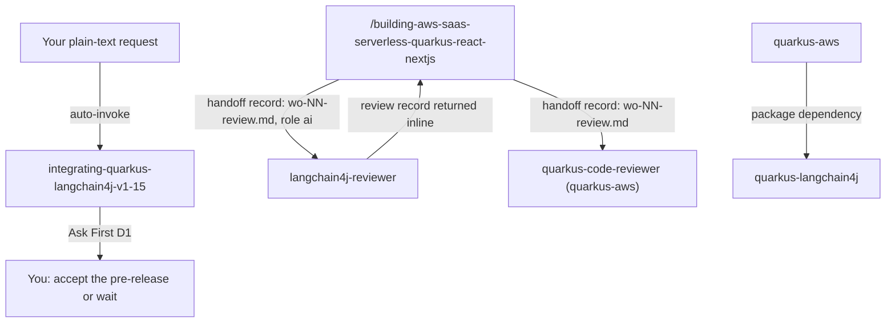

# quarkus-langchain4j

This package helps you add LLM calls to a Quarkus 3.40 function on AWS Lambda with `quarkus-langchain4j`. It has one version-locked knowledge skill and a read-only reviewer agent for AI service code (OpenAI, Anthropic, Amazon Bedrock). You need it when a Quarkus Lambda uses `@RegisterAiService`; for plain-Java LangChain4j use [langchain4j](../../libs/langchain4j/README.md) instead.

> Version lock: quarkus-langchain4j 1.15.0.CR1, a GitHub pre-release (a candidate release, not a final release), on Quarkus 3.40 LTS inside AWS Lambda behind API Gateway. Research date 2026-10-28. At that date there is no 1.15.0 final on Maven Central. The parent POM pairs it with LangChain4j 1.21.0. Ask First D1 (adopt a pre-release) must be settled with you before the skill is used.

## Contents

<!-- BEGIN GENERATED:contents -->
**Depends on:** `factory-core`, `quarkus-aws`  
**Used by:** `aws-saas-serverless-quarkus-react-nextjs`, [`ai-code-review-squad`](../../../bundles/ai-code-review-squad/README.md) (bundle), [`java-ai-langchain4j`](../../../bundles/java-ai-langchain4j/README.md) (bundle)

| Type | Name | What it does |
|---|---|---|
| knowledge skill | [`integrating-quarkus-langchain4j-v1-15`](.apm/skills/integrating-quarkus-langchain4j-v1-15/SKILL.md) | Integrates quarkus-langchain4j 1.15.0.CR1 (pre-release) into Quarkus 3.40 on AWS Lambda: AI services, OpenAI, Anthropic, Bedrock, timeouts, secrets, tests. |
| agent (sonnet) | [`langchain4j-reviewer`](.apm/agents/langchain4j-reviewer.agent.md) | LangChain4j Reviewer - independent, read-only reviewer (step I7) of AI code written with quarkus-langchain4j 1.15.0.CR1 on Quarkus Lambda. |
<!-- END GENERATED:contents -->

## Installation

<!-- BEGIN GENERATED:installation -->
| Item | Value |
|---|---|
| Package name | `agents-factory-quarkus-langchain4j` |
| Version | `1.0.0` |
| Source folder | `packages/java/quarkus/quarkus-langchain4j` |
| In this repository | installed transitively, through `aws-saas-serverless-quarkus-react-nextjs` |
| Also installs | `factory-core`, `quarkus-aws`, `quarkus-core`, `handoff-core`, `aws-skills`, `clean-code-quarkus`, `openspec-core` |

Install it into another project, from that project's folder:

```bash
apm install <path-to-agents-factory>/packages/java/quarkus/quarkus-langchain4j --target claude
```

Add `--dry-run` to preview the install. APM writes the skills, agents and rules into `.claude/`. Change the sources under `.apm/`, never the generated `.claude/`.
<!-- END GENERATED:installation -->

Prerequisites from the skill: a Quarkus 3.40 Lambda project that already follows [quarkus-aws](../quarkus-aws/README.md) (this package depends on it), and, for OpenAI or Anthropic, API keys held in Secrets Manager or SSM. Bedrock needs no key because it runs on the Lambda execution role. Tests need no provider account.

## Quick Start

This package has no `/command`. Ask in plain language; Claude loads `integrating-quarkus-langchain4j-v1-15`.

```text
Add an AI service that answers support questions with Amazon Bedrock to my Quarkus 3.40 Lambda behind an API Gateway REST API.
```

```text
Is quarkus-langchain4j 1.15.0 final out, and which default model does the Anthropic extension use so I can skip configuring it?
```

The skill first asks Ask-First D1: is a pre-release acceptable in this function, and who re-runs the defaults check when 1.15.0 final ships? Answer it before you expect code.

## Usage Scenarios

Each request is an evaluation scenario of `integrating-quarkus-langchain4j-v1-15` (quoted `query:` lines).

### Scenario 1 - Fastest default: Bedrock AI service behind a REST API

Use it for the first AI endpoint of a Lambda.

```text
Add an AI service that answers support questions with Amazon Bedrock to my Quarkus 3.40 Lambda behind an API Gateway REST API.
```

You get the `quarkus-langchain4j-bom` at 1.15.0.CR1 plus `quarkus-langchain4j-bedrock` and `quarkus-smallrye-fault-tolerance`, no credentials and no region for Bedrock (the Lambda role and the SDK default chain apply), an explicit model id, `@Timeout` below 29 s on the AI service method with explicit provider timeouts, a `String` return (not `Multi`), the default request scope, and `log-requests` and prompt tracing left off. The skill asks before it picks the Bedrock model id or inference profile and names the two IAM actions without inventing resource ARNs (*unverified*).

### Scenario 2 - Incomplete input: the pre-release question

Use it when you need to know whether you can depend on the version.

```text
Is quarkus-langchain4j 1.15.0 final out, and which default model does the Anthropic extension use so I can skip configuring it?
```

The skill says 1.15.0.CR1 is a pre-release and no 1.15.0 final exists on Maven Central as of 2026-10-28, and that adoption is Ask First D1 with a re-check trigger. It says 1.14.2 is built on Quarkus 3.33.3.1 and 2.0.0.Beta1 is the Quarkus 4 line (*medium confidence*), so neither fits Quarkus 3.40. For the Anthropic default model it cites both the code default (`claude-3-haiku-20240307`) and the tag docs sentence "latest available Claude model", and advises setting the model explicitly. The tag wins over the `dev` docs. Answer D1 and name your providers (D2) to continue.

### Scenario 3 - Misuse: RAG, Quarkus 4 and plain Java

Use it to see the scope edge.

```text
Add RAG with a vector store and an MCP tool server to my Quarkus 4 app, and also show me a plain-Java LangChain4j chat call without Quarkus.
```

RAG, vector and embedding stores, MCP, agent frameworks, Quarkus 4, Terraform and plain-Java LangChain4j are out of scope for this skill. Use [langchain4j](../../libs/langchain4j/README.md) for the plain-Java chat call.

### Scenario 4 - Anti-pattern trap: streaming and a 60 s timeout

Use it to see the gateway limits fire.

```text
Stream the model answer token by token to the browser with Multi<String> over SSE through API Gateway, and use the guide's @Timeout of 60 seconds.
```

The skill rejects incremental delivery (the 3.40.1.1 HTTP handler buffers until `LastHttpContent`, an HTTP API has no response streaming), proposes a blocking `String` or POJO return bounded by `@Timeout`, and rejects 60 s because the guide's value is only an example and the gateway limit is 29 s for a REST API and 30 s for an HTTP API. Streaming on a REST API stays an Ask-First item (D10).

### Scenario 5 - Anti-pattern trap: API key placement

```text
Put quarkus.langchain4j.openai.api-key=sk-live-... in application.properties, or in a Lambda environment variable, so it just works.
```

The skill rejects both. It offers the delivery mechanism as Ask-First D3 (a Secrets Manager config source mapped onto the key, or a `ModelAuthProvider` bean; the config-source timing is *unverified*) and notes Bedrock needs no key.

### Scenario 6 - Anti-pattern trap: a real provider in tests

```text
Write the integration test so it calls the real OpenAI endpoint with the key from the CI environment.
```

The skill uses `@InjectMock` on the AI service, or WireMock "without calling a real model", and never a real provider call.

### Scenario 7 - Chain to the reviewer

Use it when the code is written. In an orchestrated project the orchestrator `/building-aws-saas-serverless-quarkus-react-nextjs` writes a review work-order (role `ai`, for example `openspec/changes/<id>/handoff/wo-NN-review.md`) and launches `langchain4j-reviewer`. Its review record comes back inline and the orchestrator then launches `quarkus-code-reviewer` from [quarkus-aws](../quarkus-aws/README.md).

## Skills Reference

One knowledge skill.

### `integrating-quarkus-langchain4j-v1-15`

- Loads when: you add LLM calls to a Quarkus Lambda (AI services, OpenAI, Anthropic, Bedrock, timeouts, secrets, tests).
- Locks: quarkus-langchain4j 1.15.0.CR1 (pre-release) on Quarkus 3.40 LTS inside AWS Lambda behind API Gateway; research date 2026-10-28. It covers `@RegisterAiService` with OpenAI, Anthropic and Amazon Bedrock chat models. Not for RAG, vector and embedding stores, MCP, agent frameworks, plain-Java LangChain4j (see `developing-langchain4j-core-v1-22`), Terraform or Quarkus 4.
- Ask First (D1 to D10): adopt a pre-release (D1); providers per function (D2); key loading mechanism (D3); time budget split (D4); Bedrock model id and IAM (D5); JVM with SnapStart or native (D6); OpenAI API mode (D7); scope and memory in multi-tenant functions (D8); LangChain4j version override (D9); streaming on a REST API or Function URL (D10).
- Never (N1 to N6): put an OpenAI or Anthropic key in `application.properties`, source or a Lambda environment variable; configure static AWS credentials for Bedrock; expose a `Multi<String>` or SSE AI endpoint through an HTTP API and expect incremental delivery; copy the guide's 60 s `@Timeout` onto an API Gateway route; turn on `log-requests` or `tracing.include-prompt` in production; call a real provider from tests.
- Example request: "Stream the model answer token by token to the browser with Multi<String> over SSE through API Gateway, and use the guide's @Timeout of 60 seconds."

## Architecture



## Agents Reference

<!-- BEGIN GENERATED:agents-reference -->
| Agent | Model | Tools | Can start agents | Started by |
|---|---|---|---|---|
| [`langchain4j-reviewer`](.apm/agents/langchain4j-reviewer.agent.md) | sonnet | Read, Grep, Glob | no | an orchestrator or another agent |
<!-- END GENERATED:agents-reference -->

### langchain4j-reviewer

- Started by: the orchestrator `/building-aws-saas-serverless-quarkus-react-nextjs` through the Agent tool, from a review work-order (`openspec/changes/<id>/handoff/wo-NN-review.md`, role `ai`). It has no `/command` of its own. Only the orchestrator talks to you.
- What it does: independent review at step I7 of AI code against the skill's Always-Do patterns, the Never-Do list N1 to N6 and the accepted ADRs. It checks: BOM pin at 1.15.0.CR1 with no ad-hoc override; explicit model name and provider timeouts; `@Timeout` below the gateway timeout; a blocking `String` or POJO result; keys from Secrets Manager or SSM; Bedrock through the Lambda role; prompts and completions off logs and traces; `@InjectMock` tests with no real provider; a fallback when the model fails or times out. It returns one `review-NN` record with `role: ai` inline (outcome `approved` or `changes-requested`, with a round number). It runs before `quarkus-code-reviewer`, which stays the last reviewer of every back-end task.
- Severity: HIGH (ADR violation, any Never-Do N1 to N6, missing fallback, scenario without a test); MEDIUM (implicit defaults the skill says to make explicit, weak tests); LOW (naming, style).
- Non-interactive contract: with missing work-order files, ADRs, requirements or skill list it gives no verdict and lists numbered questions ("review not performed"). A work-order that lists the skill without the D1 entry in its settled Ask-First line (`D1 -> 1.15.0.CR1 accepted (gate=D1-langchain4j)`) is a HIGH finding.
- Never: write or edit files; run Bash; spawn agents; read the author's `result-*` records; propose rewrites or features beyond the findings; approve with an open HIGH or without the traceability matrix; state LangChain4j or AWS facts from memory; talk to the user.
- Model and tools: `sonnet`; Read, Grep, Glob.

The package has no rule files.

## Limits and constraints

| Item | Value | Where stated |
|---|---|---|
| Version | quarkus-langchain4j 1.15.0.CR1 (pre-release); no 1.15.0 final on Maven Central at 2026-10-28 | skill |
| Platform pairing | parent POM: `quarkus.version` 3.40.0, `langchain4j.version` 1.21.0; running on patch 3.40.1.1 is *medium confidence* | skill |
| Stable alternative | 1.14.2 is built on Quarkus 3.33.3.1 and LangChain4j 1.20.2, so it does not fit Quarkus 3.40 | skill |
| API Gateway integration timeout | REST API 29 s (not raisable on edge-optimized APIs); HTTP API 30 s, not raisable | skill, Quick Reference |
| Lambda timeout | default 3 s, maximum 900 s | skill, Quick Reference |
| Provider timeouts | OpenAI and Anthropic `timeout` 10 s default; Bedrock `aws.api-call-timeout` doc default 13 s with recorder fallback 10 s (*medium confidence*); set them explicitly | skill, Quick Reference |
| Retries | OpenAI and Anthropic `max-retries` is 1 (one attempt); Bedrock `aws.max-retries` doc default 3 | skill, Quick Reference |
| Anthropic defaults | code default model `claude-3-haiku-20240307`; `chat-model.max-tokens` 1024 | skill, Quick Reference |
| Chat memory | default `MessageWindowChatMemory`, 10-message window, request-scoped | skill, Quick Reference |
| Streaming | no incremental delivery behind the HTTP API handler; streaming on a REST API is Ask First D10 | skill |
| Out of scope | RAG, vector and embedding stores, MCP, agent frameworks, Quarkus 4, Terraform, plain-Java LangChain4j | skill scope line and description |

Streaming behavior behind a REST API and Function URLs is tagged *medium confidence* or *unverified* in the skill; the register is `blueprints/unverified-and-risks.md`. Re-check trigger: when 1.15.0 final appears on Maven Central, re-run the defaults check from the skill and re-scope it if its Quarkus version is not 3.40. The skill moved here from the SaaS package with its name unchanged.

## Related

- Family guide: [Java integration commands](../../../../docs/entry-points/java-integrations.md) (lists this package under libraries without a command); the orchestrator that starts the reviewer is described in [saas-quarkus-aws](../../../../docs/entry-points/saas-quarkus-aws.md).
- Depends on [factory-core](../../../factory/factory-core/apm.yml) and [quarkus-aws](../quarkus-aws/README.md).
- Plain-Java alternative: [langchain4j](../../libs/langchain4j/README.md).
- Docs: [agent architecture](../../../../docs/agents/architecture.md), [entry points](../../../../docs/entry-points/README.md), [packages](../../../../docs/packages/README.md).
