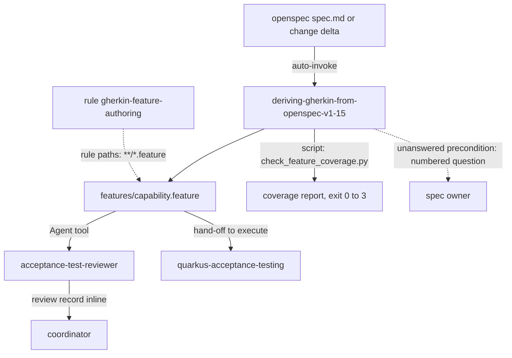

# acceptance-testing

Stack-agnostic authoring of acceptance tests from OpenSpec specs. It turns a spec or a change delta into Gherkin `.feature` files, tags each scenario for traceability, and checks coverage with a script. You need it when a closed OpenSpec spec must become `.feature` files. It runs no tests and assumes no language or framework. For Cucumber on Quarkus, add `quarkus-acceptance-testing`.

> Version lock: OpenSpec 1.15.0 specs and the Gherkin language as parsed by cucumber/gherkin 42.0.1 (Python package `gherkin-official` 42.0.1). Research date 2026-11-01. OpenSpec has no official Gherkin tooling, so the mapping is a factory design.

## Contents

<!-- BEGIN GENERATED:contents -->
**Depends on:** `factory-core`, `openspec-core`  
**Used by:** `quarkus-acceptance-testing`

| Type | Name | What it does |
|---|---|---|
| knowledge skill | [`deriving-gherkin-from-openspec-v1-15`](.apm/skills/deriving-gherkin-from-openspec-v1-15/SKILL.md) | Derive Gherkin .feature files from OpenSpec 1.15 specs and change deltas, with R-id and change tags and a coverage script. |
| agent (sonnet) | [`acceptance-test-reviewer`](.apm/agents/acceptance-test-reviewer.agent.md) | Acceptance Test Reviewer - read-only, non-interactive reviewer that checks Gherkin .feature files against an OpenSpec spec or change delta and, when given, aga… |
| rule | [`gherkin-feature-authoring.instructions`](.apm/instructions/gherkin-feature-authoring.instructions.md) | Rules for writing Gherkin .feature files derived from OpenSpec specs: declarative steps, mandatory requirement tags (change tag for deltas), no invented Given. |
<!-- END GENERATED:contents -->

## Installation

<!-- BEGIN GENERATED:installation -->
| Item | Value |
|---|---|
| Package name | `agents-factory-acceptance-testing` |
| Version | `1.0.0` |
| Source folder | `packages/quality/acceptance-testing` |
| In this repository | installed transitively, through `quarkus-acceptance-testing` |
| Also installs | `factory-core`, `openspec-core` |

Install it into another project, from that project's folder:

```bash
apm install <path-to-agents-factory>/packages/quality/acceptance-testing --target claude
```

Add `--dry-run` to preview the install. APM writes the skills, agents and rules into `.claude/`. Change the sources under `.apm/`, never the generated `.claude/`.
<!-- END GENERATED:installation -->

Runtime prerequisites: Python to run `check_feature_coverage.py` (standard library only). For the `--strict` parser check, the Python module `gherkin-official` (`gherkin.parser.Parser`); without it the script warns on stderr and continues. No other tool is needed to author features.

## Quick Start

This package has no command. The skill is a knowledge skill: Claude loads it when you ask to turn a `spec.md` or a delta into Cucumber features. Three plain requests, quoted from the evaluation scenarios:

```text
Generate the feature file for openspec/specs/items/spec.md (R1 and R2, two scenarios each).
```

```text
Change add-x adds R2 and removes R7. The delta uses plain `- WHEN` bullets. Update the features.
```

```text
The spec has `### Requirement: Greet a known visitor` with no R-id. Tag it.
```

## Usage Scenarios

The queries are the `query:` lines of `blueprints/evaluation-scenarios.md`, quoted exactly. The reviewer scenario is built from the agent description.

### Scenario 1 — Features from a spec (fastest default)

```text
Generate the feature file for openspec/specs/items/spec.md (R1 and R2, two scenarios each).
```

You get one `src/test/resources/features/items.feature` with one `Feature: items`, two `Rule:` blocks tagged `@R1` and `@R2`, and four scenarios with the spec names verbatim. `Given` appears only where the spec writes GIVEN. The Feature carries `@change-<id>` when a change id is known. The skill then runs `check_feature_coverage.py --spec-root openspec --features src/test/resources/features` and reports the traceability table.

### Scenario 2 — A change delta with plain keywords

```text
Change add-x adds R2 and removes R7. The delta uses plain `- WHEN` bullets. Update the features.
```

You get a new Rule tagged `@R2`, the Rule `@R7` deleted, and a run with `--change add-x`. The skill reads plain and bold step keywords. It asks, or states, whether features are produced per change or from the merged specs. With `--change`, untouched base requirements that have no features are reported MISSING: generate them or exclude them.

### Scenario 3 — Misuse: put Gherkin into the spec

```text
Replace spec.md with the .feature file so there is one source.
```

You get a refusal. `spec.md` stays the canonical Markdown artifact and the `.feature` is derived beside the tests. The coverage script keeps both in sync.

### Scenario 4 — Incomplete input: missing precondition

```text
Scenario 'empty tenant' obviously needs a logged-in admin, add that Given.
```

You get a numbered question (`Q1`) instead of an invented `Given`, because the spec does not state it. After the spec is updated, the `Given` can be added. Answer the question in the spec, then ask for the features again.

### Scenario 5 — Invented variants

```text
Make the quantity scenario an Outline with 0, 1, 1000 and 5000.
```

You get a check against the spec. Only variants the spec lists become `Examples` rows. Unlisted values become questions. If the spec lists none, a plain `Scenario` is used.

### Scenario 6 — Requirement without an R-id

```text
The spec has `### Requirement: Greet a known visitor` with no R-id. Tag it.
```

You get `@req-greet-a-known-visitor` above the Rule. The skill may ask whether R-ids can be added to the spec first. The script reports the requirement as covered. It never invents an `@R<n>`.

### Scenario 7 — Independent review, then chaining

```text
review change add-greeting: specs at openspec, features at src/test/resources/features, steps at src/test/java
```

Ask Claude to launch `acceptance-test-reviewer` with this brief. You get one review record: a verdict (`pass` or `changes-requested`), findings with file:line, the traceability table and the coverage script output. Then hand the features to `quarkus-acceptance-testing` to run them with Cucumber on Quarkus.

## Skills Reference

### `deriving-gherkin-from-openspec-v1-15`

- Loads when: you turn a `spec.md` or a delta into Cucumber features.
- Locks: OpenSpec 1.15.0 specs, cucumber/gherkin 42.0.1. The `R<n>` ids and the `R<n>_<scenario>_<expectation>` test names are a factory convention (F11), not OpenSpec.
- Mapping: one `.feature` per capability at `src/test/resources/features/<capability>.feature` with one `Feature:`; each `### Requirement:` becomes one `Rule:`; each `#### Scenario:` becomes one `Scenario:` under its Rule. Rules carry `@R<n>` (or `@req-<slug>`). A feature from a change delta also carries `@change-<id>`; a spec root has none. Tags inherit from Feature and Rule.
- Always: `Given` only when the spec writes GIVEN; accept bold and plain step keywords when reading a spec; tags only above Feature, Rule, Scenario, Scenario Outline or Examples; `Scenario Outline` only for variants the spec lists; declarative steps; parse every generated feature with the official parser; run the coverage script before reporting done.
- Ask first: delta handling (per change or merged specs), a missing precondition, a Rule-level `Background` when every scenario repeats the same GIVEN, spoken language, `.feature.md`, adding an R-id to a requirement.
- Never: invent a `Given`; put a tag above `Background:` or a step; write imperative UI steps; join two facts in one step; use the same step text under two keywords; two Backgrounds in one Feature or Rule, or two Features in one file; a colon after `Given`, `When`, `Then`, `And` or `But`; invent Examples rows; replace or rewrite `spec.md` with Gherkin, or invent a scenario for a requirement that has none.
- Not for: step definitions, Cucumber runners, writing the spec itself.
- Example request: "Generate the feature file for openspec/specs/items/spec.md (R1 and R2, two scenarios each)."

### Script `check_feature_coverage.py`

Lives in `.apm/skills/deriving-gherkin-from-openspec-v1-15/scripts/`. It uses only the standard library and reads files only. It never runs anything and writes nothing, so there is no dry-run mode.

```text
python <skill>/scripts/check_feature_coverage.py --spec-root openspec --features src/test/resources/features
python <skill>/scripts/check_feature_coverage.py --spec-root openspec --features src/test/resources/features --change <id> --strict
```

| Parameter | Required | Default | Description |
|---|---|---|---|
| `--features <dir>` | Yes | none | Directory with the `.feature` files. |
| `--spec-root <dir>` | No | not stated | Root that holds `specs/` (and `changes/`). |
| `--change <id>` | No | none | Merges `changes/<id>/specs/**/spec.md` over the base specs. |
| `--json` | No | off | One JSON object with `missing`, `orphans`, `covered`, `summary`, `parse_errors`, `empty_requirements`. |
| `--strict` | No | off | Also parses each feature with `gherkin.parser.Parser` from `gherkin-official`. Without that module it warns on stderr and continues. |

A feature scenario matches a spec scenario when it has the requirement tag and the same name (case-insensitive, whitespace normalized). A requirement with no scenarios is reported as a gap (`empty_requirements`), becomes a question to the spec owner and never an invented scenario.

| Exit code | Meaning |
|---|---|
| 0 | complete |
| 1 | gaps found |
| 2 | nothing found (no spec requirements or no features) |
| 3 | usage error |

Self-test: `python -m unittest discover -s <skill>/scripts/tests`.

### Rule `gherkin-feature-authoring`

- Applies to (`applyTo`): `**/*.feature`. The source file uses `applyTo:`. The installed `.claude/rules/` copy uses `paths:`.
- Enforces: declarative steps; one behavior per scenario; a requirement tag on every scenario (own or inherited), plus `@change-<id>` required for a delta; `Given` only from the spec; no HTTP, UI or SQL detail in steps; `Background` only for preconditions shared by all scenarios of its scope; `Scenario Outline` only for variants the spec lists.
- Verify step: run the coverage script and fix every gap before reporting done.

## Pipeline



## Agents Reference

<!-- BEGIN GENERATED:agents-reference -->
| Agent | Model | Tools | Can start agents | Started by |
|---|---|---|---|---|
| [`acceptance-test-reviewer`](.apm/agents/acceptance-test-reviewer.agent.md) | sonnet | Read, Grep, Glob, Bash | no | an orchestrator or another agent |
<!-- END GENERATED:agents-reference -->

### acceptance-test-reviewer

- Model `sonnet`. Tools: Read, Grep, Glob, Bash. Read-only and non-interactive. It has no `/command`; launch it with the Agent tool.
- Input: a change id or a spec root, the features directory, optionally the step-definition directory.
- It reads the skill `deriving-gherkin-from-openspec-v1-15` and the rule first. If a path cannot be read it stops and reports it.
- Workflow: locate spec and features (otherwise `needs-input`), run the coverage script (add `--change <id>` for a delta, plus `--strict`), build the matrix Requirement, Scenario, Feature file:line, Step definition, status, classify findings, give the verdict.
- Severities. HIGH: a spec scenario without a feature scenario; a feature step without a step definition (only when a steps directory is given); a `Given` or behavior not in the spec; a scenario without `@R` or `@req`, or a delta feature without `@change`. MEDIUM: imperative or UI-detail steps; a `Scenario Outline` without variants listed in the spec. LOW: an orphan feature scenario; style. `pass` only with no HIGH or MEDIUM finding.
- Output, inline: header (`from`, `outcome: done | needs-input`, `verdict`, counts), findings, the traceability table, the coverage script output verbatim with its exit code, numbered questions.
- Its Bash use is limited to the coverage script, read-only `git` (`status`, `log`, `diff`) and `ls`. That limit is an instruction in its prompt, not a tool restriction.
- Never: edit or create files, run `mvn` or any build, test or install command, guess a missing precondition, launch agents, ask the user directly.

## Output structure

```text
src/test/resources/features/
└── <capability>.feature      one Feature, one Rule per requirement, one Scenario per spec scenario
```

The reviewer returns its record inline and writes no file. The script writes nothing.

## Limits and constraints

| Item | Value | Source |
|---|---|---|
| Versions | OpenSpec 1.15.0, cucumber/gherkin 42.0.1 | skill |
| `gherkin-official` Python floor | differs between PyPI (3.10) and the main branch (3.11) | skill, version-lifetime risk |
| Coverage exit codes | 0 complete, 1 gaps, 2 nothing found, 3 usage error | script |
| Gherkin structure | one Feature per file, one Background per Feature or Rule | skill |
| Running the tests | belongs to `quarkus-acceptance-testing` | skill |
| Writing the spec | belongs to `openspec-core` | skill |
| SaaS orchestrator wiring | deferred (CLAUDE.md) | CLAUDE.md |
| Official OpenSpec to Gherkin tool | none (OpenSpec issues #508 and #987 closed as not planned) | skill |
| Markdown Gherkin (`.feature.md`) | Python support unverified | skill |

Items tagged `(unverified)` or `(medium confidence)` are listed in the skill's `blueprints/unverified-and-risks.md`.

## Related

- Guides: [Quality and CI/CD entry points](../../../docs/entry-points/quality-and-cicd.md), [OpenSpec and GitHub entry points](../../../docs/entry-points/specs-and-github.md).
- Depends on [factory-core](../../factory/factory-core/README.md) and [openspec-core](../../delivery/specs/openspec-core/README.md).
- Used by [quarkus-acceptance-testing](../quarkus-acceptance-testing/README.md).
- [Agent architecture](../../../docs/agents/architecture.md), [entry points](../../../docs/entry-points/README.md), [packages](../../../docs/packages/README.md).
