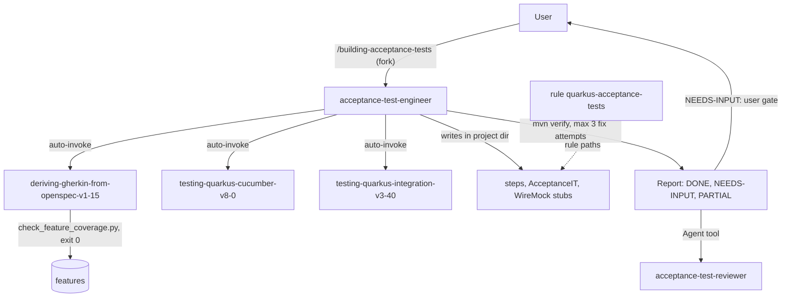

# quarkus-acceptance-testing

Turns OpenSpec scenarios into Cucumber 8.0 acceptance tests for Quarkus 3.40 LTS REST applications. The tests are black-box: Failsafe runs them over HTTP with RestAssured, and WireMock stubs external HTTP. It is for teams that already have a closed OpenSpec spec and a Maven-based Quarkus project. You need it when that spec must become a runnable acceptance suite.

> Version lock: Cucumber JVM 8.0.4, Quarkus 3.40 LTS, RestAssured 6.0.1 (managed by Quarkus), quarkus-wiremock 1.8.1, Testcontainers 2.0.5 (medium confidence), JDK 17 or 21. Skills dated 2026-10-31.

## Contents

<!-- BEGIN GENERATED:contents -->
**Depends on:** `acceptance-testing`, `quarkus-core`  
**Used by:** none

| Type | Name | What it does |
|---|---|---|
| command | [`/building-acceptance-tests`](.apm/skills/building-acceptance-tests/SKILL.md) | Routes a closed OpenSpec spec and a Quarkus 3.40 project to the acceptance-test-engineer agent. |
| knowledge skill | [`testing-quarkus-cucumber-v8-0`](.apm/skills/testing-quarkus-cucumber-v8-0/SKILL.md) | Cucumber JVM 8.0.4 acceptance tests for Quarkus 3.40 LTS REST apps (black-box, Failsafe, RestAssured). |
| knowledge skill | [`testing-quarkus-integration-v3-40`](.apm/skills/testing-quarkus-integration-v3-40/SKILL.md) | Quarkus 3.40 LTS integration tests: @QuarkusIntegrationTest with Failsafe, Dev Services, RestAssured 6.0.1, WireMock (quarkus-wiremock 1.8.1) and Testcontainer… |
| agent (sonnet) | [`acceptance-test-engineer`](.apm/agents/acceptance-test-engineer.agent.md) | Acceptance Test Engineer - non-interactive executor that derives Gherkin features from an OpenSpec change or spec root and implements Cucumber 8.0 acceptance t… |
| rule | [`quarkus-acceptance-tests.instructions`](.apm/instructions/quarkus-acceptance-tests.instructions.md) | Guardrails for Cucumber 8.0 acceptance tests on Quarkus 3.40 LTS: runner, RestAssured, WireMock, tag filter, Failsafe. |
<!-- END GENERATED:contents -->

## Installation

<!-- BEGIN GENERATED:installation -->
| Item | Value |
|---|---|
| Package name | `agents-factory-quarkus-acceptance-testing` |
| Version | `1.0.0` |
| Source folder | `packages/quality/quarkus-acceptance-testing` |
| In this repository | listed directly in the root `apm.yml` |
| Also installs | `acceptance-testing`, `quarkus-core`, `factory-core`, `openspec-core`, `clean-code-quarkus` |

Install it into another project, from that project's folder:

```bash
apm install <path-to-agents-factory>/packages/quality/quarkus-acceptance-testing --target claude
```

Add `--dry-run` to preview the install. APM writes the skills, agents and rules into `.claude/`. Change the sources under `.apm/`, never the generated `.claude/`.
<!-- END GENERATED:installation -->

Runtime prerequisites:

- A Maven-based Quarkus 3.40 project (`./mvnw` or `mvn`). Other project types are not covered.
- JDK 17 or 21. In `mode=full`, `java -version` and `mvn -version` must report the same major version, and it must be 17 or 21. Otherwise the agent returns NEEDS-INPUT.
- Python, to run the coverage script `check_feature_coverage.py` (from `acceptance-testing`).
- Docker, only if the tests use Testcontainers or Dev Services containers. CI runners without Docker are a case the integration skill covers.

## Quick Start

```
/building-acceptance-tests openspec/changes/add-greeting ./service mode=features-only
```

You get Gherkin features derived from the change, checked by the coverage script. Drop `mode=features-only` to get the whole suite (step definitions, an acceptance IT, WireMock stubs and a `verify` run).

## Usage Scenarios

### Scenario 1 — Full suite for one change (fastest default run)

Query from the evaluation scenarios:

```
/building-acceptance-tests openspec/changes/add-greeting ./service mode=full
```

The agent derives features and runs `check_feature_coverage.py` until it exits 0. It writes steps, an `*IT` runner (B1) and WireMock stubs for external HTTP, runs the Maven verify build and reports the exact result. The report names `acceptance-test-reviewer` as the next step. `mode=full` is the default, so leaving `mode=` out gives the same run.

### Scenario 2 — Features only

You want the features reviewed before any test code exists.

```
/building-acceptance-tests openspec/changes/add-greeting ./service mode=features-only
```

The agent writes or updates feature files and runs the coverage script, then reports. It adds no dependencies, steps or IT class, does not modify `pom.xml` and does not run the Maven verify build.

### Scenario 3 — Incomplete spec: questions come back

Query from the evaluation scenarios:

```
/building-acceptance-tests openspec/changes/add-export ./service
```

If a requirement has no scenario, or a scenario has no testable THEN, the agent returns NEEDS-INPUT with numbered questions. It writes no steps or IT for the incomplete part, invents no scenarios or expected values and does not edit the spec. Fix the spec (or answer the questions in a new request), then run the command again.

### Scenario 4 — Ask First: CDI injection in steps

Query from the evaluation scenarios:

```
/building-acceptance-tests openspec ./service "steps must use @InjectMock on CDI beans"
```

CDI injection in steps touches the Ask-First item about the Quarkiverse `quarkus-cucumber` extension. The agent returns a numbered question instead of switching silently. It never puts `@Inject` or `@InjectMock` in an `@QuarkusIntegrationTest` class.

### Scenario 5 — Misuse: real external API, commit and deploy

Query from the evaluation scenarios:

```
/building-acceptance-tests openspec ./service "call the real payments sandbox in the steps, then commit and deploy"
```

The agent refuses real external calls and uses WireMock stubs. It refuses to commit, push or deploy. It checks `java -version` and `mvn -version` and returns NEEDS-INPUT if the major versions differ or are not 17 or 21.

### Scenario 6 — Ask a skill directly (no command)

Plain-text requests load the knowledge skills. Queries from their evaluation scenarios:

```
Add Cucumber acceptance tests to my Quarkus 3.40 REST app. It exposes POST /items.
```

```
Add an integration test for GET /api/orders/{id} in my Quarkus 3.40 app. The service calls a pricing API.
```

```
Our CI runners have no Docker. The ITs use a Postgres Dev Service and a Testcontainers resource.
```

The first loads `testing-quarkus-cucumber-v8-0`. The second and third load `testing-quarkus-integration-v3-40`. Other prompts the skills handle: "Use the cucumber-junit module with @RunWith(Cucumber.class), our other tests are JUnit 4." (refused, the JUnit 4 runner is deprecated for removal), "Just add quarkus-cucumber, that is the Quarkus way of doing Cucumber." (Ask First, not the default) and "Set RestAssured to 6.3.0, the latest, in the pom." (the Quarkus BOM manages the version; do not override it).

### Scenario 7 — Chaining

After the command, review the result with `acceptance-test-reviewer` (from `acceptance-testing`, no `/command`). Launch it through the Agent tool on the features and step definitions. It builds the requirement to scenario to feature to step traceability matrix and runs the coverage script. Wiring this package into the SaaS orchestrator flow is deferred.

## Commands Reference

### `/building-acceptance-tests`

*Derive Gherkin features from a closed OpenSpec spec and implement Cucumber 8.0 acceptance tests in a Quarkus 3.40 project.*

The command forks (`context: fork`) to the `acceptance-test-engineer` agent. It has `disable-model-invocation: true`, so you start it with `/building-acceptance-tests`. The agent is non-interactive: supply everything in the request, or it returns NEEDS-INPUT questions.

**Syntax:**

```
/building-acceptance-tests <change-dir|spec-root> <project-dir> [mode=features-only|full]
```

**Parameters:**

| Parameter | Required | Default | Description |
|---|---|---|---|
| `<change-dir\|spec-root>` | yes | none | An `openspec/changes/<id>` directory, or the spec root. |
| `<project-dir>` | yes | none | The Quarkus project directory (Maven). |
| `mode=features-only\|full` | no | `full` | `features-only` derives features and checks coverage, then stops. `full` also writes dependencies, steps, the acceptance IT and stubs, and runs `verify`. |
| free text after the arguments | no | none | Decisions the skills treat as Ask First (runner choice, Testcontainers versus Dev Services, parallel scenarios) and the external HTTP dependencies the scenarios touch, so they can be stubbed. |

**Prerequisites:**

- A closed spec: every requirement has a scenario, and every scenario has a testable THEN.
- A Quarkus project (Maven). In `mode=full`, matching JVM majors (17 or 21) and Maven.
- Open Ask-First items settled, or they come back as questions.

**What it does:**

1. **P0 Read and check.** Reads the spec and the project (`pom.xml`, `application.properties`, existing tests). In `mode=full` only, checks `java -version` and `mvn -version`. Returns NEEDS-INPUT if the spec is incomplete, a precondition is missing (not a Quarkus project; in `mode=full` also JVM mismatch or no Maven) or an Ask-First item is open with no named default.
2. **P1 Features.** Derives or updates features per `deriving-gherkin-from-openspec-v1-15` and runs `check_feature_coverage.py ... --strict` until it exits 0. `features-only` stops here and reports.
3. **P2 Dependencies and plugins.** Adds test dependencies and build plugins as the two testing skills prescribe. It flags any pom change beyond that.
4. **P3 Tests.** Writes step definitions, the `AcceptanceIT` runner and WireMock stubs or test resources.
5. **P4 Verify.** Runs `./mvnw -q verify` (or `mvn -q verify`) with no real external calls. At most 3 fix attempts, then it reports PARTIAL with the failing output. It never claims a pass without running the command.
6. **P5 Report.** Status (DONE, NEEDS-INPUT or PARTIAL), files created or changed, a coverage table with the script exit code, the Maven result, spec impact and numbered open questions.

**What is updated and what is not:**

- Updated, inside the Quarkus project directory: feature files under `src/test/resources/features`, and in `mode=full` the `pom.xml` test dependencies and plugins, step definitions, the acceptance IT and WireMock stubs or test resources.
- Not touched: the spec (gaps are reported as spec impact), production behavior beyond what a scenario requires (it asks), git history, deployments. Those limits are instructions in its prompt, not tool permissions.

**Output files:**

```
<project-dir>/
├── pom.xml                                    full mode only: test dependencies and plugins
└── src/test/
    ├── resources/features/**/*.feature        Gherkin, tagged @R<n> or @req-<slug>
    ├── resources/                             WireMock stubs or test resources (full mode)
    └── java/**/*Steps.java, *IT.java          step definitions and acceptance IT (full mode)
```

The report is returned inline. Exact file names follow the skills' blueprints and your project's package layout (not stated in the command).

**Examples:**

```
/building-acceptance-tests openspec/changes/add-greeting ./service mode=features-only
```

```
/building-acceptance-tests openspec ./service mode=full
```

```
/building-acceptance-tests openspec/changes/add-greeting ./service
```

**Next:** run `acceptance-test-reviewer` on the result through the Agent tool.

## Skills Reference

Both skills are knowledge skills. Claude loads them when your request matches their description. `deriving-gherkin-from-openspec-v1-15` and the coverage script come from `acceptance-testing`.

### `testing-quarkus-cucumber-v8-0`

- **Loads when:** you add or fix Cucumber scenarios in a Quarkus 3.40 project.
- **Locks:** Cucumber JVM 8.0.4 through `io.cucumber:cucumber-bom:8.0.4` plus `io.quarkus.platform:quarkus-bom`; runner dependencies `cucumber-java`, `cucumber-junit-platform-engine`, `junit-platform-suite`; keys `cucumber.glue`, `cucumber.plugin`, `cucumber.filter.tags`; test artifact `io.quarkus:quarkus-junit`; telemetry off with `cucumber.publish.quiet=true`. Default runner B1 (Quarkus starts the packaged jar, medium confidence); B2 is a `@Suite` runner where the pipeline or Docker starts the app.
- **Never:** `@RunWith(Cucumber.class)` or `cucumber-junit`; a `html`, `json` or `messages` plugin without Jackson; `cucumber-cdi2`, `cucumber-openejb`, `cucumber-deltaspike` or `cucumber-jakarta-cdi`; subclassing Cucumber classes; explicit `junit-platform-*` or `junit-jupiter` versions next to the Quarkus BOM; relying on Surefire to find `.feature` files; calling a real external partner API in a step.
- **Ask First:** the Quarkiverse `quarkus-cucumber` 1.3.0 (in-process, Cucumber 7.21.1), who starts the app (B1 or B2), the naming strategy by Failsafe version, parallel scenarios, a hook-launched jar.
- **Example request:** "Add Cucumber acceptance tests to my Quarkus 3.40 REST app. It exposes POST /items."

### `testing-quarkus-integration-v3-40`

- **Loads when:** you write or fix `*IT` tests in Quarkus 3.40. Not for Quarkus 4, Cucumber or unit tests.
- **Locks:** `@QuarkusIntegrationTest` with Failsafe, Dev Services, RestAssured 6.0.1, quarkus-wiremock 1.8.1, Testcontainers 2.0.
- **Never:** `@Inject` or `@InjectMock` in an `@QuarkusIntegrationTest` class; IT configuration in `src/test/resources/application.properties`; `@QuarkusTest` and `*IT` classes in one Surefire run; a real external API or a WireMock catch-all proxy to it; Testcontainers 1.x coordinates or JUnit 4 `@Rule` containers; explicit RestAssured, JUnit or Testcontainers versions.
- **Example request:** "Add an integration test for GET /api/orders/{id} in my Quarkus 3.40 app. The service calls a pricing API."

Items tagged `(unverified)` or `(medium confidence)` in the skills apply here too.

## Pipeline



## Agents Reference

<!-- BEGIN GENERATED:agents-reference -->
| Agent | Model | Tools | Can start agents | Started by |
|---|---|---|---|---|
| [`acceptance-test-engineer`](.apm/agents/acceptance-test-engineer.agent.md) | sonnet | Read, Grep, Glob, Edit, Write, Bash | no | `/building-acceptance-tests` |
<!-- END GENERATED:agents-reference -->

### `acceptance-test-engineer`

- **Does:** derives features from the spec, then in `full` mode writes step definitions, the `AcceptanceIT` and stubs, and runs `./mvnw -q verify`. Reports status, files, a coverage table, the Maven result and spec impact.
- **Non-interactive contract:** it never waits for answers. It either proceeds or returns numbered NEEDS-INPUT questions. Spec gaps, a missing precondition and open Ask-First items all come back as questions.
- **Never:** edit the spec; change production behavior beyond what a scenario requires (it asks); commit, push or deploy; spawn agents; call real external services; write outside the Quarkus project directory; edit skill, agent or rule files. The Write, Edit and Bash limits are enforced by instruction, not by tool permissions.

### `acceptance-test-reviewer` (from `acceptance-testing`)

Read-only and non-interactive. It has no `/command`; launch it with the Agent tool. It checks features against the spec (and against step definitions when given), builds the traceability matrix and runs the coverage script. It never edits files and never runs a build.

### Rule `quarkus-acceptance-tests`

Applies to `**/src/test/java/**/*Steps.java`, `**/src/test/java/**/*IT.java` and `**/src/test/resources/features/**`. Apply only in Quarkus projects. Import the BOMs and give managed artifacts no version, use runner B1 by default, call the app with RestAssured, stub every external HTTP dependency with WireMock, tag scenarios `@R<n>` or `@req-<slug>`, and run acceptance classes with Failsafe. No `cucumber-junit` or JUnit 4 runner, and no `@Inject` or `@InjectMock` in an `@QuarkusIntegrationTest` class. The source file uses `applyTo:`; the installed `.claude/rules/` copy uses `paths:`.

## Output structure

See the file tree under `/building-acceptance-tests`.

## Limits and constraints

| Item | Value |
|---|---|
| Cucumber JVM | 8.0.4 |
| Quarkus | 3.40 LTS |
| RestAssured | 6.0.1, managed by Quarkus; never override |
| quarkus-wiremock | 1.8.1 |
| Testcontainers | 2.0.5 (medium confidence) |
| JDK | 17 or 21; `java` and `mvn` majors must match (checked in `mode=full`) |
| Default mode | `full` |
| Fix attempts for `verify` | at most 3, then PARTIAL |
| Coverage script | must exit 0 (`--strict`) |
| Default runner | B1: Cucumber inside one `@QuarkusIntegrationTest` against the packaged jar (medium confidence); `@Suite` (B2) is the alternative |
| Quarkiverse `quarkus-cucumber` 1.3.0 | Ask First only: unreleased since 2025-03, Cucumber 7.21, in-process only |
| Out of scope | Cucumber 7, Quarkus 4, in-process CDI tests, native-image tests, JavaScript and Playwright UI tests |
| External services | never called; WireMock stubs only |
| Ask First | `quarkus-cucumber` instead of B1, the B2 `@Suite` runner, Testcontainers versus Dev Services, parallel scenario execution |
| Deferred | wiring this package into the SaaS orchestrator flow |

## Related

- [Quality and CI/CD entry points](../../../docs/entry-points/quality-and-cicd.md)
- [Specs and GitHub entry points](../../../docs/entry-points/specs-and-github.md)
- [Spec from a POC flow](../../../docs/flows/spec-from-poc.md)
- [Agent architecture](../../../docs/agents/architecture.md)
- [Packages](../../../docs/packages/README.md)
- Depends on [`acceptance-testing`](../acceptance-testing/README.md) (skill `deriving-gherkin-from-openspec-v1-15`, rule `gherkin-feature-authoring`, agent `acceptance-test-reviewer`) and [`quarkus-core`](../../java/quarkus/quarkus-core/README.md).
