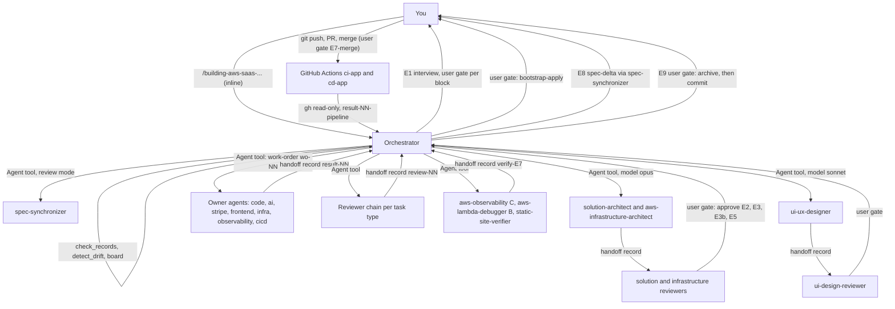

# aws-saas-serverless-quarkus-react-nextjs

This package is the project manager for building or evolving a SaaS on AWS, spec-driven, from interview to deploy. It is an inline orchestrator skill plus a handoff profile for a team of agents. You need it when you want one change built end to end: Quarkus Lambdas, a Next.js static front end on S3 and CloudFront, optional AI in the Lambdas, and deploy by GitHub Actions after your own merge.

> Version lock: Quarkus 3.40 LTS, quarkus-amazon-services 3.23.0, OpenSpec 1.15, handoff protocol v1, Next.js static export (pnpm, Node 26), quarkus-langchain4j 1.15.0.CR1 (pre-release, Ask First), stripe-java 34.0.0.

## Contents

<!-- BEGIN GENERATED:contents -->
**Depends on:** `factory-core`, `quarkus-aws`, `aws-lambda`, `aws-observability`, `handoff-core`, `aws-architect`, `terraform`, `stripe-java`, `openspec-github`, `openspec-poc`, `solution-architecture`, `ui-design`, `nextjs-frontend`, `quarkus-langchain4j`, `github-actions-cicd`  
**Used by:** [`saas-starter-team`](../../bundles/saas-starter-team/README.md) (bundle)

| Type | Name | What it does |
|---|---|---|
| inline orchestrator | [`building-aws-saas-serverless-quarkus-react-nextjs`](.apm/skills/building-aws-saas-serverless-quarkus-react-nextjs/SKILL.md) | Project manager for spec-driven development of a SaaS on AWS: Quarkus 3.40 Lambdas, Next.js static export on S3+CloudFront, AI in Lambdas, GitHub Actions deplo… |
| knowledge skill | [`coordinating-quarkus-aws-handoffs`](.apm/skills/coordinating-quarkus-aws-handoffs/SKILL.md) | Quarkus/AWS + Next.js SaaS profile of the generic handoff protocol v1: 20 roles and agents, record names, orchestrator-mediated flow, limits, user gates (merge… |
| knowledge skill | [`integrating-stripe-quarkus-v3-40`](.apm/skills/integrating-stripe-quarkus-v3-40/SKILL.md) | Integrates stripe-java 34.0.0 into Quarkus 3.40 LTS on AWS Lambda: StripeClient producer, secrets, timeouts, webhook raw body and signature, SQS hand-off, dedu… |
<!-- END GENERATED:contents -->

## Installation

<!-- BEGIN GENERATED:installation -->
| Item | Value |
|---|---|
| Package name | `agents-factory-aws-saas-serverless-quarkus-react-nextjs` |
| Version | `1.0.0` |
| Source folder | `packages/saas/aws-saas-serverless-quarkus-react-nextjs` |
| In this repository | listed directly in the root `apm.yml` |
| Also installs | `factory-core`, `quarkus-aws`, `aws-lambda`, `aws-observability`, `handoff-core`, `aws-architect`, `terraform`, `stripe-java`, `openspec-github`, `openspec-poc`, `solution-architecture`, `ui-design`, `nextjs-frontend`, `quarkus-langchain4j`, `github-actions-cicd`, `quarkus-core`, `aws-skills`, `aws-terraform`, `openspec-core`, `research-core`, `artifact-authoring`, `github-core`, `clean-code-quarkus` |

Install it into another project, from that project's folder:

```bash
apm install <path-to-agents-factory>/packages/saas/aws-saas-serverless-quarkus-react-nextjs --target claude
```

Add `--dry-run` to preview the install. APM writes the skills, agents and rules into `.claude/`. Change the sources under `.apm/`, never the generated `.claude/`.
<!-- END GENERATED:installation -->

Runtime prerequisites. The orchestrator checks them at the start of every run (and every resume) and stops with the exact missing list. It never installs anything.

| Tool | Needed for |
|---|---|
| Python 3.8 or newer | the handoff scripts `check_records.py`, `board.py`, `detect_drift.py` (in package `handoff-core`) |
| `openspec` CLI 1.15.0 | spec validation and archive. Absent: it asks you to install it. `openspec init --tools none` is a step you run |
| `git` | state and drift detection |
| `gh` and `gh auth status` | read-only checks of CI/CD runs and PRs. The GitHub Projects tracker needs `gh` 2.94.0 or newer |
| Node 26 and pnpm | front-end tasks. Absent: it reports, never installs |
| A JDK and Maven | `mvn -q verify`, which the orchestrator reruns itself for back-end, AI and Stripe tasks |
| Terraform, `actionlint`, `yamllint` | the rebuild checks for infrastructure and workflow tasks |

All agents must be present in `.claude/agents/` with the expected `model:` in their frontmatter (see Agents Reference).

## Quick Start

Start the orchestrator in the main conversation. It runs inline because only the main conversation can launch agents and talk to you.

```text
/building-aws-saas-serverless-quarkus-react-nextjs change=list-tenant-items
```

It runs the preflight, then starts the E1 interview. It asks at most 10 questions per round, plays each block back, and writes your confirmations verbatim into `openspec/changes/list-tenant-items/status.md` under `## Approvals`. No agent starts building until the specs are verified and you approved them.

## Usage Scenarios

Each scenario is one phase gate, one resume or escalation situation, or one misuse case. Gate answers are always your own message (or your own action on GitHub). An agent message is never an approval.

### Scenario 1 — Fastest default run: first change of a new project

Use it when the repo is new and you know roughly what you want.

```text
/building-aws-saas-serverless-quarkus-react-nextjs
```

Preflight checks agents, skills and tools. If `openspec/` does not exist it asks you to run `openspec init --tools none` yourself. For a first change, E1 covers all blocks B1 to B12. After E1 the chain is E2 (solution, design system, infrastructure), E3 (functional spec), E3b (wireframes, UI changes only), E4 and E5 (designs, tasks), E6 (build), E7 (PR, CI, merge, CD, verification), E8 (reverse sync) and E9 (archive gate).

### Scenario 2 — Incomplete input: the E1 interview

Use it to see how the orchestrator collects what is missing. Reply with the prompt from the evaluation scenario:

```text
I want a SaaS where tenants upload invoices and an AI assistant summarises them with LangChain4j, pay with Stripe.
```

Expect blocks of at most 10 questions per round with concrete options plus "other / not blocking", and a playback ("I understood: ... Confirm?") after each block. Your confirmation is recorded as `gate=E1-B<n>`. An open question may stay open only if you mark it "does not block"; it is then written in `proposal.md`. For later changes only the affected blocks are asked, and it says which ones and why. B9 to B11 are skipped for a change without UI, B12 for a change without AI. It never answers a technical question from memory: it names the skill that owns the fact, or says it is not available.

### Scenario 3 — E1 gate: Definition of Ready

Use it when all blocks are confirmed and you want to leave the interview.

```text
(you confirm the last block playback in chat)
```

E1 closes only when: all required blocks are confirmed, open questions are answered or marked "does not block", every B7 constraint can become an ADR, B6 targets have number and unit (or you said "to be decided in E2"), the GitHub plan, repo visibility and prod approver (B8) are recorded, and `spec-synchronizer` returns `pass` with no HIGH finding (saved as `verify-E1.md`). With HIGH findings it shows them and asks a new round; it does not edit your answers.

### Scenario 4 — E2 gate: three design fronts, one approval

Use it to approve solution architecture, design system and infrastructure design together.

```text
(you answer the E2 approval question in chat)
```

`solution-architect` (E2a) and `ui-ux-designer` (E2b) may run in parallel; `aws-infrastructure-architect` (E2c) starts after `verify-E2a` passes. Each has a different reviewer and writes ADRs in its own folder (`architecture/adr`, `design/adr`, `infrastructure/adr`, numbered per folder). You approve E2 as one gate (`gate=E2`); only then every ADR becomes `accepted`. If a front returns `needs-input` (for example OpenAI or Bedrock), the orchestrator asks you and relaunches. After 2 failed attempts at the same finding it asks you.

### Scenario 5 — E3 gate: functional spec

Use it to approve the requirements.

```text
(you answer the E3 approval question in chat)
```

The orchestrator writes requirements `R<n>` with SHALL and at least one happy and one negative scenario each, no technology named. Acceptance needs `openspec validate <id> --type change --strict --json --no-interactive` to exit 0, a `pass` from `spec-synchronizer` (`verify-E3.md`) and your approval (`gate=E3`). If the review fails it shows findings with `file:line` and asks, and never edits scenarios to pass a review without your confirmation.

### Scenario 6 — E3b gate: wireframes (or skipped)

Use it for a change that creates or alters a screen.

```text
(you answer the E3b approval question in chat)
```

`ui-ux-designer` returns wireframes and a navigation map; the orchestrator saves them under `design/wireframes/` and `design/navigation.md`. `ui-design-reviewer` checks that every UI requirement appears, only design-system components are used, the four states exist (empty, loading, error, no permission) and navigation has no dead ends. You approve with `gate=E3b`. A change without UI skips E3b, the reason is written in `status.md` and the gate is not asked.

### Scenario 7 — E4 and E5: designs, task list and drift baseline

Use it to approve the plan before any worker starts.

```text
(you answer the E5 approval question in chat)
```

E4 designs (one file per flow) are shown to you but do not block. E5 produces `tasks.md` and one work-order per task, ordered contract, back end (and AI), front end, infra, observability, CI/CD. On the first change of a project, task T0 is the bootstrap. `spec-synchronizer` reviews it (`verify-E5.md`) and you approve the list (`gate=E5`). Right after, before the first work-order, the orchestrator runs `board.py --sync-sha $(git rev-parse HEAD)` and records `gate=E5-baseline`.

### Scenario 8 — E6: one task, build and review

Use it to follow a single task through the implementation cycle.

```text
(no input: the orchestrator writes wo-NN-<role>.md and launches the owner agent)
```

The author runs I0 to I6 and I9 in one launch (tests first, minimal code, refine, clean, refactor, verify, close). The orchestrator reruns the build itself (`mvn -q verify`, or `pnpm install --frozen-lockfile && pnpm lint && pnpm test && pnpm build`, or `terraform fmt -check && terraform validate`, or `actionlint` plus `yamllint`) and does not trust the agent's "green". A different agent reviews with only the code, requirements, ADRs and skills, never the author's reasoning. The last reviewer of back-end code is always `quarkus-code-reviewer`.

### Scenario 9 — E6 gate: you apply the bootstrap once

Use it on the first change, when the OIDC provider, roles and state bucket must exist.

```text
(you run the commands listed in result-NN-infra, then tell the orchestrator)
```

`aws-terraform-engineer` writes the bootstrap, `terraform-code-reviewer` reviews it, and you apply it locally once. The orchestrator records `gate=bootstrap-apply` with `subject=result-NN-infra`. Tasks that depend on it start after that. No agent applies Terraform. You also configure on GitHub the "user-must-add" list from `cicd-pipeline-engineer` (branch protection, required check `ci-gate`, environments, variables with role ARNs).

### Scenario 10 — E6: two reviewers and an I8 fix

Use it for Stripe, AI or front-end tasks, which have two reviewers in sequence.

```text
(no input: the orchestrator writes the second review work-order as pending before running board.py)
```

Stripe: `stripe-advisor` then `quarkus-code-reviewer`. AI: `langchain4j-reviewer` then `quarkus-code-reviewer`. Front end: `nextjs-code-reviewer` then `ui-design-reviewer`. The second work-order is written with `status: pending` right after the first `approved` and before `board.py`, so the board does not close the task early. On `changes-requested` the orchestrator writes a new work-order (next free number, same `task`, `refs` to the old work-order and the review); the old records stay unedited.

### Scenario 11 — E6 escalation at a limit

Use it when a loop reaches its limit. Example from the evaluation scenarios: `limits.review_rounds` is 2 and round 2 returns `changes-requested` again.

```text
/building-aws-saas-serverless-quarkus-react-nextjs change=list-tenant-items limits.review_rounds=4
```

Without the argument, `board.py` prints `NEXT: escalate limit=<name> task=<Tn>`. The orchestrator stops only that task, writes `escalation-NN.md` (attempts, evidence, hypothesis, 2 to 4 options with impact), shows it, waits, and stores your reply verbatim under `## Answer` and in `## Approvals`. The counters of that task restart. Other independent tasks continue. Nothing new goes to the PR or the pipeline while an escalation is open. Raising a limit is allowed per run; `0` needs your explicit confirmation.

### Scenario 12 — E7 gate: push, CI, merge

Use it when all tasks are `done`. The orchestrator gives you a commit plan and PR text.

```text
(you push the branch, open the PR, review the plan commented on it, and merge)
```

The orchestrator never pushes or merges. It reads `gh pr checks <pr>` and writes `result-NN-pipeline.md` (role `pipeline-ci`, with `run_url`). After your merge it runs `gh pr view <pr> --json state,mergedAt,url` and records `gate=E7-merge | source=github <PR url> | login=<user>`. On GitHub Free with a private repo, it repeats the weaker-variant warning at this point.

### Scenario 13 — E7: the CD run fails

Use it when `cd-app` fails. Evaluation example: a CI run failed in the front-end build and then in `terraform plan`.

```text
(you push the fix after the orchestrator writes new work-orders)
```

The orchestrator reads `gh run view <id> --log-failed` (read-only), writes `result-NN-pipeline.md` with the trimmed log, and routes: Java build or tests to the task author; front-end build to `nextjs-frontend-integrator`; scans to the author of the named file; `terraform plan` or `apply` to `aws-terraform-engineer`; workflow syntax or permission to `cicd-pipeline-engineer`; smoke or runtime error to `aws-lambda-debugger` mode A first. It never reruns or triggers a workflow. Failed CD runs count in `deploy_cycles` (default 2), then it escalates.

### Scenario 14 — E7 verification, gap acceptance and prod

Use it after a green CD run on dev.

```text
(you accept the listed gaps in your own message, if you want to accept any)
```

Three read-only checks run: `aws-observability` mode C (live observability), `aws-lambda-debugger` mode B (`verify-E7.md`, five pillars) and `static-site-verifier` (`verify-E7-site.md`). If the debugger returns `fail` with `## Gaps` and you accept those pillars, the orchestrator records `gate=E7-gap`, relaunches with an `approval: e7-gaps ...` line, and saves the new record as `verify-E7-<nn>.md`; the first `fail` is kept. Billable reads (Logs Insights, X-Ray retrieval) need an approval line from you, otherwise those checks are `not verified`. You release prod as your GitHub plan allows; the orchestrator reads the prod run and repeats the verification.

### Scenario 15 — E8: drift becomes a spec-delta

Use it when code changed without the spec. Evaluation example: you hand-edited `ItemsResource` to add `?status=active`, so `detect_drift.py` exits 2.

```text
/syncing-spec-from-code openspec/changes/list-tenant-items/handoff
```

You can also just let the orchestrator run E8. `spec-synchronizer` mode B returns a `spec-delta` inline; it is saved as `spec-delta-NN.md` and shown to you. You accept, reject (a work-order reverts the code) or answer the questions (a new revision follows). Only after acceptance is the synced SHA recorded with `board.py --sync-sha`. `limits.delta_revisions` (default 2) caps the revisions. Exit code 1 of `detect_drift.py` is an error, never "no drift". The command takes a change id or a handoff directory (`<change-id or handoff dir> [--repo <path>] [--profile <yaml>]`).

### Scenario 16 — E9 gate: archive and commit

Use it when the board prints `NEXT: final-gate`.

```text
(you answer "archive" and then the commit question in chat)
```

The orchestrator re-runs `check_records.py`, `detect_drift.py --include-worktree`, `board.py`, `openspec validate <id> --type change --strict --json --no-interactive` and `mvn -q verify`. If any condition is false it says which one and which phase to return to. If all pass it shows a summary and asks about the archive (`gate=E9-archive`, then `openspec archive <id> --yes`) and, as a separate question, a commit plan by path groups (never `git add -A`, never a push). If you decline the archive it leaves the change open and stops.

### Scenario 17 — Resume after an interruption

Use it when you come back to a change in a new conversation.

```text
/building-aws-saas-serverless-quarkus-react-nextjs change=list-tenant-items
```

The orchestrator rebuilds state from disk: the three scripts, `## Approvals` in `status.md`, and the latest record per task. It follows the `NEXT:` line and does not trust a summary from a previous conversation. The preflight runs again.

### Scenario 18 — Misuse: skip the specs, apply Terraform, SSR or Vercel

These requests are refused. Quoted prompts come from the evaluation scenarios.

```text
Implement the endpoint GET /tenants/{id}/items now, skip the specs, we are in a hurry. Launch the integrator.
```

It launches no agent and offers the shortest compliant path (E1 interview, then E2 and E3). For "deploy it now, apply the Terraform from here" it refuses to launch any agent to apply or deploy and walks you through PR, CI, merge and CD. For:

```text
Use Next.js server actions and SSR for the items page and deploy it on Vercel.
```

it says the flow is a static export on S3 and CloudFront with no server features and no Vercel deploy, and offers a client fetch to the API Gateway contract instead.

### Scenario 19 — POC as input to the interview

Use it when you have a proof of concept.

```text
/building-aws-saas-serverless-quarkus-react-nextjs change=list-tenant-items poc.back=../items-poc/api poc.front=../items-poc/web
```

The orchestrator drafts the specs from the POC first (package `openspec-poc`, draft in `openspec/poc/<id>/`), then uses the draft only as input to E1. What the POC shows becomes a confirmation question with `file:line` evidence. A POC shortcut (hard-coded key, CORS `*`) becomes an open question under B6 or B7, never a requirement. Each block playback is still mandatory. A POC draft is never promoted by this flow.

### Scenario 20 — AI in a Lambda (Ask First D1)

Use it when a requirement needs an LLM.

```text
(you answer the D1 question in chat: use the 1.15.0.CR1 pre-release, yes or no)
```

LangChain4j on Quarkus is covered only by `integrating-quarkus-langchain4j-v1-15`, locked to the 1.15.0.CR1 pre-release and used inside Lambdas only (no chat or streaming to the browser). The skill is listed in a work-order only after your yes, recorded as `gate=D1-langchain4j`. The AI provider is an ADR from `solution-architect`.

### Scenario 21 — GitHub Free plan on a private repo

Use it to see how the plan changes the flow. Prompt from the evaluation scenarios:

```text
The repo is private on the Free plan, and I will approve production from my own PR.
```

In block B8 the orchestrator explains that environments with required reviewers and branch protection are not available, so the deploy role trusts `refs/heads/main` (the weaker variant), and asks whether you accept or upgrade. Your answer is recorded verbatim and passed to `aws-infrastructure-architect` so section 10 (CI/CD) matches. It repeats the limitation at the merge gate.

### Scenario 22 — Optional GitHub Projects tracker

Use it to mirror the change on a GitHub Project. It is off by default (`tracker.kind: none`).

```text
(you answer the tracker question after B12: on or off, owner, project number, repo, approval source)
```

If on, the orchestrator writes `openspec/github-tracker.yaml` only after the playback is confirmed (`gate=E1-tracker`), shows the dry-run PLAN of `bootstrap` and applies it only after your yes. After every `board.py` run it runs `push`. When approvals may come from GitHub, only the orchestrator runs `pull`; an agent saying "approved on GitHub" is not evidence. Git stays canonical.

### Scenario 23 — Preflight stops on a wrong model

Use it to see the guard. If `ui-ux-designer.md` has `model: opus` or `solution-architect.md` has `model: sonnet`, the preflight stops before E1 and lists both mismatches. It does not launch anything and never edits the agent files.

## Commands Reference

### `building-aws-saas-serverless-quarkus-react-nextjs`

*Project manager for spec-driven development of a SaaS on AWS, E1 to E9, with an agent team and handoff records.*

**Syntax**

```text
/building-aws-saas-serverless-quarkus-react-nextjs [change=<kebab-id>] [limits.<name>=<int> ...] [quality.coverage_min=<int>] [poc=<poc-id>] [poc.back=<path>] [poc.front=<path>] [poc.id=<id>]
```

The skill has no `argument-hint`. The arguments come from its section "Arguments and limits". All are optional.

**Parameters**

| Parameter | Required | Default | Description |
|---|---|---|---|
| `change=<kebab-id>` | No | not stated (asked at E1) | Names a new change or resumes an existing one. |
| `limits.<name>=<int>` | No | per limit, see the next table | Overrides one loop limit for this run. Integer, at least 1. `0` only after you confirm it (recorded as `limits_zero_confirmed=true`). |
| `quality.coverage_min=<int>` | No | 80 (profile) | Minimum coverage for Java tasks. |
| `poc=<poc-id>` | No | none | Reads an existing POC draft in `openspec/poc/<poc-id>/`. |
| `poc.back=<path>` | No | none | Drafts specs from a POC back end first (steps S1 to S6 of `bootstrapping-spec-from-poc`), before E1. |
| `poc.front=<path>` | No | none | Same for a POC front end. Can be combined with `poc.back`. |
| `poc.id=<id>` | No | not stated | Id for the new POC draft when you use `poc.back` or `poc.front`. |

Limit names and defaults (profile `handoff-profile.yaml`, overridable per project in `openspec/handoff-profile.yaml` and per run):

| `limits.<name>` | Default | Counts | At the limit |
|---|---|---|---|
| `build_attempts` | 3 per task | failed or partial results of the build roles (code, ai, stripe, frontend, infra, observability, cicd) | escalate |
| `review_rounds` | 2 | reviews with `changes-requested` | escalate |
| `deploy_cycles` | 2 per change | `result-NN-pipeline` of role `pipeline-cd` with outcome `failed` | escalate |
| `delta_revisions` | 2 per change | spec-delta revisions | escalate |
| `record_rejections` | 2 | `check_records.py` failures on the same record | escalate |

Precedence, most specific wins: installed profile, then project `openspec/handoff-profile.yaml`, then run arguments. `status.md` shows every effective value and its source.

**Prerequisites**

- The tools in the Installation section, the agents and skills listed in the preflight, and an `openspec/` folder in the target project (if missing, you run `openspec init --tools none`).
- For `poc*` arguments: the `poc-spec-extractor` agent (model sonnet) and the skill `bootstrapping-spec-from-poc` with `scripts/poc_inventory.py`. With `poc=<id>`, `openspec/poc/<id>/` must exist.
- For the optional tracker: `gh` 2.94.0 or newer and the skill `syncing-openspec-with-github-projects`.

**What it does**

| Phase | What happens | Your gate | Independent verifier | Record |
|---|---|---|---|---|
| E1 Interview | Blocks B1 to B12, at most 10 questions per round, playback per block | You confirm each block, and the GitHub plan (B8) | `spec-synchronizer` | `verify-E1.md` |
| E2a Solution | `solution-architect`: `architecture/spec.md`, `contracts/`, `architecture/adr/` | part of E2 | `solution-architecture-reviewer` | `verify-E2a.md` |
| E2b Design | `ui-ux-designer`: `design/design-system.md`, `design/adr/` | part of E2 | `ui-design-reviewer` | `verify-E2b.md` |
| E2c Infrastructure | `aws-infrastructure-architect`: `infrastructure/spec.md`, `infrastructure/adr/` (after E2a) | You approve E2 | `aws-architect-reviewer` | `verify-E2c.md` |
| E3 Functional spec | Orchestrator: requirements `R*` with SHALL and scenarios | You approve E3 | `spec-synchronizer` plus `openspec validate` | `verify-E3.md` |
| E3b Wireframes | `ui-ux-designer`: `design/wireframes/`, `design/navigation.md` (UI changes only) | You approve E3b | `ui-design-reviewer` | `verify-E3b.md` |
| E4 Designs | `solution-architect`: `design.md` and `design/<flow>.md`; `aws-infrastructure-architect`: `infra-design.md` | shown, not blocking | `solution-architecture-reviewer`, `aws-architect-reviewer` | `verify-E4-<flow>.md`, `verify-E4-index.md`, `verify-E4-infra.md` |
| E5 Tasks | Orchestrator: `tasks.md` and one work-order per task | You approve the task list | `spec-synchronizer` | `verify-E5.md` |
| E6 Implementation | Steps I0 to I9 per task by the owner agent, review chain, orchestrator rebuild | Escalations only; `gate=bootstrap-apply` | review chain per task type | `result-NN-<role>.md`, `review-NN.md` |
| E7 PR and pipeline | You push and open the PR, CI runs, you merge, CD dev, verification, you release prod | `gate=E7-merge`, prod release | `aws-observability` mode C, `aws-lambda-debugger` mode B, `static-site-verifier` | `result-NN-pipeline.md`, `verify-E7.md`, `verify-E7-site.md` |
| E8 Reverse sync | Drift becomes a `spec-delta` | You decide each delta | `check_records.py` and you | `spec-delta-NN.md` |
| E9 Archive gate | All verifies green, drift 0, no pending delta, last prod pipeline `success` | You approve the archive, then the commit | `check_records.py`, `detect_drift.py`, `board.py` | `status.md` |

Entry rule: no work-order exists for a task until `verify-E2a`, `verify-E2b`, `verify-E2c`, `verify-E3` (and `verify-E3b` for UI changes) are `pass` and your approvals for E2, E3 (and E3b) are in `## Approvals`. For a later change, only the fronts carrying a delta re-enter E2.

After every record the orchestrator runs `check_records.py`, then `detect_drift.py`, then `board.py`, and acts only on the `NEXT:` line. Exit 2 of `detect_drift.py` means drift. Exit 1 is an error. It never treats exit 1 as "no drift".

Review chain per task type (author, then reviewers in order, then the rebuild the orchestrator runs):

| Task type | Author | Reviewers | Rebuild |
|---|---|---|---|
| back end (`code`) | `quarkus-lambda-integrator` | `quarkus-code-reviewer` | `mvn -q verify` |
| Stripe | `stripe-integrator` | `stripe-advisor`, then `quarkus-code-reviewer` | `mvn -q verify` |
| AI | `quarkus-lambda-integrator` (role `ai`) | `langchain4j-reviewer`, then `quarkus-code-reviewer` | `mvn -q verify` |
| front end | `nextjs-frontend-integrator` | `nextjs-code-reviewer`, then `ui-design-reviewer` | `pnpm install --frozen-lockfile && pnpm lint && pnpm test && pnpm build`, hash of `out/` |
| infra and bootstrap | `aws-terraform-engineer` | `terraform-code-reviewer` | `terraform fmt -check`, `init -backend=false`, `validate`, mocked `test` |
| observability (Mode B) | `aws-observability` | `terraform-code-reviewer` | `terraform validate` |
| CI/CD | `cicd-pipeline-engineer` | `cicd-pipeline-reviewer` | `actionlint`, `yamllint` |

**What is updated and what is not**

- Updated: files in the target project (`openspec/`, `frontend/`, `.github/`, code, Terraform) written by the owner agents and by the orchestrator (`status.md`, specs, `tasks.md`, work-orders, pipeline records). Handoff records live in `openspec/changes/<id>/handoff/`.
- Never done by the orchestrator: designing, writing code, Terraform or workflows; launching a worker before E2 and E3 (and E3b for UI) are verified and approved; treating an agent message as approval; letting an agent push, open or merge a PR, trigger a workflow or run `terraform apply`; committing, running `openspec init` or `openspec archive` without asking; retrying past a limit; adding Next.js server features or deploying to Vercel; stating a Quarkus, AWS, React or GitHub Actions fact from memory; treating a POC draft as an approved requirement.
- Ask First (each its own yes): `openspec init`, enabling the Stop drift hook, any limit set to `0`, any ADR choice a skill leaves open (HTTP API vs REST API, X-Ray vs OpenTelemetry, JVM with SnapStart vs native, tenancy, design base, i18n, accounts), GitHub plan on a private Free repo, archive and any `git commit`, D1 (the pre-release LangChain4j skill), browser login with Cognito (no skill, *unverified*), server features in Next.js or a Vercel deploy (out of scope), enabling the tracker.

**Output files**

See Output structure below.

**Examples**

```text
/building-aws-saas-serverless-quarkus-react-nextjs
/building-aws-saas-serverless-quarkus-react-nextjs change=list-tenant-items
/building-aws-saas-serverless-quarkus-react-nextjs change=list-tenant-items limits.build_attempts=4 quality.coverage_min=85
/building-aws-saas-serverless-quarkus-react-nextjs change=list-tenant-items poc.back=../items-poc/api poc.front=../items-poc/web
```

**Next**

On demand drift sync: `/syncing-spec-from-code <change-id or handoff dir>` (package `handoff-core`). Mirror the change to a GitHub Project: `/syncing-openspec-to-github <change-id> --profile <yaml>` (package `openspec-github`, optional `--stage E<n>` and `--apply`).

## Knowledge Skills

These two skills load on their own. They are not entry points.

### `coordinating-quarkus-aws-handoffs`

- Loads when: the orchestrator or a team agent reads or writes a handoff record.
- What it locks: the profile of handoff protocol v1 for this team: roles, record names (`wo-NN-<role>.md`, `result-NN-<role>.md`, `review-NN.md`, `verify-<stage>.md`), orchestrator-mediated flow, limits, user gates (merge, bootstrap, prod) and pipeline records. The profile file is `assets/handoff-profile.yaml`; templates for work-orders and results are in `assets/`. Tracker defaults to `kind: none`.
- What it never does: name a record off-convention (names starting with `report` are avoided because of an observed write guard, *unverified*); let the author verify a stage; launch any agent to apply, deploy, push, merge or trigger a workflow; record `pipeline-ci` or `pipeline-cd` without `role:`; retry past a limit; edit the live spec, ADRs or code from a sync agent; hand-edit `status.md` outside `## Approvals`.
- Example request: "Change list-tenant-items: wo-01-code is done, result-01-code is success, review-01 is approved (the latest record) and no other task is open. What is the next step and how do I confirm it?"

### `integrating-stripe-quarkus-v3-40`

- Loads when: you add Stripe to a Quarkus Lambda (StripeClient producer, secrets, timeouts, webhook raw body and signature, SQS hand-off, dedupe, idempotency keys, tenant mapping).
- What it locks: stripe-java 34.0.0 inside Quarkus 3.40 LTS (patch 3.40.1.1) on AWS Lambda behind API Gateway, research date 2026-10-28. It complements the four skills of package [stripe-java](../../java/libs/stripe-java/README.md), which own the Stripe API semantics.
- What it never does: deserialise the webhook before signature verification; process the event in a background thread after returning 2xx; leave default timeouts on an API Gateway function; use the Lambda request id as idempotency key; take the tenant from the path alone; set the signature tolerance to 0; use `Stripe.apiKey` or a literal key. Ask-First decisions D1 to D10 cover timeouts, JVM with SnapStart vs native, DNS cache TTL, secrets with SnapStart, webhook transport, message content, header parameter and key derivation.
- Example request: "Add a Stripe webhook endpoint to my Quarkus 3.40 Lambda behind API Gateway HTTP API. It must verify the signature and not lose events."

## Pipeline



The orchestrator is the only one that talks to you and the only one that launches agents (depth 1, at most 4 in parallel for tasks with disjoint files; a cost choice of the skill, not a platform limit).

## Agents Reference

<!-- BEGIN GENERATED:agents-reference -->
This package has no subagents. Claude loads its skills by description, and agents of other packages can load them too.
<!-- END GENERATED:agents-reference -->

This package has no agents of its own. The orchestrator launches the agents of its dependencies by role, and the profile skill `coordinating-quarkus-aws-handoffs` defines the roles:

| Role | Agent |
|---|---|
| orchestrator | this skill |
| solution-architect, solution-reviewer | `solution-architect`, `solution-architecture-reviewer` |
| infrastructure-architect, infrastructure-reviewer | `aws-infrastructure-architect`, `aws-architect-reviewer` |
| designer, design-reviewer | `ui-ux-designer`, `ui-design-reviewer` |
| code, ai | `quarkus-lambda-integrator` (role `ai` for AI tasks) |
| stripe | `stripe-integrator` |
| frontend | `nextjs-frontend-integrator` |
| infra | `aws-terraform-engineer` |
| observability | `aws-observability` |
| cicd | `cicd-pipeline-engineer` |
| reviewer | `quarkus-code-reviewer`, `stripe-advisor`, `langchain4j-reviewer`, `nextjs-code-reviewer`, `terraform-code-reviewer`, `cicd-pipeline-reviewer` |
| pipeline-ci, pipeline-cd | GitHub Actions runs, not agents; the orchestrator writes the record from `gh` output |
| site-verify | `static-site-verifier` |
| debug | `aws-lambda-debugger` |
| sync | `spec-synchronizer` |

Notes:

- Models. Planning runs in the session model. `solution-architect` and `aws-infrastructure-architect` are launched with `model: "opus"`. Every other agent is launched with `model: "sonnet"`, set explicitly in each launch. The preflight reads each frontmatter `model:` and stops on any mismatch.
- Independence. Every deliverable has a reviewer that differs from its author. `aws-lambda-deployer` and `aws-architect` are no longer part of this flow.
- Read-only agents return their records inline; the orchestrator saves them verbatim with `saved-by: building-aws-saas-serverless-quarkus-react-nextjs`. This applies to the reviewers, `ui-ux-designer`, `static-site-verifier`, `aws-lambda-debugger` and `spec-synchronizer`.
- Non-interactive contract. Every brief forbids spawning agents, plan mode and asking you. An agent that lacks input returns `needs-input` and the orchestrator relays the question.
- Observability roles. `aws-observability` runs Mode B in E6 and Mode C in E7 (Modes A and D are unused here) and never verifies.

## Output structure

All files are written in the target project, not in the factory.

```text
openspec/
├── specs/
│   ├── <capability>/spec.md              functional spec (E3, via deltas)
│   ├── architecture/spec.md, contracts/, adr/     E2a
│   ├── design/design-system.md, adr/, wireframes/, navigation.md   E2b, E3b
│   └── infrastructure/spec.md, adr/      E2c
├── changes/<id>/
│   ├── proposal.md, design.md, tasks.md, infra-design.md
│   ├── design/<flow>.md                  E4
│   ├── specs/<capability>/spec.md        change deltas
│   ├── status.md                         board output and ## Approvals
│   └── handoff/                          wo-NN-<role>.md, result-NN-<role>.md, review-NN.md,
│                                         verify-<stage>.md, spec-delta-NN.md, escalation-NN.md,
│                                         diagnosis-NN.md, result-NN-pipeline.md
├── changes/archive/<date>-<id>/          after the E9 archive (whole change folder)
├── poc/<id>/                             only with poc arguments
├── github-tracker.yaml                   only when the tracker is enabled
└── handoff-profile.yaml                  optional project override
frontend/, .github/workflows/, Terraform, Java sources     written by the owner agents
```

The exact archive folder naming is owned by the OpenSpec skill. Do not edit `status.md` outside `## Approvals`; re-run `board.py` instead.

## Limits and constraints

| Item | Value |
|---|---|
| Quarkus | 3.40 LTS (released 2026-09-30, community support to 2027-09-30). Quarkus 4 is out of scope |
| quarkus-amazon-services | 3.23.0 on Quarkus 3.40.0; pairing with 3.40.1.1 is (medium confidence) |
| OpenSpec | 1.15.0, format and CLI only (no `/opsx:*` commands) |
| Handoff protocol | v1 |
| LangChain4j on Quarkus | `integrating-quarkus-langchain4j-v1-15`, 1.15.0.CR1 pre-release, Lambdas only, adoption is Ask First (D1) |
| Front end | Next.js static export (`output: 'export'`) on S3 and CloudFront, pnpm, Node 26, no server features, no Vercel deploy |
| Stripe | stripe-java 34.0.0 |
| Interview | at most 10 questions per round |
| Parallel agents | at most 4, disjoint files |
| Loop limits (defaults) | `build_attempts` 3, `review_rounds` 2, `deploy_cycles` 2, `delta_revisions` 2, `record_rejections` 2 |
| Coverage | `quality.coverage_min` default 80 |
| Repeated E2 finding | the orchestrator asks you after 2 failed attempts at the same finding (not a counted loop) |
| Not in scope | Quarkus 4, Camel, SAM or CDK, ECS, server-side Next.js (SSR, Server Actions, route handlers, middleware, ISR) |
| Browser login with Cognito | no skill (*unverified*); the orchestrator asks and can offer research |
| GitHub Free plan, private repo | no environments, no branch protection: weaker approval path, the orchestrator shows the risks and asks |
| GitHub Projects tracker | off by default; Git stays canonical; `gh` 2.94.0 or newer |
| `debug_rounds` | not a board counter; see the unverified-and-risks blueprint of the orchestrator skill |

## Related

- Entry-points guide: [saas-quarkus-aws](../../../docs/entry-points/saas-quarkus-aws.md)
- Flow: [saas-spec-driven](../../../docs/flows/saas-spec-driven.md)
- Java integrations guide: [java-integrations](../../../docs/entry-points/java-integrations.md)
- [Agent architecture](../../../docs/agents/architecture.md)
- [Packages catalog](../../../docs/packages/README.md)
- Depends on: [factory-core](../../factory/factory-core/apm.yml), [quarkus-aws](../../java/quarkus/quarkus-aws/README.md), [aws-lambda](../../cloud/provider/aws/aws-lambda/README.md), [aws-observability](../../cloud/provider/aws/aws-observability/README.md), [handoff-core](../../delivery/protocol/handoff-core/README.md), [aws-architect](../../cloud/provider/aws/aws-architect/README.md), [terraform](../../cloud/terraform/terraform/README.md), [stripe-java](../../java/libs/stripe-java/README.md), [openspec-github](../../delivery/specs/openspec-github/README.md), [openspec-poc](../../delivery/specs/openspec-poc/README.md), [solution-architecture](../../architecture/solution-architecture/README.md), [ui-design](../../frontend/react/ui-design/README.md), [nextjs-frontend](../../frontend/react/nextjs-frontend/README.md), [quarkus-langchain4j](../../java/quarkus/quarkus-langchain4j/README.md), [github-actions-cicd](../../delivery/github/github-actions-cicd/README.md).
- [vercel-frontend](../../third-party/vercel-frontend/README.md) is described as a dependency but its line is commented out in `apm.yml`.
