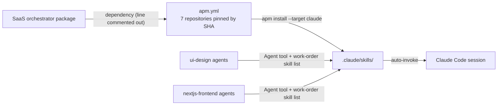

# vercel-frontend

This package copies no skill content. Its `apm.yml` points to Vercel's official agent-skill repositories, each pinned to a commit SHA, and `apm install` brings in the skills those repositories publish. You need it when a project uses the React, Next.js, design and UI skills from Vercel, for example through the SaaS orchestrator or the `ui-design` and `nextjs-frontend` agents.

> Version lock: each repository is pinned to a commit SHA, resolved 2026-10-29. The skill list comes from <https://vercel.com/docs/agent-resources/skills> (page last updated 2026-09-15).

## Contents

<!-- BEGIN GENERATED:contents -->
**Depends on:** `agent-skills`, `next.js`, `components.build`, `ai-elements`, `streamdown`, `turborepo`, `agent-browser`  
**Used by:** none

| Type | Name | What it does |
|---|---|---|
<!-- END GENERATED:contents -->

## Installation

<!-- BEGIN GENERATED:installation -->
| Item | Value |
|---|---|
| Package name | `agents-factory-vercel-frontend` |
| Version | `1.0.0` |
| Source folder | `packages/third-party/vercel-frontend` |
| In this repository | not in the root `apm.yml`; install it on its own or through a bundle |
| Also installs | `agent-skills`, `next.js`, `components.build`, `ai-elements`, `streamdown`, `turborepo`, `agent-browser` |

Install it into another project, from that project's folder:

```bash
apm install <path-to-agents-factory>/packages/third-party/vercel-frontend --target claude
```

Add `--dry-run` to preview the install. APM writes the skills, agents and rules into `.claude/`. Change the sources under `.apm/`, never the generated `.claude/`.
<!-- END GENERATED:installation -->

Prerequisites and costs, from the previous README of this package and `apm.yml`:

- Windows long paths: run `git config --global core.longpaths true` first. Without it, the next.js checkout fails with `Filename too long`. To revert: `git config --global --unset core.longpaths`.
- Install time: a first install takes about 25 to 40 minutes, almost all of it cloning next.js.
- Network: `apm install` needs access to GitHub.

Each entry in `apm.yml` is a whole GitHub repository with a `ref:` set to a commit SHA. `apm install` copies every skill each repository publishes into `.claude/skills/`. They then load automatically, like any knowledge skill. The package has no command, agent or rule.

## Quick Start

After the install, ask in plain text. Examples (plain requests, not from an evaluation file):

```text
Refactor this component, it has too many boolean props.
```

```text
Review this page against the web design guidelines.
```

## Usage Scenarios

The package has no evaluation scenarios. The requests below use the skill names and the repository table in `apm.yml`. Which upstream skill answers is decided by that skill's own description, which is not stored in this package (unverified here).

### Scenario 1 — Component API refactor

```text
Refactor this component, it has too many boolean props.
```

You get help from `composition-patterns` (from `vercel-labs/agent-skills`), as the example in the previous README intends.

### Scenario 2 — Design review

```text
Review this page against the web design guidelines.
```

The skill `web-design-guidelines` (from `vercel-labs/agent-skills`) responds.

### Scenario 3 — Installing without the long-path setting (misuse)

```text
apm install
```

On Windows without `core.longpaths`, the next.js checkout fails with `Filename too long`. Run `git config --global core.longpaths true` first.

### Scenario 4 — Asking for a skill that is not installed

```text
Install the Vercel AI SDK skills (use-ai-sdk).
```

`vercel/ai` is commented out in `apm.yml` because its checkout aborts on Windows with `local changes would be overwritten`. The same applies to `json-render`, `migration-skills` and `before-and-after` (see Limits). Uncomment one only after you test the install in an isolated folder.

### Scenario 5 — Updating a pin

```text
gh api repos/vercel/next.js/commits/<branch> --jq .sha
```

Put the new SHA in `ref:` of `apm.yml`, test the install in an isolated folder, then regenerate `.claude/` (see Pipeline).

### Scenario 6 — Using it through the agents

The agents `ui-ux-designer`, `ui-design-reviewer`, `nextjs-frontend-integrator` and `nextjs-code-reviewer` load these skills when a work-order lists them. See [ui-design](../../frontend/react/ui-design/README.md) and [nextjs-frontend](../../frontend/react/nextjs-frontend/README.md).

## Skills Reference

Upstream skill names do not follow the factory naming rules: no gerund-noun names, no version suffix, and some `SKILL.md` files are over 500 lines. The factory accepts these deviations and does not change upstream skills. On 2026-10-29 none of these skills had the same name as an existing factory skill. This table comes from the previous README; full paths are in `workspace/vercel-frontend/provenance.md` (not checked here).

| Repository | SHA (short) | License | Skills installed |
|---|---|---|---|
| `vercel-labs/agent-skills` | `1a2c79d4` | none declared | `react-best-practices`, `composition-patterns`, `web-design-guidelines`, `react-native-skills`, `react-view-transitions`, `deploy-to-vercel`, `vercel-cli-with-tokens`, `vercel-optimize`, `writing-guidelines` |
| `vercel/next.js` | `4c6a3fa4` | MIT | `next-dev-loop`, `next-cache-components-adoption`, `next-cache-components-optimizer`, `next-bundle-optimizer`, `next-partial-prefetching-adoption`, `next-partial-prefetching-optimizer` |
| `vercel/ai-elements` | `ca8be600` | Apache-2.0 | `ai-elements` |
| `vercel/streamdown` | `7dcabc64` | Apache-2.0 | `streamdown` |
| `vercel/components.build` | `ba727450` | Apache-2.0 | `building-components` |
| `vercel/turborepo` | `e158e859` | MIT | `turborepo` |
| `vercel-labs/agent-browser` | `1453dd37` | Apache-2.0 | `agent-browser` |

Full SHAs are in `apm.yml`. The package locks versions by commit, not by skill. It never copies, edits or renames an upstream skill.

## Pipeline



## Agents Reference

<!-- BEGIN GENERATED:agents-reference -->
This package has no subagents. Claude loads its skills by description, and agents of other packages can load them too.
<!-- END GENERATED:agents-reference -->

This package has no agent. These agents use its skills: `ui-ux-designer` and `ui-design-reviewer` (`building-components`, `web-design-guidelines`, `composition-patterns`), and `nextjs-frontend-integrator` and `nextjs-code-reviewer` (`react-best-practices`, `composition-patterns`, `building-components`, `web-design-guidelines`, `next-dev-loop`, `next-bundle-optimizer`, and when listed `react-view-transitions`, `turborepo`, `agent-browser`).

## Output structure

```text
.claude/skills/<upstream-skill-name>/    one folder per upstream skill, written by apm install
```

Nothing else is written by this package.

## Limits and constraints

| Item | Value |
|---|---|
| Install time | about 25 to 40 minutes on a first install, mostly cloning next.js |
| Windows | `git config --global core.longpaths true` required |
| `vercel/ai` (`use-ai-sdk`, `migrate-ai-sdk-v6-to-v7`) | commented out: on Windows its checkout aborts with `local changes would be overwritten`, even from a clean cache |
| `json-render` (path `skills/react`), `migration-skills` (path `cra-to-next-migration`), `before-and-after` (path `skill`) | commented out: with APM 0.35.0 on Windows every `path:` dependency fails with `Unable to prepare Git clone configuration probe` and fails the whole install |
| `json-render` whole repo | would bring its own `skill-creator`, which collides with the factory's |
| `before-and-after` license | PolyForm Shield 1.0.0, not open source |
| Naming | upstream names do not follow factory naming; accepted |
| Sales | never sold as a bundle |

Where the dependency is commented out in `apm.yml` (verified in the files): `packages/frontend/react/ui-design/apm.yml`, `packages/frontend/react/nextjs-frontend/apm.yml` and `packages/saas/aws-saas-serverless-quarkus-react-nextjs/apm.yml`. The root `apm.yml` states that `vercel-frontend` is not listed directly because the SaaS package resolves it transitively. Since that line is commented out in the SaaS package, a root install does not obviously pull it in (unverified; check `apm.lock.yaml`). The bundle `saas-starter-team` mentions that it pulls this package transitively and says to exclude it from sales.

To update a pin: get the new SHA with `gh api repos/<owner>/<repo>/commits/<branch> --jq .sha`, change `ref:` in `apm.yml`, test the install in an isolated folder, then run `apm install --target claude` at the repo root, followed by `python scripts/restore-rule-metadata.py` and `python scripts/fix-cross-package-links.py`.

## Related

- Guides: [SaaS on Quarkus and AWS entry points](../../../docs/entry-points/saas-quarkus-aws.md).
- Used by [nextjs-frontend](../../frontend/react/nextjs-frontend/README.md), [ui-design](../../frontend/react/ui-design/README.md) and [aws-saas-serverless-quarkus-react-nextjs](../../saas/aws-saas-serverless-quarkus-react-nextjs/README.md). Their `apm.yml` lines for this package are commented out.
- [Agent architecture](../../../docs/agents/architecture.md), [entry points](../../../docs/entry-points/README.md), [packages](../../../docs/packages/README.md).
