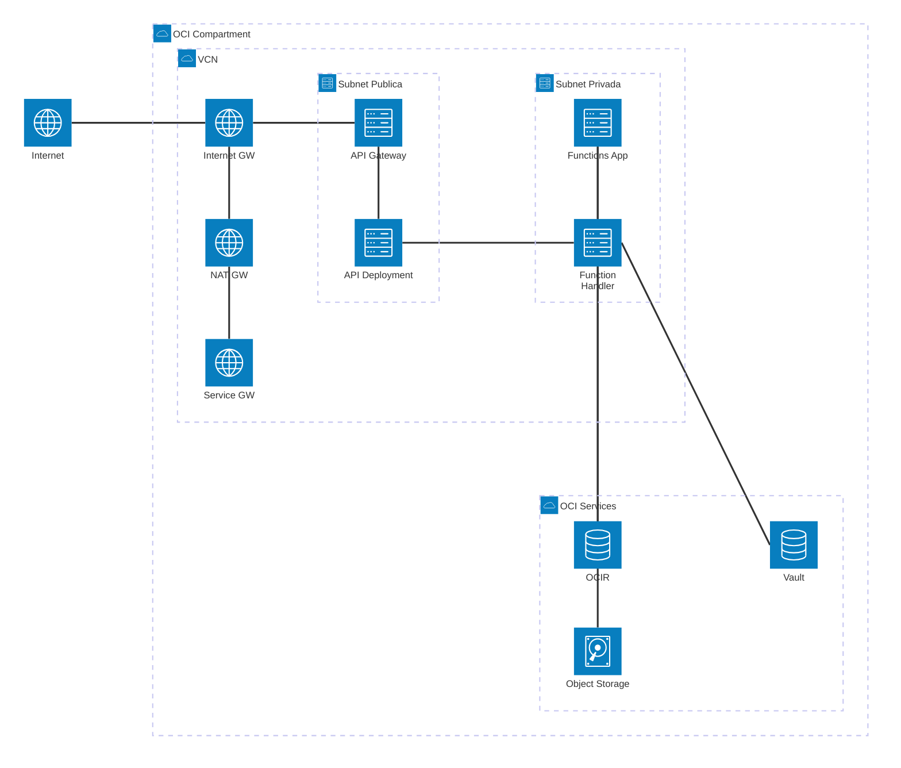
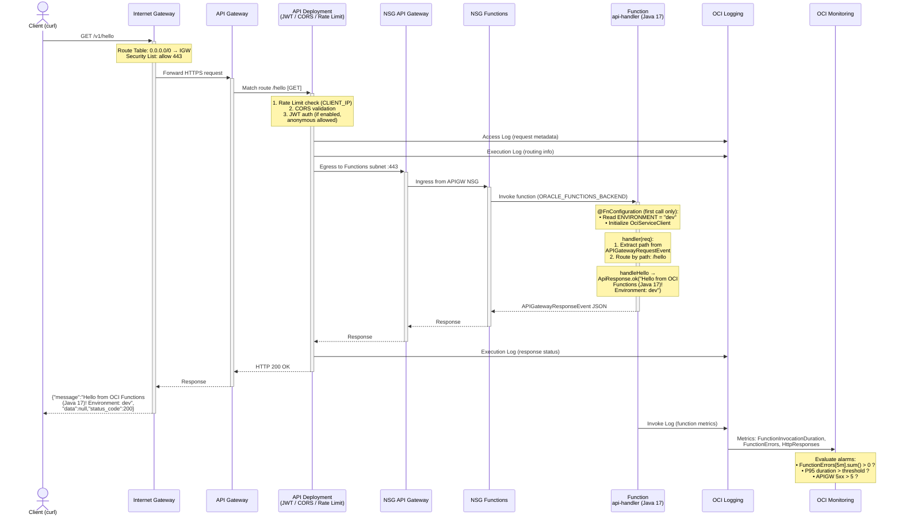

# POC OCI Serverless — Functions + API Gateway

Proof of Concept de arquitetura serverless na **Oracle Cloud Infrastructure (OCI)** utilizando **OCI Functions** e **API Gateway**, provisionada com **Terraform** modular.

## Documentação

| Documento | Conteúdo |
|-----------|----------|
| **[docs/onboarding/README.md](docs/onboarding/README.md)** | Onboarding por perfil — trilhas para dev Java e DevOps/infra |
| **[GETTING-STARTED.md](GETTING-STARTED.md)** | Setup do ambiente, build & deploy, como adicionar novas functions |
| **[docs/PROMPTS-GUIDE.md](docs/PROMPTS-GUIDE.md)** | Catálogo de agents/comandos Claude Code e guia de uso |
| **[infra/README.md](infra/README.md)** | Composição dos módulos Terraform, inputs/outputs |
| **[docs/patterns/README.md](docs/patterns/README.md)** | Catálogo de padrões de integração serverless |

## Arquitetura

```
Internet → [API Gateway (subnet pública)] → [Functions (subnet privada)] → OCI Services
                                                                          ↓
                                                              [Vault, Object Storage, DB]
```


### Diagrama de Recursos (Terraform)



> **Detalhes adicionais por módulo Terraform:**
>
> | Módulo | Recursos |
> |---|---|
> | **network** | VCN, Internet/NAT/Service Gateway, Subnet Publica + Privada, Route Tables, Security Lists, NSGs |
> | **iam** | Dynamic Groups (Functions, API Gateway), Policies (FaaS Network, APIGW Invoke, FN Services) |
> | **functions** | Functions Application, múltiplas Functions (Java 17, 256 MB, deploy condicional) |
> | **api-gateway** | Gateway, Deployment (JWT, CORS, Rate Limiting, rotas dinâmicas por function) |
> | **vault** | Vault, KMS Master Key, Secrets, Object Storage Bucket |
> | **observability** | Log Group, Service Logs (invoke, access, execution), Notification Topic, Alarms (errors, duration, throttle, 5xx) |
> | **apm** | APM Domain (free tier), Data Keys (private/public) |

### Diagrama de Sequência — `GET /v1/hello`



## Tecnologias

| Componente | Tecnologia |
|---|---|
| Compute | OCI Functions (FaaS) — multi-function por Application |
| Roteamento | OCI API Gateway (rotas dinâmicas por função) |
| Linguagem | Java 17 (Amazon Corretto) |
| FDK | Fn Project FDK 1.1.11 (fn-events) |
| OCI SDK | OCI Java SDK 3.86.x |
| IaC | Terraform >= 1.5 (OCI Provider oracle/oci >= 6.0, < 9.0; testado 1.11 / 8.x) |
| Container Registry | OCI Container Registry (OCIR) |
| Autenticação | Resource Principal / JWT / OAuth2 (Client Credentials) |
| Segredos | OCI Vault (KMS) |
| Observabilidade | OCI Logging + Monitoring Alarms |

## Estrutura do Projeto

```
poc-oci-serverless/
├── GETTING-STARTED.md           # Setup, deploy, como adicionar functions
├── docs/
│   ├── onboarding/              # Onboarding por perfil (dev Java / DevOps-infra)
│   ├── PROMPTS-GUIDE.md         # Catálogo de agents/comandos Claude Code
│   └── patterns/                # Padrões de integração serverless
├── infra/                       # Infraestrutura como código (Terraform)
│   ├── modules/                 # Módulos reutilizáveis (cada um com README)
│   │   ├── network/            # VCN, Subnets, Gateways, NSGs
│   │   ├── iam/                # Dynamic Groups + Policies
│   │   ├── function-app/       # 1 Application + 1 Function (per instance)
│   │   ├── api-gateway/        # Gateway + Deployment (JWT, CORS, Rate Limit)
│   │   ├── vault/              # Vault, KMS Keys, Object Storage Bucket
│   │   └── observability/      # Logging + Monitoring Alarms
│   └── environments/            # Composição por ambiente (dev, prod)
├── services/                    # Código das Functions (cada uma com README)
│   ├── api-handler/            # Reference — Health check (Java 17)
│   ├── func-api-facade/        # Pattern 03 — API Facade (Java 17)
│   └── func-rr-rest-proxy/     # Pattern 01a — REST Proxy (Java 17)
└── scripts/                     # Scripts de validação e build
```

### `services/`

Código-fonte das Functions serverless. Cada function tem sua própria **Application isolada** com routing centralizado no API Gateway via `route_backends`.

#### `services/api-handler/` — Reference (Health Check)

Function Java 17 de referência. Smoke test para validar conectividade do API Gateway.

| Route | Método | Descrição |
|---|---|---|
| `/hello` | GET | Health check / smoke test |

> 📖 **[services/api-handler/README.md](services/api-handler/README.md)**

---

#### `services/func-api-facade/` — Pattern 03 (API Facade)

Function Java 17 que implementa o padrão API Facade — camada de transformação integrando serviços OCI (Vault, Object Storage).

| Route | Método | Descrição |
|---|---|---|
| `/hello` | GET | Health check |
| `/secret` | POST | Lê segredo do OCI Vault |
| `/store` | POST | Grava objeto no Object Storage |

Usa **Resource Principal** para autenticação (zero credentials no código).

> 📖 **[services/func-api-facade/README.md](services/func-api-facade/README.md)**

---

#### `services/func-rr-rest-proxy/` — Pattern 01a (REST Proxy)

Function Java 17 que implementa o padrão Request-Reply REST Proxy — bridge entre Oracle RMS (JSON + OAuth2) e BrxServices (XML) para operações de loja.

| Route | Método | Descrição |
|---|---|---|
| `/store/create` | POST | Cria loja via proxy REST (RMS → BrxServices) |
| `/store/update` | POST | Atualiza loja via proxy REST (RMS → BrxServices) |

Usa **Resource Principal** + **OAuth2 Client Credentials** (IDCS) para autenticação. Segredos armazenados no OCI Vault.

> 📖 **[services/func-rr-rest-proxy/README.md](services/func-rr-rest-proxy/README.md)**

## Quick Start

> Guia completo com pré-requisitos, configuração e deploy: **[GETTING-STARTED.md](GETTING-STARTED.md)**

Resumo rápido:

```bash
# 1. Build & push de uma function
cd services/api-handler && ./build-push.sh

# 2. Provisionar infraestrutura
cd infra/environments/dev
terraform init && terraform apply -var-file="terraform.tfvars"

# 3. Testar
curl $(terraform output -raw api_base_url)/hello
```

## Padrões de Integração

O projeto implementa padrões de integração serverless em fases incrementais:

| Fase | Padrão | Serviço | Status |
|---|---|---|---|
| 0 (Reference) | 03 — API Facade | `func-api-facade` | ✅ Implementado |
| 1 (Foundations) | 01a — REST Proxy | `func-rr-rest-proxy` | ✅ Implementado |
| 1 | 01b — Database | — | Planejado |
| 1 | 01c — Event Publish | — | Planejado |
| 2 (Event-Driven) | 02 — Pub/Sub | — | Planejado |
| 3 (Composition) | 04 — Saga | — | Planejado |

> 📖 Catálogo completo: **[docs/patterns/README.md](docs/patterns/README.md)**