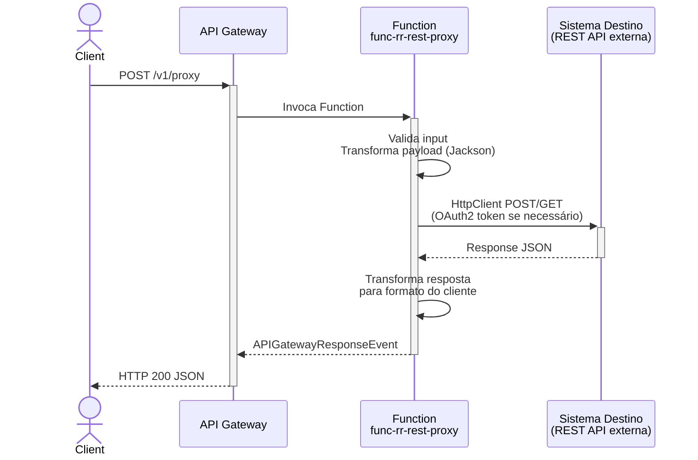
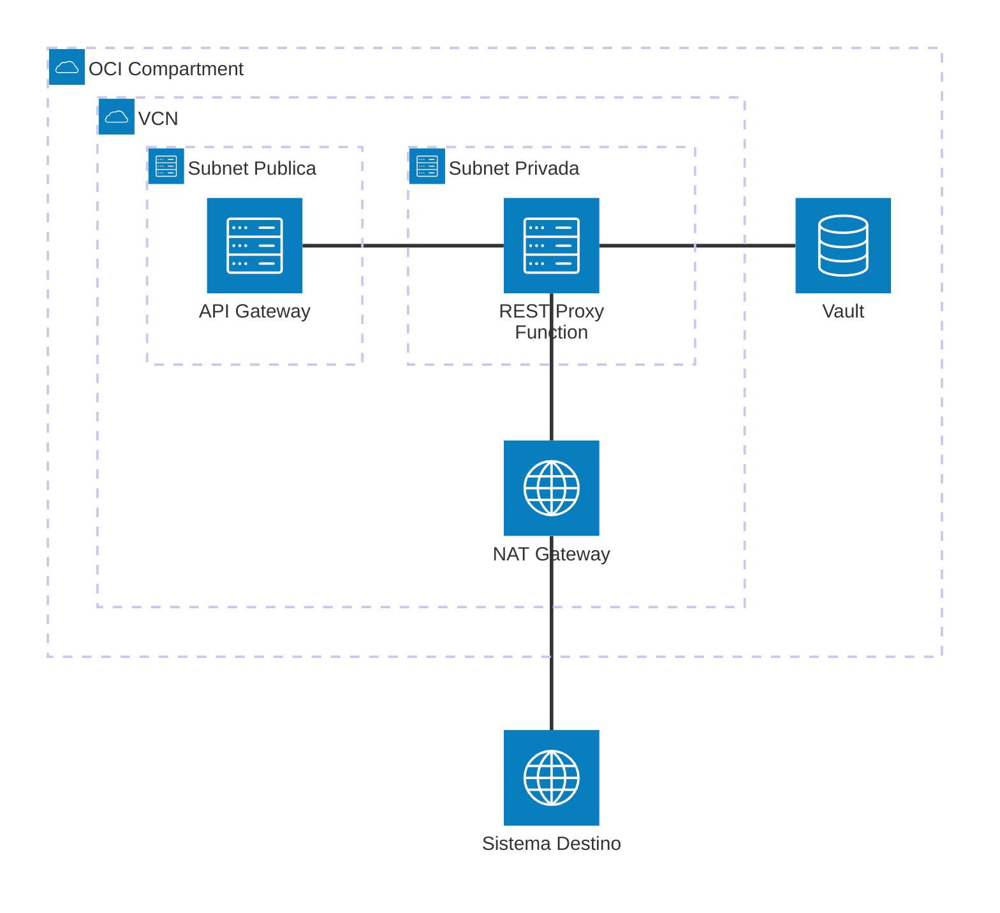

# Padrão 01a — Request-Reply: REST Proxy

> **Status**: ✅ Implementável com Functions
> **Fase**: 1 — Fundações
> **Tipo**: Síncrono
> **Variante**: REST API externa (proxy com transformação)
> **Projeto Java**: `services/func-rr-rest-proxy/`
> **Família**: Request-Reply — ver também [01b (Database)](01b-request-reply-database.md) e [01c (Event Publish)](01c-request-reply-event-publish.md)

## 1. Visão Geral

### Descrição Original
O cliente envia uma petição e espera bloqueado até receber a resposta. É o padrão mais simples e comum em integrações REST/SOAP. Componentes originais: OCI API Gateway → OIC (transformação/mapeo) → Sistema Destino.

### Adaptação OIC → Functions
OIC é substituído por uma **OCI Function** que faz transformação programática (Jackson) e invoca o sistema destino via **HttpClient Java 17** com retry e timeout.

| Componente Original | Implementação com Functions |
|---|---|
| OCI API Gateway (ponto de entrada) | ✅ Sem mudança |
| OIC (orquestação/transformação) | 🔄 `RestProxyFunction` — recebe request, transforma payload, invoca backend REST |
| Sistema Destino (ERP/SaaS) | ✅ Invocado via `HttpClient` Java 17 com OAuth2 Client Credentials |

### Impacto da Substituição
- **Perda**: Mapeo visual de dados (XSLT gráfico), adaptadores SaaS pré-construídos, replay de instâncias
- **Ganho**: Controle total no código, pay-per-use, testabilidade com mocks

### Diagrama de Arquitetura



### Diagrama de Recursos (Terraform)



> **Módulos Terraform necessários:**
>
> | Módulo | Recursos |
> |---|---|
> | **network** | VCN, NAT Gateway (saída internet), Service Gateway, Subnet Pública + Privada, NSGs |
> | **iam** | Dynamic Group Functions, Policy: `read secret-bundles`, `use virtual-network-family` |
> | **functions** | Application + Function `func-rr-rest-proxy` (256MB, 60s) |
> | **api-gateway** | Gateway + Deployment (rota `POST /proxy`) |
> | **observability** | Log Group, Service Logs, Alarms |
> | *existente* | **Vault** (secrets para OAuth2 Client ID/Secret) |

## 2. Projeto Java

### Novo projeto `services/func-rr-rest-proxy/`

- **Diretório**: `services/func-rr-rest-proxy/`
- **Package**: `com.brx.functions.rr.restproxy`
- **Handler**: `RestProxyFunction extends APIGatewayFunction<RestProxyRequest, RestProxyResponse>`
- **func.yaml name**: `func-rr-rest-proxy`

### Estrutura

```
services/func-rr-rest-proxy/
├── pom.xml
├── func.yaml
├── Dockerfile
└── src/
    ├── main/java/com/brx/functions/rr/restproxy/
    │   ├── RestProxyFunction.java           # Handler principal — valida, transforma, invoca
    │   ├── model/
    │   │   ├── RestProxyRequest.java        # DTO entrada (target_url, target_method, body)
    │   │   └── RestProxyResponse.java       # DTO saída (status_code, body, elapsed_ms)
    │   ├── service/
    │   │   └── OciSecretService.java        # Leitura de secrets do Vault (para OAuth2)
    │   └── client/
    │       └── RestProxyClient.java         # HttpClient wrapper com retry + OAuth2
    └── test/java/com/brx/functions/rr/restproxy/
        ├── RestProxyFunctionTest.java
        └── client/
            └── RestProxyClientTest.java
```

### Dependências OCI SDK
- `oci-java-sdk-common` (auth Resource Principal)
- `oci-java-sdk-secrets` (leitura de secrets do Vault para OAuth2 credentials)

### func.yaml

```yaml
schema_version: 20180708
name: func-rr-rest-proxy
version: 0.0.1
runtime: java
build_image: fnproject/fn-java-fdk-build:jdk17-latest
run_image: fnproject/fn-java-fdk:jre17-latest
cmd: com.brx.functions.rr.restproxy.RestProxyFunction::handler
memory: 256
timeout: 60
config:
  ENVIRONMENT: dev
  PROXY_TARGET_BASE_URL: https://api.example.com
  PROXY_TIMEOUT_MS: "10000"
  PROXY_OAUTH_TOKEN_URL: https://idcs.example.com/oauth2/v1/token
  PROXY_OAUTH_CLIENT_ID_OCID: ocid1.vaultsecret.oc1...
  PROXY_OAUTH_CLIENT_SECRET_OCID: ocid1.vaultsecret.oc1...
```

## 3. Requisitos de Infraestrutura

### Terraform — Módulos Existentes (sem mudança)

| Módulo | Configuração |
|--------|-------------|
| `api-gateway` | Adicionar rota `{ path = "/proxy", methods = ["POST"] }` ao `api_routes` |
| `functions` | Nova Function resource `func-rr-rest-proxy` (256MB, 60s) |
| `iam` | Sem mudança (Dynamic Group já cobre novas Functions no compartment) |
| `network` | Sem mudança (NAT GW já permite saída para internet) |
| `observability` | Sem mudança (logs e alarms já coletam da Function) |

### Terraform — Novos Recursos

Nova Function resource (mesmo padrão do módulo `functions` existente):

```hcl
module "fn_rr_rest_proxy" {
  source           = "./modules/functions"
  compartment_ocid = var.compartment_ocid
  subnet_id        = module.network.subnet_private_id
  nsg_ids          = [module.network.nsg_functions_id]
  application_name = "app-integration-patterns"
  function_name    = "func-rr-rest-proxy"
  function_image   = "gru.ocir.io/${var.ocir_namespace}/patterns/func-rr-rest-proxy:0.0.1"
  function_config = {
    PROXY_TARGET_BASE_URL          = "https://api.example.com"
    PROXY_TIMEOUT_MS               = "10000"
    PROXY_OAUTH_TOKEN_URL          = "https://idcs.example.com/oauth2/v1/token"
    PROXY_OAUTH_CLIENT_ID_OCID     = "ocid1.vaultsecret.oc1..."
    PROXY_OAUTH_CLIENT_SECRET_OCID = "ocid1.vaultsecret.oc1..."
  }
}
```

### Terraform — Mudanças de Variáveis

```hcl
# infra/env-dev/main.tf — adicionar à lista de rotas
api_routes = [
  { path = "/hello", methods = ["GET", "POST"] },
  { path = "/proxy", methods = ["POST"] },          # NOVO
]
```

### IAM
Nenhuma policy adicional. A Function já tem acesso a:
- Vault secrets (Dynamic Group `dg-functions-*` com policy `read secret-bundles`)
- NAT Gateway (para chamadas externas à internet)

## 4. Requisitos de Codificação Java

### Handler — `RestProxyFunction.java`

| Aspecto | Especificação |
|---------|--------------|
| Base class | `APIGatewayFunction<RestProxyRequest, RestProxyResponse>` (fn-events) |
| `@FnConfiguration` | Lê config vars, inicializa `OciSecretService` + `RestProxyClient` |
| Routing | Sem switch — handler único recebe request e faz proxy |
| Fluxo | Valida input → transforma payload → invoca backend → transforma resposta |

Método `handler()`:
- Valida que `target_url` e `target_method` estão presentes no body
- Instancia `RestProxyClient` (lazy, reutiliza em hot function)
- Invoca backend via `RestProxyClient.execute(request)`
- Retorna `RestProxyResponse` com status code e body do backend

### Client — `RestProxyClient.java` (novo)

| Aspecto | Especificação |
|---------|--------------|
| HttpClient | `java.net.http.HttpClient` singleton (thread-safe, reutilizável em hot function) |
| Timeout | Configurável via `PROXY_TIMEOUT_MS` (default: 10000ms) |
| Retry | 2 retries com backoff exponencial (1s, 2s) para erros 5xx e timeouts |
| OAuth2 | Client Credentials flow — token cacheado até expirar (campo `expires_in`) |
| Credentials | Client ID e Secret lidos do Vault via `OciSecretService.getSecret()` na inicialização |
| Content-Type | `application/json` |

### Modelos (DTOs)

**`RestProxyRequest.java`**:
- `target_url`: String (URL completa do backend)
- `target_method`: String (GET, POST, PUT, DELETE)
- `headers`: Map<String, String> (headers adicionais opcionais)
- `body`: Object (payload a enviar ao backend, null para GET)

**`RestProxyResponse.java`**:
- `status_code`: int (HTTP status do backend)
- `headers`: Map<String, String>
- `body`: Object (response do backend como JSON genérico)
- `elapsed_ms`: long (tempo de execução)

### Tratamento de Erros

| Cenário | Resposta |
|---------|---------|
| Input inválido (sem target_url) | 400 Bad Request |
| Backend timeout | 504 Gateway Timeout |
| Backend retorna 4xx | Propaga status code do backend |
| Backend retorna 5xx (após retries) | 502 Bad Gateway |
| Erro de rede / DNS | 502 Bad Gateway |
| OAuth2 token refresh falha | 503 Service Unavailable |

## 5. Sequência de Prompts

### Prompt 0 — Auditoria de Infraestrutura

> **Obrigatório**: Executar ANTES de qualquer implementação.

Verificar se todos os módulos Terraform necessários existem em `infra/` para implementar este padrão.

**Módulos necessários**:
- `modules/network/` — VCN, subnets, gateways, NSGs
- `modules/iam/` — Dynamic Groups, Policies (functions, api-gateway)
- `modules/functions/` — Application + Function resource
- `modules/api-gateway/` — Gateway + Deployment com rota
- `modules/vault/` — **Vault + Secrets** (OAuth2 credentials, target API keys)
- `modules/observability/` — Log Group, Alarms, ONS

**Prompt file**: `@prompts/audit-infra-prerequisites`

<details>
<summary>Fallback — prompt free-text</summary>

```
Usar @oci-terraform para auditar infra/:
1. Verificar existência de cada módulo listado em infra/modules/
2. Para módulos existentes, verificar capabilities (ex: api-gateway suporta rota POST /proxy?)
3. Para módulos FALTANTES, criar seguindo skills provisioning-oci-{service}
4. Confirmar que IAM policies cobrem novos recursos (ex: read secret-bundles para vault)
5. Reportar gaps e ações corretivas

Seguir especificação docs/patterns/01-request-reply/01a-request-reply-rest-proxy.md seção 3.
```
</details>

### Prompt 1 — Terraform (Function + rota no API Gateway)

**Prompt file (primário)**: `@prompts/add-serverless-stack` com argumentos:
- Function name: `func-rr-rest-proxy`
- API route: `POST /proxy`
- Auth type: JWT (ou conforme ambiente)
- Memory: 256MB, Timeout: 60s
- function_config: `PROXY_TARGET_BASE_URL`, `PROXY_TIMEOUT_MS`, `PROXY_OAUTH_*`

**Alternativa granular**: `@prompts/add-functions-infra` + `@prompts/add-api-gateway` separadamente.

<details>
<summary>Fallback — prompt free-text</summary>

```
Usar o agente @oci-terraform para provisionar func-rr-rest-proxy:
- Nova Function resource (256MB, 60s) com function_config para proxy settings
- Adicionar rota { path = "/proxy", methods = ["POST"] } no API Gateway
  apontando para a nova Function func-rr-rest-proxy
Seguir especificação docs/patterns/01a-request-reply-rest-proxy.md seção 3.
```
</details>

### Prompt 2 — Java (projeto + RestProxyClient)

**Prompt file (primário)**: `@prompts/add-oci-function` para scaffold do projeto, seguido de `@prompts/add-rest-client` com argumentos:
- Target API: URL configurável via `PROXY_TARGET_BASE_URL`
- Auth method: OAuth2 Client Credentials
- Existing function class: `RestProxyFunction`
- HTTP methods: GET, POST, PUT, DELETE
- Secret management: OCI Vault (`PROXY_OAUTH_CLIENT_ID_OCID`, `PROXY_OAUTH_CLIENT_SECRET_OCID`)

<details>
<summary>Fallback — prompt free-text</summary>

```
Usar o agente @oci-functions-java para criar projeto func-rr-rest-proxy
em services/ seguindo a especificação docs/patterns/01a-request-reply-rest-proxy.md.
Criar RestProxyClient.java com HttpClient Java 17 singleton,
retry (2 tentativas, backoff exponencial),
timeout configurável, e suporte a OAuth2 Client Credentials com token cache.
Criar OciSecretService.java para leitura de credentials do Vault.
Usar skill invoking-rest-apis-from-oci-functions e
instruções java-functions-external-apis.instructions.md.
```
</details>

### Prompt 3 — Java (DTOs + Handler)

**Prompt file (primário)**: `@prompts/add-event-handler` com argumentos:
- Event source: API Gateway
- Existing function class: `RestProxyFunction`
- Request type: `RestProxyRequest`
- Response type: `RestProxyResponse`

<details>
<summary>Fallback — prompt free-text</summary>

```
Criar RestProxyRequest.java e RestProxyResponse.java em model/,
e RestProxyFunction.java (APIGatewayFunction) que:
1. Valida input (target_url obrigatório)
2. Invoca backend via RestProxyClient.execute()
3. Retorna RestProxyResponse com status code e body do backend
Seguir especificação docs/patterns/01a-request-reply-rest-proxy.md seção 4.
```
</details>

### Prompt 4 — Testes

> Não há prompt file específico para testes. Usar free-text com referência à instrução de testes.

```
Criar testes unitários para:
1. RestProxyClientTest — mock de HttpClient, cenários de sucesso, retry em 5xx, timeout
2. RestProxyFunctionTest — request válido/inválido, backend timeout, backend 5xx
Usar FnTestingRule + Mockito seguindo instruções java-functions-testing.instructions.md.
```

### Prompt 5 — Config e Observabilidade

**Prompt file (primário)**: `@prompts/add-serverless-stack` já cobre configuração e integração.

<details>
<summary>Fallback — prompt free-text</summary>

```
Verificar func.yaml do func-rr-rest-proxy com config keys:
PROXY_TARGET_BASE_URL, PROXY_TIMEOUT_MS, PROXY_OAUTH_TOKEN_URL,
PROXY_OAUTH_CLIENT_ID_OCID, PROXY_OAUTH_CLIENT_SECRET_OCID.
Configurar observability (logs + alarms) para a nova Function.
```
</details>

## 6. Critérios de Verificação

### Testes que Devem Passar

| Teste | Cenário | Resultado |
|-------|---------|----------|
| `testProxyRouteSuccess` | POST /proxy com target_url válido | 200 + response do backend |
| `testProxyRouteMissingUrl` | POST /proxy sem target_url | 400 "target_url is required" |
| `testProxyRouteBackendTimeout` | Backend não responde | 504 Gateway Timeout |
| `testProxyRouteBackend5xx` | Backend retorna 500 (após retries) | 502 Bad Gateway |
| `testProxyRouteWrongMethod` | GET /proxy | 405 "Method not allowed" |
| `testRestProxyClientRetry` | 1ª chamada 500, 2ª chamada 200 | Retry funciona |
| `testRestProxyClientOAuth` | Token cache válido / expirado | Reutiliza / renova token |

### Comandos de Validação

```bash
cd services/func-rr-rest-proxy && mvn clean package
cd infra/env-dev && terraform plan
```

### Comportamento Esperado
1. Client envia POST /v1/proxy com `{ "target_url": "https://...", "target_method": "GET" }`
2. API Gateway roteia para Function func-rr-rest-proxy
3. Function valida input, obtém OAuth2 token (se configurado) do Vault
4. Function invoca backend com HttpClient, aplica retry se 5xx
5. Function transforma resposta e retorna ao client com status code original do backend
