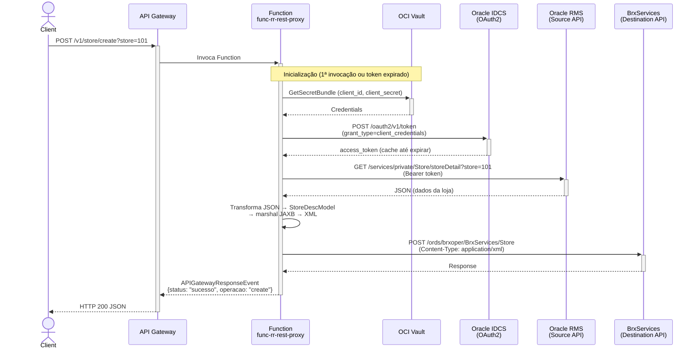
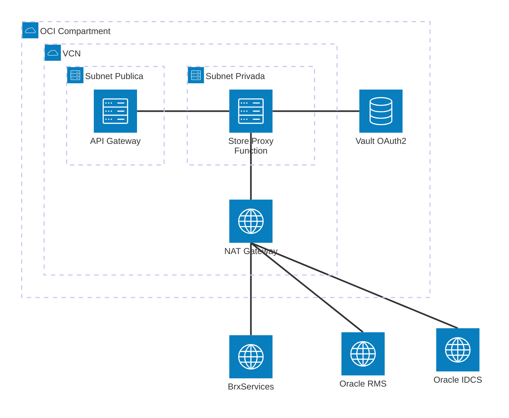

# Padrão 01a — Request-Reply: REST Proxy (Integração Store)

> **Status**: ✅ Implementado e deployed (v0.0.11, 2026-05-19)
>
> **Fase**: 1 — Fundações
>
> **Tipo**: Síncrono
>
> **Variante**: REST Proxy com transformação JSON→XML (integração Store RMS → BrxServices)
>
> **Projeto Java**: `services/func-rr-rest-proxy/`
>
> **Referência Original**: Apache Camel/Quarkus — `StoreRoute.java` (ver [`reference/rest-proxy/`](reference/rest-proxy/))
>
> **Família**: Request-Reply — ver também [01b (Database)](01b-request-reply-database.md) e [01c (Event Publish)](01c-request-reply-event-publish.md)

## 1. Visão Geral

### Descrição Original
Integração de lojas entre **Oracle RMS** (Retail Merchandising System) e **BrxServices**. O fluxo recebe um pedido de criação ou atualização de loja, busca os dados no RMS via REST (JSON), transforma para XML (JAXB) e envia ao BrxServices.

A implementação original usa **Apache Camel 3.15** com **Quarkus** (ver [`reference/rest-proxy/StoreRoute.java`](reference/rest-proxy/StoreRoute.java)), com as seguintes rotas:

| Rota Camel | Descrição |
|---|---|
| `POST /store/create` | Dispara criação de loja: OAuth2 → GET RMS → JSON→XML → POST BrxServices |
| `POST /store/update` | Dispara atualização de loja: OAuth2 → GET RMS → JSON→XML → PUT BrxServices |
| `direct:storeOAuth2Token` | Obtém access token via Client Credentials (Oracle IDCS) |
| `direct:storeGetFromSource` | GET `/services/private/Store/storeDetail?store={id}` no RMS |
| `direct:storeTransformToXml` | `.process()` mapeia JSON → `StoreDescModel` → `.marshal(jaxb)` para XML |
| `direct:storeSendToDestination` | POST (create) ou PUT (update) XML no BrxServices |

### Adaptação Camel → OCI Functions

O Apache Camel/Quarkus é substituído por uma **OCI Function** que reproduz o mesmo fluxo de forma programática com **HttpClient Java 17**, **JAXB** e **OCI Vault** para secrets.

| Componente Camel | Implementação com OCI Functions |
|---|---|
| `RouteBuilder.rest()` DSL (trigger) | 🔄 **API Gateway** rotas `POST /store/create` e `POST /store/update` → Function |
| `direct:storeOAuth2Token` (HttpClient + Basic Auth) | 🔄 `RmsClient` — método interno com token cache em memória (hot function) |
| `direct:storeGetFromSource` (`.toD()` HTTP GET) | 🔄 `RmsClient.getStoreDetail(storeId)` via `HttpClient` com Bearer token |
| `direct:storeTransformToXml` (`.process()` + `.marshal(jaxb)`) | 🔄 `StoreDescModel` JAXB — mapeamento campo a campo no handler |
| `direct:storeSendToDestination` (`.toD()` HTTP POST/PUT) | 🔄 `BrxServicesClient.send(xml, httpMethod)` via `HttpClient` |
| `@ConfigProperty` (Quarkus config) | 🔄 `RuntimeContext.getConfiguration()` via `@FnConfiguration` |
| `onException(HttpOperationFailedException)` | 🔄 Try-catch no handler → `APIGatewayResponseEvent` com status code de erro |
| OAuth2 credentials em `application.properties` | 🔄 **OCI Vault** secrets, lidos via `OciSecretService` (Resource Principal) |

### Impacto da Substituição
- **Perda**: DSL declarativa de rotas, hot-reload Quarkus, Camel error handler automático, JAXB data format integrado
- **Ganho**: Pay-per-use serverless, credentials em Vault (não em properties), controle total no código, testabilidade com mocks, zero infra para gerenciar

### Diagrama de Arquitetura



### Diagrama de Recursos (Terraform)



> **Módulos Terraform necessários:**
>
> | Módulo | Recursos |
> |---|---|
> | **network** | VCN, NAT Gateway (saída internet para IDCS, RMS e BrxServices), Service Gateway, Subnet Pública + Privada, NSGs |
> | **iam** | Dynamic Group Functions, Policy: `read secret-bundles`, `use virtual-network-family` |
> | **functions** | Application + Function `func-rr-rest-proxy` (256MB, 60s) |
> | **api-gateway** | Gateway + Deployment (rotas `POST /store/create` e `POST /store/update`) |
> | **observability** | Log Group, Service Logs, Alarms |
> | *existente* | **Vault** (secrets para OAuth2 Client ID/Secret do Oracle IDCS) |

## 2. Projeto Java

### Novo projeto `services/func-rr-rest-proxy/`

- **Diretório**: `services/func-rr-rest-proxy/`
- **Package**: `com.brx.functions.rr.restproxy`
- **Handler**: `RestProxyFunction extends APIGatewayFunction<StoreRequest, StoreResponse>`
- **func.yaml name**: `func-rr-rest-proxy`

### Estrutura

```
services/func-rr-rest-proxy/
├── pom.xml
├── func.yaml
├── Dockerfile
└── src/
    ├── main/java/com/brx/functions/rr/restproxy/
    │   ├── RestProxyFunction.java           # Handler — routing por path, orquestra o fluxo
    │   ├── model/
    │   │   ├── StoreRequest.java            # DTO entrada (store_id, operação implícita no path)
    │   │   ├── StoreResponse.java           # DTO saída (status, operacao, store_id, elapsed_ms)
    │   │   └── StoreDescModel.java          # Modelo JAXB (@XmlRootElement) — XML para BrxServices
    │   ├── service/
    │   │   └── OciSecretService.java        # Leitura de secrets do Vault (OAuth2 credentials)
    │   └── client/
    │       ├── RmsClient.java               # HttpClient → GET RMS storeDetail (JSON) com OAuth2
    │       └── BrxServicesClient.java        # HttpClient → POST/PUT XML para BrxServices
    └── test/java/com/brx/functions/rr/restproxy/
        ├── RestProxyFunctionTest.java
        └── client/
            ├── RmsClientTest.java
            └── BrxServicesClientTest.java
```

### Mapeamento de Responsabilidades: Camel → Function

| Arquivo Camel | Equivalente na Function | Responsabilidade |
|---|---|---|
| `StoreRoute.configure()` → `rest("/store")` | `RestProxyFunction.handler()` | Routing por path (create vs update) |
| `direct:storeOAuth2Token` | `RmsClient.getAccessToken()` | OAuth2 Client Credentials com cache |
| `direct:storeGetFromSource` | `RmsClient.getStoreDetail(storeId)` | GET JSON do RMS |
| `direct:storeTransformToXml` (`.process()` + `.marshal(jaxb)`) | `RestProxyFunction` — mapeamento JSON → `StoreDescModel` + JAXB marshal | Transformação JSON→XML |
| `direct:storeSendToDestination` | `BrxServicesClient.send(xml, httpMethod)` | POST/PUT XML no BrxServices |
| `onException(HttpOperationFailedException)` | Try-catch no handler | Tratamento de erros HTTP |
| `onException(Exception)` | Catch genérico no handler | Tratamento de erros inesperados |

### Dependências

- `oci-java-sdk-common` (auth Resource Principal)
- `oci-java-sdk-secrets` (leitura de secrets do Vault para OAuth2 credentials)
- `jakarta.xml.bind:jakarta.xml.bind-api:4.0.2` (JAXB API)
- `org.glassfish.jaxb:jaxb-runtime:4.0.5` (JAXB implementação — marshal `StoreDescModel` → XML)

### func.yaml

```yaml
schema_version: 20180708
name: func-rr-rest-proxy
version: 0.0.1
runtime: java
build_image: fnproject/fn-java-fdk-build:jdk17-latest
run_image: fnproject/fn-java-fdk:jre17-latest
cmd: com.brx.functions.rr.restproxy.RestProxyFunction::handler
memory: 256
timeout: 60
config:
  ENVIRONMENT: dev
  STORE_SOURCE_BASE_URL: https://rex-npe.retail.sa-vinhedo-1.ocs.oraclecloud.com/rgbu-rex-brxs-par1-mfcs/RmsReSTServices
  STORE_DESTINATION_BASE_URL: http://129.148.63.45:8080/ords/brxoper/BrxServices/Store
  STORE_TIMEOUT_MS: "10000"
  STORE_OAUTH_TOKEN_URL: https://idcs-a23fd2fe5f18408c865bfc16a04cddb8.identity.oraclecloud.com/oauth2/v1/token
  STORE_OAUTH_SCOPE: rgbu:merch:MFCS-PAR1
  STORE_OAUTH_CLIENT_ID_OCID: ocid1.vaultsecret.oc1...
  STORE_OAUTH_CLIENT_SECRET_OCID: ocid1.vaultsecret.oc1...
```

> **Referência de configuração Camel** (`application.properties`):
>
> | Property Camel | Config Key Function | Descrição |
> |---|---|---|
> | `store.source.base-url` | `STORE_SOURCE_BASE_URL` | URL base do Oracle RMS |
> | `store.destination.base-url` | `STORE_DESTINATION_BASE_URL` | URL base do BrxServices |
> | `store.oauth2.token-url` | `STORE_OAUTH_TOKEN_URL` | Endpoint OAuth2 (Oracle IDCS) |
> | `store.oauth2.scope` | `STORE_OAUTH_SCOPE` | Scope do token OAuth2 |
> | `store.oauth2.client-id` | `STORE_OAUTH_CLIENT_ID_OCID` | ⚠️ No Camel: plaintext. Na Function: **OCID do secret no Vault** |
> | `store.oauth2.client-secret` | `STORE_OAUTH_CLIENT_SECRET_OCID` | ⚠️ No Camel: plaintext. Na Function: **OCID do secret no Vault** |

## 3. Requisitos de Infraestrutura

### Terraform — Módulos Existentes (sem mudança)

| Módulo | Configuração |
|--------|-------------|
| `api-gateway` | Adicionar rotas `{ path = "/store/create", methods = ["POST"] }` e `{ path = "/store/update", methods = ["POST"] }` ao `api_routes` |
| `functions` | Nova Function resource `func-rr-rest-proxy` (256MB, 60s) |
| `iam` | Sem mudança (Dynamic Group já cobre novas Functions no compartment) |
| `network` | Sem mudança (NAT GW já permite saída para internet — IDCS, RMS, BrxServices) |
| `observability` | Sem mudança (logs e alarms já coletam da Function) |

### Terraform — Novos Recursos

Nova Function resource (mesmo padrão do módulo `functions` existente):

```hcl
module "fn_rr_rest_proxy" {
  source           = "./modules/functions"
  compartment_ocid = var.compartment_ocid
  subnet_id        = module.network.subnet_private_id
  nsg_ids          = [module.network.nsg_functions_id]
  application_name = "app-integration-patterns"
  function_name    = "func-rr-rest-proxy"
  function_image   = "gru.ocir.io/${var.ocir_namespace}/patterns/func-rr-rest-proxy:0.0.1"
  function_config = {
    STORE_SOURCE_BASE_URL          = "https://rex-npe.retail.sa-vinhedo-1.ocs.oraclecloud.com/rgbu-rex-brxs-par1-mfcs/RmsReSTServices"
    STORE_DESTINATION_BASE_URL     = "http://129.148.63.45:8080/ords/brxoper/BrxServices/Store"
    STORE_TIMEOUT_MS               = "10000"
    STORE_OAUTH_TOKEN_URL          = "https://idcs-a23fd2fe5f18408c865bfc16a04cddb8.identity.oraclecloud.com/oauth2/v1/token"
    STORE_OAUTH_SCOPE              = "rgbu:merch:MFCS-PAR1"
    STORE_OAUTH_CLIENT_ID_OCID     = "ocid1.vaultsecret.oc1..."
    STORE_OAUTH_CLIENT_SECRET_OCID = "ocid1.vaultsecret.oc1..."
  }
}
```

### Terraform — Mudanças de Variáveis

```hcl
# infra/env-dev/main.tf — adicionar às rotas do API Gateway
api_routes = [
  { path = "/hello",        methods = ["GET", "POST"] },
  { path = "/store/create", methods = ["POST"] },          # NOVO — create store
  { path = "/store/update", methods = ["POST"] },          # NOVO — update store
]
```

### IAM
Nenhuma policy adicional. A Function já tem acesso a:
- Vault secrets (Dynamic Group `dg-functions-*` com policy `read secret-bundles`)
- NAT Gateway (para chamadas externas: Oracle IDCS, RMS e BrxServices)

## 4. Requisitos de Codificação Java

### Handler — `RestProxyFunction.java`

| Aspecto | Especificação |
|---------|--------------|
| Base class | `APIGatewayFunction<StoreRequest, StoreResponse>` (fn-events) |
| `@FnConfiguration` | Lê config vars (`STORE_*`), inicializa `OciSecretService` + `RmsClient` + `BrxServicesClient` |
| Routing | Switch no path do API Gateway: `/store/create` → POST, `/store/update` → PUT |
| Fluxo | Valida store_id → OAuth2 token → GET RMS → Transform JSON→XML → POST/PUT BrxServices |

Método `handler()` — reproduz o fluxo do `StoreRoute.configure()`:

```
1. Extrai store_id do query param (equivale a header("store") no Camel)
2. Determina operação pelo path: /store/create → POST, /store/update → PUT
   (equivale a exchangeProperty("httpMethodDestination") no Camel)
3. Invoca RmsClient.getStoreDetail(storeId)
   (equivale a direct:storeGetFromSource → direct:storeOAuth2Token)
4. Mapeia JSON → StoreDescModel → marshal JAXB → XML String
   (equivale a direct:storeTransformToXml com .process() + .marshal(jaxb))
5. Invoca BrxServicesClient.send(xml, httpMethod)
   (equivale a direct:storeSendToDestination com .toD())
6. Retorna StoreResponse {status: "sucesso", operacao: "create|update", store_id: "101"}
   (equivale ao setBody(simple(...)) final de cada rota)
```

### Client — `RmsClient.java` (equivale a `direct:storeOAuth2Token` + `direct:storeGetFromSource`)

| Aspecto | Especificação |
|---------|--------------|
| HttpClient | `java.net.http.HttpClient` singleton (thread-safe, reutilizável em hot function) |
| Timeout | Configurável via `STORE_TIMEOUT_MS` (default: 10000ms) |
| OAuth2 | Client Credentials flow — token cacheado até expirar (campo `expires_in`) |
| Token request | POST `STORE_OAUTH_TOKEN_URL` com `grant_type=client_credentials&scope={scope}`, Basic Auth com client_id:client_secret |
| Credentials | Client ID e Secret lidos do Vault via `OciSecretService.getSecret()` na inicialização |
| GET Store | GET `{STORE_SOURCE_BASE_URL}/services/private/Store/storeDetail?store={id}` com `Authorization: Bearer {token}` |
| Response | JSON unmarshalled para `Map<String, Object>` (mesmo formato que o Camel recebe) |
| Retry | 2 retries com backoff exponencial (1s, 2s) para erros 5xx e timeouts |

> **Equivalência Camel**: No `StoreRoute`, o token é obtido em `direct:storeOAuth2Token` com `.setBody(simple("grant_type=client_credentials&scope=..."))` e autenticação Basic Auth via parâmetros do `.toD()`. Na Function, essa lógica fica encapsulada em `RmsClient.getAccessToken()`.

### Client — `BrxServicesClient.java` (equivale a `direct:storeSendToDestination`)

| Aspecto | Especificação |
|---------|--------------|
| HttpClient | Compartilha o singleton de `java.net.http.HttpClient` |
| Timeout | Configurável via `STORE_TIMEOUT_MS` |
| Método HTTP | POST (create) ou PUT (update) — determinado pelo handler |
| Content-Type | `application/xml` |
| URL | `STORE_DESTINATION_BASE_URL` (ex: `http://129.148.63.45:8080/ords/brxoper/BrxServices/Store`) |
| Retry | 2 retries com backoff exponencial para 5xx |

### Modelo JAXB — `StoreDescModel.java` (equivale ao `.process()` em `direct:storeTransformToXml`)

Classe anotada com `@XmlRootElement(name = "StoreDesc")`, reproduzindo o mapeamento campo a campo do `StoreRoute.java` (linhas 162-196):

| Campo JAXB (`@XmlElement`) | Campo JSON (RMS) | Tipo | Notas |
|---|---|---|---|
| `store` | `store` | `Integer` | ID da loja |
| `storeType` | `storeType` | `String` | |
| `storeName` | `storeName` | `String` | |
| `storeName10` | `storeName10` | `String` | |
| `storeName3` | `storeName3` | `String` | |
| `storeAdd1` | `add1` | `String` | ⚠️ Nome diferente |
| `storeAdd2` | `add2` | `String` | ⚠️ Nome diferente |
| `storeCity` | `city` | `String` | ⚠️ Nome diferente |
| `state` | `state` | `String` | |
| `countryId` | `countryId` | `String` | |
| `storePcode` | `post` | `String` | ⚠️ Nome diferente |
| `storeClass` | `storeClass` | `String` | |
| `storeMgrName` | `store` | `String` | ⚠️ Usa campo `store` (ver código Camel) |
| `storeOpenDate` | `storeOpenDate` | `Date` | Formato `yyyy-MM-dd`, parse com `SimpleDateFormat` |
| `phoneNumber` | `contactPhone` | `String` | ⚠️ Nome diferente |
| `stockholdingInd` | `stockholdingInd` | `String` | |
| `channelId` | `channelId` | `Integer` | |
| `district` | `district` | `Integer` | |
| `transferZone` | `transferZone` | `Integer` | |
| `defaultWh` | `defaultWh` | `Integer` | |
| `startOrderDays` | `startOrderDays` | `Integer` | |
| `currencyCode` | `currencyCode` | `String` | |
| `lang` | `lang` | `Integer` | |
| `timezoneName` | `timezoneName` | `String` | |
| `origCurrencyCode` | `currencyCode` | `String` | ⚠️ Default: mesmo valor de `currencyCode` |

> **Nota**: O mapeamento acima replica exatamente a lógica do método `.process()` no Camel. Campos marcados com ⚠️ têm nomes diferentes entre JSON (RMS) e XML (StoreDesc).

### Modelos (DTOs)

**`StoreRequest.java`**:
- `store_id`: String (ID da loja, extraído do query param `?store=`)

**`StoreResponse.java`**:
- `status`: String (`"sucesso"` ou `"erro"`)
- `operacao`: String (`"create"` ou `"update"`)
- `store_id`: String
- `elapsed_ms`: long (tempo total de execução)
- `erro`: String (mensagem de erro, null em caso de sucesso)
- `detalhe`: String (detalhe do erro, null em caso de sucesso)

> **Equivalência Camel**: No `StoreRoute`, o response de sucesso é `{status: "sucesso", operacao: "create", store: "101"}` (via `simple()`). O response de erro é `{erro: "...", detalhe: "..."}` (via `onException`).

### Tratamento de Erros

Reproduz os `onException` do `StoreRoute.java`:

| Cenário | Camel (`onException`) | Function (try-catch) | Resposta |
|---------|----------------------|---------------------|---------|
| Input inválido (sem store_id) | N/A (Camel recebe do query param) | Validação no handler | 400 `{"erro": "store_id is required"}` |
| RMS timeout | `HttpOperationFailedException` | `HttpTimeoutException` no `RmsClient` | 504 Gateway Timeout |
| RMS retorna 4xx | `HttpOperationFailedException` (statusCode) | Status check no `RmsClient` | 502 `{"erro": "Falha na chamada HTTP: {statusCode}"}` |
| RMS retorna 5xx (após retries) | `HttpOperationFailedException` (statusCode) | Retry esgotado no `RmsClient` | 502 `{"erro": "Falha na chamada HTTP: {statusCode}", "detalhe": "{responseBody}"}` |
| BrxServices timeout | `HttpOperationFailedException` | `HttpTimeoutException` no `BrxServicesClient` | 504 Gateway Timeout |
| BrxServices retorna 5xx (após retries) | `HttpOperationFailedException` | Retry esgotado no `BrxServicesClient` | 502 Bad Gateway |
| OAuth2 token refresh falha | `HttpOperationFailedException` | Erro no `RmsClient.getAccessToken()` | 503 Service Unavailable |
| Erro inesperado | `onException(Exception.class)` | Catch genérico | 500 `{"erro": "{exception.message}"}` |

## 5. Sequência de Prompts

### Prompt 0 — Auditoria de Infraestrutura

> **Obrigatório**: Executar ANTES de qualquer implementação.
> Consultar a **Seção 3** deste documento para a auditoria completa com gap analysis detalhado.

Verificar se todos os módulos Terraform necessários existem em `infra/` para implementar este padrão.

**Módulos necessários**:
- `modules/network/` — VCN, subnets, gateways, NSGs
- `modules/iam/` — Dynamic Groups, Policies (functions, api-gateway, vault)
- `modules/functions/` — Application + Function resource (func-rr-rest-proxy)
- `modules/api-gateway/` — Gateway + Deployment com **multi-function routing** (2 rotas: `/store/create`, `/store/update`)
- `modules/vault/` — **Vault + Secrets** (OAuth2 IDCS credentials, API keys)
- `modules/observability/` — Log Group, Alarms, ONS

**Prompt file**: `@prompts/audit-infra-prerequisites`

<details>
<summary>Fallback — prompt free-text</summary>

```
Usar @oci-terraform para auditar infra/:
1. Verificar existência de cada módulo listado em infra/modules/
2. Para api-gateway: verificar se suporta multi-function routing (2 rotas → mesma Function)
3. Para módulos FALTANTES (vault), criar seguindo skill provisioning-oci-vault
4. Confirmar que IAM policies cobrem: read secret-bundles para OAuth2 credentials
5. Reportar gaps e ações corretivas

Seguir especificação docs/patterns/01-request-reply/01a-request-reply-rest-proxy.md seção 3
(contém gap analysis completo com tabela de auditoria).
```
</details>

### Prompt 1 — Terraform (Function + rotas no API Gateway)

**Prompt file (primário)**: `@prompts/add-serverless-stack` com argumentos:
- Function name: `func-rr-rest-proxy`
- API routes: `POST /store/create` e `POST /store/update`
- Auth type: JWT (ou conforme ambiente)
- Memory: 256MB, Timeout: 60s
- function_config: `STORE_SOURCE_BASE_URL`, `STORE_DESTINATION_BASE_URL`, `STORE_TIMEOUT_MS`, `STORE_OAUTH_*`

**Alternativa granular**: `@prompts/add-functions-infra` + `@prompts/add-api-gateway` separadamente.

<details>
<summary>Fallback — prompt free-text</summary>

```
Usar o agente @oci-terraform para provisionar func-rr-rest-proxy:
- Nova Function resource (256MB, 60s) com function_config para integração Store
  (STORE_SOURCE_BASE_URL, STORE_DESTINATION_BASE_URL, STORE_OAUTH_*)
- Adicionar rotas { path = "/store/create", methods = ["POST"] } e
  { path = "/store/update", methods = ["POST"] } no API Gateway
  apontando para a nova Function func-rr-rest-proxy
Seguir especificação docs/patterns/01a-request-reply-rest-proxy.md seção 3.
```
</details>

### Prompt 2 — Java (projeto + RmsClient + BrxServicesClient)

**Prompt file (primário)**: `@prompts/add-oci-function` para scaffold do projeto, seguido de `@prompts/add-rest-client` com argumentos:
- Target APIs: Oracle RMS (source, JSON) + BrxServices (destination, XML)
- Auth method: OAuth2 Client Credentials (para RMS via Oracle IDCS)
- Existing function class: `RestProxyFunction`
- Secret management: OCI Vault (`STORE_OAUTH_CLIENT_ID_OCID`, `STORE_OAUTH_CLIENT_SECRET_OCID`)

<details>
<summary>Fallback — prompt free-text</summary>

```
Usar o agente @oci-functions-java para criar projeto func-rr-rest-proxy
em services/ seguindo a especificação docs/patterns/01a-request-reply-rest-proxy.md.
Criar:
1. RmsClient.java — HttpClient Java 17 singleton, OAuth2 Client Credentials
   com token cache, GET storeDetail do RMS (JSON).
   Reproduzir lógica de direct:storeOAuth2Token + direct:storeGetFromSource do StoreRoute.java.
2. BrxServicesClient.java — POST/PUT XML para BrxServices.
   Reproduzir lógica de direct:storeSendToDestination do StoreRoute.java.
3. OciSecretService.java — leitura de credentials do Vault (Resource Principal).
Usar skill invoking-rest-apis-from-oci-functions e
instruções java-functions-external-apis.instructions.md.
```
</details>

### Prompt 3 — Java (StoreDescModel JAXB + DTOs + Handler)

**Prompt file (primário)**: `@prompts/add-event-handler` com argumentos:
- Event source: API Gateway
- Existing function class: `RestProxyFunction`
- Request type: `StoreRequest`
- Response type: `StoreResponse`

<details>
<summary>Fallback — prompt free-text</summary>

```
Criar em model/:
1. StoreDescModel.java — classe JAXB (@XmlRootElement) com ~25 campos
   mapeando JSON do RMS → XML do BrxServices.
   Reproduzir o mapeamento campo a campo do .process() no StoreRoute.java (linhas 162-196).
2. StoreRequest.java — DTO entrada (store_id).
3. StoreResponse.java — DTO saída (status, operacao, store_id, elapsed_ms, erro, detalhe).

Criar RestProxyFunction.java (APIGatewayFunction) que:
1. Extrai store_id do query param
2. Determina operação pelo path (/store/create → POST, /store/update → PUT)
3. Invoca RmsClient.getStoreDetail(storeId)
4. Mapeia JSON → StoreDescModel → marshal JAXB → XML
5. Invoca BrxServicesClient.send(xml, httpMethod)
6. Retorna StoreResponse
Seguir especificação docs/patterns/01a-request-reply-rest-proxy.md seção 4.
```
</details>

### Prompt 4 — Testes

> Não há prompt file específico para testes. Usar free-text com referência à instrução de testes.

```
Criar testes unitários para:
1. RmsClientTest — mock de HttpClient, cenários: OAuth2 token success/failure,
   GET storeDetail success/timeout/5xx, token cache reutilização/renovação
2. BrxServicesClientTest — mock de HttpClient, cenários: POST/PUT success/timeout/5xx
3. RestProxyFunctionTest — create success, update success, missing store_id (400),
   RMS timeout (504), BrxServices 5xx (502), OAuth2 failure (503),
   transformação JSON→XML valida campos do StoreDescModel
Usar FnTestingRule + Mockito seguindo instruções java-functions-testing.instructions.md.
```

### Prompt 5 — Config e Observabilidade

**Prompt file (primário)**: `@prompts/add-serverless-stack` já cobre configuração e integração.

<details>
<summary>Fallback — prompt free-text</summary>

```
Verificar func.yaml do func-rr-rest-proxy com config keys:
STORE_SOURCE_BASE_URL, STORE_DESTINATION_BASE_URL, STORE_TIMEOUT_MS,
STORE_OAUTH_TOKEN_URL, STORE_OAUTH_SCOPE,
STORE_OAUTH_CLIENT_ID_OCID, STORE_OAUTH_CLIENT_SECRET_OCID.
Configurar observability (logs + alarms) para a nova Function.
```
</details>

## 6. Critérios de Verificação

### Lojas Válidas para Testes

IDs de lojas disponíveis no ambiente NPE (Oracle RMS) para uso em testes manuais e automatizados:

| Store ID | Faixa | Uso recomendado |
|----------|-------|-----------------|
| `101` | Lojas padrão | Cenário principal de create/update |
| `201` | Lojas padrão | Cenário de update |
| `301` | Lojas padrão | Cenário de create alternativo |
| `401` | Lojas padrão | Cenário de error handling |
| `4001` | Lojas especiais | Testes de transformação JAXB |
| `4002` | Lojas especiais | Testes de retry (BrxServices) |
| `4003` | Lojas especiais | Testes de OAuth2 token cache |
| `4004` | Lojas especiais | Testes de timeout |
| `1085809` | Lojas reais | Validação end-to-end (smoke test) |
| `1089319` | Lojas reais | Validação end-to-end (smoke test) |

> **Nota**: Usar sempre IDs desta lista nos testes. IDs fora deste conjunto podem não existir no RMS NPE e retornar 404.

### Testes que Devem Passar

| Teste | Cenário | Resultado Esperado |
|-------|---------|----------|
| `testStoreCreateSuccess_101` | POST /store/create?store=101 → OAuth2 → GET RMS → Transform → POST BrxServices | 200 `{status: "sucesso", operacao: "create", store_id: "101"}` |
| `testStoreCreateSuccess_201` | POST /store/create?store=201 → OAuth2 → GET RMS → Transform → POST BrxServices | 200 `{status: "sucesso", operacao: "create", store_id: "201"}` |
| `testStoreCreateSuccess_301` | POST /store/create?store=301 → OAuth2 → GET RMS → Transform → POST BrxServices | 200 `{status: "sucesso", operacao: "create", store_id: "301"}` |
| `testStoreCreateSuccess_401` | POST /store/create?store=401 → OAuth2 → GET RMS → Transform → POST BrxServices | 200 `{status: "sucesso", operacao: "create", store_id: "401"}` |
| `testStoreCreateSuccess_4001` | POST /store/create?store=4001 → OAuth2 → GET RMS → Transform → POST BrxServices | 200 `{status: "sucesso", operacao: "create", store_id: "4001"}` |
| `testStoreCreateSuccess_4002` | POST /store/create?store=4002 → OAuth2 → GET RMS → Transform → POST BrxServices | 200 `{status: "sucesso", operacao: "create", store_id: "4002"}` |
| `testStoreCreateSuccess_4003` | POST /store/create?store=4003 → OAuth2 → GET RMS → Transform → POST BrxServices | 200 `{status: "sucesso", operacao: "create", store_id: "4003"}` |
| `testStoreCreateSuccess_4004` | POST /store/create?store=4004 → OAuth2 → GET RMS → Transform → POST BrxServices | 200 `{status: "sucesso", operacao: "create", store_id: "4004"}` |
| `testStoreCreateSuccess_1085809` | POST /store/create?store=1085809 → OAuth2 → GET RMS → Transform → POST BrxServices | 200 `{status: "sucesso", operacao: "create", store_id: "1085809"}` |
| `testStoreCreateSuccess_1089319` | POST /store/create?store=1089319 → OAuth2 → GET RMS → Transform → POST BrxServices | 200 `{status: "sucesso", operacao: "create", store_id: "1089319"}` |
| `testStoreUpdateSuccess_101` | POST /store/update?store=101 → OAuth2 → GET RMS → Transform → PUT BrxServices | 200 `{status: "sucesso", operacao: "update", store_id: "101"}` |
| `testStoreUpdateSuccess_201` | POST /store/update?store=201 → OAuth2 → GET RMS → Transform → PUT BrxServices | 200 `{status: "sucesso", operacao: "update", store_id: "201"}` |
| `testStoreUpdateSuccess_1089319` | POST /store/update?store=1089319 → OAuth2 → GET RMS → Transform → PUT BrxServices | 200 `{status: "sucesso", operacao: "update", store_id: "1089319"}` |
| `testStoreCreateMissingId` | POST /store/create sem query param `store` | 400 `{erro: "store_id is required"}` |
| `testStoreOAuth2Failure` | Token endpoint retorna 401 | 503 Service Unavailable |
| `testStoreRmsTimeout` | RMS não responde dentro de `STORE_TIMEOUT_MS` | 504 Gateway Timeout |
| `testStoreRms5xx` | RMS retorna 500 (após retries) | 502 `{erro: "Falha na chamada HTTP: 500"}` |
| `testStoreBrxServicesTimeout` | BrxServices não responde | 504 Gateway Timeout |
| `testStoreBrxServices5xx` | BrxServices retorna 500 (após retries) | 502 Bad Gateway |
| `testStoreTransformFields` | JSON do RMS com todos os campos → XML StoreDesc | XML contém todos os 25 campos mapeados corretamente |
| `testStoreTransformNullFields` | JSON do RMS com campos nulos | XML omite campos nulos (JAXB nillable) |
| `testRmsClientOAuthTokenCache` | Token válido → reutiliza / token expirado → renova | Não faz request OAuth2 desnecessário |
| `testRmsClientRetry` | 1ª chamada RMS 500, 2ª chamada 200 | Retry funciona com backoff |

### Comandos de Validação

```bash
cd services/func-rr-rest-proxy && mvn clean package
cd infra/env-dev && terraform plan
```

### Comportamento Esperado

Fluxo completo (reproduz o `StoreRoute` do Camel):

1. Client envia `POST /v1/store/create?store=101`
2. API Gateway roteia para Function `func-rr-rest-proxy`
3. Function extrai `store_id=101` do query param e `operacao=create` do path
4. Function lê OAuth2 credentials do **OCI Vault** (`STORE_OAUTH_CLIENT_ID_OCID`, `STORE_OAUTH_CLIENT_SECRET_OCID`)
5. Function obtém access token do **Oracle IDCS** (`POST /oauth2/v1/token`, Client Credentials)
6. Function busca dados da loja no **Oracle RMS** (`GET /services/private/Store/storeDetail?store=101`, Bearer token)
7. Function transforma JSON → `StoreDescModel` → marshal JAXB → XML
8. Function envia XML para **BrxServices** (`POST /ords/brxoper/BrxServices/Store`, Content-Type: application/xml)
9. Function retorna `{status: "sucesso", operacao: "create", store_id: "101", elapsed_ms: 2340}`
