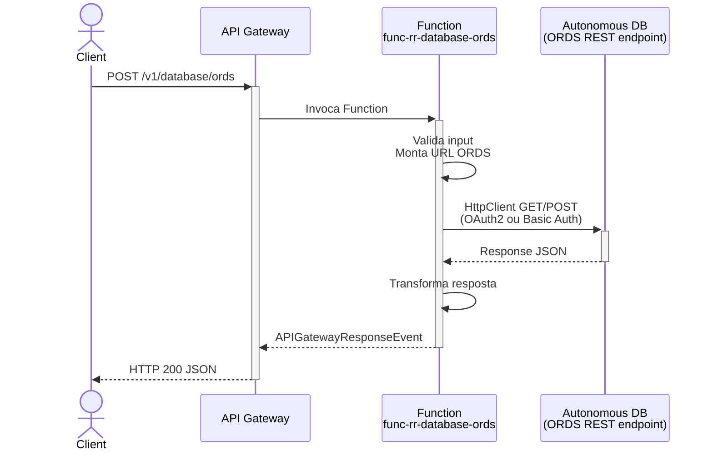
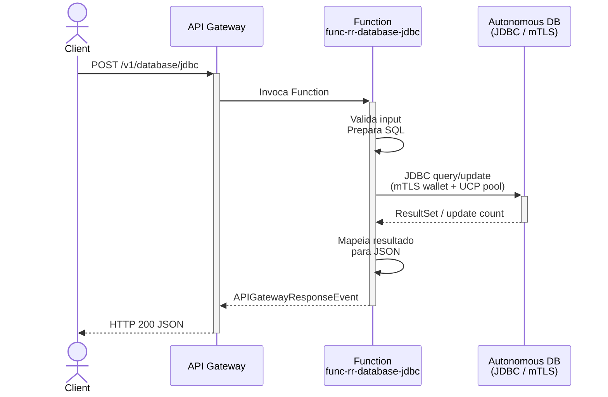
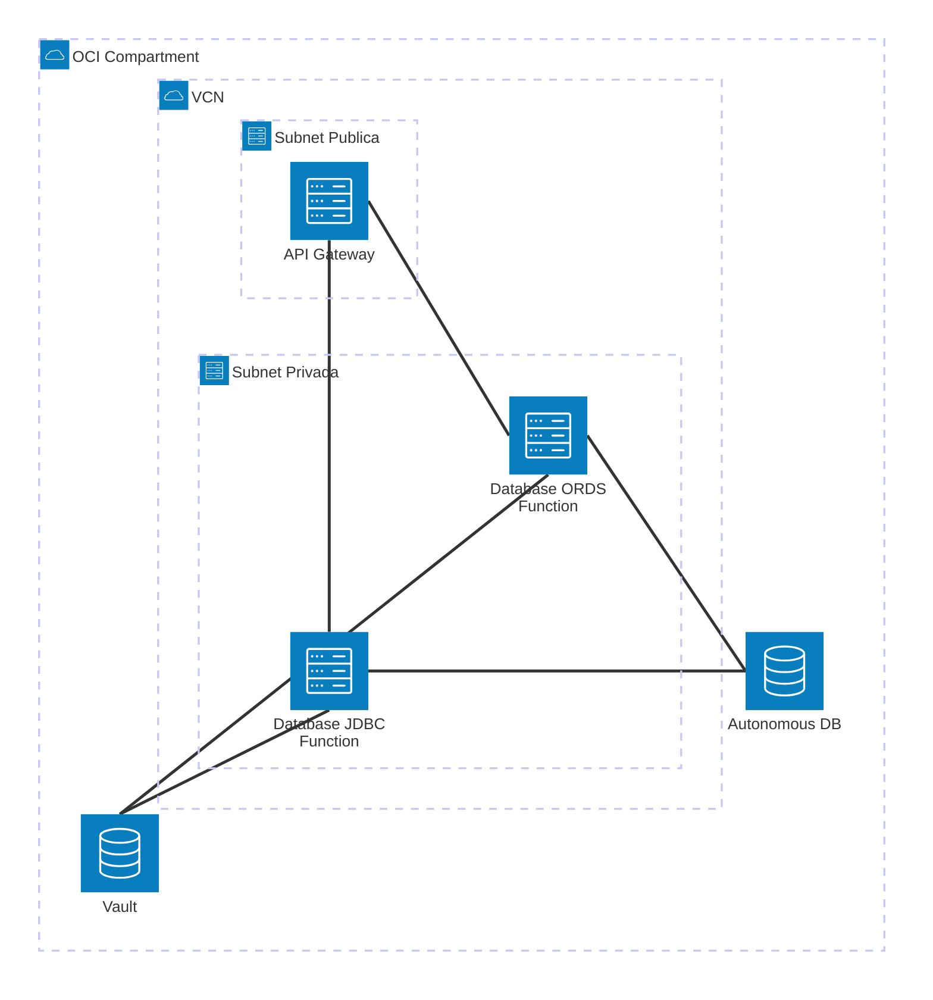

# Padrão 01b — Request-Reply: Database

> **Status**: ✅ Implementável com Functions
> **Fase**: 1 — Fundações
> **Tipo**: Síncrono
> **Variante**: Acesso a banco de dados (ORDS + JDBC)
> **Projetos Java**: `services/func-rr-database-ords/` e `services/func-rr-database-jdbc/`
> **Família**: Request-Reply — ver também [01a (REST Proxy)](01a-request-reply-rest-proxy.md) e [01c (Event Publish)](01c-request-reply-event-publish.md)

## 1. Visão Geral

### Descrição
O cliente envia uma petição e espera a resposta com dados do banco de dados. A Function atua como camada de acesso a dados, recebendo operações CRUD e executando-as contra um **OCI Autonomous Database**. Duas implementações distintas oferecem trade-offs diferentes:

| Implementação | Acesso | Quando usar |
|---|---|---|
| **ORDS** (REST Data Services) | HTTP/REST via `HttpClient` Java 17 | APIs REST pré-expostas, sem necessidade de drivers, baixa complexidade |
| **JDBC** (conexão direta) | SQL via Oracle JDBC + UCP pool | Queries complexas, transactions, stored procedures, controle total |

### Adaptação OIC → Functions

| Componente Original | Implementação com Functions |
|---|---|
| OCI API Gateway (ponto de entrada) | ✅ Sem mudança |
| OIC (orquestação/transformação) | 🔄 Function — recebe request, executa operação no banco, retorna resultado |
| Sistema Destino (Database) | ✅ OCI Autonomous Database acessado via ORDS ou JDBC |

### Impacto da Substituição
- **Perda**: Adaptadores de banco pré-construídos do OIC, visual mapper para SQL
- **Ganho**: Controle total no SQL/REST, connection pooling otimizado, pay-per-use

### Diagrama de Arquitetura — ORDS



### Diagrama de Arquitetura — JDBC



### Diagrama de Recursos (Terraform)



> **Módulos Terraform necessários:**
>
> | Módulo | Recursos |
> |---|---|
> | **network** | VCN, NAT Gateway, Service Gateway, Subnet Pública + Privada, NSGs |
> | **iam** | Dynamic Group Functions, Policy: `read secret-bundles`, `use virtual-network-family` |
> | **functions** | Application + 2 Functions: `func-rr-database-ords` (256MB) + `func-rr-database-jdbc` (512MB) |
> | **api-gateway** | Gateway + Deployment (rotas `POST /database/ords`, `POST /database/jdbc`) |
> | **observability** | Log Group, Service Logs, Alarms |
> | *externo* | **Autonomous Database** (provisionado separadamente, acessado via ORDS REST ou JDBC mTLS) |
> | *existente* | **Vault** (secrets para DB credentials + wallet mTLS) |

## 2. Projetos Java

### 2.1 Projeto ORDS — `services/func-rr-database-ords/`

- **Diretório**: `services/func-rr-database-ords/`
- **Package**: `com.brx.functions.rr.databaseords`
- **Handler**: `DatabaseOrdsFunction extends APIGatewayFunction<DatabaseOrdsRequest, DatabaseOrdsResponse>`
- **func.yaml name**: `func-rr-database-ords`

#### Estrutura

```
services/func-rr-database-ords/
├── pom.xml
├── func.yaml
├── Dockerfile
└── src/
    ├── main/java/com/brx/functions/rr/databaseords/
    │   ├── DatabaseOrdsFunction.java        # Handler principal — valida, invoca ORDS
    │   ├── model/
    │   │   ├── DatabaseOrdsRequest.java     # DTO entrada (schema, resource, method, body)
    │   │   └── DatabaseOrdsResponse.java    # DTO saída (status_code, data, elapsed_ms)
    │   ├── service/
    │   │   └── OciSecretService.java        # Leitura de secrets do Vault (para auth ORDS)
    │   └── client/
    │       └── OrdsClient.java              # HttpClient wrapper para ORDS REST endpoints
    └── test/java/com/brx/functions/rr/databaseords/
        ├── DatabaseOrdsFunctionTest.java
        └── client/
            └── OrdsClientTest.java
```

#### Dependências OCI SDK
- `oci-java-sdk-common` (auth Resource Principal)
- `oci-java-sdk-secrets` (leitura de secrets do Vault para credentials ORDS)

#### func.yaml

```yaml
schema_version: 20180708
name: func-rr-database-ords
version: 0.0.1
runtime: java
build_image: fnproject/fn-java-fdk-build:jdk17-latest
run_image: fnproject/fn-java-fdk:jre17-latest
cmd: com.brx.functions.rr.databaseords.DatabaseOrdsFunction::handler
memory: 256
timeout: 60
config:
  ENVIRONMENT: dev
  ORDS_BASE_URL: https://adb.us-ashburn-1.oraclecloud.com/ords
  ORDS_SCHEMA: hr
  ORDS_TIMEOUT_MS: "10000"
  ORDS_AUTH_TOKEN_URL: https://idcs.example.com/oauth2/v1/token
  ORDS_AUTH_CLIENT_ID_OCID: ocid1.vaultsecret.oc1...
  ORDS_AUTH_CLIENT_SECRET_OCID: ocid1.vaultsecret.oc1...
```

### 2.2 Projeto JDBC — `services/func-rr-database-jdbc/`

- **Diretório**: `services/func-rr-database-jdbc/`
- **Package**: `com.brx.functions.rr.databasejdbc`
- **Handler**: `DatabaseJdbcFunction extends APIGatewayFunction<DatabaseJdbcRequest, DatabaseJdbcResponse>`
- **func.yaml name**: `func-rr-database-jdbc`

#### Estrutura

```
services/func-rr-database-jdbc/
├── pom.xml
├── func.yaml
├── Dockerfile
└── src/
    ├── main/java/com/brx/functions/rr/databasejdbc/
    │   ├── DatabaseJdbcFunction.java        # Handler principal — valida, executa SQL
    │   ├── model/
    │   │   ├── DatabaseJdbcRequest.java     # DTO entrada (operation, table, params, sql)
    │   │   └── DatabaseJdbcResponse.java    # DTO saída (status_code, data, rows_affected, elapsed_ms)
    │   ├── service/
    │   │   └── OciSecretService.java        # Leitura de secrets do Vault (credentials + wallet)
    │   └── client/
    │       └── JdbcClient.java              # UCP connection pool, static DataSource para hot function
    └── test/java/com/brx/functions/rr/databasejdbc/
        ├── DatabaseJdbcFunctionTest.java
        └── client/
            └── JdbcClientTest.java
```

#### Dependências adicionais (além do OCI SDK)
- `com.oracle.database.jdbc:ojdbc11:23.4.0.24.05` (Oracle JDBC driver para Java 17+)
- `com.oracle.database.jdbc:ucp:23.4.0.24.05` (Universal Connection Pool)
- `com.oracle.database.security:oraclepki:23.4.0.24.05` (mTLS wallet support)
- `oci-java-sdk-common` (auth Resource Principal)
- `oci-java-sdk-secrets` (leitura de secrets do Vault)

#### func.yaml

```yaml
schema_version: 20180708
name: func-rr-database-jdbc
version: 0.0.1
runtime: java
build_image: fnproject/fn-java-fdk-build:jdk17-latest
run_image: fnproject/fn-java-fdk:jre17-latest
cmd: com.brx.functions.rr.databasejdbc.DatabaseJdbcFunction::handler
memory: 512
timeout: 60
config:
  ENVIRONMENT: dev
  JDBC_URL: jdbc:oracle:thin:@adb_high?TNS_ADMIN=/tmp/wallet
  JDBC_USER_OCID: ocid1.vaultsecret.oc1...
  JDBC_PASSWORD_OCID: ocid1.vaultsecret.oc1...
  JDBC_WALLET_SECRET_OCID: ocid1.vaultsecret.oc1...
  JDBC_POOL_MIN: "1"
  JDBC_POOL_MAX: "3"
  JDBC_POOL_TIMEOUT_MS: "5000"
```

#### Dockerfile (JDBC — aspectos específicos)

```dockerfile
# Adicional ao Dockerfile padrão FDK:
# Wallet files são extraídos do Vault na inicialização (@FnConfiguration)
# e escritos em /tmp/wallet/ (diretório temporário do container)
# Alternativa: bake wallet no image (mais rápido, requer rebuild na rotação)
```

## 3. Requisitos de Infraestrutura

### Terraform — Módulos Existentes

| Módulo | ORDS | JDBC |
|--------|------|------|
| `api-gateway` | Rota `{ path = "/database/ords", methods = ["POST"] }` | Rota `{ path = "/database/jdbc", methods = ["POST"] }` |
| `functions` | Nova Function `func-rr-database-ords` (256MB, 60s) | Nova Function `func-rr-database-jdbc` (512MB, 60s) |
| `iam` | Policy: `read secret-bundles` (existente) | Policy: `read secret-bundles` (existente) |
| `network` | NAT GW para acesso ORDS (existente) | Service Gateway para ADB (existente) ou NAT GW |
| `observability` | Sem mudança | Sem mudança |

### Terraform — Novos Recursos

```hcl
# ORDS Function
module "fn_rr_database_ords" {
  source           = "./modules/functions"
  compartment_ocid = var.compartment_ocid
  subnet_id        = module.network.subnet_private_id
  nsg_ids          = [module.network.nsg_functions_id]
  application_name = "app-integration-patterns"
  function_name    = "func-rr-database-ords"
  function_image   = "gru.ocir.io/${var.ocir_namespace}/patterns/func-rr-database-ords:0.0.1"
  function_config = {
    ORDS_BASE_URL              = "https://adb.us-ashburn-1.oraclecloud.com/ords"
    ORDS_SCHEMA                = "hr"
    ORDS_TIMEOUT_MS            = "10000"
    ORDS_AUTH_TOKEN_URL        = "https://idcs.example.com/oauth2/v1/token"
    ORDS_AUTH_CLIENT_ID_OCID   = "ocid1.vaultsecret.oc1..."
    ORDS_AUTH_CLIENT_SECRET_OCID = "ocid1.vaultsecret.oc1..."
  }
}

# JDBC Function
module "fn_rr_database_jdbc" {
  source           = "./modules/functions"
  compartment_ocid = var.compartment_ocid
  subnet_id        = module.network.subnet_private_id
  nsg_ids          = [module.network.nsg_functions_id]
  application_name = "app-integration-patterns"
  function_name    = "func-rr-database-jdbc"
  function_image   = "gru.ocir.io/${var.ocir_namespace}/patterns/func-rr-database-jdbc:0.0.1"
  function_memory  = 512
  function_config = {
    JDBC_URL                 = "jdbc:oracle:thin:@adb_high?TNS_ADMIN=/tmp/wallet"
    JDBC_USER_OCID           = "ocid1.vaultsecret.oc1..."
    JDBC_PASSWORD_OCID       = "ocid1.vaultsecret.oc1..."
    JDBC_WALLET_SECRET_OCID  = "ocid1.vaultsecret.oc1..."
    JDBC_POOL_MIN            = "1"
    JDBC_POOL_MAX            = "3"
    JDBC_POOL_TIMEOUT_MS     = "5000"
  }
}
```

### Terraform — Mudanças de Variáveis

```hcl
# infra/env-dev/main.tf — adicionar à lista de rotas
api_routes = [
  { path = "/hello",         methods = ["GET", "POST"] },
  { path = "/database/ords", methods = ["POST"] },          # NOVO
  { path = "/database/jdbc", methods = ["POST"] },          # NOVO
]
```

### IAM
- **ORDS**: Nenhuma policy adicional (acesso via NAT GW + OAuth2 do ORDS)
- **JDBC**: Nenhuma policy adicional se usando mTLS wallet. Se usando Instance Principal para ADB, adicionar:
  ```
  Allow dynamic-group dg-functions-dev to use autonomous-databases in compartment <compartment>
  ```

### Wallet Management (JDBC)

Duas abordagens com trade-offs:

| Abordagem | Prós | Contras |
|---|---|---|
| **Runtime extraction** — wallet armazenado como Base64 no Vault, extraído em `/tmp/wallet` no `@FnConfiguration` | Rotação sem rebuild, mais seguro | Cold start +2-3s, depende do Vault |
| **Baked in image** — wallet copiado no Dockerfile | Cold start rápido, sem dependência runtime | Requer rebuild na rotação do wallet |

**Recomendação**: Runtime extraction para produção (segurança), baked para dev/test (velocidade).

## 4. Requisitos de Codificação Java

### 4.1 ORDS — `DatabaseOrdsFunction.java`

| Aspecto | Especificação |
|---------|--------------|
| Base class | `APIGatewayFunction<DatabaseOrdsRequest, DatabaseOrdsResponse>` |
| `@FnConfiguration` | Lê config vars ORDS, inicializa `OciSecretService` + `OrdsClient` |
| Fluxo | Valida input → monta URL ORDS → invoca via HttpClient → retorna dados |

#### Client — `OrdsClient.java`

| Aspecto | Especificação |
|---------|--------------|
| HttpClient | `java.net.http.HttpClient` singleton (como RestProxyClient do 01a) |
| Base URL | `ORDS_BASE_URL` + `ORDS_SCHEMA` → `https://host/ords/hr/` |
| Operações | GET (query), POST (insert), PUT (update), DELETE |
| Auth | OAuth2 Client Credentials (token cache) ou Basic Auth |
| Timeout | Configurável via `ORDS_TIMEOUT_MS` (default: 10000ms) |
| Retry | 2 retries com backoff para 5xx |
| Paginação | Suporta `?offset=` e `?limit=` para ORDS auto-REST |

#### DTOs — ORDS

**`DatabaseOrdsRequest.java`**:
- `resource`: String (nome do recurso ORDS, ex: `employees`)
- `method`: String (GET, POST, PUT, DELETE)
- `query_params`: Map<String, String> (filtros, paginação)
- `body`: Object (payload para POST/PUT)

**`DatabaseOrdsResponse.java`**:
- `status_code`: int
- `data`: Object (JSON do ORDS — pode ser array ou objeto)
- `count`: Integer (total de registros, se disponível)
- `has_more`: Boolean (paginação)
- `elapsed_ms`: long

### 4.2 JDBC — `DatabaseJdbcFunction.java`

| Aspecto | Especificação |
|---------|--------------|
| Base class | `APIGatewayFunction<DatabaseJdbcRequest, DatabaseJdbcResponse>` |
| `@FnConfiguration` | Extrai wallet do Vault → `/tmp/wallet/`, inicializa `JdbcClient` com UCP DataSource |
| Fluxo | Valida input → obtém connection do pool → executa PreparedStatement → mapeia ResultSet → retorna |

#### Client — `JdbcClient.java`

| Aspecto | Especificação |
|---------|--------------|
| DataSource | `oracle.ucp.jdbc.PoolDataSourceFactory.getPoolDataSource()` — **static** (sobrevive hot function) |
| Pool sizing | Min: `JDBC_POOL_MIN` (1), Max: `JDBC_POOL_MAX` (3) — funções têm memória limitada |
| Connection timeout | `JDBC_POOL_TIMEOUT_MS` (5000ms) |
| Validation | `setValidateConnectionOnBorrow(true)` — valida antes de usar |
| SQL injection | **Somente `PreparedStatement`** — nunca concatenar input do usuário |
| ResultSet mapping | Converte `ResultSet` → `List<Map<String, Object>>` (genérico) |
| Transaction | Auto-commit true para queries, explicit commit/rollback para mutations |
| Close | `try-with-resources` em Connection, PreparedStatement, ResultSet |

#### DTOs — JDBC

**`DatabaseJdbcRequest.java`**:
- `operation`: String (QUERY, INSERT, UPDATE, DELETE)
- `table`: String (nome da tabela — validado contra allowlist)
- `params`: Map<String, Object> (parâmetros para PreparedStatement)
- `sql`: String (**SOMENTE** para QUERY com SQL pré-aprovado — validado contra allowlist de patterns)
- `limit`: Integer (max rows para QUERY, default: 100, max: 1000)

**`DatabaseJdbcResponse.java`**:
- `status_code`: int
- `data`: List<Map<String, Object>> (resultados da query)
- `rows_affected`: Integer (para INSERT/UPDATE/DELETE)
- `elapsed_ms`: long

> ⚠️ **Segurança**: O campo `sql` aceita apenas patterns pré-aprovados (ex: `SELECT * FROM employees WHERE department_id = :dept_id`). Qualquer SQL arbitrário deve ser rejeitado com 400. Usar allowlist de SQL patterns na config da Function.

### Tratamento de Erros

| Cenário | ORDS Response | JDBC Response |
|---------|--------------|---------------|
| Input inválido | 400 Bad Request | 400 Bad Request |
| ORDS/DB timeout | 504 Gateway Timeout | 504 Gateway Timeout |
| ORDS 404 (recurso não existe) | 404 Not Found | N/A |
| ORDS 400 (query inválida) | 400 Bad Request (propaga) | N/A |
| SQL exception | N/A | 500 Internal Server Error (mensagem sanitizada) |
| Connection pool esgotado | N/A | 503 Service Unavailable |
| Auth failure (wallet/credentials) | 503 Service Unavailable | 503 Service Unavailable |
| Tabela/SQL não permitido | N/A | 403 Forbidden "Operation not allowed" |

## 5. Sequência de Prompts

### Prompt 0 — Auditoria de Infraestrutura

> **Obrigatório**: Executar ANTES de qualquer implementação.

Verificar se todos os módulos Terraform necessários existem em `infra/` para implementar este padrão.

**Módulos necessários**:
- `modules/network/` — VCN, subnets, gateways, NSGs
- `modules/iam/` — Dynamic Groups, Policies (functions, api-gateway)
- `modules/functions/` — Application + Function resources (×2: ORDS + JDBC)
- `modules/api-gateway/` — Gateway + Deployment com 2 rotas
- `modules/vault/` — **Vault + Secrets** (DB wallet, ORDS credentials, JDBC connection string)
- `modules/observability/` — Log Group, Alarms, ONS

**Prompt file**: `@prompts/audit-infra-prerequisites`

<details>
<summary>Fallback — prompt free-text</summary>

```
Usar @oci-terraform para auditar infra/:
1. Verificar existência de cada módulo listado em infra/modules/
2. Para módulos existentes, verificar capabilities (ex: api-gateway suporta 2 rotas independentes?)
3. Para módulos FALTANTES, criar seguindo skills provisioning-oci-{service}
4. Confirmar que IAM policies cobrem novos recursos (ex: read secret-bundles para DB wallet)
5. Reportar gaps e ações corretivas

Seguir especificação docs/patterns/01-request-reply/01b-request-reply-database.md seção 3.
```
</details>

### Prompt 1 — Terraform (Functions + rotas)

**Prompt file (primário)**: `@prompts/add-serverless-stack` com argumentos:
- Functions: `func-rr-database-ords` (256MB) + `func-rr-database-jdbc` (512MB)
- API routes: `POST /database/ords` + `POST /database/jdbc`
- Auth type: JWT
- function_config: conforme seção 2

**Alternativa granular**: `@prompts/add-functions-infra` (2x) + `@prompts/add-api-gateway` (2 rotas).

<details>
<summary>Fallback — prompt free-text</summary>

```
Usar o agente @oci-terraform para provisionar:
1. func-rr-database-ords: Function resource (256MB, 60s) com function_config ORDS
2. func-rr-database-jdbc: Function resource (512MB, 60s) com function_config JDBC
3. Adicionar rotas { path = "/database/ords", methods = ["POST"] }
   e { path = "/database/jdbc", methods = ["POST"] } no API Gateway
Seguir especificação docs/patterns/01b-request-reply-database.md seção 3.
```
</details>

### Prompt 2 — Java ORDS (projeto + OrdsClient)

**Prompt file (primário)**: `@prompts/add-oci-function` para scaffold, seguido de `@prompts/add-rest-client` com argumentos:
- Target API: OCI Autonomous Database ORDS endpoint
- Auth method: OAuth2 Client Credentials
- Existing function class: `DatabaseOrdsFunction`
- HTTP methods: GET, POST, PUT, DELETE

> ORDS é acessado via REST, portanto o prompt `add-rest-client` é adequado.

<details>
<summary>Fallback — prompt free-text</summary>

```
Usar o agente @oci-functions-java para criar projeto func-rr-database-ords
em services/ seguindo a especificação docs/patterns/01b-request-reply-database.md.
Criar OrdsClient.java com HttpClient Java 17 singleton apontando para ORDS endpoint,
com OAuth2 Client Credentials e suporte a paginação ORDS (?offset, ?limit).
Criar OciSecretService.java para leitura de credentials do Vault.
```
</details>

### Prompt 3 — Java JDBC (projeto + JdbcClient)

**Prompt file (primário)**: `@prompts/add-oci-function` para scaffold, seguido de `@prompts/add-database-client` com argumentos:
- Database type: JDBC
- Existing function class: `DatabaseJdbcFunction`
- Autonomous DB: URL + wallet OCID
- Credentials: OCI Vault
- Operations: QUERY, INSERT, UPDATE, DELETE

<details>
<summary>Fallback — prompt free-text</summary>

```
Usar o agente @oci-functions-java para criar projeto func-rr-database-jdbc
em services/ seguindo a especificação docs/patterns/01b-request-reply-database.md.
Criar JdbcClient.java com Oracle UCP connection pool (static DataSource para hot function),
mTLS wallet extraído do Vault na inicialização,
PreparedStatement para todas as queries (nunca concatenação SQL),
e allowlist de SQL patterns na config.
Dependências: ojdbc11, ucp, oraclepki.
Memória: 512MB (overhead do JDBC driver).
```
</details>

### Prompt 4 — DTOs + Handlers

**Prompt file (primário)**: `@prompts/add-event-handler` com argumentos para API Gateway event source, aplicado a ambos os projetos.

<details>
<summary>Fallback — prompt free-text</summary>

```
Para cada projeto (func-rr-database-ords e func-rr-database-jdbc):
1. Criar DTOs (Request + Response) conforme seção 4
2. Criar Handler (APIGatewayFunction) que valida input e invoca client
3. JDBC: implementar allowlist de tabelas/SQL patterns
4. ORDS: implementar suporte a paginação
Seguir especificação docs/patterns/01b-request-reply-database.md seção 4.
```
</details>

### Prompt 5 — Testes

> Não há prompt file específico para testes. Usar free-text.

```
Criar testes unitários para ambos os projetos:
1. OrdsClientTest — mock de HttpClient, cenários: query sucesso, paginação, ORDS 404, timeout
2. DatabaseOrdsFunctionTest — input válido/inválido, resource inexistente
3. JdbcClientTest — mock de DataSource/Connection, cenários: query sucesso, SQL exception,
   pool esgotado, PreparedStatement binding
4. DatabaseJdbcFunctionTest — input válido/inválido, tabela não permitida, SQL não aprovado
Usar FnTestingRule + Mockito seguindo instruções java-functions-testing.instructions.md.
```

### Prompt 6 — Vault (secrets para credentials)

**Prompt file (primário)**: `@prompts/add-vault` com argumentos:
- Secrets: ORDS OAuth2 credentials (client_id, client_secret) + JDBC credentials (user, password) + wallet Base64
- Consuming services: `func-rr-database-ords`, `func-rr-database-jdbc`

<details>
<summary>Fallback — prompt free-text</summary>

```
Usar o agente @oci-terraform para provisionar secrets no Vault:
- ORDS: client_id + client_secret para OAuth2
- JDBC: username + password + wallet (Base64)
Seguir especificação docs/patterns/01b-request-reply-database.md seção 3.
```
</details>

## 6. Critérios de Verificação

### Testes que Devem Passar — ORDS

| Teste | Cenário | Resultado |
|-------|---------|----------|
| `testOrdsQuerySuccess` | POST /database/ords com resource=employees, method=GET | 200 + lista JSON |
| `testOrdsMissingResource` | POST /database/ords sem resource | 400 "resource is required" |
| `testOrdsResourceNotFound` | ORDS retorna 404 | 404 Not Found |
| `testOrdsTimeout` | ORDS não responde | 504 Gateway Timeout |
| `testOrdsOAuth` | Token cache válido / expirado | Reutiliza / renova token |
| `testOrdsPagination` | Query com limit e offset | Retorna has_more + count |
| `testOrdsWrongMethod` | GET /database/ords | 405 "Method not allowed" |

### Testes que Devem Passar — JDBC

| Teste | Cenário | Resultado |
|-------|---------|----------|
| `testJdbcQuerySuccess` | POST /database/jdbc com operation=QUERY, table=employees | 200 + lista JSON |
| `testJdbcInsertSuccess` | POST /database/jdbc com operation=INSERT, table=employees, params | 201 + rows_affected=1 |
| `testJdbcMissingOperation` | POST /database/jdbc sem operation | 400 "operation is required" |
| `testJdbcForbiddenTable` | table=audit_log (não está no allowlist) | 403 "Operation not allowed" |
| `testJdbcForbiddenSql` | sql="DROP TABLE employees" | 403 "SQL pattern not allowed" |
| `testJdbcTimeout` | Connection pool timeout | 504 Gateway Timeout |
| `testJdbcPoolExhausted` | Todas as connections em uso | 503 Service Unavailable |
| `testJdbcSqlException` | SQL inválido | 500 Internal Server Error (sanitizado) |
| `testJdbcWrongMethod` | GET /database/jdbc | 405 "Method not allowed" |

### Comandos de Validação

```bash
cd services/func-rr-database-ords && mvn clean package
cd services/func-rr-database-jdbc && mvn clean package
cd infra/env-dev && terraform plan
```

### Comportamento Esperado — ORDS
1. Client envia POST /v1/database/ords com `{ "resource": "employees", "method": "GET", "query_params": { "limit": "10" } }`
2. API Gateway roteia para Function func-rr-database-ords
3. Function monta URL: `https://adb.../ords/hr/employees?limit=10`
4. Function obtém OAuth2 token (se configurado) do Vault
5. Function invoca ORDS com HttpClient, retorna dados JSON ao client

### Comportamento Esperado — JDBC
1. Client envia POST /v1/database/jdbc com `{ "operation": "QUERY", "table": "employees", "params": { "department_id": 10 }, "limit": 50 }`
2. API Gateway roteia para Function func-rr-database-jdbc
3. Function valida tabela contra allowlist
4. Function obtém Connection do UCP pool, executa `SELECT * FROM employees WHERE department_id = ? LIMIT 50` via PreparedStatement
5. Function mapeia ResultSet → JSON, retorna ao client
