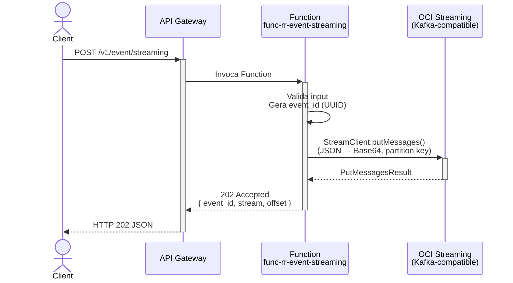
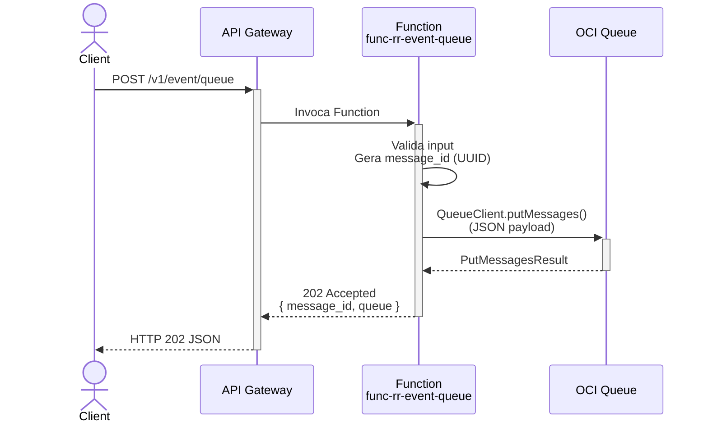
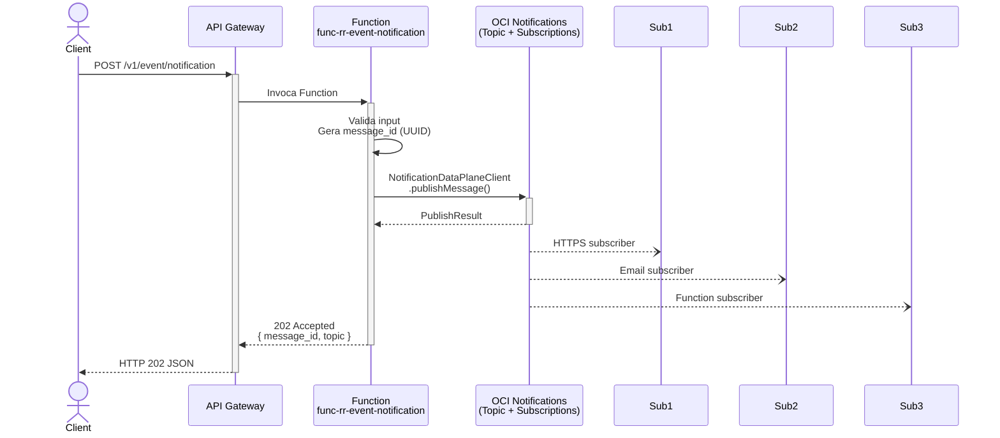
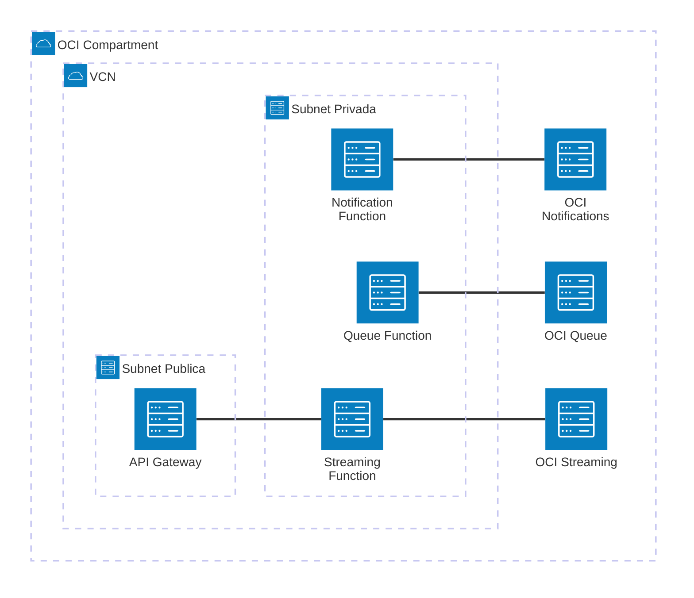

# Padrão 01c — Request-Reply: Event Publish

> **Status**: ✅ Implementável com Functions
> **Fase**: 1 — Fundações (Streaming) / Fase 2 — Event-Driven (Queue, Notifications)
> **Tipo**: Síncrono (aceita request) → Assíncrono (publica evento, retorna 202)
> **Variante**: Recebe request REST, publica evento em serviço de mensageria OCI
> **Projetos Java**: `services/func-rr-event-streaming/`, `services/func-rr-event-queue/`, `services/func-rr-event-notification/`
> **Família**: Request-Reply — ver também [01a (REST Proxy)](01a-request-reply-rest-proxy.md) e [01b (Database)](01b-request-reply-database.md)

## 1. Visão Geral

### Descrição
O cliente envia uma petição REST e a Function **aceita imediatamente** (202 Accepted), publicando o evento em um serviço de mensageria OCI para processamento assíncrono posterior. Três implementações distintas cobrem diferentes serviços de mensageria:

| Implementação | Serviço OCI | Quando usar |
|---|---|---|
| **Streaming** | OCI Streaming (Kafka-compatible) | Alta throughput, ordering por partition key, replay de mensagens |
| **Queue** | OCI Queue | Point-to-point, DLQ nativa, visibility timeout, at-least-once delivery |
| **Notification** | OCI Notifications (ONS) | Fan-out para múltiplos subscribers, fire-and-forget, integração com email/HTTPS/Slack |

### Adaptação OIC → Functions

| Componente Original | Implementação com Functions |
|---|---|
| OCI API Gateway (ponto de entrada) | ✅ Sem mudança |
| OIC (orquestração → publicação de evento) | 🔄 Function — recebe request, valida, publica evento |
| Sistema de Mensageria (JMS/MQ via OIC) | ✅ Substituído por OCI Streaming / Queue / Notifications |

### Impacto da Substituição
- **Perda**: Adaptadores JMS/MQ pré-construídos do OIC, visual flow para routing de mensagens
- **Ganho**: Serviços nativos OCI (managed, pay-per-use), Kafka compatibility (Streaming), DLQ nativa (Queue), fan-out nativo (Notifications)

### Diagrama de Arquitetura — Streaming



### Diagrama de Arquitetura — Queue



### Diagrama de Arquitetura — Notification



### Diagrama de Recursos (Terraform)



> **Módulos Terraform necessários:**
>
> | Módulo | Streaming | Queue | Notification |
> |---|---|---|---|
> | **network** | VCN, Service GW, NSGs | VCN, Service GW, NSGs | VCN, Service GW, NSGs |
> | **iam** | Policy: `use stream-push` | Policy: `use queues` | Policy: `use ons-topics` |
> | **functions** | `func-rr-event-streaming` | `func-rr-event-queue` | `func-rr-event-notification` |
> | **api-gateway** | Rota `POST /event/streaming` | Rota `POST /event/queue` | Rota `POST /event/notification` |
> | **streaming** | Stream Pool + Stream (**novo**) | — | — |
> | **queue** | — | Queue resource (**novo**) | — |
> | **notifications** | — | — | Topic + Subscriptions (existente) |
> | **observability** | Logs + Alarms | Logs + Alarms | Logs + Alarms |

## 2. Projetos Java

### 2.1 Projeto Streaming — `services/func-rr-event-streaming/`

- **Diretório**: `services/func-rr-event-streaming/`
- **Package**: `com.brx.functions.rr.eventstreaming`
- **Handler**: `EventStreamingFunction extends APIGatewayFunction<EventStreamingRequest, EventStreamingResponse>`
- **func.yaml name**: `func-rr-event-streaming`

#### Estrutura

```
services/func-rr-event-streaming/
├── pom.xml
├── func.yaml
├── Dockerfile
└── src/
    ├── main/java/com/brx/functions/rr/eventstreaming/
    │   ├── EventStreamingFunction.java      # Handler — valida, publica em Streaming
    │   ├── model/
    │   │   ├── EventStreamingRequest.java   # DTO entrada (event_type, partition_key, payload)
    │   │   └── EventStreamingResponse.java  # DTO saída (event_id, stream, offset)
    │   └── publisher/
    │       └── StreamingPublisher.java      # OCI SDK StreamClient wrapper
    └── test/java/com/brx/functions/rr/eventstreaming/
        ├── EventStreamingFunctionTest.java
        └── publisher/
            └── StreamingPublisherTest.java
```

#### Dependências OCI SDK
- `oci-java-sdk-common` (auth Resource Principal)
- `oci-java-sdk-streaming` (StreamClient para publicação)

#### func.yaml

```yaml
schema_version: 20180708
name: func-rr-event-streaming
version: 0.0.1
runtime: java
build_image: fnproject/fn-java-fdk-build:jdk17-latest
run_image: fnproject/fn-java-fdk:jre17-latest
cmd: com.brx.functions.rr.eventstreaming.EventStreamingFunction::handler
memory: 256
timeout: 60
config:
  ENVIRONMENT: dev
  STREAMING_STREAM_OCID: ocid1.stream.oc1...
  STREAMING_ENDPOINT: https://cell-1.streaming.us-ashburn-1.oci.oraclecloud.com
```

### 2.2 Projeto Queue — `services/func-rr-event-queue/`

- **Diretório**: `services/func-rr-event-queue/`
- **Package**: `com.brx.functions.rr.eventqueue`
- **Handler**: `EventQueueFunction extends APIGatewayFunction<EventQueueRequest, EventQueueResponse>`
- **func.yaml name**: `func-rr-event-queue`

#### Estrutura

```
services/func-rr-event-queue/
├── pom.xml
├── func.yaml
├── Dockerfile
└── src/
    ├── main/java/com/brx/functions/rr/eventqueue/
    │   ├── EventQueueFunction.java          # Handler — valida, publica em Queue
    │   ├── model/
    │   │   ├── EventQueueRequest.java       # DTO entrada (event_type, payload)
    │   │   └── EventQueueResponse.java      # DTO saída (message_id, queue)
    │   └── publisher/
    │       └── QueuePublisher.java          # OCI SDK QueueClient wrapper
    └── test/java/com/brx/functions/rr/eventqueue/
        ├── EventQueueFunctionTest.java
        └── publisher/
            └── QueuePublisherTest.java
```

#### Dependências OCI SDK
- `oci-java-sdk-common` (auth Resource Principal)
- `oci-java-sdk-queue` (QueueClient para publicação)

#### func.yaml

```yaml
schema_version: 20180708
name: func-rr-event-queue
version: 0.0.1
runtime: java
build_image: fnproject/fn-java-fdk-build:jdk17-latest
run_image: fnproject/fn-java-fdk:jre17-latest
cmd: com.brx.functions.rr.eventqueue.EventQueueFunction::handler
memory: 256
timeout: 60
config:
  ENVIRONMENT: dev
  QUEUE_OCID: ocid1.queue.oc1...
  QUEUE_ENDPOINT: https://cell-1.queue.messaging.us-ashburn-1.oci.oraclecloud.com
```

### 2.3 Projeto Notification — `services/func-rr-event-notification/`

- **Diretório**: `services/func-rr-event-notification/`
- **Package**: `com.brx.functions.rr.eventnotification`
- **Handler**: `EventNotificationFunction extends APIGatewayFunction<EventNotificationRequest, EventNotificationResponse>`
- **func.yaml name**: `func-rr-event-notification`

#### Estrutura

```
services/func-rr-event-notification/
├── pom.xml
├── func.yaml
├── Dockerfile
└── src/
    ├── main/java/com/brx/functions/rr/eventnotification/
    │   ├── EventNotificationFunction.java       # Handler — valida, publica em ONS
    │   ├── model/
    │   │   ├── EventNotificationRequest.java    # DTO entrada (event_type, title, payload)
    │   │   └── EventNotificationResponse.java   # DTO saída (message_id, topic)
    │   └── publisher/
    │       └── NotificationPublisher.java       # OCI SDK NotificationDataPlaneClient wrapper
    └── test/java/com/brx/functions/rr/eventnotification/
        ├── EventNotificationFunctionTest.java
        └── publisher/
            └── NotificationPublisherTest.java
```

#### Dependências OCI SDK
- `oci-java-sdk-common` (auth Resource Principal)
- `oci-java-sdk-ons` (NotificationDataPlaneClient para publicação)

#### func.yaml

```yaml
schema_version: 20180708
name: func-rr-event-notification
version: 0.0.1
runtime: java
build_image: fnproject/fn-java-fdk-build:jdk17-latest
run_image: fnproject/fn-java-fdk:jre17-latest
cmd: com.brx.functions.rr.eventnotification.EventNotificationFunction::handler
memory: 256
timeout: 60
config:
  ENVIRONMENT: dev
  NOTIFICATION_TOPIC_OCID: ocid1.onstopic.oc1...
```

## 3. Requisitos de Infraestrutura

### Terraform — Módulos por Variante

| Módulo | Streaming | Queue | Notification |
|--------|-----------|-------|-------------|
| `api-gateway` | Rota `/event/streaming` POST | Rota `/event/queue` POST | Rota `/event/notification` POST |
| `functions` | `func-rr-event-streaming` (256MB, 60s) | `func-rr-event-queue` (256MB, 60s) | `func-rr-event-notification` (256MB, 60s) |
| `iam` | Policy: `use stream-push` | Policy: `use queues` | Policy: `use ons-topics` |
| `streaming` | Stream Pool + Stream (**novo módulo**) | N/A | N/A |
| `network` | Sem mudança | Sem mudança | Sem mudança |

### Terraform — Novos Recursos

```hcl
# Streaming Function
module "fn_rr_event_streaming" {
  source           = "./modules/functions"
  compartment_ocid = var.compartment_ocid
  subnet_id        = module.network.subnet_private_id
  nsg_ids          = [module.network.nsg_functions_id]
  application_name = "app-integration-patterns"
  function_name    = "func-rr-event-streaming"
  function_image   = "gru.ocir.io/${var.ocir_namespace}/patterns/func-rr-event-streaming:0.0.1"
  function_config = {
    STREAMING_STREAM_OCID = module.streaming.stream_ocid
    STREAMING_ENDPOINT    = module.streaming.messages_endpoint
  }
}

# Queue Function
module "fn_rr_event_queue" {
  source           = "./modules/functions"
  compartment_ocid = var.compartment_ocid
  subnet_id        = module.network.subnet_private_id
  nsg_ids          = [module.network.nsg_functions_id]
  application_name = "app-integration-patterns"
  function_name    = "func-rr-event-queue"
  function_image   = "gru.ocir.io/${var.ocir_namespace}/patterns/func-rr-event-queue:0.0.1"
  function_config = {
    QUEUE_OCID     = var.queue_ocid
    QUEUE_ENDPOINT = var.queue_endpoint
  }
}

# Notification Function
module "fn_rr_event_notification" {
  source           = "./modules/functions"
  compartment_ocid = var.compartment_ocid
  subnet_id        = module.network.subnet_private_id
  nsg_ids          = [module.network.nsg_functions_id]
  application_name = "app-integration-patterns"
  function_name    = "func-rr-event-notification"
  function_image   = "gru.ocir.io/${var.ocir_namespace}/patterns/func-rr-event-notification:0.0.1"
  function_config = {
    NOTIFICATION_TOPIC_OCID = var.notification_topic_ocid
  }
}
```

### Terraform — Mudanças de Variáveis

```hcl
# infra/env-dev/main.tf — adicionar à lista de rotas
api_routes = [
  { path = "/hello",              methods = ["GET", "POST"] },
  { path = "/event/streaming",    methods = ["POST"] },          # NOVO
  { path = "/event/queue",        methods = ["POST"] },          # NOVO
  { path = "/event/notification", methods = ["POST"] },          # NOVO
]
```

### IAM — Novas Policies

```hcl
# Streaming
Allow dynamic-group dg-functions-dev to use stream-push in compartment <compartment>

# Queue
Allow dynamic-group dg-functions-dev to use queues in compartment <compartment>

# Notifications
Allow dynamic-group dg-functions-dev to use ons-topics in compartment <compartment>
```

## 4. Requisitos de Codificação Java

### 4.1 Streaming — `EventStreamingFunction.java`

| Aspecto | Especificação |
|---------|--------------|
| Base class | `APIGatewayFunction<EventStreamingRequest, EventStreamingResponse>` |
| `@FnConfiguration` | Lê `STREAMING_STREAM_OCID` + `STREAMING_ENDPOINT`, inicializa `StreamingPublisher` |
| Fluxo | Valida input → gera `event_id` (UUID) → serializa JSON → Base64 → `putMessages()` → 202 |

#### Publisher — `StreamingPublisher.java`

| Aspecto | Especificação |
|---------|--------------|
| Client | `StreamClient` singleton (Resource Principal auth, cached) |
| Endpoint | Configurável via `STREAMING_ENDPOINT` |
| Serialization | JSON → `Base64.getEncoder().encodeToString()` |
| Partition key | Campo `partition_key` do request (default: `event_type`) |
| Batching | Single message por invocação (batch via chamadas múltiplas) |
| Retry | SDK built-in retry (3 tentativas, backoff) |

#### DTOs — Streaming

**`EventStreamingRequest.java`**:
- `event_type`: String (obrigatório — tipo do evento, ex: `order.created`)
- `partition_key`: String (opcional — para ordering, default: `event_type`)
- `payload`: Object (corpo do evento como JSON genérico)

**`EventStreamingResponse.java`**:
- `event_id`: String (UUID gerado pela Function)
- `stream`: String (nome do Stream)
- `offset`: Long (offset da mensagem no Stream)
- `elapsed_ms`: long

### 4.2 Queue — `EventQueueFunction.java`

| Aspecto | Especificação |
|---------|--------------|
| Base class | `APIGatewayFunction<EventQueueRequest, EventQueueResponse>` |
| `@FnConfiguration` | Lê `QUEUE_OCID` + `QUEUE_ENDPOINT`, inicializa `QueuePublisher` |
| Fluxo | Valida input → gera `message_id` (UUID) → serializa JSON → `putMessages()` → 202 |

#### Publisher — `QueuePublisher.java`

| Aspecto | Especificação |
|---------|--------------|
| Client | `QueueClient` singleton (Resource Principal auth, cached) |
| Endpoint | Configurável via `QUEUE_ENDPOINT` |
| Serialization | JSON string (sem Base64 — Queue aceita texto direto) |
| DLQ | Configurada no recurso Queue (Terraform), não no código |
| Visibility timeout | Default do Queue (30s), não configurável no publish |
| Retry | SDK built-in retry |

#### DTOs — Queue

**`EventQueueRequest.java`**:
- `event_type`: String (obrigatório)
- `payload`: Object (corpo da mensagem como JSON)

**`EventQueueResponse.java`**:
- `message_id`: String (UUID gerado pela Function)
- `queue`: String (nome do Queue)
- `elapsed_ms`: long

### 4.3 Notification — `EventNotificationFunction.java`

| Aspecto | Especificação |
|---------|--------------|
| Base class | `APIGatewayFunction<EventNotificationRequest, EventNotificationResponse>` |
| `@FnConfiguration` | Lê `NOTIFICATION_TOPIC_OCID`, inicializa `NotificationPublisher` |
| Fluxo | Valida input → gera `message_id` (UUID) → `publishMessage()` → 202 |

#### Publisher — `NotificationPublisher.java`

| Aspecto | Especificação |
|---------|--------------|
| Client | `NotificationDataPlaneClient` singleton (Resource Principal auth, cached) |
| Publish | `publishMessage(PublishMessageDetails)` com `title` e `body` |
| Title | Campo `title` do request (max 256 chars) |
| Body | JSON serializado do `payload` (max 65536 bytes — limite ONS) |
| Fan-out | Automático — ONS distribui para todos os subscribers do Topic |
| Retry | SDK built-in retry |

#### DTOs — Notification

**`EventNotificationRequest.java`**:
- `event_type`: String (obrigatório)
- `title`: String (obrigatório — título da notificação, max 256 chars)
- `payload`: Object (corpo da mensagem como JSON, max 64KB)

**`EventNotificationResponse.java`**:
- `message_id`: String (UUID gerado pela Function)
- `topic`: String (nome do Topic ONS)
- `elapsed_ms`: long

### Tratamento de Erros (todos os 3 projetos)

| Cenário | Resposta |
|---------|---------|
| Input inválido (sem event_type) | 400 Bad Request |
| Payload excede limite do serviço | 400 Bad Request "Payload too large" |
| Serviço de mensageria timeout | 504 Gateway Timeout |
| Serviço de mensageria indisponível | 503 Service Unavailable |
| Auth failure (Resource Principal) | 503 Service Unavailable |
| Publish falha (após retries do SDK) | 502 Bad Gateway |
| Método HTTP incorreto (GET) | 405 Method Not Allowed |

## 5. Sequência de Prompts

### Prompt 0 — Auditoria de Infraestrutura

> **Obrigatório**: Executar ANTES de qualquer implementação.

Verificar se todos os módulos Terraform necessários existem em `infra/` para implementar este padrão.

**Módulos necessários**:
- `modules/network/` — VCN, subnets, gateways, NSGs
- `modules/iam/` — Dynamic Groups, Policies (functions, api-gateway, streaming, queue, ons)
- `modules/functions/` — Application + Function resources (×3: streaming, queue, notification)
- `modules/api-gateway/` — Gateway + Deployment com 3 rotas
- `modules/streaming/` — **Stream Pool + Stream** (event-stream)
- `modules/queue/` — **OCI Queue** para variante queue
- `modules/notifications/` — **ONS Topic + Subscription** para variante notification
- `modules/observability/` — Log Group, Alarms, ONS

**Prompt file**: `@prompts/audit-infra-prerequisites`

<details>
<summary>Fallback — prompt free-text</summary>

```
Usar @oci-terraform para auditar infra/:
1. Verificar existência de cada módulo listado em infra/modules/
2. Para módulos existentes, verificar capabilities
3. Para módulos FALTANTES (streaming, queue, notifications), criar seguindo skills:
   - provisioning-oci-streaming
   - provisioning-oci-queue (se disponível) ou resource oci_queue_queue
   - provisioning-oci-notifications (ONS)
4. Confirmar que IAM policies cobrem novos recursos (stream-push, use queues, use ons-topics)
5. Reportar gaps e ações corretivas

Seguir especificação docs/patterns/01-request-reply/01c-request-reply-event-publish.md seção 3.
```
</details>

### Prompt 1 — Terraform (Functions + rotas + IAM)

**Prompt file (primário)**: `@prompts/add-serverless-stack` (3 vezes, uma por Function) com argumentos:
- Function name: `func-rr-event-streaming` / `func-rr-event-queue` / `func-rr-event-notification`
- API route: `POST /event/streaming` / `POST /event/queue` / `POST /event/notification`
- Auth type: JWT
- Memory: 256MB, Timeout: 60s

**Complementar**: `@prompts/add-iam` para policies de `stream-push`, `use queues`, `use ons-topics`.

**Para Streaming**: `@prompts/add-streaming` para provisionar Stream Pool + Stream.

<details>
<summary>Fallback — prompt free-text</summary>

```
Usar o agente @oci-terraform para provisionar:
1. func-rr-event-streaming: Function (256MB, 60s) + rota POST /event/streaming
2. func-rr-event-queue: Function (256MB, 60s) + rota POST /event/queue
3. func-rr-event-notification: Function (256MB, 60s) + rota POST /event/notification
4. IAM policies: stream-push, use queues, use ons-topics para dg-functions-dev
5. Streaming: Stream Pool + Stream (se não existir)
Seguir especificação docs/patterns/01c-request-reply-event-publish.md seção 3.
```
</details>

### Prompt 2 — Java (Streaming publisher)

**Prompt file (primário)**: `@prompts/add-oci-function` para scaffold, seguido de `@prompts/add-event-publishing` com argumentos:
- Target service: OCI Streaming
- Existing function class: `EventStreamingFunction`
- Message format: JSON com `event_type` + `payload`
- Volume: baixo (single message por invocação)

<details>
<summary>Fallback — prompt free-text</summary>

```
Usar o agente @oci-functions-java para criar projeto func-rr-event-streaming
em services/ seguindo a especificação docs/patterns/01c-request-reply-event-publish.md.
Criar StreamingPublisher.java com StreamClient singleton (Resource Principal),
serialização JSON→Base64, partition key configurável.
Retornar 202 Accepted com event_id (UUID).
```
</details>

### Prompt 3 — Java (Queue publisher)

**Prompt file (primário)**: `@prompts/add-oci-function` para scaffold, seguido de `@prompts/add-event-publishing` com argumentos:
- Target service: OCI Queue
- Existing function class: `EventQueueFunction`
- Message format: JSON com `event_type` + `payload`

<details>
<summary>Fallback — prompt free-text</summary>

```
Usar o agente @oci-functions-java para criar projeto func-rr-event-queue
em services/ seguindo a especificação docs/patterns/01c-request-reply-event-publish.md.
Criar QueuePublisher.java com QueueClient singleton (Resource Principal),
serialização JSON direta.
Retornar 202 Accepted com message_id (UUID).
```
</details>

### Prompt 4 — Java (Notification publisher)

**Prompt file (primário)**: `@prompts/add-oci-function` para scaffold, seguido de `@prompts/add-event-publishing` com argumentos:
- Target service: OCI Notifications
- Existing function class: `EventNotificationFunction`
- Message format: JSON com `title` + `payload`

<details>
<summary>Fallback — prompt free-text</summary>

```
Usar o agente @oci-functions-java para criar projeto func-rr-event-notification
em services/ seguindo a especificação docs/patterns/01c-request-reply-event-publish.md.
Criar NotificationPublisher.java com NotificationDataPlaneClient singleton
(Resource Principal), publishMessage com title + body JSON.
Retornar 202 Accepted com message_id (UUID).
Validar que payload < 64KB (limite ONS).
```
</details>

### Prompt 5 — Testes (todos os 3 projetos)

> Não há prompt file específico para testes. Usar free-text.

```
Criar testes unitários para os 3 projetos de event publishing:

1. StreamingPublisherTest — mock de StreamClient, cenários: publish sucesso,
   serialização JSON→Base64 correta, partition key, stream indisponível
2. EventStreamingFunctionTest — input válido (202), sem event_type (400),
   stream timeout (504)

3. QueuePublisherTest — mock de QueueClient, cenários: publish sucesso,
   queue indisponível, message format
4. EventQueueFunctionTest — input válido (202), sem event_type (400),
   queue timeout (504)

5. NotificationPublisherTest — mock de NotificationDataPlaneClient, cenários:
   publish sucesso, topic indisponível, payload > 64KB
6. EventNotificationFunctionTest — input válido (202), sem event_type (400),
   sem title (400), payload oversized (400)

Usar FnTestingRule + Mockito seguindo instruções java-functions-testing.instructions.md.
```

## 6. Critérios de Verificação

### Testes que Devem Passar — Streaming

| Teste | Cenário | Resultado |
|-------|---------|----------|
| `testStreamingPublishSuccess` | POST /event/streaming com event_type + payload | 202 + event_id |
| `testStreamingMissingEventType` | POST /event/streaming sem event_type | 400 "event_type is required" |
| `testStreamingTimeout` | Stream não responde | 504 Gateway Timeout |
| `testStreamingUnavailable` | Streaming service down | 503 Service Unavailable |
| `testStreamingWrongMethod` | GET /event/streaming | 405 "Method not allowed" |
| `testStreamingBase64Encoding` | Verifica que payload é JSON→Base64 | Encoding correto |

### Testes que Devem Passar — Queue

| Teste | Cenário | Resultado |
|-------|---------|----------|
| `testQueuePublishSuccess` | POST /event/queue com event_type + payload | 202 + message_id |
| `testQueueMissingEventType` | POST /event/queue sem event_type | 400 "event_type is required" |
| `testQueueTimeout` | Queue não responde | 504 Gateway Timeout |
| `testQueueUnavailable` | Queue service down | 503 Service Unavailable |
| `testQueueWrongMethod` | GET /event/queue | 405 "Method not allowed" |

### Testes que Devem Passar — Notification

| Teste | Cenário | Resultado |
|-------|---------|----------|
| `testNotificationPublishSuccess` | POST /event/notification com event_type + title + payload | 202 + message_id |
| `testNotificationMissingEventType` | POST sem event_type | 400 "event_type is required" |
| `testNotificationMissingTitle` | POST sem title | 400 "title is required" |
| `testNotificationPayloadTooLarge` | payload > 64KB | 400 "Payload too large" |
| `testNotificationTimeout` | ONS não responde | 504 Gateway Timeout |
| `testNotificationUnavailable` | ONS service down | 503 Service Unavailable |
| `testNotificationWrongMethod` | GET /event/notification | 405 "Method not allowed" |

### Comandos de Validação

```bash
cd services/func-rr-event-streaming && mvn clean package
cd services/func-rr-event-queue && mvn clean package
cd services/func-rr-event-notification && mvn clean package
cd infra/env-dev && terraform plan
```

### Comportamento Esperado — Streaming
1. Client envia POST /v1/event/streaming com `{ "event_type": "order.created", "partition_key": "customer-123", "payload": { "order_id": "abc" } }`
2. API Gateway roteia para Function func-rr-event-streaming
3. Function gera `event_id` (UUID), serializa payload JSON → Base64
4. Function publica via `StreamClient.putMessages()` com partition key
5. Function retorna 202 Accepted com `{ "event_id": "uuid", "stream": "...", "offset": 42 }`

### Comportamento Esperado — Queue
1. Client envia POST /v1/event/queue com `{ "event_type": "order.created", "payload": { "order_id": "abc" } }`
2. API Gateway roteia para Function func-rr-event-queue
3. Function gera `message_id` (UUID), serializa payload JSON
4. Function publica via `QueueClient.putMessages()`
5. Function retorna 202 Accepted com `{ "message_id": "uuid", "queue": "..." }`

### Comportamento Esperado — Notification
1. Client envia POST /v1/event/notification com `{ "event_type": "order.created", "title": "New Order", "payload": { "order_id": "abc" } }`
2. API Gateway roteia para Function func-rr-event-notification
3. Function gera `message_id` (UUID), valida payload < 64KB
4. Function publica via `NotificationDataPlaneClient.publishMessage()` com title + body
5. ONS distribui para todos os subscribers do Topic (HTTPS, email, Function, etc.)
6. Function retorna 202 Accepted com `{ "message_id": "uuid", "topic": "..." }`
