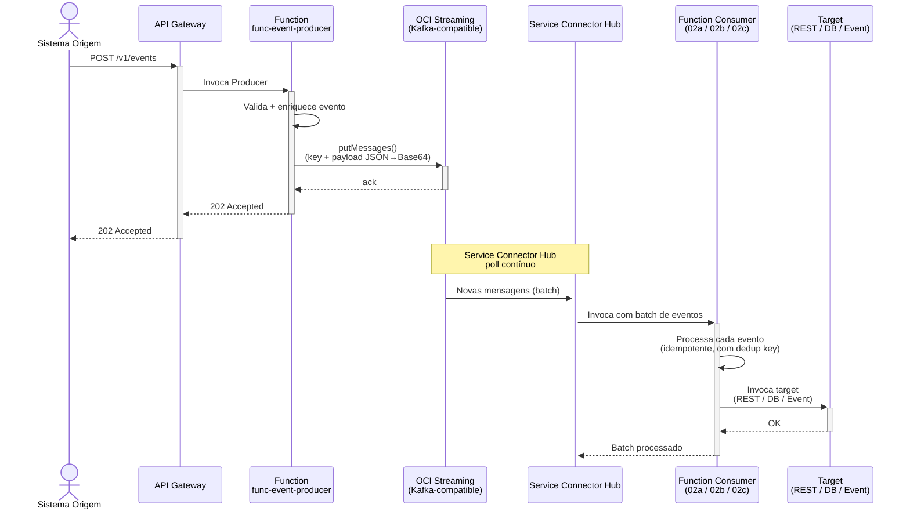

# Padrão 02 — Event-Driven / Pub-Sub

> **Status**: ✅ **Entregue (POC) e validado no dev** — 2026-07-22. Producer + 2 consumers (notify + audit) via Service Connector Hub; **fan-out real** (mesmo `event_id` nos 2) e **trace distribuído único** (traceparent no envelope) provados ao vivo. Ver [handoff](../../handoff/event-pubsub/capability-complete.md) e a skill `designing-oci-event-driven-pubsub`.
> **Fase**: 2 — Event-Driven
> **Tipo**: Assíncrono
> **Projeto Java (Producer)**: `services/func-event-producer/`
> **Consumers entregues (POC)**: `services/func-evt-consumer-notify/` (forward REST — realiza [02a](02a-event-driven-rest-consumer.md)) + `services/func-evt-consumer-audit/` (log + métrica — realiza [02b](02b-event-driven-database-consumer.md)). Os projetos nomeados `func-event-consumer-rest/ords/jdbc/chain` das variantes permanecem como trabalho futuro.
> **Família**: Event-Driven — ver [02a (REST Consumer)](02a-event-driven-rest-consumer.md), [02b (Database Consumer)](02b-event-driven-database-consumer.md), [02c (Event Chain)](02c-event-driven-event-chain.md)
>
> **⚠️ Lições duras desta entrega (ver skill + handoff):** SCH **não lê stream pool privado** (roda fora da VCN → pool público ou consumer in-VCN); cold-start de imagem JVM pesada (~60s) vs deadline síncrono do SCH; **SimpleSpanProcessor** obrigatório em FaaS; `TraceStatus` só em `show traces`. Detalhes em `designing-oci-event-driven-pubsub` (blueprints) e [docs/handoff/event-pubsub/](../../handoff/event-pubsub/).

## 1. Visão Geral

### Descrição Original
Produtores publicam eventos num bus de mensagens (Topic/Stream). Consumidores se subscrevem e reagem de forma independente e assíncrona. Componentes originais: Oracle Streaming Service (Kafka-compatible), OIC (subscriber), OCI Events Service.

### Adaptação OIC → Functions
OIC como subscriber é substituído por **OCI Function + Service Connector Hub**. O producer publica em OCI Streaming via SDK e é exposto como API REST no API Gateway. Três variantes de consumer cobrem os cenários mais comuns de reação a eventos:

| Componente Original | Implementação com Functions |
|---|---|
| Oracle Streaming (bus de eventos) | ✅ Sem mudança — OCI Streaming provisionado via Terraform |
| OIC Subscriber → REST API | 🔄 [02a](02a-event-driven-rest-consumer.md) — `ConnectorHubFunction` invoca API REST externa |
| OIC Subscriber → Database | 🔄 [02b](02b-event-driven-database-consumer.md) — `ConnectorHubFunction` persiste em base de dados (ORDS/JDBC) |
| OIC Subscriber → Outro evento | 🔄 [02c](02c-event-driven-event-chain.md) — `ConnectorHubFunction` re-publica em outro serviço (event chaining) |
| OCI Events Service | ✅ Event Rules para triggers de infraestrutura |

### Variantes do Consumer

| Variante | Projeto Java | Target | Quando Usar |
|----------|-------------|--------|-------------|
| [02a — REST Consumer](02a-event-driven-rest-consumer.md) | `func-event-consumer-rest` | API REST externa | Notificar sistemas, integrações HTTP, webhooks |
| [02b — Database Consumer](02b-event-driven-database-consumer.md) | `func-event-consumer-ords` / `func-event-consumer-jdbc` | Base de dados (ORDS/JDBC) | Materializar eventos, audit log, projeções |
| [02c — Event Chain](02c-event-driven-event-chain.md) | `func-event-consumer-chain` | Outro Streaming/Queue/ONS | Pipelines de eventos, fan-out, transformação |

### Impacto da Substituição
- **Perda**: Consumo pull direto de Streaming, dashboard visual de mensagens, DLQ visual, adaptadores SaaS
- **Ganho**: Pay-per-use (Function só executa quando há eventos), auto-scaling, batch processing nativo, consumer especializado por target

### Diagrama de Arquitetura (Visão Geral)



### Diagrama de Recursos (Terraform)

```mermaid
architecture-beta
    group oci(cloud)[OCI Compartment]

    group vcn(cloud)[VCN] in oci

    group pub(server)[Subnet Publica] in vcn
    service apigw(server)[API Gateway] in pub

    group priv(server)[Subnet Privada] in vcn
    service fn_prod(server)[Producer Function] in priv
    service fn_cons(server)[Consumer Function] in priv

    service stream(server)[OCI Streaming] in oci
    service sch(server)[Service Connector Hub] in oci

    apigw:R -- L:fn_prod
    fn_prod:R -- L:stream
    stream:B -- T:sch
    sch:R -- L:fn_cons
```



> **Módulos Terraform necessários:**
>
> | Módulo | Recursos |
> |---|---|
> | **network** | VCN, NAT GW, Service GW, Subnet Pública + Privada, NSGs |
> | **iam** | Dynamic Group Functions (`stream-push`), SCH policies (`fn-function`, `fn-invocation`) |
> | **functions** | Application + Producer Function + Consumer Function(s) |
> | **api-gateway** | Gateway + Deployment (rota `POST /events` para producer) |
> | **streaming** (**novo**) | Stream Pool (private endpoint) + Stream (partitions, retention) |
> | **service-connector** (**novo**) | Service Connector Hub (source: Streaming → target: Function, batch config) |
> | **observability** | Log Group, Service Logs, Alarms |

## 2. Projeto Java — Producer

### Novo projeto `services/func-event-producer/`

- **Diretório**: `services/func-event-producer/`
- **Package**: `com.brx.functions.eventproducer`
- **Handler**: `EventProducerFunction extends APIGatewayFunction<EventRequest, EventResponse>`
- **func.yaml name**: `func-event-producer`

### Estrutura

```
services/func-event-producer/
├── pom.xml
├── func.yaml
├── Dockerfile
└── src/
    ├── main/java/com/brx/functions/eventproducer/
    │   ├── EventProducerFunction.java      # Handler — valida + publica
    │   ├── model/
    │   │   ├── EventRequest.java           # DTO entrada (event_type, payload)
    │   │   └── EventResponse.java          # DTO saída (event_id, status)
    │   └── client/
    │       └── StreamingPublisher.java     # OCI Streaming SDK wrapper
    └── test/java/com/brx/functions/eventproducer/
        ├── EventProducerFunctionTest.java
        └── client/
            └── StreamingPublisherTest.java
```

### Dependências OCI SDK
- `oci-java-sdk-common` (auth Resource Principal)
- `oci-java-sdk-streaming` (StreamClient para publicação)

### func.yaml

```yaml
schema_version: 20180708
name: func-event-producer
version: 0.0.1
runtime: java
build_image: fnproject/fn-java-fdk-build:jdk17-latest
run_image: fnproject/fn-java-fdk:jre17-latest
cmd: com.brx.functions.eventproducer.EventProducerFunction::handler
memory: 256
timeout: 60
config:
  ENVIRONMENT: dev
  STREAM_OCID: ocid1.stream.oc1...
  STREAM_ENDPOINT: https://cell-1.streaming.sa-saopaulo-1.oci.oraclecloud.com
```

## 3. Requisitos de Infraestrutura — Compartilhados

### Terraform — Novo Módulo: `infra/modules/streaming/`

```hcl
resource "oci_streaming_stream_pool" "this" {
  compartment_id = var.compartment_ocid
  name           = "${var.project_name}-${var.environment}-pool"

  private_endpoint_settings {
    subnet_id = var.subnet_id
    nsg_ids   = var.nsg_ids
  }

  kafka_settings {
    auto_create_topics_enable = false
    num_partitions            = var.default_partitions
    log_retention_hours       = var.retention_hours
  }
}

resource "oci_streaming_stream" "this" {
  name               = var.stream_name
  stream_pool_id     = oci_streaming_stream_pool.this.id
  partitions         = var.partitions
  retention_in_hours = var.retention_hours
}
```

### Terraform — Módulos por Componente

| Módulo | Producer | Consumers (02a/02b/02c) |
|--------|----------|------------------------|
| `streaming` | Stream Pool + Stream (**novo módulo**) | — (usa stream existente) |
| `api-gateway` | Rota `POST /events` para producer | — (sem rota, invocados via SCH) |
| `functions` | `func-event-producer` (256MB, 60s) | 1 Function por variante (ver docs 02a/02b/02c) |
| `iam` | Policy: `use stream-push` | Policy: SCH invoca Functions (ver docs 02a/02b/02c) |
| `network` | Sem mudança | Sem mudança |

### Terraform — Producer Function + API Gateway

```hcl
module "fn_event_producer" {
  source           = "./modules/functions"
  compartment_ocid = var.compartment_ocid
  subnet_id        = module.network.subnet_private_id
  nsg_ids          = [module.network.nsg_functions_id]
  application_name = "app-integration-patterns"
  function_name    = "func-event-producer"
  function_image   = "gru.ocir.io/${var.ocir_namespace}/patterns/func-event-producer:0.0.1"
  function_config = {
    STREAM_OCID     = module.streaming.stream_ocid
    STREAM_ENDPOINT = module.streaming.messages_endpoint
  }
}
```

### IAM — Policies do Producer

```hcl
# Functions publicam em Streaming
Allow dynamic-group dg-functions-dev to use stream-push in compartment <compartment>
```

> Policies de Service Connector Hub e policies específicas de cada consumer estão documentadas nas variantes [02a](02a-event-driven-rest-consumer.md), [02b](02b-event-driven-database-consumer.md), [02c](02c-event-driven-event-chain.md).

### Service Connector Hub (compartilhado)

Cada consumer precisa de um Service Connector Hub configurado para invocar a Function correspondente:

```
Source:  OCI Streaming → stream_ocid
Target: OCI Functions → <func-event-consumer-*>
Batch:  size = 100, timeout = 60s
```

> IAM para SCH invocar Functions (policies `fn-function` e `fn-invocation` para `serviceconnector`) — ver seção IAM de cada variante.

## 4. Requisitos de Codificação Java — Producer

### Handler — `EventProducerFunction.java`

| Aspecto | Especificação |
|---------|--------------|
| Base class | `APIGatewayFunction<EventRequest, EventResponse>` |
| `@FnConfiguration` | Lê `STREAM_OCID` + `STREAM_ENDPOINT`, inicializa `StreamingPublisher` |
| Fluxo | Valida input → gera `event_id` (UUID) → publica em Streaming → 202 Accepted |

### Client — `StreamingPublisher.java`

| Aspecto | Especificação |
|---------|--------------|
| Client | `StreamClient` inicializado com Resource Principal + stream endpoint |
| Método | `publish(String key, Object payload)` → `PutMessagesResultEntry` |
| Serialização | Jackson → JSON bytes → Base64 encode (Streaming exige Base64) |
| Key | `event_type` como partition key (garante ordering por tipo) |
| Verificação | Checar `entry.getError()` em cada `PutMessagesResultEntry` |
| Idempotência | Gerar `event_id` (UUID) e incluir no payload para dedup no consumer |

### Modelos (DTOs)

**`EventRequest.java`** (Producer input):
- `event_type`: String (obrigatório — ex: "order.created", "payment.completed")
- `payload`: Object (dados do evento)
- `correlation_id`: String (opcional, para tracing)

**`EventResponse.java`** (Producer output):
- `event_id`: String (UUID gerado)
- `status`: String ("accepted")
- `stream`: String (nome do stream)

### Modelo Compartilhado — `DomainEvent.java`

> Usado por todos os consumers (02a/02b/02c). Cada variante inclui este DTO no seu projeto.

- `event_id`: String (UUID para idempotência)
- `event_type`: String (ex: "order.created")
- `payload`: Object (dados do evento como JSON genérico)
- `correlation_id`: String (opcional, para tracing)
- `timestamp`: String (ISO-8601)

### Tratamento de Erros — Producer

| Cenário | Resposta |
|---------|---------|
| Evento inválido (sem event_type) | 400 Bad Request |
| Streaming indisponível | 503 Service Unavailable |
| Streaming timeout | 504 Gateway Timeout |
| Publicação parcial falha | Log erro, retornar lista de falhas |
| Método HTTP incorreto (GET) | 405 Method Not Allowed |

## 5. Sequência de Prompts — Producer + Infraestrutura

### Prompt 0 — Auditoria de Infraestrutura

> **Obrigatório**: Executar ANTES de qualquer implementação.

Verificar se todos os módulos Terraform necessários existem em `infra/` para implementar este padrão.

**Módulos necessários**:
- `modules/network/` — VCN, subnets, gateways, NSGs
- `modules/iam/` — Dynamic Groups, Policies (functions, streaming, service-connector)
- `modules/functions/` — Application + Function resource (producer)
- `modules/streaming/` — **Stream Pool + Stream** (event-stream, 3 partitions)
- `modules/service-connector/` — **Service Connector Hub** (Streaming → Functions)
- `modules/observability/` — Log Group, Alarms, ONS

**Prompt file**: `@prompts/audit-infra-prerequisites`

<details>
<summary>Fallback — prompt free-text</summary>

```
Usar @oci-terraform para auditar infra/:
1. Verificar existência de cada módulo listado em infra/modules/
2. Para módulos existentes, verificar capabilities
3. Para módulos FALTANTES (streaming, service-connector), criar seguindo skills:
   - provisioning-oci-streaming (Stream Pool + Stream)
   - Service Connector Hub (oci_sch_service_connector)
4. Confirmar que IAM policies cobrem: stream-push, stream-pull, use service-connector
5. Reportar gaps e ações corretivas

Seguir especificação docs/patterns/02-event-driven/02-event-driven-pub-sub.md seção 3.
```
</details>

### Prompt 1 — Terraform (Streaming)

**Prompt file (primário)**: `@prompts/add-streaming` com argumentos:
- Stream name: `event-stream`
- Stream pool: novo (private endpoint)
- Partitions: 3
- Retention: 7 dias (168h)

<details>
<summary>Fallback — prompt free-text</summary>

```
Usar o agente @oci-terraform para criar módulo infra/modules/streaming/
com stream pool (private endpoint) e stream configurável.
Seguir skill provisioning-oci-streaming.
Adicionar ao infra/main.tf como novo module.
```
</details>

### Prompt 2 — Terraform (Producer Function + API Gateway + IAM)

**Prompt file (primário)**: `@prompts/add-serverless-stack` com argumentos:
- Function name: `func-event-producer`
- API route: `POST /events`
- Auth type: JWT
- Memory: 256MB, Timeout: 60s

**Complementar**: `@prompts/add-iam` com argumentos:
- Resource type: Functions (producer)
- Required actions: `use stream-push`
- Compartment scope: `<compartment>`

<details>
<summary>Fallback — prompt free-text</summary>

```
Usar o agente @oci-terraform para provisionar func-event-producer:
- Function resource (256MB, 60s)
- Rota POST /events no API Gateway
- IAM policy: Functions usam stream-push
Seguir especificação docs/patterns/02-event-driven-pub-sub.md seção 3.
```
</details>

### Prompt 3 — Java (Producer)

**Prompt file (primário)**: `@prompts/add-oci-function` para scaffold com argumentos:
- Function name: `func-event-producer`
- Handler type: API Gateway
- Function class: `EventProducerFunction`

Seguido de `@prompts/add-event-publishing` com argumentos:
- Target service: OCI Streaming
- Existing function class: `EventProducerFunction`
- Message format: JSON com `event_type` + `payload` + `correlation_id`
- Volume: baixo (single message por invocação)

<details>
<summary>Fallback — prompt free-text</summary>

```
Usar o agente @oci-functions-java para criar projeto func-event-producer
em services/ seguindo docs/patterns/02-event-driven-pub-sub.md.
Criar StreamingPublisher.java com OCI Streaming SDK (putMessages),
serialização JSON→Base64, e verificação de erro por mensagem.
Usar skill publishing-events-from-oci-functions.
```
</details>

### Prompt 4 — Testes (Producer)

**Prompt file (primário)**: `@prompts/add-function-tests` com argumentos:
- Function class: `EventProducerFunction`
- Event source: API Gateway
- SDK clients to mock: `StreamClient`
- Additional classes: `StreamingPublisher`
- Scenarios: input válido (202), sem `event_type` (400), streaming indisponível (503), serialização JSON→Base64 correta, falha parcial em batch

<details>
<summary>Fallback — prompt free-text</summary>

```
Criar testes para func-event-producer:
- StreamingPublisherTest: mock StreamClient, sucesso, falha parcial, serialização
- EventProducerFunctionTest: input válido/inválido, streaming indisponível
Usar FnTestingRule + Mockito.
```
</details>

## 6. Critérios de Verificação — Producer

### Testes que Devem Passar

| Teste | Cenário | Resultado |
|-------|---------|----------|
| `testPublishSuccess` | Evento válido com event_type + payload | 202, event_id retornado |
| `testPublishMissingType` | Sem event_type | 400 "event_type is required" |
| `testPublishStreamingDown` | StreamClient falha | 503 Service Unavailable |
| `testPublishStreamingTimeout` | StreamClient timeout | 504 Gateway Timeout |
| `testSerializeToBase64` | Payload JSON | Base64 válido no Streaming |
| `testPublishWrongMethod` | GET /events | 405 Method Not Allowed |

### Comandos de Validação

```bash
cd services/func-event-producer && mvn clean package
cd infra/env-dev && terraform plan
```

### Comportamento Esperado
1. Sistema origem envia POST /v1/events com `{ "event_type": "order.created", "payload": {...}, "correlation_id": "abc-123" }`
2. API Gateway roteia para func-event-producer
3. Producer valida input, gera `event_id` (UUID)
4. Producer serializa payload JSON → Base64, publica em OCI Streaming com partition key = `event_type`
5. Retorna 202 Accepted com `{ "event_id": "uuid", "status": "accepted", "stream": "event-stream" }`
6. Service Connector Hub detecta nova mensagem → invoca consumer apropriado (ver variantes [02a](02a-event-driven-rest-consumer.md)/[02b](02b-event-driven-database-consumer.md)/[02c](02c-event-driven-event-chain.md))
