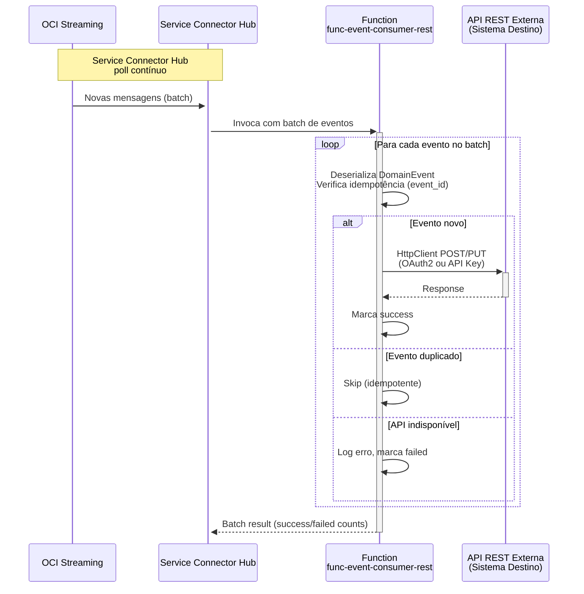
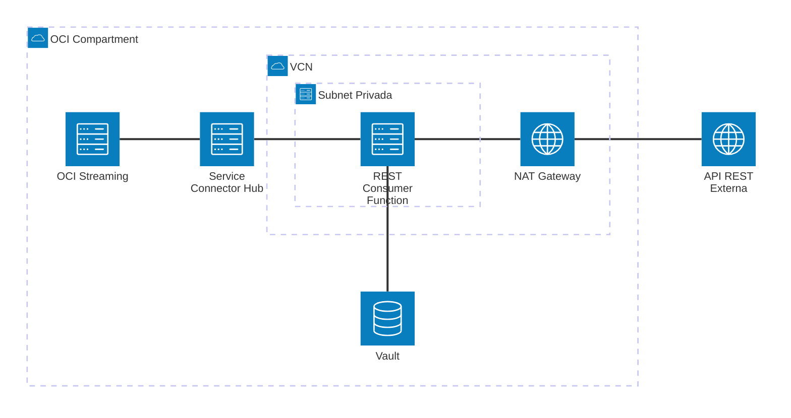

# Padrão 02a — Event-Driven: REST API Consumer

> **Status**: ✅ Implementável com Functions + Service Connector Hub
> **Fase**: 2 — Event-Driven
> **Tipo**: Assíncrono
> **Variante**: Consumer recebe eventos do Streaming via SCH e invoca API REST externa
> **Projeto Java**: `services/func-event-consumer-rest/`
> **Família**: Event-Driven — ver [02 (Producer + Overview)](02-event-driven-pub-sub.md), [02b (Database)](02b-event-driven-database-consumer.md), [02c (Event Chain)](02c-event-driven-event-chain.md)

## 1. Visão Geral

### Descrição
O consumer recebe batches de eventos do OCI Streaming via Service Connector Hub e, para cada evento, invoca uma API REST externa (sistema destino). Combina o padrão **Event-Driven** com o padrão de invocação REST semelhante ao [01a (REST Proxy)](../01-request-reply/01a-request-reply-rest-proxy.md), mas em contexto assíncrono.

### Quando Usar
- O sistema destino expõe uma API REST (HTTP/HTTPS)
- A integração não precisa de resposta síncrona para o produtor original
- Cenários de notificação/integração: receber evento de domínio → chamar sistema externo
- Exemplos: notificar ERP sobre novo pedido, atualizar sistema de tracking, enviar dados para parceiros

### Diagrama de Arquitetura



### Diagrama de Recursos (Terraform)



> **Módulos Terraform necessários:**
>
> | Módulo | Recursos |
> |---|---|
> | **network** | VCN, NAT GW (saída internet), Service GW, NSGs |
> | **iam** | SCH policies (`fn-function`, `fn-invocation`), Function `read secret-bundles` |
> | **functions** | Function `func-event-consumer-rest` (256MB, 120s) — **sem rota API Gateway** |
> | **service-connector** | SCH: source Streaming → target Function (batch 100, timeout 60s) |
> | **observability** | Logs + Alarms |
> | *pré-requisito* | **streaming** (provisionado via [02 base](02-event-driven-pub-sub.md)) |
> | *existente* | **Vault** (OAuth2 credentials para API destino) |

## 2. Projeto Java

### Novo projeto `services/func-event-consumer-rest/`

- **Diretório**: `services/func-event-consumer-rest/`
- **Package**: `com.brx.functions.eventconsumer.rest`
- **Handler**: `EventConsumerRestFunction extends ConnectorHubFunction<DomainEvent>`
- **func.yaml name**: `func-event-consumer-rest`

### Estrutura

```
services/func-event-consumer-rest/
├── pom.xml
├── func.yaml
├── Dockerfile
└── src/
    ├── main/java/com/brx/functions/eventconsumer/rest/
    │   ├── EventConsumerRestFunction.java    # Handler — processa batch, invoca REST
    │   ├── model/
    │   │   └── DomainEvent.java             # DTO do evento (deserializado do Streaming)
    │   ├── client/
    │   │   └── TargetApiClient.java         # HttpClient wrapper (OAuth2 + timeout)
    │   └── service/
    │       └── EventProcessor.java          # Lógica de processamento + idempotência
    └── test/java/com/brx/functions/eventconsumer/rest/
        ├── EventConsumerRestFunctionTest.java
        ├── client/
        │   └── TargetApiClientTest.java
        └── service/
            └── EventProcessorTest.java
```

### Dependências OCI SDK
- `oci-java-sdk-common` (auth Resource Principal)
- `oci-java-sdk-secrets` (se credenciais REST em OCI Vault)

### func.yaml

```yaml
schema_version: 20180708
name: func-event-consumer-rest
version: 0.0.1
runtime: java
build_image: fnproject/fn-java-fdk-build:jdk17-latest
run_image: fnproject/fn-java-fdk:jre17-latest
cmd: com.brx.functions.eventconsumer.rest.EventConsumerRestFunction::handler
memory: 256
timeout: 120
config:
  ENVIRONMENT: dev
  TARGET_API_URL: https://api.destino.example.com/v1/events
  TARGET_API_TIMEOUT_MS: "10000"
  TARGET_API_AUTH_TYPE: oauth2
  VAULT_SECRET_OCID_CLIENT_ID: ocid1.vaultsecret.oc1...
  VAULT_SECRET_OCID_CLIENT_SECRET: ocid1.vaultsecret.oc1...
```

> Timeout 120s — processa batch de múltiplos eventos com chamadas HTTP por item.

## 3. Requisitos de Infraestrutura

> **Pré-requisito**: Producer e Streaming já provisionados via [02 base](02-event-driven-pub-sub.md).

### Terraform — Módulos

| Módulo | Configuração |
|--------|-------------|
| `functions` | `func-event-consumer-rest` (256MB, 120s) — sem rota API Gateway |
| `iam` | Policy: SCH invoca Function + Function lê secrets do Vault |
| `network` | Sem mudança (NSG permite egress HTTPS para API externa) |

### Terraform — Novos Recursos

```hcl
module "fn_event_consumer_rest" {
  source           = "./modules/functions"
  compartment_ocid = var.compartment_ocid
  subnet_id        = module.network.subnet_private_id
  nsg_ids          = [module.network.nsg_functions_id]
  application_name = "app-integration-patterns"
  function_name    = "func-event-consumer-rest"
  function_image   = "gru.ocir.io/${var.ocir_namespace}/patterns/func-event-consumer-rest:0.0.1"
  function_memory  = 256
  function_timeout = 120
  function_config = {
    TARGET_API_URL                  = var.target_api_url
    TARGET_API_TIMEOUT_MS           = "10000"
    TARGET_API_AUTH_TYPE            = "oauth2"
    VAULT_SECRET_OCID_CLIENT_ID     = var.vault_secret_client_id_ocid
    VAULT_SECRET_OCID_CLIENT_SECRET = var.vault_secret_client_secret_ocid
  }
}
```

### Service Connector Hub

```
Source:  OCI Streaming → stream_ocid (do módulo streaming)
Target: OCI Functions → func-event-consumer-rest
Batch:  size = 100, timeout = 60s
```

### IAM — Novas Policies

```hcl
# Service Connector Hub invoca Functions
Allow any-user to use fn-function in compartment <compartment> where all {
  request.principal.type='serviceconnector'
}
Allow any-user to use fn-invocation in compartment <compartment> where all {
  request.principal.type='serviceconnector'
}

# Function lê secrets do Vault (para credenciais OAuth2)
Allow dynamic-group dg-functions-dev to read secret-bundles in compartment <compartment>
```

## 4. Requisitos de Codificação Java

### Handler — `EventConsumerRestFunction.java`

| Aspecto | Especificação |
|---------|--------------|
| Base class | `ConnectorHubFunction<DomainEvent>` (fn-events 1.1.x) |
| `@FnConfiguration` | Lê `TARGET_API_URL`, `TARGET_API_AUTH_TYPE`, inicializa `TargetApiClient` |
| Recebimento | Batch de eventos do Service Connector Hub |
| Processamento | Iterar sobre batch, processar cada evento individualmente |
| Idempotência | Verificar `event_id` contra set de IDs processados (in-memory, hot function) |
| Erro por item | Log do erro, continuar processando demais itens |
| Resposta | Batch result com contagem de success/failure |

### Client — `TargetApiClient.java`

| Aspecto | Especificação |
|---------|--------------|
| HTTP Client | `java.net.http.HttpClient` singleton (cached, hot function) |
| Auth | OAuth2 Client Credentials com token cache (ou API Key header) |
| Timeout | Configurável via `TARGET_API_TIMEOUT_MS` (budget do batch) |
| Retry | 1 retry com backoff linear (budget permitting) |
| Serialização | Jackson para JSON request/response |
| Vault | Leitura de `CLIENT_ID` e `CLIENT_SECRET` do OCI Vault na inicialização |

### Modelo — `DomainEvent.java`

- `event_id`: String (UUID para idempotência)
- `event_type`: String (ex: "order.created")
- `payload`: Object (dados do evento como JSON genérico)
- `correlation_id`: String (opcional, para tracing)
- `timestamp`: String (ISO-8601)

### Tratamento de Erros

| Cenário | Comportamento |
|---------|--------------|
| Evento duplicado (event_id já processado) | Skip, log info |
| API REST timeout | Log error, item marcado como failed, continuar batch |
| API REST 4xx | Log error com body, item failed |
| API REST 5xx | Retry 1x, se falhar novamente: item failed |
| API REST indisponível (connection refused) | Log error, item failed |
| OAuth2 token refresh falha | Log error, batch inteiro falha (sem credenciais) |
| Erro de deserialização do evento | Log error, skip item |

## 5. Sequência de Prompts

### Prompt 0 — Auditoria de Infraestrutura

> **Obrigatório**: Executar ANTES de qualquer implementação.

Verificar se todos os módulos Terraform necessários existem em `infra/` para implementar este padrão.

**Módulos necessários**:
- `modules/network/` — VCN, subnets, gateways, NSGs
- `modules/iam/` — Dynamic Groups, Policies (functions, service-connector)
- `modules/functions/` — Application + Function resource (consumer)
- `modules/service-connector/` — **Service Connector Hub** (source → Function)
- `modules/vault/` — **Vault + Secrets** (target REST API credentials)
- `modules/observability/` — Log Group, Alarms, ONS

**Prompt file**: `@prompts/audit-infra-prerequisites`

<details>
<summary>Fallback — prompt free-text</summary>

```
Usar @oci-terraform para auditar infra/:
1. Verificar existência de cada módulo listado em infra/modules/
2. Para módulos existentes, verificar capabilities
3. Para módulos FALTANTES (service-connector, vault), criar seguindo skills:
   - Service Connector Hub (oci_sch_service_connector)
   - provisioning-oci-vault (Vault + Secrets)
4. Confirmar que IAM policies cobrem: use service-connector, read secret-bundles
5. Reportar gaps e ações corretivas

Seguir especificação docs/patterns/02-event-driven/02a-event-driven-rest-consumer.md seção 3.
```
</details>

### Prompt 1 — Terraform (Function + IAM)

**Prompt file (primário)**: `@prompts/add-functions-infra` com argumentos:
- Function name: `func-event-consumer-rest`
- Application name: `app-integration-patterns` (existente)
- Memory: 256MB, Timeout: 120s
- Docker image: `gru.ocir.io/${ocir_namespace}/patterns/func-event-consumer-rest:0.0.1`

**Complementar**: `@prompts/add-iam` com argumentos:
- Resource type: Functions (consumer) + Service Connector Hub
- Required actions: SCH invoca Function (`fn-function`, `fn-invocation` para `serviceconnector`), Function lê `secret-bundles` (Vault)

<details>
<summary>Fallback — prompt free-text</summary>

```
Usar o agente @oci-terraform para provisionar func-event-consumer-rest:
- Function resource (256MB, 120s) sem rota API Gateway
- IAM: SCH invoca Functions + Function lê secrets do Vault
Seguir especificação docs/patterns/02a-event-driven-rest-consumer.md seção 3.
```
</details>

### Prompt 2 — Java (scaffold + event handler)

**Prompt file (primário)**: `@prompts/add-oci-function` para scaffold com argumentos:
- Function name: `func-event-consumer-rest`
- Handler type: event-driven (Service Connector Hub)
- Function class: `EventConsumerRestFunction`

Seguido de `@prompts/add-event-handler` com argumentos:
- Event source: Service Connector Hub
- Existing function class: `EventConsumerRestFunction`
- Request type: `DomainEvent` (batch)
- Idempotency: sim (`event_id` dedup)

<details>
<summary>Fallback — prompt free-text</summary>

```
Usar o agente @oci-functions-java para criar projeto func-event-consumer-rest
em services/ seguindo docs/patterns/02a-event-driven-rest-consumer.md.
Criar EventConsumerRestFunction com ConnectorHubFunction<DomainEvent>,
processamento de batch com idempotência (event_id dedup) e
erro por item (não falhar batch inteiro).
```
</details>

### Prompt 3 — Java (REST client)

**Prompt file (primário)**: `@prompts/add-rest-client` com argumentos:
- Target API URL: configurável via `TARGET_API_URL`
- Auth method: OAuth2 Client Credentials (secrets no Vault)
- Existing function class: `EventConsumerRestFunction`
- HTTP methods: POST
- Secret management: OCI Vault (`VAULT_SECRET_OCID_CLIENT_ID`, `VAULT_SECRET_OCID_CLIENT_SECRET`)

<details>
<summary>Fallback — prompt free-text</summary>

```
Adicionar TargetApiClient.java ao projeto func-event-consumer-rest com:
- HttpClient Java 17 singleton com OAuth2 Client Credentials
- Token cache com refresh automático
- Credenciais lidas do OCI Vault via SecretsClient
- Timeout configurável via TARGET_API_TIMEOUT_MS
- Retry 1x para 5xx com backoff linear
Seguir skill invoking-rest-apis-from-oci-functions.
```
</details>

### Prompt 4 — Testes

**Prompt file (primário)**: `@prompts/add-function-tests` com argumentos:
- Function class: `EventConsumerRestFunction`
- Event source: Service Connector Hub
- SDK clients to mock: nenhum SDK OCI (HttpClient mockado via mock)
- Additional classes: `TargetApiClient`, `EventProcessor`
- Scenarios: batch 3 eventos OK, evento duplicado (skip), REST API 5xx (retry + fail), REST API timeout, OAuth2 token refresh falha, partial batch success

<details>
<summary>Fallback — prompt free-text</summary>

```
Criar testes para func-event-consumer-rest:
- TargetApiClientTest: mock HttpClient, sucesso, timeout, 5xx com retry, OAuth2 refresh
- EventProcessorTest: processamento OK, evento duplicado (skip), erro em 1 item
- EventConsumerRestFunctionTest: batch 3 eventos, partial success, OAuth2 falha
Usar FnTestingRule + ConnectorHubTestFeature + Mockito.
```
</details>

## 6. Critérios de Verificação

### Testes que Devem Passar

| Teste | Cenário | Resultado |
|-------|---------|----------|
| `testBatchProcessingSuccess` | 3 eventos válidos, API retorna 200 | 3 processados com sucesso |
| `testIdempotentSkip` | Evento com event_id duplicado | Skip, sem reprocessamento |
| `testPartialBatchFailure` | 2 OK + 1 API retorna 500 | 2 success + 1 failure |
| `testApiTimeout` | API não responde dentro do timeout | Item marcado como failed, batch continua |
| `testApiConnectionRefused` | API indisponível | Item marcado como failed, batch continua |
| `testOAuth2TokenRefreshFailure` | Vault indisponível ou credenciais inválidas | Batch inteiro falha |
| `testDeserializationError` | Evento com formato inválido | Skip com log error |

### Comandos de Validação

```bash
cd services/func-event-consumer-rest && mvn clean package
cd infra/env-dev && terraform plan
```

### Comportamento Esperado
1. Service Connector Hub detecta novas mensagens no Stream
2. SCH invoca func-event-consumer-rest com batch de eventos
3. Function obtém token OAuth2 (cache ou refresh via Vault)
4. Para cada evento no batch: deserializa `DomainEvent`, verifica idempotência
5. Eventos novos: POST para `TARGET_API_URL` com payload transformado
6. Eventos duplicados: skip silencioso
7. Retorna resultado do batch com contagem de success/failure
