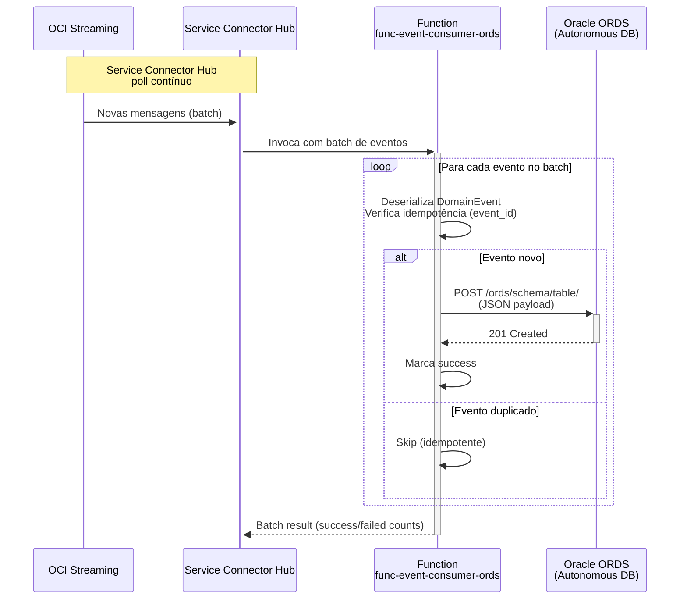
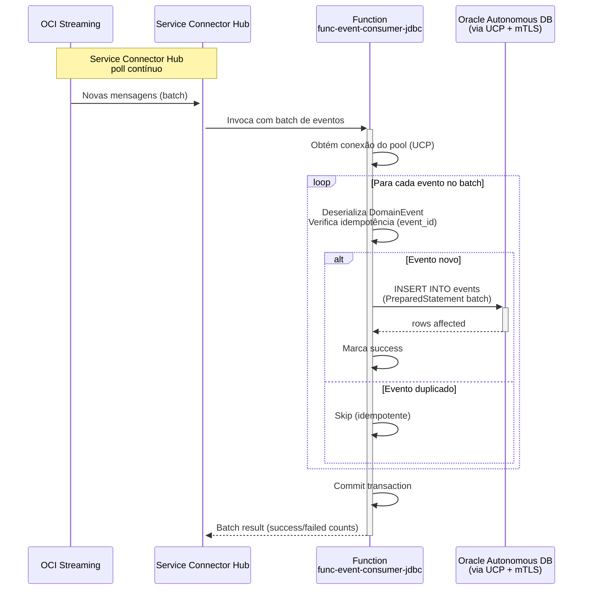
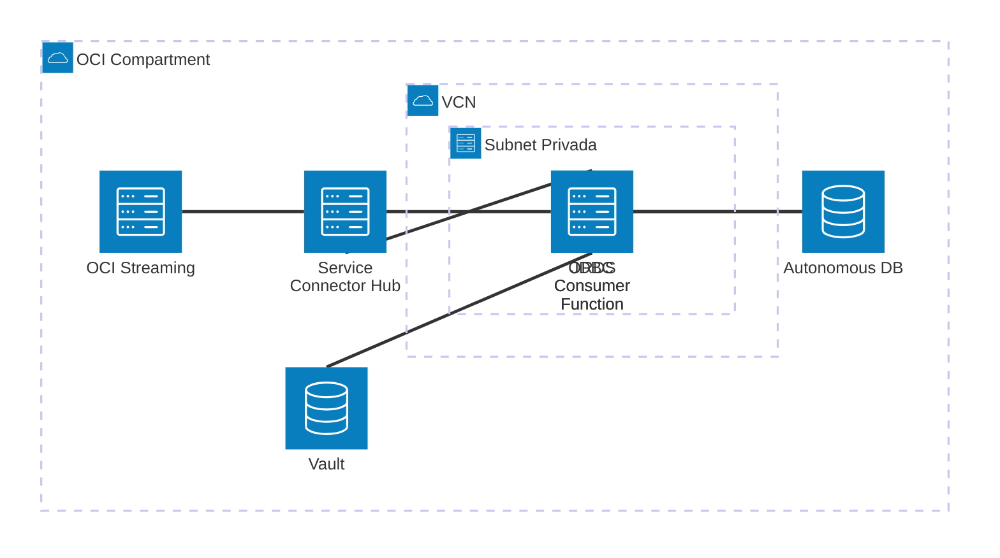

# Padrão 02b — Event-Driven: Database Consumer

> **Status**: ✅ Implementável com Functions + Service Connector Hub
> **Fase**: 2 — Event-Driven
> **Tipo**: Assíncrono
> **Variante**: Consumer recebe eventos do Streaming via SCH e persiste em base de dados
> **Projetos Java**: `services/func-event-consumer-ords/` + `services/func-event-consumer-jdbc/`
> **Família**: Event-Driven — ver [02 (Producer + Overview)](02-event-driven-pub-sub.md), [02a (REST)](02a-event-driven-rest-consumer.md), [02c (Event Chain)](02c-event-driven-event-chain.md)

## 1. Visão Geral

### Descrição
O consumer recebe batches de eventos do OCI Streaming via Service Connector Hub e, para cada evento, persiste os dados em uma base de dados Oracle. Duas implementações distintas cobrem diferentes estratégias de acesso, seguindo o mesmo padrão do [01b (Request-Reply Database)](../01-request-reply/01b-request-reply-database.md):

| Implementação | Acesso | Quando Usar |
|---|---|---|
| **ORDS** | REST API sobre Oracle Autonomous DB | Sem driver JDBC, sem wallet, payload JSON nativo, operações simples (INSERT/UPSERT) |
| **JDBC** | Conexão direta via Oracle UCP | Queries complexas, transações multi-statement, stored procedures, alto throughput |

### Diagrama de Arquitetura — ORDS



### Diagrama de Arquitetura — JDBC



### Diagrama de Recursos (Terraform)



> **Módulos Terraform necessários:**
>
> | Módulo | ORDS | JDBC |
> |---|---|---|
> | **network** | VCN, Service GW, NSGs | VCN, Service GW, NSGs |
> | **iam** | SCH policies, `read secret-bundles` | SCH policies, `read secret-bundles` |
> | **functions** | `func-event-consumer-ords` (256MB, 120s) | `func-event-consumer-jdbc` (512MB, 120s) |
> | **service-connector** | SCH: Streaming → Function | SCH: Streaming → Function |
> | **observability** | Logs + Alarms | Logs + Alarms |
> | *pré-requisito* | **streaming** (via [02 base](02-event-driven-pub-sub.md)) | **streaming** (via [02 base](02-event-driven-pub-sub.md)) |
> | *externo* | **Autonomous DB** (ORDS REST) | **Autonomous DB** (JDBC mTLS) |
> | *existente* | **Vault** (ORDS auth secrets) | **Vault** (DB password + wallet) |

## 2. Projetos Java

### 2.1 Projeto ORDS — `services/func-event-consumer-ords/`

- **Diretório**: `services/func-event-consumer-ords/`
- **Package**: `com.brx.functions.eventconsumer.ords`
- **Handler**: `EventConsumerOrdsFunction extends ConnectorHubFunction<DomainEvent>`
- **func.yaml name**: `func-event-consumer-ords`

#### Estrutura

```
services/func-event-consumer-ords/
├── pom.xml
├── func.yaml
├── Dockerfile
└── src/
    ├── main/java/com/brx/functions/eventconsumer/ords/
    │   ├── EventConsumerOrdsFunction.java    # Handler — processa batch, persiste via ORDS
    │   ├── model/
    │   │   └── DomainEvent.java             # DTO do evento (deserializado do Streaming)
    │   ├── client/
    │   │   └── OrdsClient.java              # HttpClient wrapper para ORDS (OAuth2/Basic)
    │   └── service/
    │       └── EventProcessor.java          # Lógica de processamento + idempotência
    └── test/java/com/brx/functions/eventconsumer/ords/
        ├── EventConsumerOrdsFunctionTest.java
        ├── client/
        │   └── OrdsClientTest.java
        └── service/
            └── EventProcessorTest.java
```

#### Dependências OCI SDK
- `oci-java-sdk-common` (auth Resource Principal)
- `oci-java-sdk-secrets` (credenciais ORDS em OCI Vault)

#### func.yaml

```yaml
schema_version: 20180708
name: func-event-consumer-ords
version: 0.0.1
runtime: java
build_image: fnproject/fn-java-fdk-build:jdk17-latest
run_image: fnproject/fn-java-fdk:jre17-latest
cmd: com.brx.functions.eventconsumer.ords.EventConsumerOrdsFunction::handler
memory: 256
timeout: 120
config:
  ENVIRONMENT: dev
  ORDS_BASE_URL: https://xxxxx.adb.sa-saopaulo-1.oraclecloudapps.com/ords/schema
  ORDS_AUTH_TYPE: oauth2
  VAULT_SECRET_OCID_CLIENT_ID: ocid1.vaultsecret.oc1...
  VAULT_SECRET_OCID_CLIENT_SECRET: ocid1.vaultsecret.oc1...
```

### 2.2 Projeto JDBC — `services/func-event-consumer-jdbc/`

- **Diretório**: `services/func-event-consumer-jdbc/`
- **Package**: `com.brx.functions.eventconsumer.jdbc`
- **Handler**: `EventConsumerJdbcFunction extends ConnectorHubFunction<DomainEvent>`
- **func.yaml name**: `func-event-consumer-jdbc`

#### Estrutura

```
services/func-event-consumer-jdbc/
├── pom.xml
├── func.yaml
├── Dockerfile
└── src/
    ├── main/java/com/brx/functions/eventconsumer/jdbc/
    │   ├── EventConsumerJdbcFunction.java    # Handler — processa batch, persiste via JDBC
    │   ├── model/
    │   │   └── DomainEvent.java             # DTO do evento (deserializado do Streaming)
    │   ├── repository/
    │   │   └── EventRepository.java         # DAO com PreparedStatement batch insert
    │   └── service/
    │       ├── EventProcessor.java          # Lógica de processamento + idempotência
    │       └── WalletManager.java           # Extração e cache do wallet mTLS
    └── test/java/com/brx/functions/eventconsumer/jdbc/
        ├── EventConsumerJdbcFunctionTest.java
        ├── repository/
        │   └── EventRepositoryTest.java
        └── service/
            └── EventProcessorTest.java
```

#### Dependências OCI SDK + JDBC
- `oci-java-sdk-common` (auth Resource Principal)
- `oci-java-sdk-secrets` (wallet e credenciais em OCI Vault)
- `ojdbc11` (Oracle JDBC driver)
- `ucp` (Oracle Universal Connection Pool)
- `oraclepki` + `osdt_core` + `osdt_cert` (mTLS wallet support)

#### func.yaml

```yaml
schema_version: 20180708
name: func-event-consumer-jdbc
version: 0.0.1
runtime: java
build_image: fnproject/fn-java-fdk-build:jdk17-latest
run_image: fnproject/fn-java-fdk:jre17-latest
cmd: com.brx.functions.eventconsumer.jdbc.EventConsumerJdbcFunction::handler
memory: 512
timeout: 120
config:
  ENVIRONMENT: dev
  DB_TNS_NAME: mydb_tp
  DB_USER: EVENTS_USER
  VAULT_SECRET_OCID_DB_PASSWORD: ocid1.vaultsecret.oc1...
  VAULT_SECRET_OCID_WALLET: ocid1.vaultsecret.oc1...
```

> Memory 512MB — JDBC driver + connection pool requerem mais memória. Timeout 120s — batch processing.

## 3. Requisitos de Infraestrutura

> **Pré-requisito**: Producer e Streaming já provisionados via [02 base](02-event-driven-pub-sub.md).

### Terraform — Módulos por Variante

| Módulo | ORDS | JDBC |
|--------|------|------|
| `functions` | `func-event-consumer-ords` (256MB, 120s) | `func-event-consumer-jdbc` (512MB, 120s) |
| `iam` | SCH invoca Function + Function lê Vault | SCH invoca Function + Function lê Vault |
| `network` | NSG: egress HTTPS para ORDS endpoint | NSG: egress 1522 para DB private endpoint |

### Terraform — Novos Recursos

```hcl
# ORDS Consumer
module "fn_event_consumer_ords" {
  source           = "./modules/functions"
  compartment_ocid = var.compartment_ocid
  subnet_id        = module.network.subnet_private_id
  nsg_ids          = [module.network.nsg_functions_id]
  application_name = "app-integration-patterns"
  function_name    = "func-event-consumer-ords"
  function_image   = "gru.ocir.io/${var.ocir_namespace}/patterns/func-event-consumer-ords:0.0.1"
  function_memory  = 256
  function_timeout = 120
  function_config = {
    ORDS_BASE_URL                   = var.ords_base_url
    ORDS_AUTH_TYPE                  = "oauth2"
    VAULT_SECRET_OCID_CLIENT_ID     = var.vault_secret_ords_client_id_ocid
    VAULT_SECRET_OCID_CLIENT_SECRET = var.vault_secret_ords_client_secret_ocid
  }
}

# JDBC Consumer
module "fn_event_consumer_jdbc" {
  source           = "./modules/functions"
  compartment_ocid = var.compartment_ocid
  subnet_id        = module.network.subnet_private_id
  nsg_ids          = [module.network.nsg_functions_id]
  application_name = "app-integration-patterns"
  function_name    = "func-event-consumer-jdbc"
  function_image   = "gru.ocir.io/${var.ocir_namespace}/patterns/func-event-consumer-jdbc:0.0.1"
  function_memory  = 512
  function_timeout = 120
  function_config = {
    DB_TNS_NAME                  = var.db_tns_name
    DB_USER                      = var.db_user
    VAULT_SECRET_OCID_DB_PASSWORD = var.vault_secret_db_password_ocid
    VAULT_SECRET_OCID_WALLET      = var.vault_secret_wallet_ocid
  }
}
```

### Service Connector Hub

```
Source:  OCI Streaming → stream_ocid (do módulo streaming)
Target: OCI Functions → func-event-consumer-ords OU func-event-consumer-jdbc
Batch:  size = 100, timeout = 60s
```

### IAM — Novas Policies

```hcl
# Service Connector Hub invoca Functions
Allow any-user to use fn-function in compartment <compartment> where all {
  request.principal.type='serviceconnector'
}
Allow any-user to use fn-invocation in compartment <compartment> where all {
  request.principal.type='serviceconnector'
}

# Function lê secrets do Vault (credenciais DB/ORDS + wallet)
Allow dynamic-group dg-functions-dev to read secret-bundles in compartment <compartment>
```

## 4. Requisitos de Codificação Java

### 4.1 ORDS — `EventConsumerOrdsFunction.java`

| Aspecto | Especificação |
|---------|--------------|
| Base class | `ConnectorHubFunction<DomainEvent>` (fn-events 1.1.x) |
| `@FnConfiguration` | Lê `ORDS_BASE_URL`, `ORDS_AUTH_TYPE`, inicializa `OrdsClient` |
| Fluxo | Batch → iterar → idempotência → POST ORDS → commit implícito |

#### Client — `OrdsClient.java`

| Aspecto | Especificação |
|---------|--------------|
| HTTP Client | `java.net.http.HttpClient` singleton (cached, hot function) |
| Auth | OAuth2 Client Credentials com token cache (credenciais do Vault) |
| Endpoint | `ORDS_BASE_URL` + `/events/` (REST endpoint auto-gerado ou custom) |
| Serialização | Jackson → JSON payload direto (ORDS aceita JSON nativo) |
| Timeout | Configurável, budget do batch |
| Insert | POST para endpoint ORDS com JSON body |
| Upsert | POST com `If-Match` header ou endpoint específico de upsert |

### 4.2 JDBC — `EventConsumerJdbcFunction.java`

| Aspecto | Especificação |
|---------|--------------|
| Base class | `ConnectorHubFunction<DomainEvent>` (fn-events 1.1.x) |
| `@FnConfiguration` | Inicializa UCP `PoolDataSource`, extrai wallet do Vault |
| Fluxo | Batch → obter conexão → iterar → idempotência → batch INSERT → COMMIT |

#### Repository — `EventRepository.java`

| Aspecto | Especificação |
|---------|--------------|
| Pool | `PoolDataSource` (UCP) singleton, 1-3 conexões, cached (hot function) |
| Auth | mTLS wallet + DB user/password do Vault |
| Insert | `PreparedStatement` com `addBatch()` para insert eficiente |
| Idempotência DB | `INSERT ... ON CONFLICT (event_id) DO NOTHING` ou `MERGE INTO` |
| Transaction | Uma transação por batch — commit após todos os inserts |
| Rollback | Se erro crítico, rollback do batch inteiro |

#### Service — `WalletManager.java`

| Aspecto | Especificação |
|---------|--------------|
| Wallet | Lido do OCI Vault (Base64-encoded zip) na inicialização |
| Cache | Extraído para `/tmp/wallet/` (cold start), reutilizado (hot function) |
| TNS | Configurado via `DB_TNS_NAME` apontando para wallet `tnsnames.ora` |

### Modelo — `DomainEvent.java` (compartilhado)

- `event_id`: String (UUID para idempotência)
- `event_type`: String (ex: "order.created")
- `payload`: Object (dados do evento como JSON genérico)
- `correlation_id`: String (opcional, para tracing)
- `timestamp`: String (ISO-8601)

### Tratamento de Erros

| Cenário | ORDS | JDBC |
|---------|------|------|
| Evento duplicado | Skip (idempotente) | `MERGE INTO` ignora duplicata |
| DB/ORDS timeout | Item failed, continuar batch | Item failed, continuar batch |
| DB/ORDS indisponível | Batch inteiro falha | Batch inteiro falha (sem conexão) |
| Constraint violation | Item failed com log | Rollback, item failed com log |
| Wallet expirado (JDBC) | N/A | Batch inteiro falha, log error |
| Auth failure (Vault) | Batch falha (sem credenciais) | Batch falha (sem credenciais) |
| Erro de deserialização | Skip item com log | Skip item com log |

## 5. Sequência de Prompts

### Prompt 0 — Auditoria de Infraestrutura

> **Obrigatório**: Executar ANTES de qualquer implementação.

Verificar se todos os módulos Terraform necessários existem em `infra/` para implementar este padrão.

**Módulos necessários**:
- `modules/network/` — VCN, subnets, gateways, NSGs
- `modules/iam/` — Dynamic Groups, Policies (functions, service-connector)
- `modules/functions/` — Application + Function resources (×2: consumer-ords, consumer-jdbc)
- `modules/service-connector/` — **Service Connector Hub** (source → Function)
- `modules/vault/` — **Vault + Secrets** (DB wallet, ORDS credentials, JDBC connection string)
- `modules/observability/` — Log Group, Alarms, ONS

**Prompt file**: `@prompts/audit-infra-prerequisites`

<details>
<summary>Fallback — prompt free-text</summary>

```
Usar @oci-terraform para auditar infra/:
1. Verificar existência de cada módulo listado em infra/modules/
2. Para módulos existentes, verificar capabilities
3. Para módulos FALTANTES (service-connector, vault), criar seguindo skills:
   - Service Connector Hub (oci_sch_service_connector)
   - provisioning-oci-vault (Vault + Secrets para DB wallet)
4. Confirmar que IAM policies cobrem: use service-connector, read secret-bundles
5. Reportar gaps e ações corretivas

Seguir especificação docs/patterns/02-event-driven/02b-event-driven-database-consumer.md seção 3.
```
</details>

### Prompt 1 — Terraform (Functions + IAM)

**Prompt file (primário)**: `@prompts/add-functions-infra` (2 vezes) com argumentos:
- Function 1: `func-event-consumer-ords`, Memory: 256MB, Timeout: 120s
- Function 2: `func-event-consumer-jdbc`, Memory: 512MB, Timeout: 120s
- Application name: `app-integration-patterns` (existente)

**Complementar**: `@prompts/add-iam` com argumentos:
- Resource type: Functions (consumers) + Service Connector Hub
- Required actions: SCH invoca Functions, Functions lêem `secret-bundles` do Vault

<details>
<summary>Fallback — prompt free-text</summary>

```
Usar o agente @oci-terraform para provisionar:
1. func-event-consumer-ords: Function (256MB, 120s) sem rota API Gateway
2. func-event-consumer-jdbc: Function (512MB, 120s) sem rota API Gateway
3. IAM: SCH invoca Functions + Functions lêem secrets do Vault
Seguir especificação docs/patterns/02b-event-driven-database-consumer.md seção 3.
```
</details>

### Prompt 2 — Java (ORDS consumer)

**Prompt file (primário)**: `@prompts/add-oci-function` para scaffold com argumentos:
- Function name: `func-event-consumer-ords`
- Handler type: event-driven (Service Connector Hub)
- Function class: `EventConsumerOrdsFunction`

Seguido de `@prompts/add-event-handler` com argumentos:
- Event source: Service Connector Hub
- Existing function class: `EventConsumerOrdsFunction`
- Request type: `DomainEvent` (batch)
- Idempotency: sim (`event_id` dedup)

Seguido de `@prompts/add-database-client` com argumentos:
- Database type: ORDS
- Existing function class: `EventConsumerOrdsFunction`
- Autonomous DB URL: configurável via `ORDS_BASE_URL`
- Auth method: OAuth2 Client Credentials (Vault)
- CRUD operations: INSERT (POST)

<details>
<summary>Fallback — prompt free-text</summary>

```
Usar o agente @oci-functions-java para criar projeto func-event-consumer-ords
em services/ seguindo docs/patterns/02b-event-driven-database-consumer.md.
Criar EventConsumerOrdsFunction com ConnectorHubFunction<DomainEvent>,
OrdsClient com HttpClient + OAuth2, batch processing com idempotência.
Seguir skill invoking-rest-apis-from-oci-functions (ORDS é REST).
```
</details>

### Prompt 3 — Java (JDBC consumer)

**Prompt file (primário)**: `@prompts/add-oci-function` para scaffold com argumentos:
- Function name: `func-event-consumer-jdbc`
- Handler type: event-driven (Service Connector Hub)
- Function class: `EventConsumerJdbcFunction`

Seguido de `@prompts/add-event-handler` com argumentos:
- Event source: Service Connector Hub
- Existing function class: `EventConsumerJdbcFunction`
- Request type: `DomainEvent` (batch)
- Idempotency: sim (`event_id` dedup via `MERGE INTO`)

Seguido de `@prompts/add-database-client` com argumentos:
- Database type: JDBC
- Existing function class: `EventConsumerJdbcFunction`
- Autonomous DB details: TNS via `DB_TNS_NAME`
- Auth method: mTLS wallet + password (Vault)
- Vault secret OCIDs: `VAULT_SECRET_OCID_DB_PASSWORD`, `VAULT_SECRET_OCID_WALLET`
- CRUD operations: batch INSERT (`PreparedStatement.addBatch()`)

<details>
<summary>Fallback — prompt free-text</summary>

```
Usar o agente @oci-functions-java para criar projeto func-event-consumer-jdbc
em services/ seguindo docs/patterns/02b-event-driven-database-consumer.md.
Criar EventConsumerJdbcFunction com ConnectorHubFunction<DomainEvent>,
EventRepository com UCP PoolDataSource + mTLS wallet,
WalletManager para extração do Vault, batch INSERT com MERGE INTO.
Seguir skill developing-oci-functions-java (JDBC).
```
</details>

### Prompt 4 — Testes (ORDS)

**Prompt file (primário)**: `@prompts/add-function-tests` com argumentos:
- Function class: `EventConsumerOrdsFunction`
- Event source: Service Connector Hub
- SDK clients to mock: nenhum SDK OCI (HttpClient mockado)
- Additional classes: `OrdsClient`, `EventProcessor`
- Scenarios: batch 3 eventos OK, evento duplicado (skip), ORDS timeout, ORDS 4xx, partial batch success

<details>
<summary>Fallback — prompt free-text</summary>

```
Criar testes para func-event-consumer-ords:
- OrdsClientTest: mock HttpClient, insert sucesso, timeout, 4xx, OAuth2 refresh
- EventProcessorTest: processamento OK, duplicado (skip), erro em 1 item
- EventConsumerOrdsFunctionTest: batch 3 eventos, partial success
Usar FnTestingRule + ConnectorHubTestFeature + Mockito.
```
</details>

### Prompt 5 — Testes (JDBC)

**Prompt file (primário)**: `@prompts/add-function-tests` com argumentos:
- Function class: `EventConsumerJdbcFunction`
- Event source: Service Connector Hub
- SDK clients to mock: nenhum SDK OCI (DataSource mockado)
- Additional classes: `EventRepository`, `EventProcessor`, `WalletManager`
- Scenarios: batch 3 eventos OK, evento duplicado (MERGE ignora), constraint violation, connection pool exhausted, wallet expirado, partial batch success

<details>
<summary>Fallback — prompt free-text</summary>

```
Criar testes para func-event-consumer-jdbc:
- EventRepositoryTest: mock DataSource/Connection, batch insert OK, MERGE duplicado,
  constraint violation, connection timeout
- WalletManagerTest: wallet extraction, cache hit, wallet inválido
- EventConsumerJdbcFunctionTest: batch 3 eventos, partial success, pool exhausted
Usar FnTestingRule + ConnectorHubTestFeature + Mockito.
```
</details>

## 6. Critérios de Verificação

### Testes que Devem Passar — ORDS

| Teste | Cenário | Resultado |
|-------|---------|----------|
| `testOrdsBatchSuccess` | 3 eventos válidos, ORDS retorna 201 | 3 insertados com sucesso |
| `testOrdsIdempotentSkip` | Evento com event_id duplicado | Skip, sem reprocessamento |
| `testOrdsPartialFailure` | 2 OK + 1 ORDS retorna 409 | 2 success + 1 failure |
| `testOrdsTimeout` | ORDS não responde | Item failed, batch continua |
| `testOrdsUnavailable` | ORDS indisponível | Batch inteiro falha |
| `testOrdsOAuth2Failure` | Vault indisponível | Batch falha (sem credenciais) |
| `testOrdsDeserializationError` | Evento malformado | Skip com log error |

### Testes que Devem Passar — JDBC

| Teste | Cenário | Resultado |
|-------|---------|----------|
| `testJdbcBatchInsertSuccess` | 3 eventos válidos | 3 rows inserted, commit |
| `testJdbcMergeDuplicate` | Evento com event_id existente na tabela | MERGE ignora, sem erro |
| `testJdbcPartialFailure` | 2 OK + 1 constraint violation | Rollback batch, log error |
| `testJdbcConnectionTimeout` | DB não responde | Batch inteiro falha |
| `testJdbcPoolExhausted` | Todas conexões em uso | Batch falha após timeout |
| `testJdbcWalletExpired` | Wallet mTLS inválido | Batch falha na inicialização |
| `testJdbcWalletCache` | Segunda invocação (hot function) | Wallet reutilizado do cache |

### Comandos de Validação

```bash
cd services/func-event-consumer-ords && mvn clean package
cd services/func-event-consumer-jdbc && mvn clean package
cd infra/env-dev && terraform plan
```

### Comportamento Esperado — ORDS
1. Service Connector Hub detecta novas mensagens no Stream
2. SCH invoca func-event-consumer-ords com batch de eventos
3. Function obtém token OAuth2 (cache ou refresh via Vault)
4. Para cada evento: deserializa `DomainEvent`, verifica idempotência (in-memory)
5. Eventos novos: POST para `ORDS_BASE_URL/events/` com JSON payload
6. ORDS insere na tabela do Autonomous DB
7. Retorna resultado do batch com contagem de success/failure

### Comportamento Esperado — JDBC
1. Service Connector Hub detecta novas mensagens no Stream
2. SCH invoca func-event-consumer-jdbc com batch de eventos
3. Function obtém conexão do UCP pool (mTLS wallet + credenciais do Vault)
4. Para cada evento: deserializa `DomainEvent`
5. Executa `MERGE INTO events (...) VALUES (...)` via `PreparedStatement.addBatch()`
6. Commit da transação (todos os inserts de uma vez)
7. Eventos com `event_id` já existente são ignorados pelo `MERGE`
8. Retorna resultado do batch com contagem de success/failure
