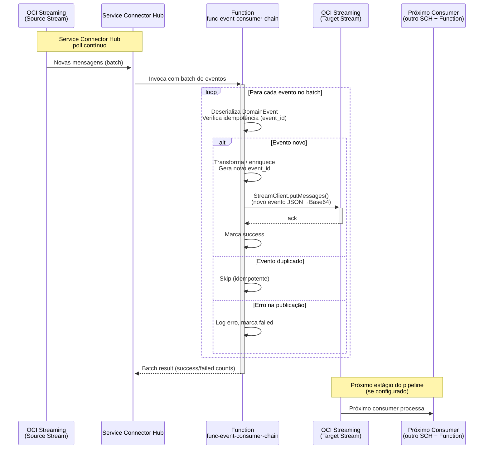
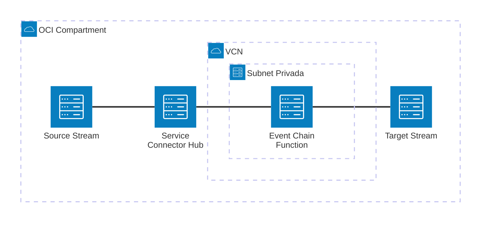

# Padrão 02c — Event-Driven: Event Chain

> **Status**: ✅ Implementável com Functions + Service Connector Hub
> **Fase**: 2 — Event-Driven
> **Tipo**: Assíncrono
> **Variante**: Consumer recebe eventos do Streaming via SCH e re-publica em outro serviço (event chaining)
> **Projeto Java**: `services/func-event-consumer-chain/`
> **Família**: Event-Driven — ver [02 (Producer + Overview)](02-event-driven-pub-sub.md), [02a (REST)](02a-event-driven-rest-consumer.md), [02b (Database)](02b-event-driven-database-consumer.md)

## 1. Visão Geral

### Descrição
O consumer recebe batches de eventos do OCI Streaming via Service Connector Hub, transforma os dados e re-publica em outro serviço de mensageria OCI. Este padrão implementa **event chaining** (pipeline de eventos) — análogo ao [01c (Event Publish)](../01-request-reply/01c-request-reply-event-publish.md) mas no lado do consumo, criando pipelines de processamento assíncronos.

### Quando Usar
- Pipeline de transformação de eventos (ETL event-driven)
- Fan-out: evento de domínio gera múltiplos eventos derivados
- Routing: direcionar eventos para diferentes destinos baseado em `event_type`
- Enriquecimento: adicionar dados ao evento antes de re-publicar
- Bridge entre serviços: Streaming → Queue (para DLQ), Streaming → Notifications (para alertas)

### Targets Suportados

| Target | Serviço OCI | Cenário |
|--------|-------------|---------|
| Outro Stream | OCI Streaming | Pipeline de processamento, routing por `event_type`, enriquecimento |
| Queue | OCI Queue | Entregar evento para consumer específico, DLQ nativa |
| Notification | OCI Notifications (ONS) | Fan-out para múltiplos subscribers, alertas |

> Este documento usa **OCI Streaming** como target principal. Para Queue e Notifications, a estrutura do publisher muda (conforme [01c](../01-request-reply/01c-request-reply-event-publish.md)), mas o handler e a lógica de processamento são idênticos.

### Diagrama de Arquitetura



### Diagrama de Recursos (Terraform)



> **Módulos Terraform necessários:**
>
> | Módulo | Recursos |
> |---|---|
> | **network** | VCN, Service GW, NSGs (streaming via private endpoint) |
> | **iam** | SCH policies (`fn-function`, `fn-invocation`), Function `use stream-push` |
> | **functions** | Function `func-event-consumer-chain` (256MB, 120s) — **sem rota API Gateway** |
> | **streaming** | Target Stream (**novo**, mesmo pool do source) |
> | **service-connector** | SCH: source Stream → target Function (batch 100, timeout 60s) |
> | **observability** | Logs + Alarms |
> | *pré-requisito* | **streaming** source (provisionado via [02 base](02-event-driven-pub-sub.md)) |

## 2. Projeto Java

### Novo projeto `services/func-event-consumer-chain/`

- **Diretório**: `services/func-event-consumer-chain/`
- **Package**: `com.brx.functions.eventconsumer.chain`
- **Handler**: `EventConsumerChainFunction extends ConnectorHubFunction<DomainEvent>`
- **func.yaml name**: `func-event-consumer-chain`

### Estrutura

```
services/func-event-consumer-chain/
├── pom.xml
├── func.yaml
├── Dockerfile
└── src/
    ├── main/java/com/brx/functions/eventconsumer/chain/
    │   ├── EventConsumerChainFunction.java   # Handler — processa batch, re-publica
    │   ├── model/
    │   │   ├── DomainEvent.java             # DTO do evento fonte (deserializado do Streaming)
    │   │   └── TransformedEvent.java        # DTO do evento transformado (para re-publicação)
    │   ├── publisher/
    │   │   └── StreamingPublisher.java      # OCI SDK StreamClient wrapper (target stream)
    │   └── service/
    │       ├── EventProcessor.java          # Lógica de processamento + idempotência
    │       └── EventTransformer.java        # Lógica de transformação / enriquecimento
    └── test/java/com/brx/functions/eventconsumer/chain/
        ├── EventConsumerChainFunctionTest.java
        ├── publisher/
        │   └── StreamingPublisherTest.java
        └── service/
            ├── EventProcessorTest.java
            └── EventTransformerTest.java
```

### Dependências OCI SDK
- `oci-java-sdk-common` (auth Resource Principal)
- `oci-java-sdk-streaming` (StreamClient para re-publicação)

### func.yaml

```yaml
schema_version: 20180708
name: func-event-consumer-chain
version: 0.0.1
runtime: java
build_image: fnproject/fn-java-fdk-build:jdk17-latest
run_image: fnproject/fn-java-fdk:jre17-latest
cmd: com.brx.functions.eventconsumer.chain.EventConsumerChainFunction::handler
memory: 256
timeout: 120
config:
  ENVIRONMENT: dev
  TARGET_STREAM_OCID: ocid1.stream.oc1...
  TARGET_STREAM_ENDPOINT: https://cell-1.streaming.sa-saopaulo-1.oci.oraclecloud.com
  TRANSFORM_MODE: enrich
```

> `TRANSFORM_MODE`: `enrich` (adiciona campos), `route` (direciona por event_type), `split` (1 evento → N eventos).

## 3. Requisitos de Infraestrutura

> **Pré-requisito**: Producer e Source Stream já provisionados via [02 base](02-event-driven-pub-sub.md).

### Terraform — Módulos

| Módulo | Configuração |
|--------|-------------|
| `streaming` | Target Stream (pode ser novo stream no mesmo pool ou stream existente) |
| `functions` | `func-event-consumer-chain` (256MB, 120s) — sem rota API Gateway |
| `iam` | Policy: SCH invoca Function + Function publica em Streaming (target) |
| `network` | Sem mudança (streaming via private endpoint na mesma subnet) |

### Terraform — Novos Recursos

```hcl
# Target Stream (se diferente do source)
resource "oci_streaming_stream" "target" {
  name               = "${var.stream_name}-processed"
  stream_pool_id     = module.streaming.stream_pool_id  # mesmo pool
  partitions         = var.target_partitions
  retention_in_hours = var.target_retention_hours
}

# Consumer Function
module "fn_event_consumer_chain" {
  source           = "./modules/functions"
  compartment_ocid = var.compartment_ocid
  subnet_id        = module.network.subnet_private_id
  nsg_ids          = [module.network.nsg_functions_id]
  application_name = "app-integration-patterns"
  function_name    = "func-event-consumer-chain"
  function_image   = "gru.ocir.io/${var.ocir_namespace}/patterns/func-event-consumer-chain:0.0.1"
  function_memory  = 256
  function_timeout = 120
  function_config = {
    TARGET_STREAM_OCID     = oci_streaming_stream.target.id
    TARGET_STREAM_ENDPOINT = module.streaming.messages_endpoint
    TRANSFORM_MODE         = "enrich"
  }
}
```

### Service Connector Hub

```
Source:  OCI Streaming → source stream_ocid (eventos originais)
Target: OCI Functions → func-event-consumer-chain
Batch:  size = 100, timeout = 60s
```

### IAM — Novas Policies

```hcl
# Service Connector Hub invoca Functions
Allow any-user to use fn-function in compartment <compartment> where all {
  request.principal.type='serviceconnector'
}
Allow any-user to use fn-invocation in compartment <compartment> where all {
  request.principal.type='serviceconnector'
}

# Function publica no target stream
Allow dynamic-group dg-functions-dev to use stream-push in compartment <compartment>
```

## 4. Requisitos de Codificação Java

### Handler — `EventConsumerChainFunction.java`

| Aspecto | Especificação |
|---------|--------------|
| Base class | `ConnectorHubFunction<DomainEvent>` (fn-events 1.1.x) |
| `@FnConfiguration` | Lê `TARGET_STREAM_OCID`, `TARGET_STREAM_ENDPOINT`, `TRANSFORM_MODE`, inicializa `StreamingPublisher` + `EventTransformer` |
| Recebimento | Batch de eventos do Service Connector Hub |
| Processamento | Iterar → idempotência → transformar → re-publicar |
| Idempotência | Verificar `event_id` do evento original (in-memory, hot function) |
| Erro por item | Log do erro, continuar processando demais itens |
| Resposta | Batch result com contagem de success/failure |

### Publisher — `StreamingPublisher.java`

| Aspecto | Especificação |
|---------|--------------|
| Client | `StreamClient` singleton (Resource Principal auth, cached) |
| Endpoint | `TARGET_STREAM_ENDPOINT` (pode ser diferente do source) |
| Stream | `TARGET_STREAM_OCID` (stream destino, diferente do source) |
| Serialização | Jackson → JSON bytes → Base64 encode |
| Key | `event_type` do evento transformado como partition key |
| Verificação | Checar `entry.getError()` em cada `PutMessagesResultEntry` |

### Service — `EventTransformer.java`

| Aspecto | Especificação |
|---------|--------------|
| Input | `DomainEvent` (evento original do source stream) |
| Output | `TransformedEvent` (evento para o target stream) |
| Modes | `enrich`: adiciona campos (timestamp, source_event_id, metadata) |
| | `route`: filtra por `event_type`, descarta eventos não relevantes |
| | `split`: 1 evento → N eventos derivados (fan-out) |
| ID | Gera novo `event_id` (UUID) para o evento transformado |
| Lineage | Preserva `source_event_id` e `correlation_id` para tracing |

### Modelos (DTOs)

**`DomainEvent.java`** (input — evento original):
- `event_id`: String (UUID do evento original, para idempotência)
- `event_type`: String (ex: "order.created")
- `payload`: Object (dados do evento)
- `correlation_id`: String (opcional)
- `timestamp`: String (ISO-8601)

**`TransformedEvent.java`** (output — evento transformado):
- `event_id`: String (novo UUID para o evento transformado)
- `source_event_id`: String (UUID do evento original — lineage)
- `event_type`: String (pode ser diferente do original, ex: "order.enriched")
- `payload`: Object (dados transformados/enriquecidos)
- `correlation_id`: String (preservado do original)
- `timestamp`: String (ISO-8601 do momento da transformação)

### Tratamento de Erros

| Cenário | Comportamento |
|---------|--------------|
| Evento duplicado (event_id já processado) | Skip, log info |
| Transformação falha (dados inválidos) | Log error, skip item |
| Target stream indisponível | Log error, item marcado como failed |
| Target stream timeout | Log error, item failed, continuar batch |
| Publicação parcial falha | Verificar `getError()` por mensagem, marcar failed |
| Evento filtrado (mode=route, tipo não relevante) | Skip silencioso (não é erro) |
| Erro de deserialização do evento source | Log error, skip item |

## 5. Sequência de Prompts

### Prompt 0 — Auditoria de Infraestrutura

> **Obrigatório**: Executar ANTES de qualquer implementação.

Verificar se todos os módulos Terraform necessários existem em `infra/` para implementar este padrão.

**Módulos necessários**:
- `modules/network/` — VCN, subnets, gateways, NSGs
- `modules/iam/` — Dynamic Groups, Policies (functions, streaming, service-connector)
- `modules/functions/` — Application + Function resource (processor)
- `modules/streaming/` — **Stream Pool + Streams** (×2: source-stream, processed-stream)
- `modules/service-connector/` — **Service Connector Hub** (Streaming → Function)
- `modules/observability/` — Log Group, Alarms, ONS

**Prompt file**: `@prompts/audit-infra-prerequisites`

<details>
<summary>Fallback — prompt free-text</summary>

```
Usar @oci-terraform para auditar infra/:
1. Verificar existência de cada módulo listado em infra/modules/
2. Para módulos existentes, verificar capabilities
3. Para módulos FALTANTES (streaming, service-connector), criar seguindo skills:
   - provisioning-oci-streaming (2 Streams: source + processed)
   - Service Connector Hub (oci_sch_service_connector)
4. Confirmar que IAM policies cobrem: stream-push, stream-pull, use service-connector
5. Reportar gaps e ações corretivas

Seguir especificação docs/patterns/02-event-driven/02c-event-driven-event-chain.md seção 3.
```
</details>

### Prompt 1 — Terraform (Streaming target + Function + IAM)

**Prompt file (primário)**: `@prompts/add-streaming` com argumentos:
- Stream name: `event-stream-processed` (target stream)
- Stream pool: existente (mesmo pool do source stream)
- Partitions: 3
- Retention: 7 dias (168h)

**Complementar**: `@prompts/add-functions-infra` com argumentos:
- Function name: `func-event-consumer-chain`
- Application name: `app-integration-patterns` (existente)
- Memory: 256MB, Timeout: 120s

**Complementar**: `@prompts/add-iam` com argumentos:
- Resource type: Functions (consumer) + Service Connector Hub
- Required actions: SCH invoca Function, Function publica em Streaming (`stream-push`)

<details>
<summary>Fallback — prompt free-text</summary>

```
Usar o agente @oci-terraform para provisionar:
1. Target stream (event-stream-processed) no mesmo stream pool
2. func-event-consumer-chain: Function (256MB, 120s) sem rota API Gateway
3. IAM: SCH invoca Functions + Functions publicam em stream-push
Seguir especificação docs/patterns/02c-event-driven-event-chain.md seção 3.
```
</details>

### Prompt 2 — Java (scaffold + event handler)

**Prompt file (primário)**: `@prompts/add-oci-function` para scaffold com argumentos:
- Function name: `func-event-consumer-chain`
- Handler type: event-driven (Service Connector Hub)
- Function class: `EventConsumerChainFunction`

Seguido de `@prompts/add-event-handler` com argumentos:
- Event source: Service Connector Hub
- Existing function class: `EventConsumerChainFunction`
- Request type: `DomainEvent` (batch)
- Idempotency: sim (`event_id` dedup)

<details>
<summary>Fallback — prompt free-text</summary>

```
Usar o agente @oci-functions-java para criar projeto func-event-consumer-chain
em services/ seguindo docs/patterns/02c-event-driven-event-chain.md.
Criar EventConsumerChainFunction com ConnectorHubFunction<DomainEvent>,
processamento de batch com idempotência (event_id dedup) e
erro por item (não falhar batch inteiro).
```
</details>

### Prompt 3 — Java (publisher + transformer)

**Prompt file (primário)**: `@prompts/add-event-publishing` com argumentos:
- Target service: OCI Streaming (target stream, diferente do source)
- Existing function class: `EventConsumerChainFunction`
- Message format: JSON com `TransformedEvent` (event_id, source_event_id, event_type, payload)
- Volume: batch (múltiplas mensagens por invocação)

<details>
<summary>Fallback — prompt free-text</summary>

```
Adicionar ao projeto func-event-consumer-chain:
1. StreamingPublisher.java com StreamClient singleton (Resource Principal)
   para publicar no TARGET_STREAM_OCID, serialização JSON→Base64
2. EventTransformer.java com modos enrich/route/split,
   geração de novo event_id e preservação de source_event_id
3. TransformedEvent.java como DTO de saída
Seguir skill publishing-events-from-oci-functions.
```
</details>

### Prompt 4 — Testes

**Prompt file (primário)**: `@prompts/add-function-tests` com argumentos:
- Function class: `EventConsumerChainFunction`
- Event source: Service Connector Hub
- SDK clients to mock: `StreamClient` (target publisher)
- Additional classes: `StreamingPublisher`, `EventTransformer`, `EventProcessor`
- Scenarios: batch 3 eventos OK (enrich mode), evento duplicado (skip), target stream indisponível, transformação falha, route mode filtra evento, split mode gera N eventos, partial batch success

<details>
<summary>Fallback — prompt free-text</summary>

```
Criar testes para func-event-consumer-chain:
- StreamingPublisherTest: mock StreamClient, publish sucesso, falha parcial, serialização Base64
- EventTransformerTest: enrich mode (adiciona campos), route mode (filtra), split mode (1→N)
- EventProcessorTest: processamento OK, duplicado (skip), erro em 1 item
- EventConsumerChainFunctionTest: batch 3 eventos, partial success, target indisponível
Usar FnTestingRule + ConnectorHubTestFeature + Mockito.
```
</details>

## 6. Critérios de Verificação

### Testes que Devem Passar

| Teste | Cenário | Resultado |
|-------|---------|----------|
| `testEnrichBatchSuccess` | 3 eventos, mode=enrich | 3 eventos enriquecidos publicados no target |
| `testIdempotentSkip` | Evento com event_id duplicado | Skip, sem re-publicação |
| `testRouteModeFilter` | Evento com event_type não relevante | Skip silencioso, não publicado |
| `testRouteModeMatch` | Evento com event_type relevante | Publicado no target |
| `testSplitModeOneToMany` | 1 evento, mode=split | N eventos derivados publicados |
| `testTargetStreamUnavailable` | StreamClient falha | Item failed, batch continua |
| `testTransformationError` | Dados inválidos para transformação | Skip com log error |
| `testPartialBatchFailure` | 2 OK + 1 target falha | 2 success + 1 failure |
| `testLineagePreserved` | Evento transformado | `source_event_id` = event_id original |
| `testNewEventIdGenerated` | Evento transformado | `event_id` é novo UUID (≠ original) |

### Comandos de Validação

```bash
cd services/func-event-consumer-chain && mvn clean package
cd infra/env-dev && terraform plan
```

### Comportamento Esperado
1. Service Connector Hub detecta novas mensagens no Source Stream
2. SCH invoca func-event-consumer-chain com batch de eventos
3. Para cada evento: deserializa `DomainEvent`, verifica idempotência
4. Aplica transformação conforme `TRANSFORM_MODE`:
   - `enrich`: adiciona metadata, timestamps, source_event_id
   - `route`: verifica event_type, descarta eventos não relevantes
   - `split`: gera múltiplos eventos derivados
5. Gera novo `event_id` para cada evento transformado
6. Publica evento(s) transformado(s) no Target Stream via `StreamClient.putMessages()`
7. Retorna resultado do batch com contagem de success/failure
8. Próximo estágio do pipeline pode consumir do Target Stream (outro SCH + Function)
