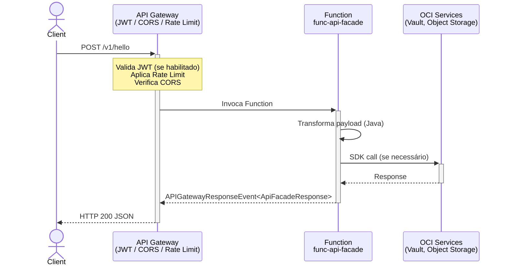
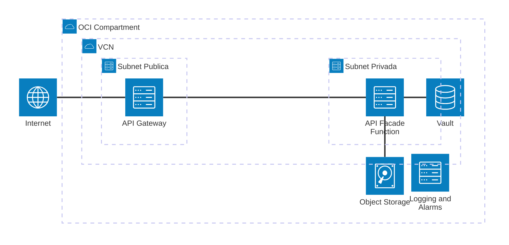

# Padrão 03 — API Facade

> **Status**: ✅ Implementado e deployed (v0.0.2, 2026-05-14)
> **Fase**: 0 — Referência
> **Tipo**: Síncrono | Segurança e Interface
> **Projeto Java**: `services/func-api-facade/`

## 1. Visão Geral

### Descrição Original
Cria uma camada de abstração entre os sistemas backend complexos e os consumidores externos, oferecendo uma API limpa, moderna (REST/JSON) e segura. Centraliza validação de tokens (JWT), Rate Limiting e políticas CORS.

### Adaptação OIC → Functions
Nenhuma adaptação necessária. O padrão API Facade mapeia diretamente para a arquitetura **API Gateway + OCI Functions** sem necessidade de OIC:

| Componente Original | Implementação Atual |
|---|---|
| OCI API Gateway | ✅ Módulo `infra/modules/api-gateway/` |
| IDCS/IAM (autenticação) | ✅ JWT auth configurável no API Gateway |
| OIC (transformação) | ✅ Substituído por `ApiFacadeFunction.java` (transformação em código) |
| Backend (ERP/SaaS) | ✅ `OciServiceClient.java` (Vault, Object Storage) |

### Diagrama de Arquitetura



### Diagrama de Recursos (Terraform)



> **Módulos Terraform necessários:**
>
> | Módulo | Recursos |
> |---|---|
> | **network** | VCN, Internet GW, NAT GW, Service GW, Subnet Pública + Privada, Route Tables, NSGs |
> | **iam** | Dynamic Groups (Functions, API GW), Policies (FaaS network, invoke, `read secret-bundles`, `manage objects`) |
> | **functions** | Application + Function `func-api-facade` (256MB, 60s, tracing habilitado) |
> | **api-gateway** | Gateway (PUBLIC) + Deployment (JWT auth, CORS, Rate Limiting, rotas `/hello`, `/secret`, `/store`) |
> | **observability** | Log Group, Service Logs (invoke, access, execution), Notification Topic, Alarms (errors, duration, 5xx) |
> | *existente* | **Vault** (secrets), **Object Storage** (bucket para `/store`) |

## 2. Projeto Java: `services/func-api-facade/`

- **Diretório**: `services/func-api-facade/`
- **Package**: `com.brx.functions.apifacade`
- **Handler**: `ApiFacadeFunction extends APIGatewayFunction<ApiFacadeRequest, ApiFacadeResponse>`
- **FDK**: 1.1.11 com fn-events
- **Java**: 17

### Estrutura

```
services/func-api-facade/
├── pom.xml                    # FDK 1.1.11, OCI SDK 3.86.0
├── func.yaml                  # name: func-api-facade, memory: 256, timeout: 60
├── Dockerfile                 # Multi-stage build JDK17
└── src/
    ├── main/java/com/brx/functions/apifacade/
    │   ├── ApiFacadeFunction.java        # Handler principal — routing por path
    │   ├── model/
    │   │   ├── ApiFacadeRequest.java     # DTO de entrada (Jackson)
    │   │   └── ApiFacadeResponse.java    # DTO de saída (status_code, message, data)
    │   └── service/
    │       └── OciServiceClient.java     # Clients OCI SDK (Vault, Object Storage)
    └── test/java/com/brx/functions/apifacade/
        └── ApiFacadeFunctionTest.java    # 6 testes (FnTestingRule + APIGatewayTestFeature)
```

### Dependências OCI SDK

| Módulo | Uso |
|--------|-----|
| `oci-java-sdk-common` | Auth (Resource Principal / Config File) |
| `oci-java-sdk-secrets` | Leitura de segredos do Vault |
| `oci-java-sdk-objectstorage` | CRUD Object Storage |

### Dependências OCI SDK

| Módulo | Uso |
|--------|-----|
| `oci-java-sdk-common` | Auth (Resource Principal / Config File) |
| `oci-java-sdk-secrets` | Leitura de segredos do Vault |
| `oci-java-sdk-objectstorage` | CRUD Object Storage |

### func.yaml

```yaml
schema_version: 20180708
name: func-api-facade
version: 0.0.1
runtime: java
build_image: fnproject/fn-java-fdk-build:jdk17-latest
run_image: fnproject/fn-java-fdk:jre17-latest
cmd: com.brx.functions.apifacade.ApiFacadeFunction::handler
memory: 256
timeout: 60
config:
  ENVIRONMENT: dev
```

## 3. Requisitos de Infraestrutura

Módulos Terraform existentes em `infra/modules/`:

| Módulo | Recursos | Config Relevante |
|--------|----------|-----------------|
| `network` | VCN, Subnet pública + privada, IGW, NAT GW, Service GW, NSGs | `use_nsg = true` |
| `iam` | Dynamic Groups (Functions, API GW), Policies (FaaS network, invoke, services) | Least-privilege |
| `functions` | Application + Function | 256 MB, 60s timeout, tracing habilitado |
| `api-gateway` | Gateway (PUBLIC) + Deployment | Rotas dinâmicas, `/health` estático |
| `observability` | Log Group, Service Logs, Alarms, Notification Topic | 3 alarms (errors, latency, 5xx) |

### Terraform — Novos Recursos

Nova Function resource (mesmo padrão do módulo `functions` existente):

```hcl
module "fn_api_facade" {
  source           = "./modules/functions"
  compartment_ocid = var.compartment_ocid
  subnet_id        = module.network.subnet_private_id
  nsg_ids          = [module.network.nsg_functions_id]
  application_name = "app-integration-patterns"
  function_name    = "func-api-facade"
  function_image   = "gru.ocir.io/${var.ocir_namespace}/patterns/func-api-facade:0.0.1"
  function_config = {
    ENVIRONMENT = "dev"
  }
}
```

### Rotas Configuradas

| Path | Métodos | Backend | Auth |
|------|---------|---------|------|
| `/hello` | GET, POST | Function `func-api-facade` | JWT (se habilitado) |
| `/health` | GET | Stock response 200 | Anônimo (sempre) |

### IAM Policies

```hcl
# FaaS usa VCN e lê repositórios OCIR
"allow service FaaS to use virtual-network-family in compartment ${compartment}"
"allow service FaaS to read repos in compartment ${compartment}"

# API Gateway invoca Functions
"allow dynamic-group dg-apigw-* to use functions-family in compartment ${compartment}"

# Functions lêem secrets, gerenciam objetos, usam logs
"allow dynamic-group dg-functions-* to read secret-bundles in compartment ${compartment}"
"allow dynamic-group dg-functions-* to manage objects in compartment ${compartment}"
"allow dynamic-group dg-functions-* to use log-content in compartment ${compartment}"
```

## 4. Requisitos de Codificação

### Handler — `ApiFacadeFunction.java`

| Aspecto | Especificação |
|---------|--------------|
| Base class | `APIGatewayFunction<ApiFacadeRequest, ApiFacadeResponse>` (fn-events) |
| Inicialização | `@FnConfiguration` — lê config vars, instancia `OciServiceClient` |
| Routing | `switch(path)` — `/hello`, `/secret`, `/store` |
| Erros | 400 (input inválido), 404 (rota não encontrada), 405 (método errado), 503 (OCI indisponível) |
| Logging | JSON estruturado (`{"event":"request","method":"...","path":"..."}`) |

### Client OCI — `OciServiceClient.java`

| Aspecto | Especificação |
|---------|--------------|
| Auth | Resource Principal (OCI Functions) / Config File (local) |
| Retry | 3 tentativas, backoff exponencial com jitter (5s base) |
| Timeouts | 5s connection, 15s read |
| Clients | `ObjectStorageClient`, `SecretsClient` |

## 5. Sequência de Prompts

### Prompt 0 — Auditoria de Infraestrutura

> **Obrigatório**: Executar ANTES de qualquer implementação.

Verificar se todos os módulos Terraform necessários existem em `infra/` para implementar este padrão.

**Módulos necessários**:
- `modules/network/` — VCN, subnets, gateways, NSGs
- `modules/iam/` — Dynamic Groups, Policies (functions, api-gateway)
- `modules/functions/` — Application + Function resource (facade)
- `modules/api-gateway/` — Gateway + Deployment com rota
- `modules/vault/` — **Vault + Secrets** (backend API credentials, tokens)
- `modules/observability/` — Log Group, Alarms, ONS

**Prompt file**: `@prompts/audit-infra-prerequisites`

<details>
<summary>Fallback — prompt free-text</summary>

```
Usar @oci-terraform para auditar infra/:
1. Verificar existência de cada módulo listado em infra/modules/
2. Para módulos existentes, verificar capabilities
3. Para módulos FALTANTES (vault), criar seguindo skill provisioning-oci-vault
4. Confirmar que IAM policies cobrem: read secret-bundles
5. Reportar gaps e ações corretivas

Seguir especificação docs/patterns/03-api-facade/03-api-facade.md seção 3.
```
</details>

### Prompt 1 — Terraform (Function + rotas no API Gateway)

**Prompt file (primário)**: `@prompts/add-serverless-stack` com argumentos:
- Function name: `func-api-facade`
- API routes: `GET,POST /hello`, `POST /secret`, `POST /store`
- Auth type: JWT (ou conforme ambiente)
- Memory: 256MB, Timeout: 60s
- function_config: `ENVIRONMENT`

<details>
<summary>Fallback — prompt free-text</summary>

```
Usar o agente @oci-terraform para provisionar func-api-facade:
- Nova Function resource (256MB, 60s) com function_config
- Adicionar rotas { path = "/hello", methods = ["GET", "POST"] } e
  { path = "/secret", methods = ["POST"] } e
  { path = "/store", methods = ["POST"] } no API Gateway
  apontando para a nova Function func-api-facade
Seguir especificação docs/patterns/03-api-facade.md seção 3.
```
</details>

### Prompt 2 — Java (projeto + OciServiceClient)

**Prompt file (primário)**: `@prompts/add-oci-function` para scaffold, seguido de:
- `@prompts/add-object-storage` com argumentos: bucket configurável, operações read/write, function class `ApiFacadeFunction`
- `@prompts/add-rest-client` com argumentos: OCI Vault secrets endpoint, auth OCI Request Signing

<details>
<summary>Fallback — prompt free-text</summary>

```
Usar o agente @oci-functions-java para criar projeto func-api-facade
em services/ seguindo a especificação docs/patterns/03-api-facade.md.
Criar OciServiceClient.java com ObjectStorageClient e SecretsClient,
Resource Principal auth, retry (3 tentativas, backoff exponencial),
timeouts (5s connection, 15s read).
Usar skills integrating-oci-functions-objectstorage e
instruções java-functions-sdk-integration.instructions.md.
```
</details>

### Prompt 3 — Java (DTOs + Handler)

**Prompt file (primário)**: `@prompts/add-event-handler` com argumentos:
- Event source: API Gateway
- Existing function class: `ApiFacadeFunction`
- Request type: `ApiFacadeRequest`
- Response type: `ApiFacadeResponse`

<details>
<summary>Fallback — prompt free-text</summary>

```
Criar ApiFacadeRequest.java e ApiFacadeResponse.java em model/,
e ApiFacadeFunction.java (APIGatewayFunction) com routing:
- /hello → retorna mensagem com environment
- /secret → lê secret do Vault via OciServiceClient
- /store → CRUD Object Storage via OciServiceClient
Seguir especificação docs/patterns/03-api-facade.md seção 4.
```
</details>

### Prompt 4 — Testes

**Prompt file (primário)**: `@prompts/add-function-tests` com argumentos:
- Function class: `ApiFacadeFunction`
- Event source: API Gateway
- SDK clients to mock: `ObjectStorageClient`, `SecretsClient`
- Scenarios: `testHelloRoute` (200), `testUnknownRoute` (404), `testSecretRouteMissingResourceId` (400), `testStoreRouteMissingFields` (400), `testSecretRouteOciUnavailable` (503), `testSecretRouteWrongMethod` (405)

<details>
<summary>Fallback — prompt free-text</summary>

```
Criar testes unitários ApiFacadeFunctionTest.java para:
1. testHelloRoute — GET /hello → 200
2. testUnknownRoute — GET /unknown → 404
3. testSecretRouteMissingResourceId — POST /secret sem body → 400
4. testStoreRouteMissingFields — POST /store sem bucket/object → 400
5. testSecretRouteOciUnavailable — POST /secret com OCI null → 503
6. testSecretRouteWrongMethod — GET /secret → 405
Usar FnTestingRule + Mockito seguindo instruções java-functions-testing.instructions.md.
```
</details>

### Prompt 5 — Config e Observabilidade

**Prompt file (primário)**: `@prompts/add-observability` com argumentos:
- Function name: `func-api-facade`
- Alarm thresholds: latência P95 25s, error rate 5%
- Environment: dev

<details>
<summary>Fallback — prompt free-text</summary>

```
Verificar func.yaml do func-api-facade com config key ENVIRONMENT.
Configurar observability (logs + alarms) para a nova Function.
```
</details>

## 6. Critérios de Verificação

### Testes que Devem Passar (6)

| Teste | Verifica |
|-------|---------|
| `testHelloRoute` | GET /hello → 200 + mensagem com environment |
| `testUnknownRoute` | GET /unknown → 404 "Route not found" |
| `testSecretRouteMissingResourceId` | POST /secret sem body → 400 |
| `testStoreRouteMissingFields` | POST /store sem bucket/object → 400 |
| `testSecretRouteOciUnavailable` | POST /secret com OCI null → 503 |
| `testSecretRouteWrongMethod` | GET /secret → 405 |

### Comandos de Validação

```bash
# Build + testes
cd services/func-api-facade && mvn clean package

# Terraform validate
cd infra && terraform validate

# Terraform tests
cd infra/tests && ./run_tests.sh
```

### Comportamento Esperado

1. API Gateway recebe request HTTPS na subnet pública
2. Valida JWT (se habilitado), aplica Rate Limit, verifica CORS
3. Invoca Function `func-api-facade` na subnet privada via NSG
4. Function transforma payload e chama OCI services via Resource Principal
5. Response retorna com `Content-Type: application/json`
6. Logs de invocação, acesso e execução registrados no OCI Logging
7. Alarms disparados se: erros de invocação, latência P95 > 25s, respostas 5xx > 5
