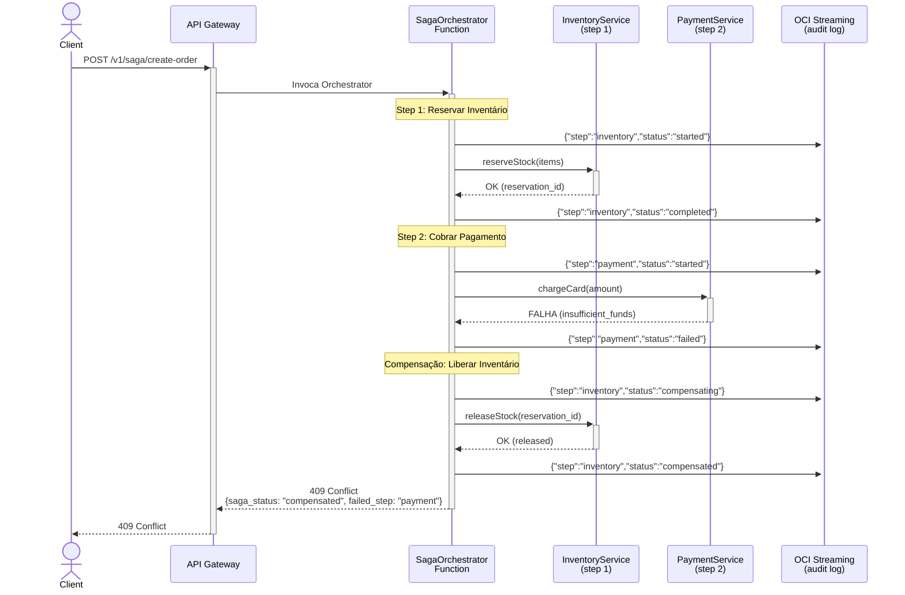
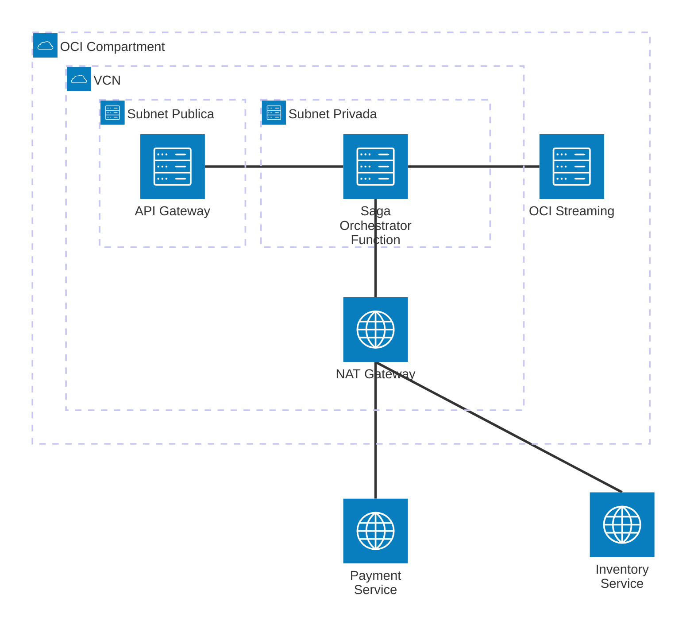

# Padrão 04 — Saga / Compensação

> **Status**: ⚠️ Parcialmente implementável (apenas sagas curtas <300s)
> **Fase**: 3 — Composição
> **Tipo**: Resiliência
> **Projeto Java**: `services/func-saga-orders/` (multi-handler no mesmo projeto)

## 1. Visão Geral

### Descrição Original
Manejo de transações distribuídas em arquiteturas de microserviços. Em vez de bloqueos de banco de dados (2PC), executa uma sequência de transações locais. Se uma falha, executa "transações de compensação" para desfazer mudanças anteriores. Dois tipos: Coreografia (eventos) e Orquestação (controlador central OIC).

### Adaptação OIC → Functions
OIC como orquestrador central é substituído por uma **Function orquestradora** que chama participantes sequencialmente via REST (Function-to-Function) e executa compensação em caso de falha. Eventos de auditoria publicados em OCI Streaming.

| Componente Original | Implementação com Functions |
|---|---|
| OIC (orquestador central) | 🔄 `SagaOrchestratorFunction` — orquestação em código Java |
| Participantes (serviços) | ✅ Functions participantes no mesmo projeto (invoke síncrono) |
| Oracle Streaming (coreografia) | ✅ Publicação de saga events para auditoria |

### Impacto da Substituição
- **Perda**: BPEL-style compensation handlers, replay visual, workflows de longa duração (>300s), persistência de estado
- **Ganho**: Lógica de compensação testável unitariamente, custo zero quando idle

### Limitações Críticas
- **Timeout máximo 300s** — sagas com mais de 5 minutos são inviáveis
- **Sem persistência de estado** — se a Function orquestradora falha, não há replay automático
- **Recomendado para**: Sagas simples (2-4 steps, <120s total)

### Diagrama de Arquitetura



### Diagrama de Recursos (Terraform)



> **Módulos Terraform necessários:**
>
> | Módulo | Recursos |
> |---|---|
> | **network** | VCN, NAT GW (chamadas REST a participantes), Service GW, NSGs |
> | **iam** | Dynamic Group Functions, Policy: `use stream-push` |
> | **functions** | Function `func-saga-orders` (**512MB**, **120s** — múltiplas chamadas + compensação) |
> | **api-gateway** | Rota `POST /saga/{action}` |
> | **streaming** | Stream `saga-events` (3 partitions, 168h retention para auditoria) |
> | **observability** | Logs + Alarms (atenção especial a timeouts >120s) |

## 2. Projeto Java

- **Diretório**: `services/func-saga-orders/`
- **Package**: `com.brx.functions.sagaorders`
- **Multi-handler**: Todas as Functions no mesmo projeto (orquestrador + participantes)

### Estrutura

```
services/func-saga-orders/
├── pom.xml
├── func.yaml                              # Entry point: SagaOrchestratorFunction
├── Dockerfile
└── src/
    ├── main/java/com/brx/functions/sagaorders/
    │   ├── SagaOrchestratorFunction.java   # Handler principal — orquestração
    │   ├── model/
    │   │   ├── SagaRequest.java            # DTO entrada (order data)
    │   │   ├── SagaResponse.java           # DTO saída (saga result)
    │   │   ├── SagaStep.java               # Definição de um step
    │   │   ├── SagaEvent.java              # Evento de auditoria
    │   │   └── StepResult.java             # Resultado de cada step
    │   ├── service/
    │   │   ├── SagaExecutor.java           # Engine de execução sequencial + compensação
    │   │   ├── InventoryService.java       # Step 1: reserva de inventário
    │   │   └── PaymentService.java         # Step 2: cobrança
    │   └── client/
    │       ├── ServiceInvoker.java         # HttpClient para chamar participantes
    │       └── SagaEventPublisher.java     # Publica saga events em Streaming
    └── test/java/com/brx/functions/sagaorders/
        ├── SagaOrchestratorFunctionTest.java
        └── service/
            ├── SagaExecutorTest.java       # Testes da engine
            ├── InventoryServiceTest.java
            └── PaymentServiceTest.java
```

### Dependências OCI SDK

| Módulo | Uso |
|--------|-----|
| `oci-java-sdk-common` | Resource Principal |
| `oci-java-sdk-streaming` | Publicação de saga events |

### func.yaml

```yaml
schema_version: 20180708
name: func-saga-orders
version: 0.0.1
runtime: java
build_image: fnproject/fn-java-fdk-build:jdk17-latest
run_image: fnproject/fn-java-fdk:jre17-latest
cmd: com.brx.functions.sagaorders.SagaOrchestratorFunction::handler
memory: 512
timeout: 120
config:
  ENVIRONMENT: dev
  INVENTORY_SERVICE_URL: https://api.example.com/inventory
  PAYMENT_SERVICE_URL: https://api.example.com/payments
  STREAM_OCID: ocid1.stream.oc1...
  STREAM_ENDPOINT: https://cell-1.streaming.sa-saopaulo-1.oci.oraclecloud.com
  STEP_TIMEOUT_MS: "10000"
```

> Memory 512MB (múltiplas chamadas HTTP), timeout 120s (soma de todos os steps).

## 3. Requisitos de Infraestrutura

### Terraform — Módulos Existentes

| Módulo | Configuração |
|--------|-------------|
| `functions` | Nova Function: func-saga-orders, 512MB, 120s |
| `api-gateway` | Nova rota `{ path = "/saga/{action}", methods = ["POST"] }` |
| `streaming` | Reutilizar stream do padrão 02, ou criar stream `saga-events` |
| `iam` | Reutilizar policies de Streaming (stream-push) |

### Terraform — Stream para Saga Events

```hcl
resource "oci_streaming_stream" "saga_events" {
  name               = "saga-events"
  stream_pool_id     = module.streaming.stream_pool_id
  partitions         = 3
  retention_in_hours = 168   # 7 dias (auditoria)
}
```

### IAM
Reutilizar policy `stream-push` do padrão 02.

## 4. Requisitos de Codificação Java

### Engine — `SagaExecutor.java`

| Aspecto | Especificação |
|---------|--------------|
| Responsabilidade | Executa steps em sequência, compensa em ordem reversa se falha |
| Input | `List<SagaStep>` — lista ordenada de steps |
| Cada `SagaStep` contém | `name`, `executeAction` (Supplier), `compensateAction` (Supplier) |
| Execução | Iterar steps: execute → se OK, adicionar à stack de compensação → próximo step |
| Falha | Ao falhar, iterar stack de compensação em ordem reversa (LIFO) |
| Evento | Publicar saga event em Streaming para cada transição de estado |
| Resultado | `SagaResponse` com: `saga_id`, `status` (completed/compensated/failed), `steps` (lista de resultados) |

### Ciclo de Vida do SagaExecutor

```
execute(steps):
  completedSteps = Stack()
  
  for step in steps:
    publishEvent(step.name, "started")
    result = step.execute()
    
    if result.isSuccess():
      completedSteps.push(step)
      publishEvent(step.name, "completed")
    else:
      publishEvent(step.name, "failed", result.error)
      
      // COMPENSAÇÃO (ordem reversa)
      while !completedSteps.isEmpty():
        compensateStep = completedSteps.pop()
        publishEvent(compensateStep.name, "compensating")
        compensateStep.compensate()
        publishEvent(compensateStep.name, "compensated")
      
      return SagaResponse.compensated(step.name, result.error)
  
  return SagaResponse.completed()
```

### Handler — `SagaOrchestratorFunction.java`

```
1. @FnConfiguration: lê configs (service URLs, streaming, timeout)
2. handler():
   a. Valida SagaRequest (items, payment_info)
   b. Define steps:
      Step 1: InventoryService.reserve(items) / compensate: InventoryService.release()
      Step 2: PaymentService.charge(amount) / compensate: PaymentService.refund()
   c. Chama SagaExecutor.execute(steps)
   d. Se completed: 201 Created
   e. Se compensated: 409 Conflict (com detalhes do step que falhou)
   f. Se failed (compensação falhou): 500 (com detalhes, requer intervenção manual)
```

### Serviços Participantes

**`InventoryService.java`**:
- `reserve(List<Item> items)` → `StepResult` (reservation_id ou erro)
- `release(String reservationId)` → `StepResult` (compensação)

**`PaymentService.java`**:
- `charge(String paymentMethodId, BigDecimal amount)` → `StepResult` (transaction_id ou erro)
- `refund(String transactionId)` → `StepResult` (compensação)

Ambos usam `ServiceInvoker` (HttpClient) para chamar APIs REST externas.

### Publisher — `SagaEventPublisher.java`

Publica eventos de auditoria no OCI Streaming:
```json
{
  "saga_id": "uuid",
  "step": "inventory",
  "status": "completed",
  "timestamp": "2024-12-01T10:30:00Z",
  "data": { "reservation_id": "abc" }
}
```

### Modelos (DTOs)

**`SagaRequest.java`**:
- `items`: List (itens do pedido)
- `payment_method_id`: String
- `total_amount`: BigDecimal

**`SagaResponse.java`**:
- `saga_id`: String (UUID)
- `status`: String ("completed" | "compensated" | "failed")
- `failed_step`: String (nome do step que falhou, null se completed)
- `error`: String (mensagem de erro, null se completed)
- `steps`: List\<StepResult\> (resultado de cada step)

### Tratamento de Erros

| Cenário | Status | Saga Status |
|---------|--------|------------|
| Todos os steps OK | 201 | `completed` |
| Step falha, compensação OK | 409 | `compensated` |
| Step falha, compensação falha | 500 | `failed` (requer intervenção manual) |
| Input inválido | 400 | N/A |
| Timeout do orchestrator | 504 | `unknown` (saga pode estar parcialmente executada) |

## 5. Sequência de Prompts

### Prompt 0 — Auditoria de Infraestrutura

> **Obrigatório**: Executar ANTES de qualquer implementação.

Verificar se todos os módulos Terraform necessários existem em `infra/` para implementar este padrão.

**Módulos necessários**:
- `modules/network/` — VCN, subnets, gateways, NSGs
- `modules/iam/` — Dynamic Groups, Policies (functions, api-gateway, streaming)
- `modules/functions/` — Application + Function resource (saga-orders)
- `modules/api-gateway/` — Gateway + Deployment com rota
- `modules/streaming/` — **Stream Pool + Stream** (saga-events para coordenação)
- `modules/observability/` — Log Group, Alarms, ONS

**Prompt file**: `@prompts/audit-infra-prerequisites`

<details>
<summary>Fallback — prompt free-text</summary>

```
Usar @oci-terraform para auditar infra/:
1. Verificar existência de cada módulo listado em infra/modules/
2. Para módulos existentes, verificar capabilities
3. Para módulos FALTANTES (streaming), criar seguindo skill provisioning-oci-streaming
4. Confirmar que IAM policies cobrem: stream-push para saga-events
5. Reportar gaps e ações corretivas

Seguir especificação docs/patterns/04-saga-compensation/04-saga-compensation.md seção 3.
```
</details>

### Prompt 1 — Java (projeto + SagaExecutor)

**Prompt file (primário)**: `@prompts/add-oci-function` para scaffold do projeto `func-saga-orders`.

> ⚠️ O `SagaExecutor` é lógica pattern-specific — usar free-text complementar abaixo.

<details>
<summary>Fallback — prompt free-text (SagaExecutor engine)</summary>

```
Usar o agente @oci-functions-java para criar projeto func-saga-orders
em services/ seguindo docs/patterns/04-saga-compensation.md.
Criar SagaExecutor.java: engine que executa steps sequenciais,
compensa em ordem reversa (LIFO) se falha, publica eventos.
Criar SagaStep, StepResult, SagaEvent models.
```
</details>

### Prompt 2 — Java (Participantes)

**Prompt file (primário)**: `@prompts/add-rest-client` com argumentos:
- Target API: APIs REST dos serviços participantes (Inventory, Payment)
- Auth method: OCI Request Signing (ou conforme backend)
- Existing function class: `SagaOrchestratorFunction`
- HTTP methods: POST (execute/compensate)

<details>
<summary>Fallback — prompt free-text</summary>

```
Criar InventoryService.java e PaymentService.java em service/ com
métodos execute/compensate que chamam APIs REST via ServiceInvoker.
Criar ServiceInvoker.java (HttpClient wrapper com timeout configurável).
Seguir docs/patterns/04-saga-compensation.md seção 4.
```
</details>

### Prompt 3 — Java (Handler + Publisher)

**Prompt file (primário)**: `@prompts/add-event-handler` com argumentos:
- Event source: API Gateway
- Existing function class: `SagaOrchestratorFunction`
- Request type: `SagaRequest`
- Response type: `SagaResponse`

**Complementar**: `@prompts/add-event-publishing` com argumentos:
- Target service: OCI Streaming
- Existing function class: `SagaOrchestratorFunction`
- Message format: `SagaEvent` (saga_id, step, status, timestamp)

<details>
<summary>Fallback — prompt free-text</summary>

```
Criar SagaOrchestratorFunction.java que monta os steps
(inventory.reserve → payment.charge), executa via SagaExecutor,
e retorna SagaResponse. Criar SagaEventPublisher.java que publica
saga events em OCI Streaming.
Usar skills implementing-oci-functions-events e publishing-events-from-oci-functions.
```
</details>

### Prompt 4 — Testes (SagaExecutor)

**Prompt file (primário)**: `@prompts/add-function-tests` com argumentos:
- Additional classes: `SagaExecutor`
- SDK clients to mock: nenhum (lógica pura)
- Scenarios: all steps succeed → completed, step 2 fails → compensate step 1 (LIFO) → compensated, step 3 fails → compensate 2 then 1 → compensated, compensation fails → failed, eventos publicados para cada transição

<details>
<summary>Fallback — prompt free-text</summary>

```
Criar SagaExecutorTest.java com cenários:
- All steps succeed → completed
- Step 2 fails → compensate step 1 (reverse order) → compensated
- Step 3 fails → compensate step 2 then step 1 → compensated
- Compensation fails → failed (requer intervenção)
- Eventos publicados para cada transição de estado
Usar Mockito para mock dos services e publisher.
```
</details>

### Prompt 5 — Testes (Function + Participantes)

**Prompt file (primário)**: `@prompts/add-function-tests` com argumentos:
- Function class: `SagaOrchestratorFunction`
- Event source: API Gateway
- SDK clients to mock: `StreamClient` (via SagaEventPublisher)
- Additional classes: `InventoryService`, `PaymentService`
- Scenarios: end-to-end com mock services, reserve OK/fail, charge OK/fail (insufficient_funds), refund OK

<details>
<summary>Fallback — prompt free-text</summary>

```
Criar testes para:
- SagaOrchestratorFunctionTest: end-to-end com mock services
- InventoryServiceTest: reserve OK, reserve fail, release OK
- PaymentServiceTest: charge OK, charge fail (insufficient_funds), refund OK
Usar FnTestingRule + Mockito.
```
</details>

### Prompt 6 — Terraform

**Prompt file (primário)**: `@prompts/add-serverless-stack` com argumentos:
- Function name: `func-saga-orders`
- API route: `POST /saga/{action}`
- Auth type: JWT
- Memory: 512MB, Timeout: 120s

**Complementar**: `@prompts/add-streaming` com argumentos:
- Stream name: `saga-events`
- Partitions: 3
- Retention: 7 dias
- Stream pool: reutilizar existente (se criado no padrão 02) ou novo

<details>
<summary>Fallback — prompt free-text</summary>

```
Usar o agente @oci-terraform para:
- Provisionar func-saga-orders (512MB, 120s)
- Rota POST /saga/{action} no API Gateway
- Stream "saga-events" (3 partições, 7 dias retenção)
- Reutilizar IAM policies de streaming do padrão 02
```
</details>

## 6. Critérios de Verificação

### Testes que Devem Passar

| Teste | Cenário | Resultado |
|-------|---------|----------|
| `testAllStepsComplete` | Inventory OK + Payment OK | 201, status=completed |
| `testPaymentFailsCompensateInventory` | Inventory OK + Payment FAIL | 409, status=compensated, inventory released |
| `testCompensationOrder` | Step 3 fail | Compensate 2 then 1 (LIFO) |
| `testCompensationFails` | Step fail + compensation fail | 500, status=failed |
| `testSagaEventsPublished` | Qualquer execução | Eventos publicados para cada step transition |
| `testInvalidInput` | Sem items | 400 |
| `testSagaIdGenerated` | Qualquer request | saga_id UUID presente |

### Comandos de Validação

```bash
cd services/func-saga-orders && mvn clean package
```

### Comportamento Esperado
1. Client envia POST /v1/saga/create-order com items + payment
2. Orchestrator gera saga_id, executa Step 1 (reserve inventory)
3. Se OK, executa Step 2 (charge payment)
4. Se Step 2 falha, compensa Step 1 (release inventory) em ordem reversa
5. Cada transição de estado publicada em Streaming (auditoria)
6. Retorna 201 (completed) ou 409 (compensated) com detalhes de cada step
