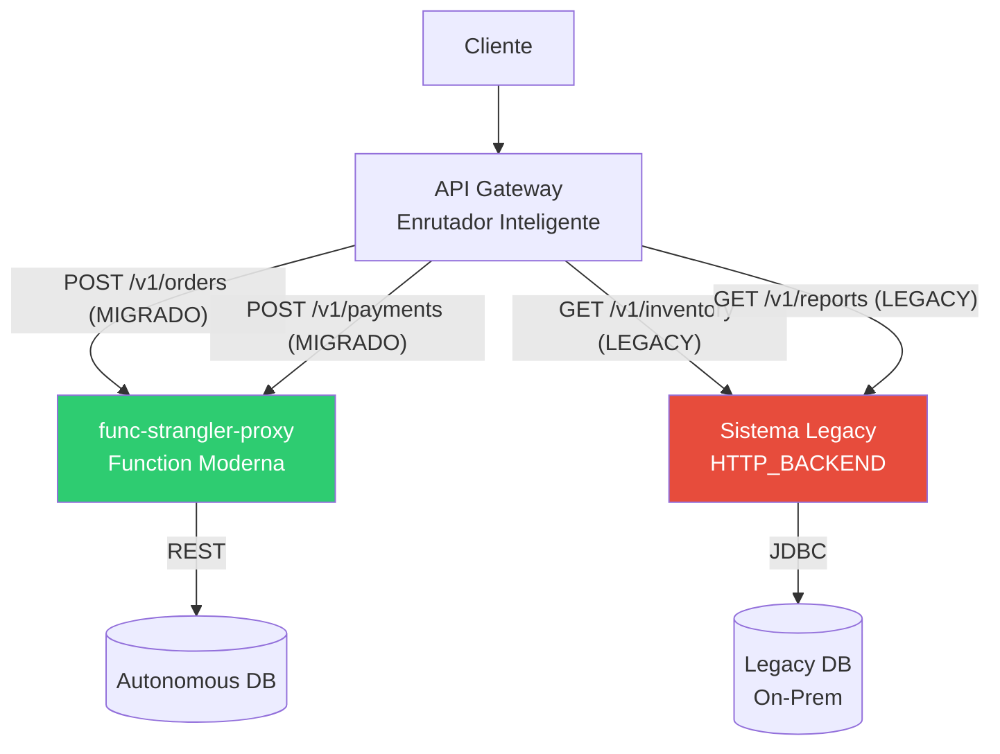
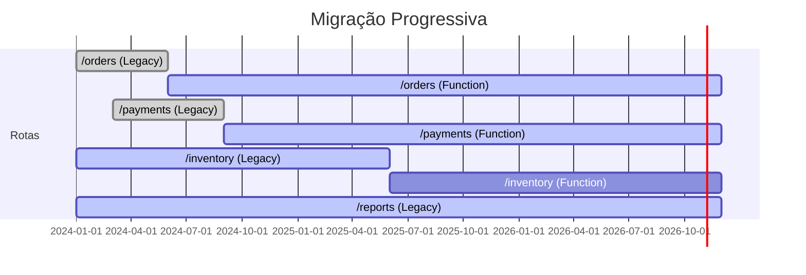
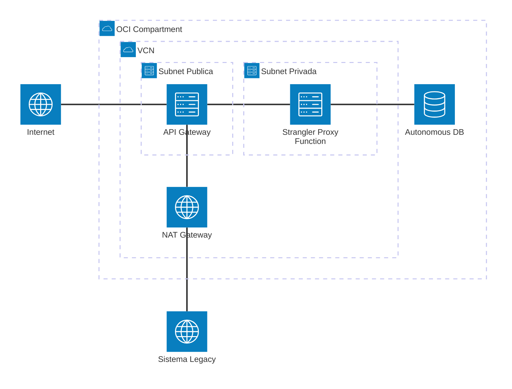

# Padrão 06 — Strangler Fig Runtime

> **Status**: ✅ Implementável com Functions (exceto VPN/FastConnect)
> **Fase**: 3 — Composição
> **Tipo**: Arquitetura e Migração
> **Projeto Java**: `services/func-strangler-proxy/`

## 1. Visão Geral

### Descrição Original
Migrar sistemas legacy de forma progressiva. Uma "fachada" (API Gateway) enruta petições entre o sistema antigo e a nova arquitetura. A medida que funcionalidades são modernizadas, o Gateway redirige mais tráfego ao novo sistema até que o legacy é "estrangulado" e retirado.

### Adaptação OIC → Functions
OIC/OKE como hospedeiros dos novos microserviços são substituídos por **Functions** como endpoints modernos. O API Gateway é o componente central do padrão — funciona como roteador inteligente com multi-backend.

| Componente Original | Implementação com Functions |
|---|---|
| OCI API Gateway (enrutador) | ✅ Multi-backend routing: Functions + HTTP_BACKEND |
| OIC / OKE (novos serviços) | 🔄 Functions como novos endpoints modernos |
| Legacy (On-Prem) | ⚠️ HTTP_BACKEND apontando para URL legacy (requer conectividade) |

### Impacto da Substituição
- **Perda**: Adaptadores OIC para sistemas legacy (DB, SOAP, JMS), OKE para workloads stateful
- **Ganho**: Zero infra a gerenciar para novos serviços, migração rota-a-rota, rollback instantâneo

### Diagrama de Arquitetura





### Diagrama de Recursos (Terraform)



> **Módulos Terraform necessários:**
>
> | Módulo | Recursos |
> |---|---|
> | **network** | VCN, Internet GW, NAT GW (conectividade com legacy), NSGs |
> | **iam** | Dynamic Group Functions, API GW invoke policy |
> | **functions** | Function `func-strangler-proxy` (256MB, 60s) — endpoint moderno |
> | **api-gateway** | Gateway + Deployment com **multi-backend**: `ORACLE_FUNCTIONS_BACKEND` (rotas migradas) + `HTTP_BACKEND` (rotas legacy) |
> | **observability** | Logs + Alarms |
>
> **Nota**: O core do padrão é o **routing no API Gateway**. A migração é feita rota-a-rota via `terraform apply` (zero-downtime swap de backend).

## 2. Projeto Java

- **Diretório**: `services/func-strangler-proxy/`
- **Package**: `com.brx.functions.stranglerproxy`
- **Handler**: `StranglerProxyFunction extends APIGatewayFunction<ProxyRequest, ProxyResponse>`

### Estrutura

```
services/func-strangler-proxy/
├── pom.xml
├── func.yaml
├── Dockerfile
└── src/
    ├── main/java/com/brx/functions/stranglerproxy/
    │   ├── StranglerProxyFunction.java     # Handler — lógica moderna
    │   ├── model/
    │   │   ├── ProxyRequest.java
    │   │   ├── ProxyResponse.java
    │   │   └── OrderDto.java               # Exemplo: entidade migrada
    │   ├── service/
    │   │   └── OrderService.java           # Lógica de negócio moderna
    │   └── client/
    │       └── DatabaseClient.java         # Client para novo backend (REST/DB)
    └── test/java/com/brx/functions/stranglerproxy/
        ├── StranglerProxyFunctionTest.java
        └── service/
            └── OrderServiceTest.java
```

### func.yaml

```yaml
schema_version: 20180708
name: func-strangler-proxy
version: 0.0.1
runtime: java
build_image: fnproject/fn-java-fdk-build:jdk17-latest
run_image: fnproject/fn-java-fdk:jre17-latest
cmd: com.brx.functions.stranglerproxy.StranglerProxyFunction::handler
memory: 256
timeout: 60
config:
  ENVIRONMENT: dev
  NEW_BACKEND_URL: https://api.modern.example.com
  LEGACY_API_URL: https://legacy.example.com/api
  MIGRATION_MODE: "modern"
```

## 3. Requisitos de Infraestrutura

### Terraform — Multi-Backend Routing no API Gateway

O core do padrão é o **routing no API Gateway**. Rotas migradas apontam para Functions, rotas legacy apontam para HTTP_BACKEND.

```hcl
# Rotas migradas → FUNCTIONS_BACKEND
resource "oci_apigateway_deployment" "migration" {
  specification {
    # Rota moderna (migrada) → Function
    routes {
      path    = "/orders"
      methods = ["GET", "POST", "PUT"]
      backend {
        type        = "ORACLE_FUNCTIONS_BACKEND"
        function_id = module.fn_strangler_proxy.function_id
      }
    }

    # Rota legacy (ainda não migrada) → HTTP backend
    routes {
      path    = "/inventory"
      methods = ["GET"]
      backend {
        type = "HTTP_BACKEND"
        url  = "https://legacy.example.com/api/inventory"
      }
    }

    routes {
      path    = "/reports"
      methods = ["GET"]
      backend {
        type = "HTTP_BACKEND"
        url  = "https://legacy.example.com/api/reports"
      }
    }
  }
}
```

### Terraform — Módulos Existentes

| Módulo | Configuração |
|--------|-------------|
| `functions` | Nova Function `func-strangler-proxy` |
| `api-gateway` | Modificar para suportar multi-backend (Functions + HTTP_BACKEND) |
| `network` | NAT GW para alcançar legacy via internet (ou VPN se on-prem) |

### Processo de Migração de uma Rota

```
1. Rota inicia como HTTP_BACKEND → legacy URL
2. Desenvolver Function moderna (novo projeto ou nova rota no existente)
3. Mudar backend no Terraform: HTTP_BACKEND → ORACLE_FUNCTIONS_BACKEND
4. terraform apply (zero-downtime — API Gateway faz swap)
5. Monitorar. Se problemas, reverter Terraform (rollback instantâneo)
6. Após estabilização, remover endpoint legacy
```

## 4. Requisitos de Codificação Java

### Handler — `StranglerProxyFunction.java`

| Aspecto | Especificação |
|---------|--------------|
| Base class | `APIGatewayFunction<ProxyRequest, ProxyResponse>` |
| Responsabilidade | Implementar a funcionalidade moderna que substitui o legacy |
| Compatibilidade | Response deve manter mesmo formato JSON que o legacy (para clientes existentes) |
| Feature flag | `MIGRATION_MODE` config: "modern" (usar nova lógica), "legacy-proxy" (proxy para legacy, para testes) |

### Compatibilidade de Contrato

A Function moderna **deve retornar o mesmo contrato JSON** que o endpoint legacy retornava, para não quebrar clientes existentes:

```java
// Legacy retornava:
// { "order_id": "123", "status": "pending", "total": 99.90 }

// Function moderna DEVE retornar o mesmo formato:
// { "order_id": "123", "status": "pending", "total": 99.90 }

// Campos novos podem ser ADICIONADOS (backward-compatible):
// { "order_id": "123", "status": "pending", "total": 99.90, "created_at": "2024-..." }
```

### Tratamento de Erros

| Cenário | Resposta |
|---------|---------|
| Input válido, lógica moderna OK | 200 + dados |
| Input inválido | 400 (manter mesmo formato de erro do legacy) |
| Novo backend falha | 503 |
| MIGRATION_MODE = "legacy-proxy" | Proxy para URL legacy (para comparação A/B) |

## 5. Sequência de Prompts

### Prompt 0 — Auditoria de Infraestrutura

> **Obrigatório**: Executar ANTES de qualquer implementação.

Verificar se todos os módulos Terraform necessários existem em `infra/` para implementar este padrão.

**Módulos necessários**:
- `modules/network/` — VCN, subnets, gateways, NSGs
- `modules/iam/` — Dynamic Groups, Policies (functions, api-gateway)
- `modules/functions/` — Application + Function resource
- `modules/api-gateway/` — Gateway + Deployment com **multi-backend** (ORACLE_FUNCTIONS_BACKEND + HTTP_BACKEND para legacy)
- `modules/observability/` — Log Group, Alarms, ONS

**Prompt file**: `@prompts/audit-infra-prerequisites`

<details>
<summary>Fallback — prompt free-text</summary>

```
Usar @oci-terraform para auditar infra/:
1. Verificar existência de cada módulo listado em infra/modules/
2. Para api-gateway: verificar se suporta multi-backend (ORACLE_FUNCTIONS_BACKEND + HTTP_BACKEND)
   - Se só suporta single function_id, EVOLUIR módulo para suportar backend_type por rota
3. Para módulos FALTANTES, criar seguindo skills provisioning-oci-{service}
4. Confirmar que IAM policies cobrem novos recursos
5. Reportar gaps e ações corretivas

Seguir especificação docs/patterns/06-strangler-fig/06-strangler-fig.md seção 3.
```
</details>

### Prompt 1 — Java (projeto + handler)

**Prompt file (primário)**: `@prompts/add-oci-function` para scaffold, seguido de `@prompts/add-event-handler` com argumentos:
- Event source: API Gateway
- Existing function class: `StranglerProxyFunction`
- Request type: request compatível com contrato legacy
- Response type: response compatível com contrato legacy

<details>
<summary>Fallback — prompt free-text</summary>

```
Usar o agente @oci-functions-java para criar projeto func-strangler-proxy
em services/ seguindo docs/patterns/06-strangler-fig.md.
Criar StranglerProxyFunction que implementa lógica moderna de /orders
mantendo compatibilidade de contrato JSON com o sistema legacy.
Config MIGRATION_MODE para switch entre modern e legacy-proxy.
```
</details>

### Prompt 2 — Terraform (multi-backend routing)

**Prompt file (primário)**: `@prompts/add-api-gateway` com argumentos:
- Routes:
  - `/orders` → ORACLE_FUNCTIONS_BACKEND (`func-strangler-proxy`)
  - `/inventory` → HTTP_BACKEND (legacy URL)
  - `/reports` → HTTP_BACKEND (legacy URL)
- Auth type: JWT
- CORS: conforme ambiente

> ⚠️ Requer suporte a multi-backend (FUNCTIONS_BACKEND + HTTP_BACKEND por rota) no módulo `api-gateway`. Verificar se o módulo já suporta `backend_type` por rota.

<details>
<summary>Fallback — prompt free-text</summary>

```
Usar o agente @oci-terraform para configurar API Gateway com
multi-backend routing seguindo docs/patterns/06-strangler-fig.md seção 3:
- /orders → ORACLE_FUNCTIONS_BACKEND (func-strangler-proxy)
- /inventory → HTTP_BACKEND (legacy URL)
- /reports → HTTP_BACKEND (legacy URL)
Modificar módulo api-gateway para suportar tipo de backend por rota.
```
</details>

### Prompt 3 — Testes

**Prompt file (primário)**: `@prompts/add-function-tests` com argumentos:
- Function class: `StranglerProxyFunction`
- Event source: API Gateway
- SDK clients to mock: `HttpClient` (para chamadas ao legacy, se proxy mode)
- Scenarios: compatibilidade de contrato (mesmos campos que legacy), campos novos backward-compatible, `MIGRATION_MODE` switch funciona, erros mantêm formato legacy

<details>
<summary>Fallback — prompt free-text</summary>

```
Criar testes para func-strangler-proxy:
- Compatibilidade de contrato: response tem mesmos campos que legacy
- Campos novos adicionados (backward-compatible)
- MIGRATION_MODE switch funciona
- Erros mantêm formato do legacy
Usar FnTestingRule + Mockito.
```
</details>

### Prompt 4 — Documentação de migração

> Não há prompt file para documentação. Usar free-text.

```
Documentar o processo de migração de uma rota no README do projeto:
1. Identificar rota legacy
2. Desenvolver Function moderna (contrato compatível)
3. Mudar backend no Terraform
4. Aplicar, monitorar, rollback se necessário
```

## 6. Critérios de Verificação

### Testes que Devem Passar

| Teste | Cenário | Resultado |
|-------|---------|----------|
| `testModernOrdersResponse` | GET /orders | 200 + JSON compatível com legacy |
| `testContractCompatibility` | Comparar campos | Todos os campos legacy presentes |
| `testBackwardCompatibleNewFields` | Response | Campos novos adicionais OK |
| `testMigrationModeLegacyProxy` | MIGRATION_MODE=legacy-proxy | Proxies para legacy URL |
| `testMigrationModeModern` | MIGRATION_MODE=modern | Usa lógica nova |

### Comandos de Validação

```bash
cd services/func-strangler-proxy && mvn clean package
cd infra/env-dev && terraform plan
```

### Comportamento Esperado
1. Client chama GET /v1/orders → API Gateway roteia para Function moderna
2. Client chama GET /v1/inventory → API Gateway roteia para legacy (HTTP_BACKEND)
3. Ambas as respostas seguem o mesmo formato JSON
4. Migração de rota: mudar backend no Terraform → `terraform apply` → zero-downtime
5. Rollback: reverter Terraform → legacy restaurado instantaneamente
