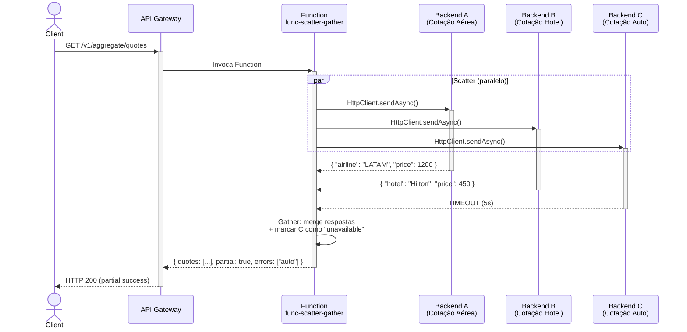
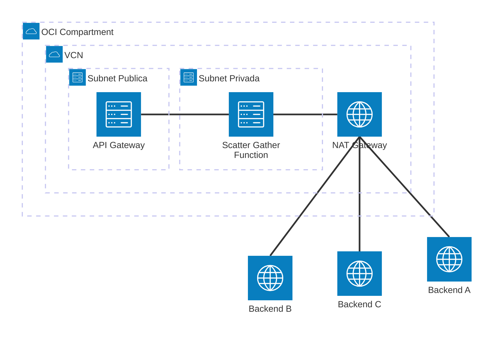

# Padrão 07 — Scatter-Gather

> **Status**: ✅ Implementável com Functions
> **Fase**: 1 — Fundações
> **Tipo**: Síncrono Avançado
> **Projeto Java**: `services/func-scatter-gather/`

## 1. Visão Geral

### Descrição Original
Envia uma petição a múltiplos sistemas backend em paralelo (Scatter) e consolida (Gather) as respostas em um único mensagem unificado. Componente original: OIC para orquestação paralela e consolidação.

### Adaptação OIC → Functions
OIC é substituído por uma **Function Java** que usa `CompletableFuture.allOf()` do Java 17 para disparar chamadas HTTP paralelas e consolidar resultados com merge de JSONs.

| Componente Original | Implementação com Functions |
|---|---|
| OCI API Gateway | ✅ Sem mudança |
| OIC (orquestação paralela) | 🔄 `ScatterGatherFunction` com `CompletableFuture` + `HttpClient.sendAsync()` |
| Backends (múltiplas fontes) | ✅ Invocados em paralelo via HttpClient |

### Impacto da Substituição
- **Perda**: Orquestação visual, tratamento individual de falha por branch, monitoramento de cada branch
- **Ganho**: Controle granular do merge, tratamento de partial-success em código, timeout por backend

### Diagrama de Arquitetura



### Diagrama de Recursos (Terraform)



> **Módulos Terraform necessários:**
>
> | Módulo | Recursos |
> |---|---|
> | **network** | VCN, Internet GW, NAT GW (saída para múltiplos backends), NSGs |
> | **iam** | Dynamic Group Functions, API GW invoke policy |
> | **functions** | Function `func-scatter-gather` (**512MB**, **120s** — paralelismo consome mais memória) |
> | **api-gateway** | Rota `GET,POST /aggregate/{resource}` |
> | **observability** | Logs + Alarms (atenção a timeouts parciais) |
>
> **Nota**: Nenhum módulo novo. Usa apenas infra base (network + functions + api-gateway). Backends são externos via NAT Gateway.

## 2. Projeto Java

- **Diretório**: `services/func-scatter-gather/`
- **Package**: `com.brx.functions.scattergather`
- **Handler**: `ScatterGatherFunction extends APIGatewayFunction<SGRequest, SGResponse>`
- **func.yaml name**: `func-scatter-gather`

### Estrutura

```
services/func-scatter-gather/
├── pom.xml
├── func.yaml
├── Dockerfile
└── src/
    ├── main/java/com/brx/functions/scattergather/
    │   ├── ScatterGatherFunction.java     # Handler — scatter + gather
    │   ├── model/
    │   │   ├── SGRequest.java             # DTO entrada (lista de targets)
    │   │   ├── SGResponse.java            # DTO saída (dados + erros parciais)
    │   │   ├── TargetEndpoint.java        # Config de cada backend
    │   │   └── BackendResult.java         # Resultado individual
    │   └── client/
    │       └── ParallelHttpClient.java    # HttpClient async wrapper
    └── test/java/com/brx/functions/scattergather/
        ├── ScatterGatherFunctionTest.java
        └── client/
            └── ParallelHttpClientTest.java
```

### Dependências OCI SDK
- `oci-java-sdk-common` (auth Resource Principal — se backends forem OCI services)
- Nenhuma SDK adicional — usa `java.net.http.HttpClient` nativo

### func.yaml

```yaml
schema_version: 20180708
name: func-scatter-gather
version: 0.0.1
runtime: java
build_image: fnproject/fn-java-fdk-build:jdk17-latest
run_image: fnproject/fn-java-fdk:jre17-latest
cmd: com.brx.functions.scattergather.ScatterGatherFunction::handler
memory: 512
timeout: 120
config:
  ENVIRONMENT: dev
  DEFAULT_BACKEND_TIMEOUT_MS: "5000"
  MAX_PARALLEL_CALLS: "10"
```

> **Nota**: Memory 512MB (paralelismo consome mais), timeout 120s (aguardar múltiplos backends).

## 3. Requisitos de Infraestrutura

### Terraform — Módulos Existentes

| Módulo | Configuração Específica |
|--------|------------------------|
| `functions` | Nova Function: memory 512MB, timeout 120s, shape GENERIC_X86 |
| `api-gateway` | Nova rota `{ path = "/aggregate/{resource}", methods = ["GET", "POST"] }` |
| `iam` | Sem mudança |
| `network` | Sem mudança (NAT GW para chamadas externas) |

### Terraform — Novos Recursos
Nenhum.

### IAM
Nenhuma policy adicional.

## 4. Requisitos de Codificação Java

### Client — `ParallelHttpClient.java`

| Aspecto | Especificação |
|---------|--------------|
| HttpClient | Singleton, `newBuilder().connectTimeout(Duration.ofSeconds(5)).build()` |
| Método | `scatterGather(List<TargetEndpoint> targets)` → `List<BackendResult>` |
| Execução | `HttpClient.sendAsync()` para cada target → `CompletableFuture<HttpResponse<String>>` |
| Aguardar | `CompletableFuture.allOf(futures).get(globalTimeout, TimeUnit.MILLISECONDS)` |
| Timeout individual | Cada target tem seu próprio timeout via `HttpRequest.timeout()` |
| Partial success | Se um backend falha/timeout, resultado incluído como `BackendResult.error(name, reason)` |
| Thread pool | Default do HttpClient (virtual threads no Java 21, executor pool no Java 17) |

### Handler — `ScatterGatherFunction.java`

```
1. @FnConfiguration: lê DEFAULT_BACKEND_TIMEOUT_MS, MAX_PARALLEL_CALLS
2. handler():
   a. Valida SGRequest (lista de targets não vazia, <= MAX_PARALLEL_CALLS)
   b. Chama ParallelHttpClient.scatterGather(targets)
   c. Separa resultados em successes vs errors
   d. Merge dados em JSON unificado
   e. Define partial = true se algum backend falhou
   f. Retorna SGResponse com dados, lista de erros, metadata (elapsed_ms, total_backends, success_count)
```

### Modelos (DTOs)

**`SGRequest.java`**:
- `targets`: List\<TargetEndpoint\> (backends a chamar)

**`TargetEndpoint.java`**:
- `name`: String (identificador: "airline", "hotel", "auto")
- `url`: String (URL completa)
- `method`: String (GET/POST, default GET)
- `timeout_ms`: int (timeout individual, default: 5000)
- `headers`: Map\<String, String\> (opcional)
- `body`: Object (opcional, para POST)

**`BackendResult.java`**:
- `name`: String (identificador do backend)
- `status_code`: int (0 se timeout/erro)
- `data`: Object (resposta JSON parseada)
- `error`: String (null se sucesso, mensagem se erro)
- `elapsed_ms`: long

**`SGResponse.java`**:
- `results`: List\<BackendResult\> (todos os resultados)
- `partial`: boolean (true se algum backend falhou)
- `errors`: List\<String\> (nomes dos backends que falharam)
- `metadata`: `{ total: int, success: int, failed: int, elapsed_ms: long }`

### Tratamento de Erros

| Cenário | Comportamento |
|---------|--------------|
| Todos os backends OK | 200, `partial: false` |
| Alguns backends falham | 200, `partial: true`, `errors: [nomes]` |
| Todos os backends falham | 502, `partial: true`, dados vazios |
| Lista de targets vazia | 400, "targets list is required" |
| Mais targets que MAX | 400, "max N parallel calls allowed" |
| Timeout global | 200 ou 504, resultados parciais obtidos até o momento |

## 5. Sequência de Prompts

### Prompt 0 — Auditoria de Infraestrutura

> **Obrigatório**: Executar ANTES de qualquer implementação.

Verificar se todos os módulos Terraform necessários existem em `infra/` para implementar este padrão.

**Módulos necessários**:
- `modules/network/` — VCN, subnets, gateways, NSGs
- `modules/iam/` — Dynamic Groups, Policies (functions, api-gateway)
- `modules/functions/` — Application + Function resource (scatter-gather)
- `modules/api-gateway/` — Gateway + Deployment com rota
- `modules/observability/` — Log Group, Alarms, ONS

**Prompt file**: `@prompts/audit-infra-prerequisites`

<details>
<summary>Fallback — prompt free-text</summary>

```
Usar @oci-terraform para auditar infra/:
1. Verificar existência de cada módulo listado em infra/modules/
2. Para módulos existentes, verificar capabilities
3. Todos os módulos base já devem existir — validar configuração
4. Confirmar que IAM policies cobrem recursos necessários
5. Reportar gaps e ações corretivas

Seguir especificação docs/patterns/07-scatter-gather/07-scatter-gather.md seção 3.
```
</details>

### Prompt 1 — Java (projeto + ParallelHttpClient)

**Prompt file (primário)**: `@prompts/add-oci-function` para scaffold, seguido de `@prompts/add-rest-client` com argumentos:
- Target API: múltiplas URLs (configuráveis dinamicamente via request)
- Auth method: conforme backends (OAuth2 / API Key / None)
- Existing function class: `ScatterGatherFunction`
- HTTP methods: GET, POST

> ⚠️ O `ParallelHttpClient` usa `CompletableFuture.allOf()` e `HttpClient.sendAsync()` — lógica pattern-specific que vai além do `add-rest-client` padrão. Usar free-text complementar abaixo.

<details>
<summary>Fallback — prompt free-text (ParallelHttpClient)</summary>

```
Usar o agente @oci-functions-java para criar o projeto func-scatter-gather
em services/ seguindo a especificação docs/patterns/07-scatter-gather.md.
Criar ParallelHttpClient.java com HttpClient.sendAsync() e
CompletableFuture.allOf() para chamadas paralelas com timeout individual
e suporte a partial-success.
```
</details>

### Prompt 2 — Java (Handler + DTOs)

**Prompt file (primário)**: `@prompts/add-event-handler` com argumentos:
- Event source: API Gateway
- Existing function class: `ScatterGatherFunction`
- Request type: `SGRequest` (com lista de `TargetEndpoint`)
- Response type: `SGResponse` (com `successes`, `errors`, `partial` flag)

<details>
<summary>Fallback — prompt free-text</summary>

```
Criar ScatterGatherFunction.java, SGRequest, SGResponse, TargetEndpoint,
e BackendResult seguindo docs/patterns/07-scatter-gather.md seção 4.
O handler deve: validar input, chamar ParallelHttpClient.scatterGather(),
separar successes/errors, retornar JSON unificado com metadata.
```
</details>

### Prompt 3 — Testes (ParallelHttpClient)

**Prompt file (primário)**: `@prompts/add-function-tests` com argumentos:
- Additional classes: `ParallelHttpClient`
- SDK clients to mock: `HttpClient` (Java 17)
- Scenarios: 3 backends OK → 3 resultados, 1 backend timeout → partial success (2 OK + 1 error), todos timeout → lista vazia com todos em errors, respeito ao timeout individual

<details>
<summary>Fallback — prompt free-text</summary>

```
Criar ParallelHttpClientTest.java testando:
- 3 backends OK → 3 resultados com dados
- 1 backend timeout → partial success com 2 OK + 1 error
- Todos os backends timeout → lista vazia com todos em errors
- Respeito ao timeout individual por target
Usar Mockito para mock do HttpClient.
```
</details>

### Prompt 4 — Testes (Function)

**Prompt file (primário)**: `@prompts/add-function-tests` com argumentos:
- Function class: `ScatterGatherFunction`
- Event source: API Gateway
- SDK clients to mock: `HttpClient` (via ParallelHttpClient)
- Scenarios: targets válidos → response com resultados, sem targets → 400, mais targets que MAX → 400, partial success → `partial: true` + errors listados

<details>
<summary>Fallback — prompt free-text</summary>

```
Criar ScatterGatherFunctionTest.java testando:
- Request com targets válidos → response com resultados
- Request sem targets → 400
- Request com mais targets que MAX → 400
- Partial success → partial: true + errors listados
Usar FnTestingRule + APIGatewayTestFeature.
```
</details>

### Prompt 5 — Terraform

**Prompt file (primário)**: `@prompts/add-serverless-stack` com argumentos:
- Function name: `func-scatter-gather`
- API route: `GET,POST /aggregate/{resource}`
- Auth type: JWT
- Memory: 512MB, Timeout: 120s

<details>
<summary>Fallback — prompt free-text</summary>

```
Usar o agente @oci-terraform para provisionar func-scatter-gather:
- Nova Function com memory 512MB, timeout 120s
- Nova rota "/aggregate/{resource}" GET/POST no API Gateway
Seguir especificação docs/patterns/07-scatter-gather.md seção 3.
```
</details>

## 6. Critérios de Verificação

### Testes que Devem Passar

| Teste | Cenário | Resultado |
|-------|---------|----------|
| `testAllBackendsSuccess` | 3 targets OK | `partial: false`, 3 results com data |
| `testPartialSuccess` | 2 OK + 1 timeout | `partial: true`, `errors: ["backend-c"]` |
| `testAllBackendsFail` | 3 timeouts | 502, `partial: true`, 3 errors |
| `testEmptyTargets` | targets = [] | 400 |
| `testExceedsMaxParallel` | 15 targets (max 10) | 400 |
| `testIndividualTimeouts` | target A timeout 1s, B timeout 5s | Respeita cada um |
| `testMetadataPresent` | Qualquer request válido | metadata com total, success, failed, elapsed_ms |

### Comandos de Validação

```bash
cd services/func-scatter-gather && mvn clean package
```

### Comportamento Esperado
1. Client envia GET /v1/aggregate/quotes com lista de targets
2. Function dispara chamadas HTTP em paralelo (CompletableFuture)
3. Aguarda todas completarem (ou timeout individual)
4. Merge resultados: dados dos backends OK + erros dos que falharam
5. Retorna JSON unificado com `partial: true/false` e metadata
