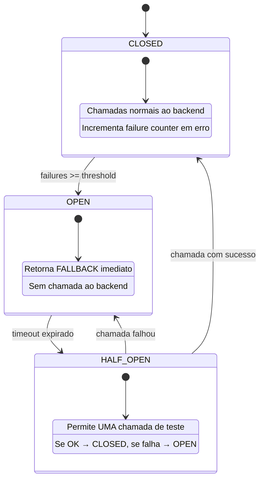
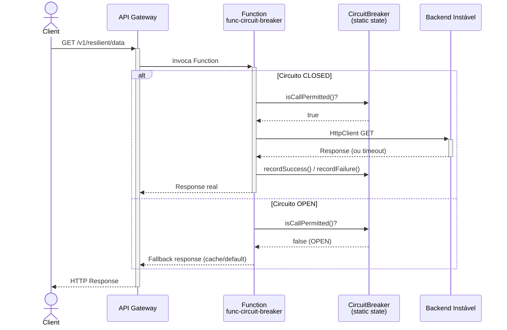
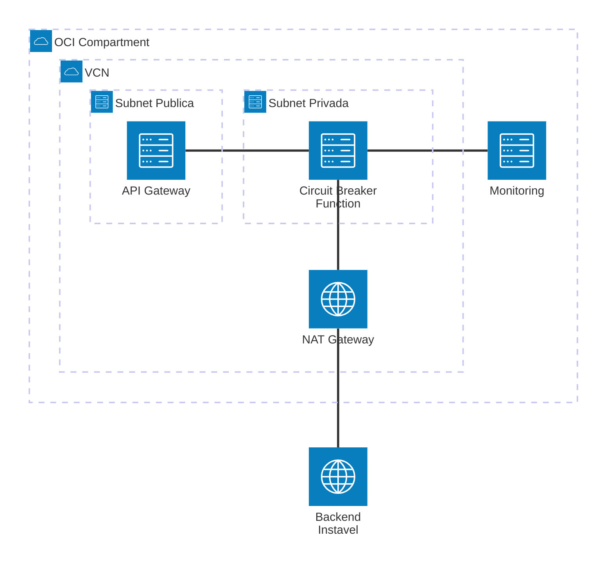

# Padrão 08 — Circuit Breaker

> **Status**: ✅ Implementável com Functions
> **Fase**: 1 — Fundações
> **Tipo**: Resiliência
> **Projeto Java**: `services/func-circuit-breaker/`

## 1. Visão Geral

### Descrição Original
Evita que uma aplicação intente executar repetidamente uma operação que tem altas probabilidades de falhar. Funciona como um interruptor eléctrico: se detecta falhas contínuas, "abre" o circuito e devolve uma resposta por defeito (fallback) imediatamente. Componentes originais: OCI API Gateway, OIC (Fault Handling), Service Mesh (Istio/OKE).

### Adaptação OIC → Functions
O circuit breaker é implementado como **state machine em código Java** dentro da Function. O estado é mantido em campo `static` (sobrevive entre invocações no hot function model). Requer `provisioned_concurrency >= 1` para manter instância viva.

| Componente Original | Implementação com Functions |
|---|---|
| OCI API Gateway | ✅ Sem mudança |
| OIC Fault Handling | 🔄 State machine Java (`CircuitBreaker.java`) em `static` field |
| Service Mesh (Istio/OKE) | ❌ Não implementado — circuit breaker a nível de Function, não de rede |

### Impacto da Substituição
- **Perda**: Estado centralizado (cada instância tem seu próprio circuito), dashboard de status, fault handling declarativo
- **Ganho**: Zero dependência de plataforma, lógica testável unitariamente, configurável via func.yaml

### Diagrama de Arquitetura





### Diagrama de Recursos (Terraform)



> **Módulos Terraform necessários:**
>
> | Módulo | Recursos |
> |---|---|
> | **network** | VCN, Internet GW, NAT GW (saída para backend instável), NSGs |
> | **iam** | Dynamic Group Functions, API GW invoke policy |
> | **functions** | Function `func-circuit-breaker` (256MB, 60s, **`provisioned_concurrency = 1`** — manter estado em memória) |
> | **api-gateway** | Rota `GET,POST /resilient/{path*}` |
> | **observability** | Logs + Alarms + Custom Metric (circuit-open, opcional) |
>
> **Nota crítica**: `provisioned_concurrency >= 1` é essencial — sem ela, o estado do circuit breaker (campo `static`) é perdido quando a instância é reciclada.

## 2. Projeto Java

- **Diretório**: `services/func-circuit-breaker/`
- **Package**: `com.brx.functions.circuitbreaker`
- **Handler**: `CircuitBreakerFunction extends APIGatewayFunction<CBRequest, CBResponse>`
- **func.yaml name**: `func-circuit-breaker`

### Estrutura

```
services/func-circuit-breaker/
├── pom.xml
├── func.yaml
├── Dockerfile
└── src/
    ├── main/java/com/brx/functions/circuitbreaker/
    │   ├── CircuitBreakerFunction.java    # Handler principal
    │   ├── model/
    │   │   ├── CBRequest.java             # DTO entrada
    │   │   └── CBResponse.java            # DTO saída (inclui circuit_state)
    │   ├── service/
    │   │   └── CircuitBreaker.java        # State machine (static)
    │   └── client/
    │       └── BackendClient.java         # HttpClient wrapper para backend
    └── test/java/com/brx/functions/circuitbreaker/
        ├── CircuitBreakerFunctionTest.java
        └── service/
            └── CircuitBreakerTest.java    # Testes da state machine isolada
```

### Dependências OCI SDK
- `oci-java-sdk-common` (auth Resource Principal)
- `oci-java-sdk-monitoring` (custom metrics — opcional)

### func.yaml

```yaml
schema_version: 20180708
name: func-circuit-breaker
version: 0.0.1
runtime: java
build_image: fnproject/fn-java-fdk-build:jdk17-latest
run_image: fnproject/fn-java-fdk:jre17-latest
cmd: com.brx.functions.circuitbreaker.CircuitBreakerFunction::handler
memory: 256
timeout: 60
config:
  ENVIRONMENT: dev
  BACKEND_BASE_URL: https://api.backend-instavel.example.com
  BACKEND_TIMEOUT_MS: "5000"
  CB_FAILURE_THRESHOLD: "5"
  CB_OPEN_TIMEOUT_MS: "30000"
  CB_HALF_OPEN_MAX_CALLS: "1"
  FALLBACK_MESSAGE: "Service temporarily unavailable. Using cached data."
```

## 3. Requisitos de Infraestrutura

### Terraform — Módulos Existentes

| Módulo | Configuração Específica |
|--------|------------------------|
| `functions` | `provisioned_concurrency = 1` (manter estado em memória), `function_memory_in_mbs = 256` |
| `api-gateway` | Nova rota `{ path = "/resilient/{path*}", methods = ["GET", "POST"] }` |
| `iam` | Sem mudança (Dynamic Group já cobre novas Functions no compartment) |
| `network` | Sem mudança |
| `observability` | Adicionar alarm para circuit-open (custom metric, opcional) |

### Terraform — Novos Recursos
Nenhum módulo novo. Porém, precisa de:
- Nova Function resource no módulo `functions` (ou segundo bloco de module)
- Nova imagem Docker no OCIR

### Terraform — Exemplo de Configuração

```hcl
# Nova Function
module "fn_circuit_breaker" {
  source           = "./modules/functions"
  compartment_ocid = var.compartment_ocid
  subnet_id        = module.network.subnet_private_id
  nsg_ids          = [module.network.nsg_functions_id]
  application_name = "app-integration-patterns"
  function_name    = "func-circuit-breaker"
  function_image   = "gru.ocir.io/${var.ocir_namespace}/patterns/func-circuit-breaker:0.0.1"
  provisioned_concurrency = 1   # CRÍTICO: mantém estado do circuit breaker
  function_config = {
    BACKEND_BASE_URL     = "https://api.backend-instavel.example.com"
    CB_FAILURE_THRESHOLD = "5"
    CB_OPEN_TIMEOUT_MS   = "30000"
  }
}
```

### IAM
Nenhuma policy adicional (Dynamic Group com `resource.type = 'fnfunc'` já cobre).

## 4. Requisitos de Codificação Java

### State Machine — `CircuitBreaker.java`

| Aspecto | Especificação |
|---------|--------------|
| Estado | `enum State { CLOSED, OPEN, HALF_OPEN }` |
| Storage | Campo `static` — sobrevive entre invocações no hot function |
| Thread-safety | `AtomicReference<State>` + `AtomicInteger` para contadores |
| Threshold | Configurável via `CB_FAILURE_THRESHOLD` (default: 5) |
| Open timeout | `CB_OPEN_TIMEOUT_MS` (default: 30000ms) — tempo antes de testar HALF_OPEN |
| Half-open calls | `CB_HALF_OPEN_MAX_CALLS` (default: 1) — quantas chamadas de teste |

**Métodos**:
- `isCallPermitted()` → boolean (verifica estado, transiciona OPEN→HALF_OPEN se timeout expirou)
- `recordSuccess()` → reseta contador, transiciona para CLOSED
- `recordFailure()` → incrementa contador, transiciona para OPEN se >= threshold
- `getState()` → State atual (para incluir na resposta)
- `getMetrics()` → `{ state, failureCount, lastFailureTime, successCount }`

### Handler — `CircuitBreakerFunction.java`

```
1. @FnConfiguration: lê configs (thresholds, backend URL, fallback message)
2. handler(): 
   a. Verifica CircuitBreaker.isCallPermitted()
   b. Se false → retorna fallback response (200 com dados degradados + header X-Circuit-State: OPEN)
   c. Se true → chama BackendClient.execute()
   d. Se sucesso → CircuitBreaker.recordSuccess(), retorna response real
   e. Se falha → CircuitBreaker.recordFailure(), retorna error ou fallback
3. Sempre inclui header X-Circuit-State no response
```

### Client — `BackendClient.java`

| Aspecto | Especificação |
|---------|--------------|
| HttpClient | `java.net.http.HttpClient` singleton |
| Timeout | `BACKEND_TIMEOUT_MS` (default: 5000ms) |
| Retry | **Sem retry** (circuit breaker já controla resiliência) |
| Exceções que contam como falha | Timeout, IOException, 5xx |
| Exceções que NÃO contam | 4xx (erro do cliente, não do backend) |

### Modelos (DTOs)

**`CBRequest.java`**:
- `path`: String (path do backend a chamar)
- `method`: String (GET, POST)
- `body`: Object (payload opcional)

**`CBResponse.java`**:
- `status_code`: int
- `data`: Object
- `circuit_state`: String (CLOSED, OPEN, HALF_OPEN)
- `is_fallback`: boolean
- `message`: String

### Tratamento de Erros

| Cenário | Circuit Breaker Action | Resposta |
|---------|----------------------|---------|
| Backend OK (2xx) | `recordSuccess()` | 200 + dados reais |
| Backend 4xx | Nenhuma (não é falha de infra) | Propaga 4xx |
| Backend 5xx | `recordFailure()` | 502 + fallback se disponível |
| Backend timeout | `recordFailure()` | 504 + fallback |
| Circuito OPEN | Bloqueado | 200 + fallback + `is_fallback: true` |
| Circuito HALF_OPEN, teste OK | `recordSuccess()` → CLOSED | 200 + dados reais |

## 5. Sequência de Prompts

### Prompt 0 — Auditoria de Infraestrutura

> **Obrigatório**: Executar ANTES de qualquer implementação.

Verificar se todos os módulos Terraform necessários existem em `infra/` para implementar este padrão.

**Módulos necessários**:
- `modules/network/` — VCN, subnets, gateways, NSGs
- `modules/iam/` — Dynamic Groups, Policies (functions, api-gateway)
- `modules/functions/` — Application + Function resource (circuit-breaker, `provisioned_concurrency = 1` para state)
- `modules/api-gateway/` — Gateway + Deployment com rota
- `modules/observability/` — Log Group, Alarms, ONS

**Prompt file**: `@prompts/audit-infra-prerequisites`

<details>
<summary>Fallback — prompt free-text</summary>

```
Usar @oci-terraform para auditar infra/:
1. Verificar existência de cada módulo listado em infra/modules/
2. Para functions: confirmar suporte a provisioned_concurrency = 1 (necessário para state do circuit breaker)
3. Todos os módulos base já devem existir — validar configuração
4. Confirmar que IAM policies cobrem recursos necessários
5. Reportar gaps e ações corretivas

Seguir especificação docs/patterns/08-circuit-breaker/08-circuit-breaker.md seção 3.
```
</details>

### Prompt 1 — Java (projeto + CircuitBreaker)

**Prompt file (primário)**: `@prompts/add-oci-function` para scaffold do projeto `func-circuit-breaker`.

> ⚠️ O `CircuitBreaker` é uma state machine com `AtomicReference` — lógica pattern-specific. Usar free-text complementar abaixo.

<details>
<summary>Fallback — prompt free-text (CircuitBreaker state machine)</summary>

```
Usar o agente @oci-functions-java para criar o projeto func-circuit-breaker
em services/ seguindo a especificação docs/patterns/08-circuit-breaker.md.
Criar a classe CircuitBreaker.java (state machine com AtomicReference)
com estados CLOSED/OPEN/HALF_OPEN, threshold configurável, e open timeout.
Seguir instruções java-functions-standards.instructions.md e
java-functions-project-structure.instructions.md.
```
</details>

### Prompt 2 — Java (BackendClient + Handler)

**Prompt file (primário)**: `@prompts/add-rest-client` com argumentos:
- Target API: URL configurável via `BACKEND_URL`
- Auth method: conforme backend
- Existing function class: `CircuitBreakerFunction`
- HTTP methods: GET, POST

**Complementar**: `@prompts/add-event-handler` com argumentos:
- Event source: API Gateway
- Existing function class: `CircuitBreakerFunction`
- Request type: request genérico (proxy)
- Response type: response com `is_fallback` flag e `X-Circuit-State` header

<details>
<summary>Fallback — prompt free-text</summary>

```
Criar BackendClient.java (HttpClient singleton, sem retry) e
CircuitBreakerFunction.java que integra CircuitBreaker + BackendClient
seguindo a especificação docs/patterns/08-circuit-breaker.md seção 4.
A Function deve: verificar circuito, chamar ou retornar fallback,
registrar sucesso/falha, e incluir X-Circuit-State no response.
Usar skills invoking-rest-apis-from-oci-functions e
implementing-oci-functions-events.
```
</details>

### Prompt 3 — Testes (state machine)

**Prompt file (primário)**: `@prompts/add-function-tests` com argumentos:
- Additional classes: `CircuitBreaker`
- SDK clients to mock: nenhum (lógica pura, state machine isolada)
- Scenarios: CLOSED→OPEN após N falhas, OPEN permanece antes do timeout, OPEN→HALF_OPEN após timeout, HALF_OPEN→CLOSED após sucesso, HALF_OPEN→OPEN após falha, reset de contadores

<details>
<summary>Fallback — prompt free-text</summary>

```
Criar CircuitBreakerTest.java testando a state machine isolada:
- Transição CLOSED→OPEN após N falhas consecutivas
- Permanência em OPEN antes do timeout
- Transição OPEN→HALF_OPEN após timeout
- Transição HALF_OPEN→CLOSED após sucesso
- Transição HALF_OPEN→OPEN após falha
- Reset de contadores após transição para CLOSED
Usar JUnit 4 seguindo java-functions-testing.instructions.md.
```
</details>

### Prompt 4 — Testes (Function)

**Prompt file (primário)**: `@prompts/add-function-tests` com argumentos:
- Function class: `CircuitBreakerFunction`
- Event source: API Gateway
- SDK clients to mock: `HttpClient` (via BackendClient)
- Scenarios: circuito CLOSED + backend OK → response real, circuito OPEN → fallback com `is_fallback: true`, sequência de falhas abre circuito, header `X-Circuit-State` presente em todas as respostas

<details>
<summary>Fallback — prompt free-text</summary>

```
Criar CircuitBreakerFunctionTest.java testando o handler completo:
- Request com circuito CLOSED e backend OK → response real
- Request com circuito OPEN → fallback response com is_fallback: true
- Sequência de falhas que abre o circuito
- Header X-Circuit-State presente em todas as respostas
Usar FnTestingRule + Mockito para mock do HttpClient.
```
</details>

### Prompt 5 — Terraform

**Prompt file (primário)**: `@prompts/add-serverless-stack` com argumentos:
- Function name: `func-circuit-breaker`
- API route: `GET,POST /resilient/{path*}`
- Auth type: JWT
- Memory: 256MB, Timeout: 60s
- provisioned_concurrency: 1 (mantém estado do circuito em memória)
- function_config: `CB_FAILURE_THRESHOLD`, `CB_OPEN_TIMEOUT_MS`, `CB_HALF_OPEN_MAX_CALLS`, `BACKEND_URL`

<details>
<summary>Fallback — prompt free-text</summary>

```
Usar o agente @oci-terraform para provisionar o func-circuit-breaker:
- Nova Function com provisioned_concurrency = 1 (mantém estado)
- Nova rota "/resilient/{path*}" no API Gateway
- Configurar function_config com thresholds do circuit breaker
Seguir especificação docs/patterns/08-circuit-breaker.md seção 3.
```
</details>

## 6. Critérios de Verificação

### Testes que Devem Passar

| Teste | Cenário | Resultado |
|-------|---------|----------|
| `testCircuitStartsClosed` | Estado inicial | CLOSED |
| `testTransitionToOpen` | 5 falhas consecutivas | OPEN |
| `testOpenRejectsCalls` | Call durante OPEN | `isCallPermitted() = false` |
| `testTransitionToHalfOpen` | OPEN + timeout expirado | HALF_OPEN |
| `testHalfOpenToClosedOnSuccess` | HALF_OPEN + sucesso | CLOSED, counters reset |
| `testHalfOpenToOpenOnFailure` | HALF_OPEN + falha | OPEN |
| `test4xxDoesNotCountAsFailure` | Backend retorna 404 | Counter não incrementa |
| `testFallbackResponseFormat` | Circuito OPEN | 200, `is_fallback: true`, `circuit_state: OPEN` |
| `testCircuitStateHeader` | Qualquer request | Header `X-Circuit-State` presente |

### Comandos de Validação

```bash
cd services/func-circuit-breaker && mvn clean package
cd infra/env-dev && terraform plan
```

### Comportamento Esperado
1. Primeiras chamadas passam normalmente (CLOSED)
2. Após 5 falhas consecutivas do backend, circuito abre (OPEN)
3. Chamadas durante OPEN retornam fallback imediato (sem tocar no backend)
4. Após 30s, circuito entra em HALF_OPEN e permite 1 chamada de teste
5. Se teste OK → CLOSED (fluxo normal restaurado)
6. Se teste falha → OPEN (mais 30s de espera)
7. Todas as respostas incluem `circuit_state` no body e `X-Circuit-State` no header
