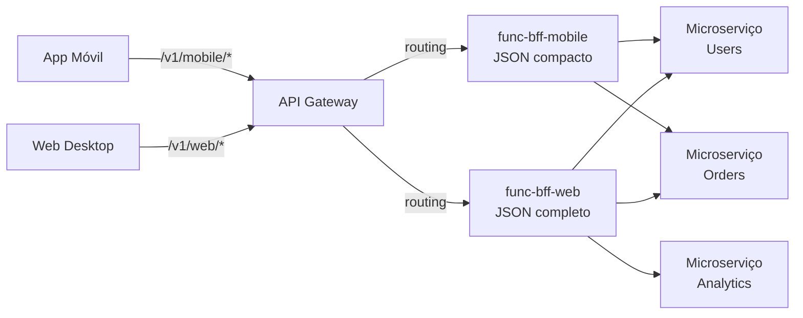
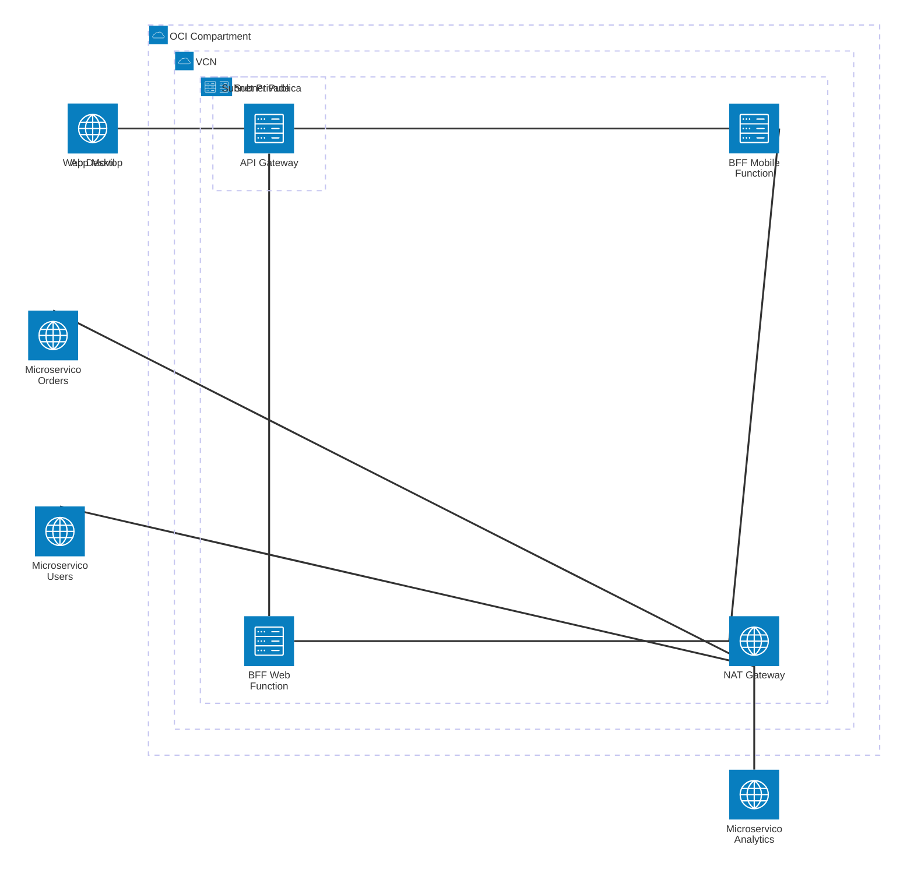

# Padrão 11 — BFF (Backend for Frontend)

> **Status**: ✅ Implementável com Functions
> **Fase**: 3 — Composição
> **Tipo**: Arquitetura
> **Projetos Java**: `services/func-bff-mobile/` + `services/func-bff-web/`

## 1. Visão Geral

### Descrição Original
Cria um serviço backend específico para cada tipo de interface (Web, Móvil, IoT), em vez de uma API monolítica. Componentes originais: OCI API Gateway, OCI Functions (recomendado como ideal para BFF), OIC.

### Adaptação OIC → Functions
O próprio documento de padrões indica que **FaaS é ideal para BFF**. Nenhuma adaptação significativa — Functions são a implementação natural.

| Componente Original | Implementação com Functions |
|---|---|
| OCI API Gateway | ✅ Routing por path prefix (`/mobile/*`, `/web/*`) |
| OCI Functions (BFF) | ✅ Uma Function por canal (mobile, web) |
| OIC (orquestação) | 🔄 Cada Function invoca microserviços diretamente via HttpClient |

### Impacto da Substituição
- **Perda**: Adaptadores visuais para composição de dados, mapeo drag-and-drop
- **Ganho**: Payload 100% otimizado por canal em código, cada equipe controla seu BFF

### Diagrama de Arquitetura



### Diagrama de Recursos (Terraform)



> **Módulos Terraform necessários:**
>
> | Módulo | Recursos |
> |---|---|
> | **network** | VCN, Internet GW, NAT GW (chamadas a microserviços), NSGs |
> | **iam** | Dynamic Group Functions, API GW invoke policy |
> | **functions** | 2 Functions: `func-bff-mobile` (256MB, **30s**) + `func-bff-web` (512MB, **60s**) |
> | **api-gateway** | Gateway + Deployment com routing por canal: `/mobile/*` → bff-mobile, `/web/*` → bff-web |
> | **observability** | Logs + Alarms (CORS diferenciado por canal) |
>
> **Nota**: Cada BFF pode ter CORS configurado diferentemente — mobile geralmente não precisa, web precisa de `allowed_origins`.

## 2. Projetos Java

### Mobile BFF: `services/func-bff-mobile/`

- **Package**: `com.brx.functions.bffmobile`
- **Handler**: `BffMobileFunction extends APIGatewayFunction<BffRequest, BffMobileResponse>`
- **Foco**: Payload compacto, campos mínimos, sem objetos aninhados, imagens como URLs thumbnail

```
services/func-bff-mobile/
├── pom.xml
├── func.yaml
├── Dockerfile
└── src/
    ├── main/java/com/brx/functions/bffmobile/
    │   ├── BffMobileFunction.java          # Handler — routing + transformação compacta
    │   ├── model/
    │   │   ├── BffRequest.java             # DTO entrada (path + params)
    │   │   ├── BffMobileResponse.java      # DTO saída (campos mínimos)
    │   │   └── UserSummary.java            # Exemplo: user com 4 campos
    │   └── client/
    │       └── DomainServiceClient.java    # HttpClient para microserviços
    └── test/java/com/brx/functions/bffmobile/
        └── BffMobileFunctionTest.java
```

### Web BFF: `services/func-bff-web/`

- **Package**: `com.brx.functions.bffweb`
- **Handler**: `BffWebFunction extends APIGatewayFunction<BffRequest, BffWebResponse>`
- **Foco**: Payload completo, objetos aninhados, dados analíticos, paginação

```
services/func-bff-web/
├── pom.xml
├── func.yaml
├── Dockerfile
└── src/
    ├── main/java/com/brx/functions/bffweb/
    │   ├── BffWebFunction.java             # Handler — routing + dados completos
    │   ├── model/
    │   │   ├── BffRequest.java
    │   │   ├── BffWebResponse.java         # DTO com todos os campos + nested
    │   │   └── UserDetail.java             # Exemplo: user com 20+ campos
    │   └── client/
    │       └── DomainServiceClient.java    # HttpClient (mesmo padrão)
    └── test/java/com/brx/functions/bffweb/
        └── BffWebFunctionTest.java
```

### func.yaml — Mobile

```yaml
schema_version: 20180708
name: func-bff-mobile
version: 0.0.1
runtime: java
build_image: fnproject/fn-java-fdk-build:jdk17-latest
run_image: fnproject/fn-java-fdk:jre17-latest
cmd: com.brx.functions.bffmobile.BffMobileFunction::handler
memory: 256
timeout: 30
config:
  ENVIRONMENT: dev
  USERS_SERVICE_URL: https://api.internal.example.com/users
  ORDERS_SERVICE_URL: https://api.internal.example.com/orders
```

> Timeout 30s (mobile deve ser rápido).

### func.yaml — Web

```yaml
schema_version: 20180708
name: func-bff-web
version: 0.0.1
runtime: java
build_image: fnproject/fn-java-fdk-build:jdk17-latest
run_image: fnproject/fn-java-fdk:jre17-latest
cmd: com.brx.functions.bffweb.BffWebFunction::handler
memory: 512
timeout: 60
config:
  ENVIRONMENT: dev
  USERS_SERVICE_URL: https://api.internal.example.com/users
  ORDERS_SERVICE_URL: https://api.internal.example.com/orders
  ANALYTICS_SERVICE_URL: https://api.internal.example.com/analytics
```

> Memory 512MB e timeout 60s (web agrega mais dados, incluindo analytics).

## 3. Requisitos de Infraestrutura

### Terraform — Módulos Existentes

| Módulo | Configuração |
|--------|-------------|
| `functions` | 2 novas Functions: func-bff-mobile (256MB, 30s) + func-bff-web (512MB, 60s) |
| `api-gateway` | 2 rotas: `/mobile/{resource}` → bff-mobile, `/web/{resource}` → bff-web |
| `iam` | Sem mudança |
| `network` | Sem mudança |

### API Gateway — Routing por Canal

```hcl
# Opção 1: Deployments separados (path prefix diferente)
# /v1/mobile/* → func-bff-mobile
# /v1/web/*    → func-bff-web

# Opção 2: Mesmo deployment, routes com backends diferentes
api_routes_mobile = [
  { path = "/mobile/users",    methods = ["GET"], function_id = fn_bff_mobile.id },
  { path = "/mobile/orders",   methods = ["GET"], function_id = fn_bff_mobile.id },
]
api_routes_web = [
  { path = "/web/users",       methods = ["GET"], function_id = fn_bff_web.id },
  { path = "/web/users/{id}",  methods = ["GET"], function_id = fn_bff_web.id },
  { path = "/web/orders",      methods = ["GET"], function_id = fn_bff_web.id },
  { path = "/web/analytics",   methods = ["GET"], function_id = fn_bff_web.id },
]
```

### CORS Diferenciado

```hcl
# Mobile: permitir origens de app nativa (geralmente não precisa de CORS)
# Web: permitir domínio do frontend
cors_allowed_origins_web = ["https://app.brx.example.com"]
```

## 4. Requisitos de Codificação Java

### Diferenças entre Mobile e Web

| Aspecto | Mobile | Web |
|---------|--------|-----|
| Payload size | ~500 bytes | ~5 KB |
| Campos por entidade | 3-5 essenciais | 15-20+ completos |
| Objetos aninhados | Não (flat) | Sim (nested) |
| Imagens | URL thumbnail (100px) | URL full-size |
| Paginação | Cursor-based (infinite scroll) | Offset + total_count |
| Analytics | Não inclui | Inclui dados de dashboard |
| Backends chamados | 2 (users, orders) | 3 (users, orders, analytics) |

### Exemplo: Resposta de User

**Mobile** (`UserSummary.java`):
```json
{
  "id": "123",
  "name": "João",
  "avatar_url": "https://cdn.example.com/avatars/123_thumb.jpg",
  "status": "active"
}
```

**Web** (`UserDetail.java`):
```json
{
  "id": "123",
  "name": "João Silva",
  "email": "joao@example.com",
  "phone": "+55 11 99999-0000",
  "avatar_url": "https://cdn.example.com/avatars/123_full.jpg",
  "status": "active",
  "created_at": "2024-01-15T10:30:00Z",
  "last_login": "2024-12-01T08:15:00Z",
  "address": { "street": "...", "city": "...", "state": "..." },
  "orders_count": 42,
  "total_spent": 15000.00,
  "preferences": { "language": "pt-BR", "notifications": true }
}
```

### Client — `DomainServiceClient.java` (mesmo padrão em ambos)

| Aspecto | Especificação |
|---------|--------------|
| HttpClient | Singleton |
| Timeout | Configurável por serviço (`USERS_SERVICE_URL`, `ORDERS_SERVICE_URL`) |
| Auth | Header `Authorization: Bearer <token>` (se microserviços internos exigem) |
| Métodos | `getUsers()`, `getOrders()`, `getAnalytics()` (web only) |

### Tratamento de Erros

| Cenário | Mobile | Web |
|---------|--------|-----|
| Backend users falha | 503 (sem dados degradados) | 200 parcial + `errors: ["users"]` |
| Backend analytics falha | N/A | 200 parcial (sem analytics, restante OK) |
| Todos os backends falham | 503 | 503 |

## 5. Sequência de Prompts

### Prompt 0 — Auditoria de Infraestrutura

> **Obrigatório**: Executar ANTES de qualquer implementação.

Verificar se todos os módulos Terraform necessários existem em `infra/` para implementar este padrão.

**Módulos necessários**:
- `modules/network/` — VCN, subnets, gateways, NSGs
- `modules/iam/` — Dynamic Groups, Policies (functions, api-gateway)
- `modules/functions/` — Application + Function resources (×2: func-bff-mobile, func-bff-web)
- `modules/api-gateway/` — Gateway + Deployment com **multi-function routing** (rotas diferentes → Functions diferentes)
- `modules/observability/` — Log Group, Alarms, ONS

**Prompt file**: `@prompts/audit-infra-prerequisites`

<details>
<summary>Fallback — prompt free-text</summary>

```
Usar @oci-terraform para auditar infra/:
1. Verificar existência de cada módulo listado em infra/modules/
2. Para api-gateway: verificar se suporta multi-function routing
   (rotas diferentes apontando para Functions diferentes)
   - Se só suporta single function_id, EVOLUIR módulo para function_id por rota
3. Para módulos FALTANTES, criar seguindo skills provisioning-oci-{service}
4. Confirmar que IAM policies cobrem novos recursos
5. Reportar gaps e ações corretivas

Seguir especificação docs/patterns/11-bff/11-bff.md seção 3.
```
</details>

### Prompt 1 — Java (func-bff-mobile)

**Prompt file (primário)**: `@prompts/add-oci-function` para scaffold, seguido de:
- `@prompts/add-rest-client` com argumentos: Target API = microserviços internos, Auth = OCI Request Signing, function class = `BffMobileFunction`
- `@prompts/add-event-handler` com argumentos: Event source = API Gateway, function class = `BffMobileFunction`, response type = `UserSummary` (4 campos compactos)

<details>
<summary>Fallback — prompt free-text</summary>

```
Usar o agente @oci-functions-java para criar projeto func-bff-mobile
em services/ seguindo docs/patterns/11-bff.md.
Handler BffMobileFunction com rotas /users e /orders,
retornando payload compacto (UserSummary com 4 campos).
DomainServiceClient com HttpClient para chamar microserviços.
```
</details>

### Prompt 2 — Java (func-bff-web)

**Prompt file (primário)**: `@prompts/add-oci-function` para scaffold, seguido de:
- `@prompts/add-rest-client` com argumentos: Target API = microserviços internos, Auth = OCI Request Signing, function class = `BffWebFunction`
- `@prompts/add-event-handler` com argumentos: Event source = API Gateway, function class = `BffWebFunction`, response type = `UserDetail` (15+ campos, nested objects)

<details>
<summary>Fallback — prompt free-text</summary>

```
Usar o agente @oci-functions-java para criar projeto func-bff-web
em services/ seguindo docs/patterns/11-bff.md.
Handler BffWebFunction com rotas /users, /orders, /analytics,
retornando payload completo (UserDetail com 15+ campos, nested objects).
Mesmo DomainServiceClient pattern do mobile.
```
</details>

### Prompt 3 — Testes (ambos)

**Prompt file (primário)**: `@prompts/add-function-tests` (2 vezes) com argumentos:
- **Mobile**: Function class = `BffMobileFunction`, Event source = API Gateway, mock `HttpClient`, scenarios: resposta compacta, campos mínimos, sem nested objects
- **Web**: Function class = `BffWebFunction`, Event source = API Gateway, mock `HttpClient`, scenarios: resposta completa, todos os campos, com nested objects

<details>
<summary>Fallback — prompt free-text</summary>

```
Criar testes para ambos os BFFs:
- BffMobileFunctionTest: resposta compacta, campos mínimos, sem nested
- BffWebFunctionTest: resposta completa, todos os campos, com nested
- Verificar que mobile NÃO retorna campos do web (email, address, etc.)
Usar FnTestingRule + Mockito para mock dos backends.
```
</details>

### Prompt 4 — Terraform (Functions + Routing)

**Prompt file (primário)**: `@prompts/add-serverless-stack` (2 vezes) com argumentos:
- Function 1: `func-bff-mobile`, Memory: 256MB, Timeout: 30s, Route: `GET /mobile/{resource}`
- Function 2: `func-bff-web`, Memory: 512MB, Timeout: 60s, Route: `GET /web/{resource}`

**Complementar**: `@prompts/add-api-gateway` para configuração de CORS apenas nas rotas `/web/*`.

<details>
<summary>Fallback — prompt free-text</summary>

```
Usar o agente @oci-terraform para:
- Provisionar func-bff-mobile (256MB, 30s) e func-bff-web (512MB, 60s)
- Configurar API Gateway com routing: /mobile/* → mobile, /web/* → web
- CORS configurado apenas para rotas /web/*
```
</details>

### Prompt 5 — Validação de payload (contract tests)

**Prompt file (primário)**: `@prompts/add-function-tests` com argumentos:
- Function class: `BffMobileFunction`
- Scenarios: mobile response NUNCA contém campos sensíveis (email, phone, address), mobile response tamanho < 1KB por entidade, web response contém todos os campos documentados

<details>
<summary>Fallback — prompt free-text</summary>

```
Criar testes de contrato que verifiquem:
- Mobile response NUNCA contém campos sensíveis (email, phone, address)
- Mobile response tamanho < 1KB por entidade
- Web response contém todos os campos documentados
```
</details>

## 6. Critérios de Verificação

### Testes que Devem Passar

| Teste | Projeto | Cenário | Resultado |
|-------|---------|---------|----------|
| `testMobileUsersSummary` | Mobile | GET /users | Lista de UserSummary (4 campos) |
| `testMobileNoEmail` | Mobile | GET /users | Response NÃO contém "email" |
| `testMobileNoNested` | Mobile | GET /users | Response NÃO contém objetos aninhados |
| `testWebUsersDetail` | Web | GET /users | Lista de UserDetail (15+ campos) |
| `testWebIncludesAddress` | Web | GET /users | Response contém "address" (nested) |
| `testWebAnalytics` | Web | GET /analytics | Dados analíticos presentes |
| `testMobilePayloadSize` | Mobile | GET /users/123 | Response < 1KB |

### Comandos de Validação

```bash
cd services/func-bff-mobile && mvn clean package
cd services/func-bff-web && mvn clean package
```

### Comportamento Esperado
1. App mobile chama GET /v1/mobile/users → payload compacto (~500 bytes)
2. Web desktop chama GET /v1/web/users → payload completo (~5 KB)
3. Ambos chamam os mesmos microserviços de domínio
4. Mobile: timeout 30s, Web: timeout 60s (agrega mais dados)
5. API Gateway aplica CORS apenas em rotas /web/*
