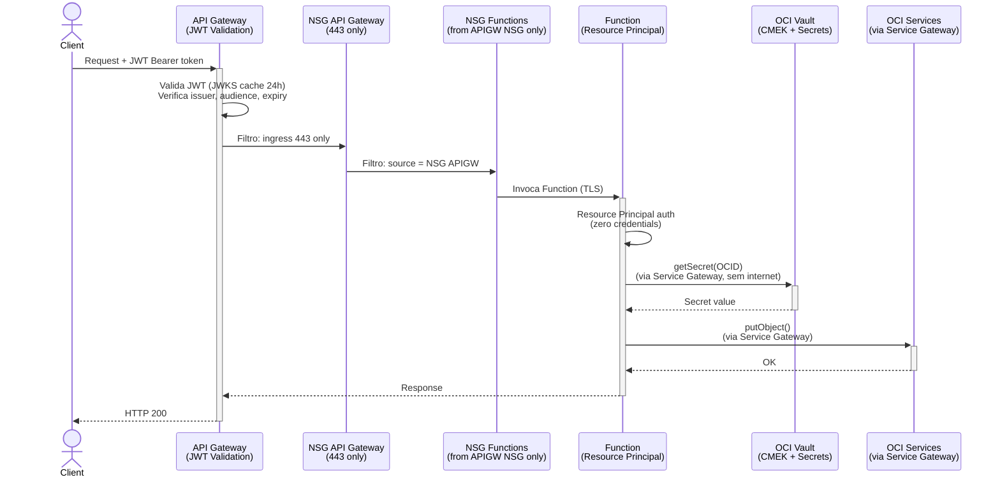
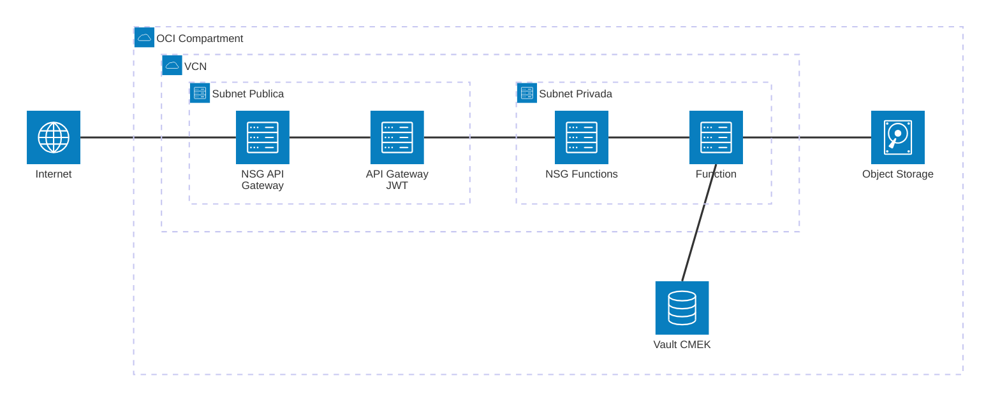

# Padrão 13 — Zero-Trust Integration

> **Status**: ⚠️ Parcialmente implementável (sem mTLS/Service Mesh)
> **Fase**: 1 — Fundações (cross-cutting)
> **Tipo**: Segurança
> **Projeto Java**: Nenhum (configuração transversal aplicada a todos os padrões)

## 1. Visão Geral

### Descrição Original
Modelo de segurança "Nunca confíes, siempre verifica". Toda comunicação entre APIs, microserviços e integrações deve estar autenticada, autorizada e encriptada, mesmo dentro da mesma VCN.

### Adaptação OIC → Functions
Não substitui OIC — este padrão é transversal. A implementação foca nos componentes disponíveis:

| Componente Original | Implementação com Functions |
|---|---|
| OCI IAM / IDCS | ✅ JWT validation no API Gateway, Resource Principal nas Functions |
| OCI API Gateway | ✅ JWT auth, Rate Limiting, CORS |
| OKE + Istio (mTLS) | ❌ Não disponível — segurança via NSGs + Resource Principal |
| OCI Vault (KMS) | ✅ Customer-managed keys, secrets com rotação |

### Impacto
- **Perda**: mTLS entre serviços (requer Service Mesh), certificados client-side
- **Ganho**: Zero credentials no código (Resource Principal), encriptação automática, NSG micro-segmentação

### Diagrama de Arquitetura



### Diagrama de Recursos (Terraform)



> **Módulos Terraform necessários:**
>
> | Módulo | Recursos |
> |---|---|
> | **network** | VCN, Internet GW, Service GW (All Services), NSGs restritivos (APIGW: ingress 443, egress NSG FN; Functions: ingress from NSG APIGW, egress SGW+NAT) |
> | **iam** | Dynamic Groups, Policies least-privilege: `read secret-bundles`, `use keys`, `manage objects` |
> | **api-gateway** | JWT authentication (`jwt_auth_enabled`, JWKS cache 24h, rota `/health` anônima) |
> | **vault** (**novo**) | Vault (DEFAULT), Customer-Managed Key (AES-256), Auto-Rotation (90 dias), Secrets |
> | **observability** | Logs + Alarms |
>
> **Zero-Trust Checklist Terraform:**
> - NSGs micro-segmentados (API GW ↔ Functions only)
> - Service Gateway para tráfego OCI (sem internet pública)
> - JWT obrigatório em todas as rotas (exceto `/health`)
> - Vault CMEK com rotação automática
> - Resource Principal (zero credentials no código)

## 2. Projeto Java
Nenhum projeto dedicado. Este padrão define **configurações de segurança** aplicadas transversalmente a todos os projetos.

### Checklist por Projeto Java

Cada Function (qualquer padrão) deve seguir:

| Requisito | Implementação | Verificação |
|-----------|--------------|-------------|
| Zero hardcoded credentials | Resource Principal em OCI, Vault para secrets externos | Grep por `password`, `secret`, `key` no código |
| Secrets via Vault | `OciServiceClient.getSecret(OCID)` | Config key sufixada `_OCID` |
| JSON logging estruturado | `{"event":"...","method":"..."}` sem PII | Grep por dados sensíveis nos logs |
| Input validation | Validar todos os campos antes de processar | Testes com payloads maliciosos |
| Error sanitization | Nunca expor stack traces ao client | 500 retorna "Internal server error" |

## 3. Requisitos de Infraestrutura

### Terraform — JWT Authentication (API Gateway)

```hcl
# infra/env-dev/main.tf
jwt_auth_enabled = true
jwt_issuers      = ["https://identity.oraclecloud.com/"]
jwt_audiences    = ["https://api.brx.example.com"]
jwt_jwks_uri     = "https://idcs-xxxx.identity.oraclecloud.com/admin/v1/SigningCert/jwk"
```

Configuração no módulo `api-gateway`:
- JWKS cache: 24 horas (default)
- Max clock skew: 60 segundos
- Rota `/health` sempre anônima
- Todas as demais rotas exigem JWT válido

### Terraform — OCI Vault (Encryption + Secrets)

```hcl
# Novo: provisionar Vault com customer-managed key
module "vault" {
  source           = "./modules/vault"     # Skill: provisioning-oci-vault
  compartment_ocid = var.compartment_ocid
  vault_name       = "vault-integration-patterns"
  key_name         = "key-functions-encryption"
  key_shape        = "AES"
  key_length       = 32                    # AES-256
  enable_auto_rotation = true
  rotation_interval_days = 90
}
```

### Terraform — Network Security (NSGs)

NSGs já existem no módulo `network`. Verificar configuração:

```hcl
# NSG API Gateway (público)
ingress: 0.0.0.0/0 → TCP 443 (HTTPS only)
egress:  → NSG Functions (TCP 443)

# NSG Functions (privado)
ingress: source = NSG API Gateway → TCP 443
egress:  → Service Gateway (OCI services)
egress:  → NAT Gateway (internet, para APIs externas)
```

### Terraform — Service Gateway

Já existente. Garante que Functions acessam Vault e Object Storage **sem tráfego pela internet pública**.

### IAM — Policies de Segurança

```hcl
# Functions leem secrets (já existe)
"allow dynamic-group dg-functions-* to read secret-bundles in compartment ${compartment}"

# Functions usam keys para encriptação (novo se necessário)
"allow dynamic-group dg-functions-* to use keys in compartment ${compartment}"

# API Gateway valida JWT (implícito, sem policy adicional)
```

## 4. Requisitos de Codificação (Cross-cutting)

### Padrão de Autenticação em toda Function

```java
// @FnConfiguration — SEMPRE usar Resource Principal
private AbstractAuthenticationDetailsProvider buildAuthProvider() {
    if (System.getenv("OCI_RESOURCE_PRINCIPAL_VERSION") != null) {
        return ResourcePrincipalAuthenticationDetailsProvider.builder().build();
    }
    // Fallback para desenvolvimento local APENAS
    return new ConfigFileAuthenticationDetailsProvider("DEFAULT");
}
```

### Padrão de Leitura de Secrets

```java
// NUNCA ler secrets em texto do func.yaml config
// SEMPRE usar OCID → Vault
String dbPassword = ociClient.getSecret(
    ctx.getConfigurationByKey("DB_PASSWORD_OCID").orElseThrow()
);
```

### Padrão de Logging Seguro

```java
// ✅ BOM — sem PII
LOG.info("{\"event\":\"request\",\"path\":\"" + path + "\",\"method\":\"" + method + "\"}");

// ❌ RUIM — expõe dados sensíveis
LOG.info("Request body: " + requestBody);
LOG.info("Secret value: " + secretValue);
LOG.info("Error: " + exception.getStackTrace());
```

### Padrão de Error Response

```java
// ✅ BOM — sanitizado
return error(500, "Internal server error");

// ❌ RUIM — expõe internals
return error(500, exception.getMessage());
return error(500, Arrays.toString(exception.getStackTrace()));
```

## 5. Sequência de Prompts

### Prompt 0 — Auditoria de Infraestrutura

> **Obrigatório**: Executar ANTES de qualquer implementação.

Verificar se todos os módulos Terraform necessários existem em `infra/` para implementar este padrão.

**Módulos necessários**:
- `modules/network/` — VCN, subnets, gateways, **NSGs restritivas** (ingress/egress mínimo)
- `modules/iam/` — Dynamic Groups, **Policies com escopo mínimo** (least-privilege)
- `modules/functions/` — Application + Function resource
- `modules/vault/` — **Vault + CMEK keys + Secret rotation** (zero-trust requer encrypção e rotação)
- `modules/observability/` — Log Group, Alarms, ONS

**Prompt file**: `@prompts/audit-infra-prerequisites`

<details>
<summary>Fallback — prompt free-text</summary>

```
Usar @oci-terraform para auditar infra/:
1. Verificar existência de cada módulo listado em infra/modules/
2. Para vault: verificar suporte a CMEK (Customer-Managed Encryption Keys) e secret rotation
3. Para network: verificar NSGs com regras restritivas (ingress/egress mínimo)
4. Para iam: verificar policies com escopo mínimo (least-privilege)
5. Para módulos FALTANTES (vault estendido), criar seguindo skill provisioning-oci-vault
6. Reportar gaps e ações corretivas

Seguir especificação docs/patterns/13-zero-trust/13-zero-trust.md seção 3.
```
</details>

### Prompt 1 — JWT no API Gateway

**Prompt file (primário)**: `@prompts/add-api-gateway` com argumentos:
- Authentication type: JWT
- JWT config: `jwt_auth_enabled = true`, `jwt_issuers`, `jwt_audiences`, `jwt_jwks_uri`
- Rota `/health` como exceção (anônima)
- Atualizar `infra/env-dev/main.tf`

<details>
<summary>Fallback — prompt free-text</summary>

```
Habilitar JWT authentication no API Gateway Terraform.
Configurar jwt_auth_enabled = true, jwt_issuers, jwt_audiences,
e jwt_jwks_uri no infra/env-dev/main.tf.
Rota /health deve permanecer anônima.
Usar agente @oci-terraform com skill provisioning-oci-api-gateway.
```
</details>

### Prompt 2 — Vault com CMEK

**Prompt file (primário)**: `@prompts/add-vault` com argumentos:
- Vault type: Default
- Key algorithm: AES-256
- Rotation policy: 90 dias (auto-rotation)
- Secret names: conforme Functions que consumirão secrets
- Consuming services: todas as Functions do projeto

**Complementar**: `@prompts/add-iam` para policy de Functions usarem keys.

<details>
<summary>Fallback — prompt free-text</summary>

```
Provisionar OCI Vault com customer-managed encryption key (AES-256)
e rotação automática a cada 90 dias.
Criar módulo infra/modules/vault/ seguindo skill provisioning-oci-vault.
Adicionar IAM policy para Functions usarem keys.
```
</details>

### Prompt 3 — NSGs restritivos

**Prompt file (primário)**: `@prompts/add-serverless-stack` com argumentos:
- NSG rules (verificação/ajuste):
  - API GW NSG: ingress ONLY 443, egress ONLY para NSG Functions
  - Functions NSG: ingress ONLY de NSG API GW, egress para Service GW + NAT GW
- Service Gateway: confirmar "All Services"

<details>
<summary>Fallback — prompt free-text</summary>

```
Verificar e ajustar NSGs no módulo network para:
- API GW NSG: ingress ONLY 443, egress ONLY para NSG Functions
- Functions NSG: ingress ONLY de NSG API GW, egress para Service GW + NAT GW
Confirmar que Service Gateway está configurado para "All Services".
```
</details>

### Prompt 4 — Auditoria de código

> Não há prompt file para auditoria. Processo manual/semi-automatizado.

```
Auditar todos os projetos Java em services/ para conformidade Zero-Trust:
- Grep por hardcoded credentials (password, secret, key, token)
- Verificar que todos os secrets usam _OCID suffix
- Verificar que error responses não expõem stack traces
- Verificar que logs não contêm PII ou dados sensíveis
```

## 6. Critérios de Verificação

### Checklist de Segurança

| # | Verificação | Comando/Método |
|---|------------|---------------|
| 1 | JWT habilitado no API Gateway | `terraform output` → jwt_auth_enabled = true |
| 2 | Request sem JWT → 401 | `curl -X GET https://apigw/v1/hello` → 401 Unauthorized |
| 3 | Request com JWT válido → 200 | `curl -H "Authorization: Bearer <token>" ...` → 200 |
| 4 | /health acessível sem JWT | `curl https://apigw/v1/health` → 200 |
| 5 | NSG bloqueia acesso direto à Function | Tentativa de conexão direta à subnet privada → timeout |
| 6 | Vault provisionado com CMEK | `terraform output` → vault_id, key_id |
| 7 | Zero credentials no código | `grep -r "password\|secret\|apikey" services/*/src/ --include="*.java"` → 0 resultados |
| 8 | Logs sem PII | Revisar OCI Logging → nenhum payload ou secret logado |
| 9 | Error responses sanitizados | Forçar erro 500 → response contém apenas "Internal server error" |

### Comportamento Esperado
1. Todo tráfego externo passa por API Gateway com validação JWT
2. Apenas tráfego do API Gateway chega às Functions (NSG)
3. Functions acessam OCI services via Service Gateway (sem internet)
4. Secrets nunca aparecem em código, logs ou responses de erro
5. Chaves de encriptação rotacionam automaticamente a cada 90 dias
