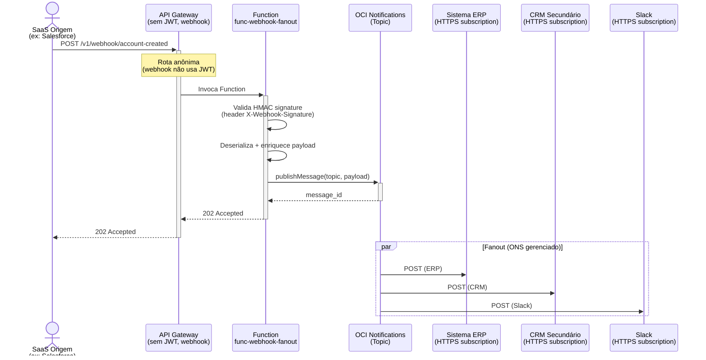

# Padrão 17 — Webhook Fanout

> **Status**: ✅ Implementável com Functions + Notifications
> **Fase**: 2 — Event-Driven
> **Tipo**: Assíncrono
> **Projeto Java**: `services/func-webhook-fanout/`

## 1. Visão Geral

### Descrição Original
Um sistema origem emite um evento via HTTP POST (Webhook). A plataforma recebe e distribui (fanout) a múltiplos sistemas destino de forma concorrente. Componentes originais: OCI API Gateway, OIC (distribuidor).

### Adaptação OIC → Functions
OIC como distribuidor é substituído por **Function + OCI Notifications (ONS)**. A Function recebe o webhook, valida a assinatura HMAC, e publica num Notification Topic. ONS faz o fanout nativo para múltiplas subscriptions.

| Componente Original | Implementação com Functions |
|---|---|
| OCI API Gateway | ✅ Recebe POST webhook (sem JWT — webhook usa HMAC) |
| OIC (distribuidor) | 🔄 Function valida + ONS Topic faz fanout nativo |
| Destinos múltiplos | ✅ ONS Subscriptions (HTTPS, Email, Function, Slack) |

### Impacto da Substituição
- **Perda**: Dashboard de entregas, DLQ com interface de reproceso, retry visual
- **Ganho**: ONS fanout gerenciado (retry nativo por subscription), pay-per-use, zero manutenção

### Diagrama de Arquitetura



### Diagrama de Recursos (Terraform)

```mermaid
architecture-beta
    service saas(internet)[SaaS Origem]

    group oci(cloud)[OCI Compartment]

    group vcn(cloud)[VCN] in oci

    group pub(server)[Subnet Publica] in vcn
    service apigw(server)[API Gateway] in pub

    group priv(server)[Subnet Privada] in vcn
    service fn(server)[Webhook Fanout Function] in priv

    service vault(database)[Vault] in oci
    service ons(server)[Notifications Topic] in oci

    service d1(internet)[Sistema ERP]
    service d2(internet)[CRM Secundario]
    service d3(internet)[Slack]

    saas:R -- L:apigw
    apigw:R -- L:fn
    fn:R -- L:ons
    fn:B -- T:vault
    ons:B -- T:d1
    ons:B -- T:d2
    ons:B -- T:d3
```

> **Módulos Terraform necessários:**
>
> | Módulo | Recursos |
> |---|---|
> | **network** | VCN, Internet GW, Service GW, NSGs |
> | **iam** | Dynamic Group Functions, Policy: `use ons-topics`, `read secret-bundles` |
> | **functions** | Function `func-webhook-fanout` (256MB, 60s) |
> | **api-gateway** | Rota `POST /webhook/{event}` **sem JWT** (anônima — webhook usa HMAC) |
> | **observability** | Notification Topic (existente) + Subscriptions (HTTPS, Email, Slack) |
> | *existente* | **Vault** (HMAC secret para validação de assinatura) |

## 2. Projeto Java

- **Diretório**: `services/func-webhook-fanout/`
- **Package**: `com.brx.functions.webhookfanout`
- **Handler**: `WebhookFanoutFunction extends APIGatewayFunction<WebhookPayload, WebhookResponse>`

### Estrutura

```
services/func-webhook-fanout/
├── pom.xml
├── func.yaml
├── Dockerfile
└── src/
    ├── main/java/com/brx/functions/webhookfanout/
    │   ├── WebhookFanoutFunction.java      # Handler — valida + publica
    │   ├── model/
    │   │   ├── WebhookPayload.java         # DTO genérico do webhook
    │   │   └── WebhookResponse.java        # DTO resposta
    │   ├── service/
    │   │   └── HmacValidator.java          # Validação de assinatura HMAC-SHA256
    │   └── client/
    │       └── NotificationPublisher.java  # OCI Notifications SDK wrapper
    └── test/java/com/brx/functions/webhookfanout/
        ├── WebhookFanoutFunctionTest.java
        └── service/
            └── HmacValidatorTest.java
```

### Dependências OCI SDK

| Módulo | Uso |
|--------|-----|
| `oci-java-sdk-ons` | `NotificationDataPlaneClient.publishMessage()` |
| `oci-java-sdk-common` | Resource Principal auth |

### func.yaml

```yaml
schema_version: 20180708
name: func-webhook-fanout
version: 0.0.1
runtime: java
build_image: fnproject/fn-java-fdk-build:jdk17-latest
run_image: fnproject/fn-java-fdk:jre17-latest
cmd: com.brx.functions.webhookfanout.WebhookFanoutFunction::handler
memory: 256
timeout: 60
config:
  ENVIRONMENT: dev
  NOTIFICATION_TOPIC_OCID: ocid1.onstopic.oc1...
  WEBHOOK_SECRET_OCID: ocid1.vaultsecret.oc1...
  HMAC_HEADER_NAME: X-Webhook-Signature
  HMAC_ALGORITHM: HmacSHA256
```

## 3. Requisitos de Infraestrutura

### Terraform — Módulos Existentes

| Módulo | Configuração |
|--------|-------------|
| `functions` | Nova Function `func-webhook-fanout`, memory 256MB, timeout 60s |
| `api-gateway` | Nova rota `{ path = "/webhook/{event}", methods = ["POST"] }` **sem JWT** (anônima) |
| `observability` | Notification Topic já existe — adicionar subscriptions |
| `iam` | Nova policy: Functions publicam em Notifications |

### Terraform — Rota Webhook (anônima)

A rota do webhook **não deve exigir JWT** — a autenticação é via HMAC no payload. Configurar no módulo `api-gateway` com autenticação anônima para este path específico.

### IAM — Novas Policies

```hcl
# Functions publicam em Notifications
"allow dynamic-group dg-functions-* to use ons-topics in compartment ${compartment}"
```

### Notification Topic — Subscriptions

```hcl
# Subscriptions configuradas no Notification Topic
resource "oci_ons_subscription" "erp" {
  compartment_id = var.compartment_ocid
  topic_id       = oci_ons_notification_topic.webhook.id
  protocol       = "HTTPS"
  endpoint       = "https://erp.example.com/api/webhook-handler"
}

resource "oci_ons_subscription" "crm" {
  compartment_id = var.compartment_ocid
  topic_id       = oci_ons_notification_topic.webhook.id
  protocol       = "HTTPS"
  endpoint       = "https://crm.example.com/api/webhook-handler"
}

resource "oci_ons_subscription" "slack" {
  compartment_id = var.compartment_ocid
  topic_id       = oci_ons_notification_topic.webhook.id
  protocol       = "SLACK"
  endpoint       = "https://hooks.slack.com/services/T00/B00/xxxx"
}
```

## 4. Requisitos de Codificação Java

### Validador — `HmacValidator.java`

| Aspecto | Especificação |
|---------|--------------|
| Algoritmo | HMAC-SHA256 (configurável via `HMAC_ALGORITHM`) |
| Secret | Lido do Vault via `WEBHOOK_SECRET_OCID` na inicialização |
| Input | Raw body (String) + header signature |
| Método | `validate(String rawBody, String headerSignature)` → boolean |
| Comparação | `MessageDigest.isEqual()` (constant-time, previne timing attacks) |

### Publisher — `NotificationPublisher.java`

| Aspecto | Especificação |
|---------|--------------|
| Client | `NotificationDataPlaneClient` com Resource Principal |
| Método | `publish(String topicOcid, String title, String body)` → message_id |
| Payload | JSON serializado do webhook enriquecido (+ timestamp, event_type) |
| Título | `event_type` do webhook (ex: "account-created") |

### Handler — `WebhookFanoutFunction.java`

```
1. @FnConfiguration: lê configs, inicializa HmacValidator (secret do Vault), NotificationPublisher
2. handler():
   a. Extrai raw body e header HMAC do request
   b. Valida HMAC signature → 401 se inválido
   c. Deserializa WebhookPayload
   d. Enriquece com timestamp, correlation_id, source path (/webhook/{event})
   e. Publica no ONS Topic via NotificationPublisher
   f. Retorna 202 Accepted com message_id
```

### Modelos (DTOs)

**`WebhookPayload.java`** (genérico):
- `event_type`: String (extraído do path: `/webhook/account-created` → "account-created")
- `data`: Object (payload original do webhook)
- `source`: String (sistema origem)
- `timestamp`: String (ISO-8601, adicionado pela Function)
- `correlation_id`: String (UUID gerado)

**`WebhookResponse.java`**:
- `status`: String ("accepted")
- `message_id`: String (ID da mensagem no ONS)
- `correlation_id`: String

### Tratamento de Erros

| Cenário | Resposta |
|---------|---------|
| HMAC inválido | 401 Unauthorized "Invalid webhook signature" |
| Body vazio | 400 Bad Request |
| ONS indisponível | 503 Service Unavailable |
| Publicação OK | 202 Accepted |

## 5. Sequência de Prompts

### Prompt 0 — Auditoria de Infraestrutura

> **Obrigatório**: Executar ANTES de qualquer implementação.

Verificar se todos os módulos Terraform necessários existem em `infra/` para implementar este padrão.

**Módulos necessários**:
- `modules/network/` — VCN, subnets, gateways, NSGs
- `modules/iam/` — Dynamic Groups, Policies (functions, api-gateway, ons)
- `modules/functions/` — Application + Function resource (webhook-fanout)
- `modules/api-gateway/` — Gateway + Deployment com rota (webhook endpoint)
- `modules/vault/` — **Vault + Secrets** (HMAC signing key para webhook validation)
- `modules/notifications/` — **ONS Topic + Subscriptions** (fanout para múltiplos destinos)
- `modules/observability/` — Log Group, Alarms, ONS

**Prompt file**: `@prompts/audit-infra-prerequisites`

<details>
<summary>Fallback — prompt free-text</summary>

```
Usar @oci-terraform para auditar infra/:
1. Verificar existência de cada módulo listado em infra/modules/
2. Para módulos existentes, verificar capabilities
3. Para módulos FALTANTES (vault, notifications), criar seguindo skills:
   - provisioning-oci-vault (Vault + Secret para HMAC key)
   - ONS Topic + Subscriptions (oci_ons_notification_topic)
4. Confirmar que IAM policies cobrem: read secret-bundles, use ons-topics
5. Reportar gaps e ações corretivas

Seguir especificação docs/patterns/17-webhook-fanout/17-webhook-fanout.md seção 3.
```
</details>

### Prompt 1 — Java (projeto + HmacValidator)

**Prompt file (primário)**: `@prompts/add-oci-function` para scaffold do projeto `func-webhook-fanout`.

> ⚠️ O `HmacValidator` usa HMAC-SHA256 com secret do Vault e comparação constant-time (`MessageDigest.isEqual`) — lógica pattern-specific. Usar free-text complementar abaixo.

<details>
<summary>Fallback — prompt free-text (HmacValidator)</summary>

```
Usar o agente @oci-functions-java para criar projeto func-webhook-fanout
em services/ seguindo docs/patterns/17-webhook-fanout.md.
Criar HmacValidator.java com HMAC-SHA256, secret do Vault, e
comparação constant-time (MessageDigest.isEqual).
```
</details>

### Prompt 2 — Java (NotificationPublisher + Handler)

**Prompt file (primário)**: `@prompts/add-event-publishing` com argumentos:
- Target service: OCI Notifications
- Existing function class: `WebhookFanoutFunction`
- Message format: JSON enriquecido com `timestamp` + `correlation_id`

**Complementar**: `@prompts/add-event-handler` com argumentos:
- Event source: API Gateway
- Existing function class: `WebhookFanoutFunction`
- Request type: webhook payload (raw body + headers para HMAC)
- Response type: 202 Accepted

<details>
<summary>Fallback — prompt free-text</summary>

```
Criar NotificationPublisher.java com OCI Notifications SDK
(NotificationDataPlaneClient.publishMessage) e
WebhookFanoutFunction.java que: valida HMAC, enriquece payload,
publica no ONS Topic.
Usar skill publishing-events-from-oci-functions.
```
</details>

### Prompt 3 — Testes

**Prompt file (primário)**: `@prompts/add-function-tests` com argumentos:
- Function class: `WebhookFanoutFunction`
- Event source: API Gateway
- SDK clients to mock: `NotificationDataPlaneClient`
- Additional classes: `HmacValidator`
- Scenarios:
  - HmacValidator: signature válida, inválida, timing-attack safe
  - Function: webhook OK → 202, HMAC inválido → 401, body vazio → 400

<details>
<summary>Fallback — prompt free-text</summary>

```
Criar testes:
- HmacValidatorTest: signature válida, inválida, timing-attack safe
- WebhookFanoutFunctionTest: webhook OK→202, HMAC inválido→401, body vazio→400
Usar FnTestingRule + Mockito para mock do NotificationDataPlaneClient.
```
</details>

### Prompt 4 — Terraform (Function + Rota)

**Prompt file (primário)**: `@prompts/add-serverless-stack` com argumentos:
- Function name: `func-webhook-fanout`
- API route: `POST /webhook/{event}` (anônima — SEM JWT)
- Auth type: No auth (HMAC validado no código)
- Memory: 256MB, Timeout: 60s

**Complementar**: `@prompts/add-iam` para policy `use ons-topics`.

<details>
<summary>Fallback — prompt free-text</summary>

```
Usar o agente @oci-terraform para:
- Provisionar func-webhook-fanout
- Adicionar rota POST /webhook/{event} no API Gateway SEM JWT (anônima)
- Criar Notification Topic com subscriptions de exemplo (HTTPS)
- Adicionar IAM policy para Functions usarem ons-topics
```
</details>

### Prompt 5 — Vault (webhook secret)

**Prompt file (primário)**: `@prompts/add-vault` com argumentos:
- Secret names: `webhook-hmac-secret`
- Key algorithm: AES-256
- Consuming services: `func-webhook-fanout` (via `WEBHOOK_SECRET_OCID`)

<details>
<summary>Fallback — prompt free-text</summary>

```
Criar secret no OCI Vault para o HMAC shared secret do webhook.
Configurar WEBHOOK_SECRET_OCID no func.yaml config.
```
</details>

## 6. Critérios de Verificação

### Testes que Devem Passar

| Teste | Cenário | Resultado |
|-------|---------|----------|
| `testValidHmac` | Signature correta | `validate() = true` |
| `testInvalidHmac` | Signature errada | `validate() = false` |
| `testTimingAttackSafe` | Comparação constant-time | Usa `MessageDigest.isEqual()` |
| `testWebhookAccepted` | HMAC válido + payload OK | 202 + message_id |
| `testWebhookUnauthorized` | HMAC inválido | 401 |
| `testWebhookEmptyBody` | Body null/vazio | 400 |
| `testEventTypeFromPath` | POST /webhook/account-created | event_type = "account-created" |
| `testCorrelationIdGenerated` | Qualquer webhook válido | correlation_id presente (UUID) |

### Comandos de Validação

```bash
cd services/func-webhook-fanout && mvn clean package
cd infra/env-dev && terraform plan
```

### Comportamento Esperado
1. SaaS origem envia POST /v1/webhook/account-created com HMAC header
2. API Gateway roteia (sem JWT) para func-webhook-fanout
3. Function valida HMAC contra secret do Vault
4. Function enriquece payload (timestamp, correlation_id, event_type)
5. Function publica no ONS Topic
6. ONS faz fanout para todas as subscriptions (ERP, CRM, Slack)
7. Retorna 202 Accepted ao SaaS origem (resposta imediata)
