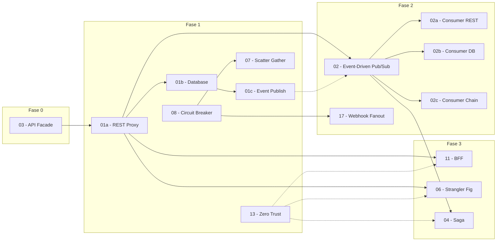

# Padrões de Integração — Especificações de Implementação

Especificações técnicas para implementar padrões de integração Oracle Cloud usando **OCI Functions** (Java 17 + FDK 1.1.x) como runtime de processamento, substituindo OIC onde aplicável.

## Stack Tecnológico

| Camada | Tecnologia | Versão |
|--------|-----------|--------|
| Runtime | OCI Functions (Fn Project) | FDK 1.1.11 |
| Linguagem | Java | 17 |
| Build | Maven | 3.x |
| Infra | Terraform | >= 1.5 (testado 1.11) |
| Provider | OCI Provider (oracle/oci) | >= 6.0, < 9.0 (testado 8.x) |
| SDK | OCI Java SDK | 3.86.x |

> **Inconsistências conhecidas (backlog de hygiene, não bloqueiam):**
> - Versão do plugin JaCoCo varia entre functions (`func-api-facade` 0.8.12, `func-rr-rest-proxy` 0.8.13, `api-handler` sem plugin). Padronizar em 0.8.13 (ou parent POM) se cobertura for enforced.
> - Skills de monitoring carregam `blueprints/evaluation-scenarios.{md,json}` (fixtures de avaliação) não referenciados na navegação do SKILL.md — manter como fixtures ou linkar.

## Estado Atual (atualizado 2026-07-22)

### Progresso de Implementação

| Fase | Padrão | Projeto Java | Estado | Data |
|------|--------|-------------|--------|------|
| 0 | 03 — API Facade | `func-api-facade` | ✅ Deployed v0.0.2 | 2026-05-14 |
| 1 | 01a — REST Proxy | `func-rr-rest-proxy` | ✅ Deployed v0.0.11 | 2026-05-19 |
| 1 | 01b — Database | `func-rr-database-ords` / `jdbc` | ❌ Não iniciado | — |
| 1 | 01c — Event Publish | `func-rr-event-*` | ❌ Não iniciado | — |
| 1 | 08 — Circuit Breaker | `func-circuit-breaker` | ❌ Não iniciado | — |
| 1 | 07 — Scatter Gather | `func-scatter-gather` | ❌ Não iniciado | — |
| 1 | 13 — Zero Trust | _(cross-cutting)_ | ❌ Não iniciado | — |
| 2 | 02 — Event-Driven | `func-event-producer` + `func-evt-consumer-notify` + `func-evt-consumer-audit` | ✅ Entregue POC v0.0.2 (dev): fan-out + trace provados | 2026-07-22 |
| 2 | 02a — Consumer REST | `func-event-consumer-rest` | ❌ Não iniciado | — |
| 2 | 02b — Consumer DB | `func-event-consumer-*` | ❌ Não iniciado | — |
| 2 | 02c — Consumer Chain | `func-event-consumer-chain` | ❌ Não iniciado | — |
| 2 | 17 — Webhook Fanout | `func-webhook-fanout` | ❌ Não iniciado | — |
| 3 | 11 — BFF | `func-bff-mobile` / `web` | ❌ Não iniciado | — |
| 3 | 06 — Strangler Fig | `func-strangler-proxy` | ❌ Não iniciado | — |
| 3 | 04 — Saga | `func-saga-orders` | ❌ Não iniciado | — |

> **Legado**: `api-handler` (v0.0.5, 2026-05-13) — projeto original, package `com.brx.serverless`

### Módulos Terraform

| Módulo | Estado | Notas |
|--------|--------|-------|
| `network` | ✅ Implementado | VCN, subnets, NSGs, NAT/Internet GW |
| `iam` | ✅ Implementado | Dynamic Groups, Policies (Resource Principal) |
| `function-app` | ✅ Implementado | 1 Application + 1 Function por instância |
| `api-gateway` | ✅ Implementado | Gateway + Deployment, `route_backends` |
| `vault` | ✅ Implementado | KMS Vault + Key + Object Storage bucket |
| `observability` | ✅ Implementado | Logging (3 logs) + Monitoring (3 alarms) + ONS |
| `streaming` | ✅ Implementado | Stream pool (público, p/ SCH) + stream `event-stream` — Fase 2 / 01c |
| `service-connector` | ✅ Implementado | 2 SCH (notify/audit), cursores distintos = fan-out — Fase 2 |
| `queue` | ❌ Pendente | Requerido para 01c |
| `notifications` | ❌ Pendente | Requerido para 01c |

---

## Convenções

- **Diretório de projeto**: `services/func-<domain>`
- **Package Java**: `com.brx.functions.<domain>`
- **Handler class**: `<Domain>Function` no root do package
- **func.yaml name**: `func-<domain>`
- **Config keys**: `UPPER_SNAKE_CASE`, sufixo `_OCID` para OCIDs, `_ENDPOINT` para URLs

Referência completa: [java-functions-project-structure.instructions.md](../../.github/instructions/java-functions-project-structure.instructions.md)

## Ordem de Implementação

### Fase 0 — Referência

| # | Especificação | Projeto Java | Descrição | Estado |
|---|--------------|-------------|-----------|--------|
| 03 | [03-api-facade.md](03-api-facade/03-api-facade.md) | `func-api-facade` | API Facade com transformação, JWT, Rate Limit | ✅ 2026-05-14 |

### Fase 1 — Fundações (requer módulo `vault` ✅; `streaming`+`queue`+`notifications` para 01c)

| # | Especificação | Projeto(s) Java | Descrição | Estado |
|---|--------------|----------------|----------|--------|
| 01a | [01a-request-reply-rest-proxy.md](01-request-reply/01a-request-reply-rest-proxy.md) | `func-rr-rest-proxy` | Request-Reply: proxy REST com transformação + invocação de API externa | ✅ 2026-05-19 |
| 01b | [01b-request-reply-database.md](01-request-reply/01b-request-reply-database.md) | `func-rr-database-ords` + `func-rr-database-jdbc` | Request-Reply: acesso a banco de dados via ORDS (REST) e JDBC | ❤ Pendente |
| 01c | [01c-request-reply-event-publish.md](01-request-reply/01c-request-reply-event-publish.md) | `func-rr-event-streaming` + `func-rr-event-queue` + `func-rr-event-notification` | Request-Reply: publicação de eventos em Streaming, Queue e Notifications | ❤ Pendente |
| 08 | [08-circuit-breaker.md](08-circuit-breaker/08-circuit-breaker.md) | `func-circuit-breaker` | Resiliência com state machine CLOSED/OPEN/HALF_OPEN | ❤ Pendente |
| 07 | [07-scatter-gather.md](07-scatter-gather/07-scatter-gather.md) | `func-scatter-gather` | Chamadas paralelas + consolidação de respostas | ❤ Pendente |
| 13 | [13-zero-trust.md](13-zero-trust/13-zero-trust.md) | _(cross-cutting)_ | Configuração de segurança: JWT, Vault, NSGs | ❤ Pendente |

### Fase 2 — Event-Driven (requer módulos `streaming` + `service-connector`)

| # | Especificação | Projeto(s) Java | Descrição |
|---|--------------|----------------|-----------|
| 02 | [02-event-driven-pub-sub.md](02-event-driven/02-event-driven-pub-sub.md) | `func-event-producer` | Event-Driven Pub/Sub: producer + overview |
| 02a | [02a-event-driven-rest-consumer.md](02-event-driven/02a-event-driven-rest-consumer.md) | `func-event-consumer-rest` | Consumer: invoca API REST externa |
| 02b | [02b-event-driven-database-consumer.md](02-event-driven/02b-event-driven-database-consumer.md) | `func-event-consumer-ords` + `func-event-consumer-jdbc` | Consumer: persiste em base de dados (ORDS/JDBC) |
| 02c | [02c-event-driven-event-chain.md](02-event-driven/02c-event-driven-event-chain.md) | `func-event-consumer-chain` | Consumer: re-publica evento (event chaining) |
| 17 | [17-webhook-fanout.md](17-webhook-fanout/17-webhook-fanout.md) | `func-webhook-fanout` | Webhook recebido + distribuição via ONS/Streaming |

### Fase 3 — Composição (depende de Fases 1 e 2)

| # | Especificação | Projeto(s) Java | Descrição |
|---|--------------|----------------|-----------|
| 11 | [11-bff.md](11-bff/11-bff.md) | `func-bff-mobile` + `func-bff-web` | Backend for Frontend por canal |
| 06 | [06-strangler-fig.md](06-strangler-fig/06-strangler-fig.md) | `func-strangler-proxy` | Migração progressiva de legacy |
| 04 | [04-saga-compensation.md](04-saga-compensation/04-saga-compensation.md) | `func-saga-orders` (multi-handler) | Saga orquestrada com compensação |

## Mapa de Dependências



- **04 (Saga)** depende de **02 (Event-Driven)** para publicação de saga events em Streaming
- **06 (Strangler)** depende de **01a (REST Proxy)** como padrão base de proxy
- **11 (BFF)** depende de **01a (REST Proxy)** para invocação de microserviços
- **01c (Event Publish)** depende parcialmente de **02 (Event-Driven)** para Streaming infra
- **13 (Zero-Trust)** aplica-se transversalmente a todos os padrões

## Projetos Java — Visão Geral

```
services/
├── api-handler/              # ✅ Existente — projeto legado (v0.0.5, 2026-05-13)
├── func-api-facade/          # ✅ Padrão 03 — API Facade (v0.0.2, 2026-05-14)
├── func-rr-rest-proxy/       # ✅ Padrão 01a — proxy REST (v0.0.11, 2026-05-19)
├── func-rr-database-ords/    # ❌ Padrão 01b — acesso DB via ORDS (REST)
├── func-rr-database-jdbc/    # ❌ Padrão 01b — acesso DB via JDBC (Oracle UCP)
├── func-rr-event-streaming/  # ❌ Padrão 01c — publica em OCI Streaming
├── func-rr-event-queue/      # ❌ Padrão 01c — publica em OCI Queue
├── func-rr-event-notification/ # ❌ Padrão 01c — publica em OCI Notifications
├── func-event-producer/          # ❌ Padrão 02 — publica em Streaming (event-driven)
├── func-event-consumer-rest/     # ❌ Padrão 02a — consumer: invoca API REST
├── func-event-consumer-ords/     # ❌ Padrão 02b — consumer: persiste via ORDS
├── func-event-consumer-jdbc/     # ❌ Padrão 02b — consumer: persiste via JDBC
├── func-event-consumer-chain/    # ❌ Padrão 02c — consumer: re-publica evento
├── func-saga-orders/         # ❌ Padrão 04 — orchestrator + participantes
├── func-strangler-proxy/     # ❌ Padrão 06 — Function moderna
├── func-scatter-gather/      # ❌ Padrão 07 — paralelo + merge
├── func-circuit-breaker/     # ❌ Padrão 08 — state machine
├── func-bff-mobile/          # ❌ Padrão 11 — BFF mobile (payload compacto)
├── func-bff-web/             # ❌ Padrão 11 — BFF web (payload completo)
└── func-webhook-fanout/      # ❌ Padrão 17 — webhook + fanout
```

> **Resumo**: 3 de referência (03, 01a) + **Pattern 02 Pub/Sub entregue como POC** (producer + 2 consumers notify/audit, via Streaming + SCH, validado no dev 2026-07-22). Próximos: hardening do 02 (alarmes SCH, IAM least-privilege), 01b (Database), 01c (Event Publish).

## Resumo de Esforço

| Fase | Specs | Projetos Java | Novos Módulos TF | Estado |
|------|-------|--------------|-----------------|--------|
| 0 | 1 | 1 | 0 | ✅ Concluído (2026-05-14) |
| 1 | 6 | 8 | 2 (streaming, queue/ons) | 🔨 1/6 specs (01a done) |
| 2 | 5 | 6 | 2 (streaming, service-connector) | 🔨 02 Pub/Sub POC entregue (producer+notify+audit); 02a/b/c nomeados pendentes |
| 3 | 3 | 4 | 0 | ❌ Não iniciado |
| **Total** | **15** | **19 novos** | **4 pendentes** | **2/15 specs (13%)** |

> **Módulos já implementados (6):** `network`, `iam`, `function-app`, `api-gateway`, `vault`, `observability`
>
> **Módulos pendentes (4):** `streaming`, `service-connector`, `queue`, `notifications`
>
> **Nota**: `streaming` é compartilhado entre Fase 1 e Fase 2.

## Convenção de Prompts

Cada especificação inclui uma **Seção 5 — Sequência de Prompts** com o fluxo de implementação.

Todo padrão DEVE iniciar com **Prompt 0 — Auditoria de Infraestrutura** antes de qualquer implementação.

> **Guia completo de prompts, skills e workflows**: [docs/PROMPTS-GUIDE.md](../PROMPTS-GUIDE.md)
