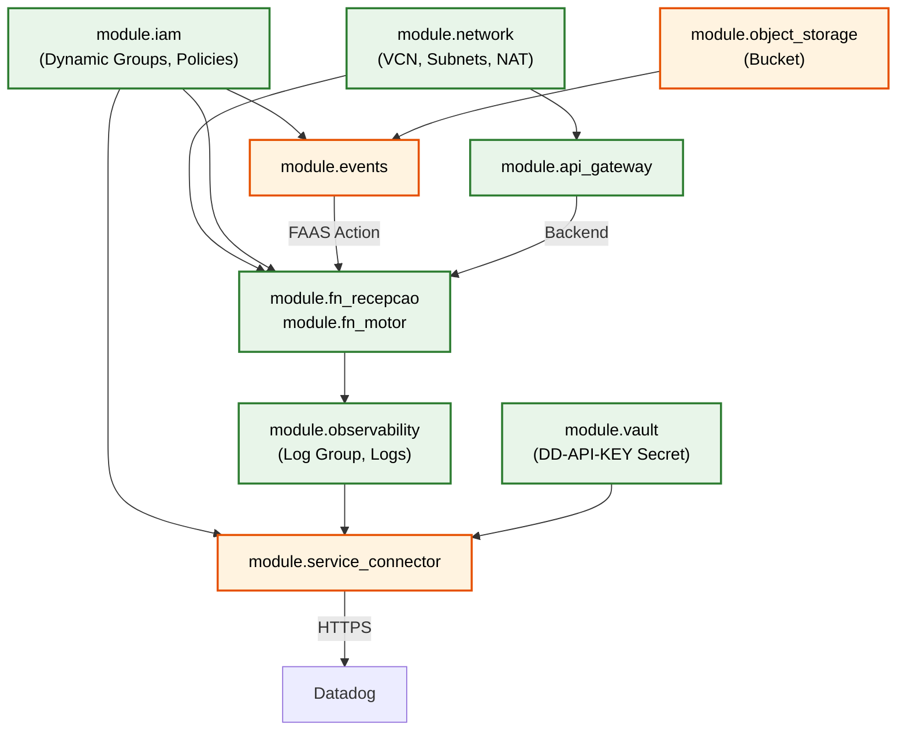

# Especificação de Infraestrutura Terraform — PoC BAM Datadog

**Projeto:** PoC Monitoramento de Processos de Negócio (BAM) com Datadog  
**Environment:** `infra/environments/bam/` (isolado, `terraform destroy` limpo)  
**Provider:** `oracle/oci ~> 8.15` | **Terraform:** `>= 1.9`

---

## 1. Visão Geral

A infraestrutura é provisionada em um **environment Terraform isolado** (`infra/environments/bam/`), independente dos environments `dev` e `prod` existentes. Isso garante:

- `terraform destroy` completo sem impacto em recursos existentes
- State file separado (`terraform.tfstate` local)
- Variáveis e secrets independentes
- Ciclo de vida desacoplado

---

## 2. Variáveis de Input (`variables.tf`)

```hcl
# === Identificação OCI ===
variable "tenancy_ocid" {
  description = "OCID da tenancy OCI raiz"
  type        = string
}

variable "compartment_ocid" {
  description = "OCID do compartimento dedicado à PoC BAM"
  type        = string
}

variable "region" {
  description = "Região OCI alvo (ex: sa-saopaulo-1)"
  type        = string
}

# === Projeto ===
variable "project_name" {
  description = "Nome do projeto para naming convention"
  type        = string
  default     = "poc-bam"
}

variable "environment" {
  description = "Identificador do environment"
  type        = string
  default     = "bam"
}

# === Datadog (Sensíveis) ===
variable "datadog_api_key" {
  description = "API Key do Datadog para ingestão de logs (DD-API-KEY)"
  type        = string
  sensitive   = true
}

variable "datadog_site_url" {
  description = "Endpoint de ingestão de logs do Datadog"
  type        = string
  default     = "https://http-intake.logs.datadoghq.com/api/v2/logs"
}

# === Function Images (OCIR) ===
variable "fn_recepcao_proposta_image" {
  description = "URI da imagem OCIR para fn-recepcao-proposta"
  type        = string
}

variable "fn_motor_credito_image" {
  description = "URI da imagem OCIR para fn-motor-credito"
  type        = string
}

# === Rede (Brownfield opcional) ===
variable "existing_subnet_id" {
  description = "OCID de subnet privada existente. Se fornecido, ignora criação de VCN."
  type        = string
  default     = null
}

variable "existing_public_subnet_id" {
  description = "OCID de subnet pública existente para API Gateway."
  type        = string
  default     = null
}
```

### Injeção de Secrets (Boas Práticas)

```bash
# Via variável de ambiente (recomendado para execução local)
export TF_VAR_datadog_api_key="sua_chave_aqui"

# Via tfvars NÃO versionado (listado no .gitignore)
# terraform.tfvars.local ← nunca commitado
```

---

## 3. Módulos Terraform — Composição

### 3.1 Grafo de Dependências



**Legenda:**
- 🟢 Verde = Módulos existentes (reutilizados/estendidos)
- 🟠 Laranja = Módulos novos a criar

---

### 3.2 Módulos Existentes (Reutilizar)

| Módulo | Path | Adaptações Necessárias |
|--------|------|----------------------|
| `network` | `infra/modules/network/` | Nenhuma — reutilizar as-is (VCN + Private + Public Subnet + NAT + IGW) |
| `function-app` | `infra/modules/function-app/` | Nenhuma — instanciar 2x (uma por function) |
| `iam` | `infra/modules/iam/` | Adicionar policy statements para SCH e Events |
| `observability` | `infra/modules/observability/` | Reutilizar Log Group + Custom Logs para Functions |
| `vault` | `infra/modules/vault/` | Armazenar `datadog_api_key` como Secret |
| `api-gateway` | `infra/modules/api-gateway/` | Reutilizar com route para teste manual |

### 3.3 Módulos Novos (Criar)

| Módulo | Path | Recursos Terraform |
|--------|------|-------------------|
| `object-storage` | `infra/modules/object-storage/` | `oci_objectstorage_bucket`, `data.oci_objectstorage_namespace` |
| `events` | `infra/modules/events/` | `oci_events_rule` |
| `service-connector` | `infra/modules/service-connector/` | `oci_sch_service_connector` |

---

## 4. Especificação por Camada

### Camada 1: Identidade e Segurança (IAM)

**Agente:** `@oci-terraform` | **Skill:** `provisioning-oci-iam`

#### Dynamic Group

```hcl
resource "oci_identity_dynamic_group" "bam_functions" {
  compartment_id = var.tenancy_ocid  # Dynamic Groups são tenancy-level
  name           = "dg-${var.project_name}-functions-${var.environment}"
  description    = "Functions da PoC BAM"
  matching_rule  = "ALL {resource.type = 'fnfunc', resource.compartment.id = '${var.compartment_ocid}'}"
}
```

#### Policies

```hcl
resource "oci_identity_policy" "bam_policies" {
  compartment_id = var.compartment_ocid
  name           = "pol-${var.project_name}-${var.environment}"
  description    = "Políticas de acesso para PoC BAM"
  statements = [
    # Functions → Object Storage (leitura de propostas)
    "Allow dynamic-group ${oci_identity_dynamic_group.bam_functions.name} to manage objects in compartment ${var.compartment_name}",

    # Functions → Functions (fn1 invoca fn2)
    "Allow dynamic-group ${oci_identity_dynamic_group.bam_functions.name} to use functions-family in compartment ${var.compartment_name}",

    # Functions → Vault (leitura de secrets, se necessário)
    "Allow dynamic-group ${oci_identity_dynamic_group.bam_functions.name} to read secret-family in compartment ${var.compartment_name}",

    # Service Connector Hub → Logging (leitura de logs)
    "Allow any-user to read log-content in compartment ${var.compartment_name} where any {request.principal.type='serviceconnector'}",

    # Service Connector Hub → gestão
    "Allow any-user to manage serviceconnectors in compartment ${var.compartment_name} where any {request.principal.type='serviceconnector'}",
  ]
}
```

---

### Camada 2: Rede (Networking)

**Agente:** `@oci-terraform` | **Skill:** `provisioning-oci-networking`

| Recurso | Configuração |
|---------|-------------|
| VCN | `cidr_blocks = ["10.0.0.0/16"]`, `display_name = "vcn-${var.project_name}-${var.environment}"` |
| Subnet Privada | `cidr_block = "10.0.1.0/24"`, `prohibit_public_ip_on_vnic = true` |
| Subnet Pública | `cidr_block = "10.0.0.0/24"`, `prohibit_public_ip_on_vnic = false` (API GW) |
| NAT Gateway | Egress para internet (Functions → Datadog SDK, se necessário) |
| Internet Gateway | Para API Gateway (subnet pública) |
| Route Table (Privada) | `0.0.0.0/0` → NAT Gateway |
| Route Table (Pública) | `0.0.0.0/0` → Internet Gateway |
| NSG Functions | Ingress: API GW NSG (port 443). Egress: All |
| NSG API GW | Ingress: `0.0.0.0/0` (port 443). Egress: Functions NSG |

**Brownfield Support:**
```hcl
# Se existing_subnet_id fornecido, pula criação de rede
locals {
  create_network = var.existing_subnet_id == null
  private_subnet_id = local.create_network ? module.network[0].private_subnet_id : var.existing_subnet_id
  public_subnet_id  = local.create_network ? module.network[0].public_subnet_id : var.existing_public_subnet_id
}

module "network" {
  count  = local.create_network ? 1 : 0
  source = "../../modules/network"
  # ... variáveis
}
```

---

### Camada 3: Object Storage (NOVO MÓDULO)

**Agente:** `@oci-terraform` | **Skill:** `provisioning-oci-object-storage`

#### Interface do Módulo

**Inputs (`variables.tf`):**

| Variável | Tipo | Descrição |
|----------|------|-----------|
| `compartment_ocid` | `string` | Compartimento do bucket |
| `bucket_name` | `string` | Nome do bucket (globalmente único na região) |
| `project_name` | `string` | Para tags |
| `environment` | `string` | Para tags |
| `enable_versioning` | `bool` | Versionamento de objetos (default: `true`) |
| `storage_tier` | `string` | `Standard` ou `Archive` (default: `Standard`) |
| `kms_key_id` | `string` | OCID da key para CMEK encryption (optional) |

**Outputs (`outputs.tf`):**

| Output | Descrição |
|--------|-----------|
| `bucket_name` | Nome do bucket criado |
| `bucket_namespace` | Namespace do Object Storage |
| `bucket_id` | OCID do bucket |

#### Recurso Principal

```hcl
data "oci_objectstorage_namespace" "current" {
  compartment_id = var.compartment_ocid
}

resource "oci_objectstorage_bucket" "this" {
  compartment_id = var.compartment_ocid
  namespace      = data.oci_objectstorage_namespace.current.namespace
  name           = var.bucket_name

  access_type    = "NoPublicAccess"
  storage_tier   = var.storage_tier
  versioning     = var.enable_versioning ? "Enabled" : "Disabled"
  auto_tiering   = "InfrequentAccess"

  dynamic "kms_key_id" {
    for_each = var.kms_key_id != null ? [1] : []
    content {
      kms_key_id = var.kms_key_id
    }
  }

  freeform_tags = local.common_tags
}
```

**Instanciação no environment:**

```hcl
module "object_storage" {
  source           = "../../modules/object-storage"
  compartment_ocid = var.compartment_ocid
  bucket_name      = "bucket-bam-entrada-propostas-${var.environment}"
  project_name     = var.project_name
  environment      = var.environment
  enable_versioning = true
}
```

---

### Camada 4: Events Rule (NOVO MÓDULO)

**Agente:** `@oci-terraform` | **Skill:** `provisioning-oci-events`

#### Interface do Módulo

**Inputs:**

| Variável | Tipo | Descrição |
|----------|------|-----------|
| `compartment_ocid` | `string` | Compartimento |
| `rule_display_name` | `string` | Nome da regra |
| `bucket_name` | `string` | Bucket que gera eventos |
| `function_id` | `string` | OCID da function a invocar |
| `project_name` | `string` | Para tags |
| `environment` | `string` | Para tags |

**Outputs:**

| Output | Descrição |
|--------|-----------|
| `rule_id` | OCID da regra de eventos |

#### Recurso Principal

```hcl
resource "oci_events_rule" "object_create" {
  compartment_id = var.compartment_ocid
  display_name   = var.rule_display_name
  description    = "Trigger fn-recepcao-proposta on ObjectCreate in ${var.bucket_name}"
  is_enabled     = true

  condition = jsonencode({
    eventType = ["com.oraclecloud.objectstorage.createobject"]
    data = {
      additionalDetails = {
        bucketName = [var.bucket_name]
      }
    }
  })

  actions {
    actions {
      action_type = "FAAS"
      function_id = var.function_id
      is_enabled  = true
    }
  }

  freeform_tags = local.common_tags
}
```

---

### Camada 5: Functions Application + Functions

**Agente:** `@oci-terraform` | **Skill:** `provisioning-oci-functions`

Reutilizar o módulo `function-app` existente, instanciado 2x (Application isolada por function):

```hcl
# Function 1: Recepção de Proposta (Orquestrador)
module "fn_recepcao_proposta" {
  source           = "../../modules/function-app"
  compartment_ocid = var.compartment_ocid
  subnet_id        = local.private_subnet_id
  project_name     = var.project_name
  environment      = var.environment
  function_name    = "recepcao-proposta"
  function_image   = var.fn_recepcao_proposta_image
  memory_in_mbs    = 256
  timeout_in_seconds = 120

  config = {
    "BUCKET_NAME"          = module.object_storage.bucket_name
    "BUCKET_NAMESPACE"     = module.object_storage.bucket_namespace
    "FN_MOTOR_CREDITO_ID"  = module.fn_motor_credito.function_id
  }
}

# Function 2: Motor de Crédito (Worker)
module "fn_motor_credito" {
  source           = "../../modules/function-app"
  compartment_ocid = var.compartment_ocid
  subnet_id        = local.private_subnet_id
  project_name     = var.project_name
  environment      = var.environment
  function_name    = "motor-credito"
  function_image   = var.fn_motor_credito_image
  memory_in_mbs    = 512
  timeout_in_seconds = 60

  config = {}
}
```

**Nota:** `memory_in_mbs = 256` para fn1 (I/O bound), `512` para fn2 (CPU bound — regras de negócio).

---

### Camada 6: Observabilidade (Logging)

**Agente:** `@oci-terraform` | **Skill:** `provisioning-oci-logging`

Reutilizar/estender o módulo `observability` existente:

```hcl
module "observability" {
  source           = "../../modules/observability"
  compartment_ocid = var.compartment_ocid
  project_name     = var.project_name
  environment      = var.environment

  # IDs das Functions Applications para criar logs
  function_app_ids = [
    module.fn_recepcao_proposta.application_id,
    module.fn_motor_credito.application_id,
  ]

  # Configuração de Log Group
  log_group_name = "log-group-bam-poc"

  # Logs a criar (invoke logs capturam stdout)
  enable_invoke_logs    = true
  enable_execution_logs = false  # Não necessário para PoC
  enable_access_logs    = false  # Sem API GW access logs (simplificar)
}
```

#### Log Group + Custom Logs

```hcl
resource "oci_logging_log_group" "bam" {
  compartment_id = var.compartment_ocid
  display_name   = "log-group-bam-poc"
  description    = "Logs do pipeline BAM para ingestão no Datadog"
  freeform_tags  = local.common_tags
}

resource "oci_logging_log" "fn_invoke" {
  for_each = toset(var.function_app_ids)

  display_name = "log-fn-invoke-${each.key}"
  log_group_id = oci_logging_log_group.bam.id
  log_type     = "SERVICE"
  is_enabled   = true

  configuration {
    compartment_id = var.compartment_ocid
    source {
      category    = "invoke"
      resource    = each.value
      service     = "functions"
      source_type = "OCISERVICE"
    }
  }

  retention_duration = 30  # dias
  freeform_tags      = local.common_tags
}
```

---

### Camada 7: Service Connector Hub (NOVO MÓDULO)

**Agente:** `@oci-terraform` | **Skill:** `provisioning-oci-connector-hub`

#### Interface do Módulo

**Inputs:**

| Variável | Tipo | Descrição |
|----------|------|-----------|
| `compartment_ocid` | `string` | Compartimento |
| `display_name` | `string` | Nome do connector |
| `log_group_id` | `string` | OCID do Log Group (source) |
| `target_url` | `string` | URL do endpoint Datadog (target) |
| `target_headers` | `map(string)` | Headers HTTP (inclui DD-API-KEY) |
| `project_name` | `string` | Para tags |
| `environment` | `string` | Para tags |

**Outputs:**

| Output | Descrição |
|--------|-----------|
| `connector_id` | OCID do Service Connector |
| `connector_state` | Estado (ACTIVE, INACTIVE) |

#### Recurso Principal

```hcl
resource "oci_sch_service_connector" "logging_to_datadog" {
  compartment_id = var.compartment_ocid
  display_name   = var.display_name
  description    = "Route BAM logs from OCI Logging to Datadog via HTTP"

  # Source: OCI Logging
  source {
    kind = "logging"
    log_sources {
      compartment_id = var.compartment_ocid
      log_group_id   = var.log_group_id
    }
  }

  # Target: HTTP Plugin (Datadog endpoint)
  target {
    kind = "functions"  # Alternativa: usar Function como proxy para HTTP
    # OU, se HTTP plugin disponível:
    # kind = "streaming" / custom target
  }

  # Nota: O target HTTP nativo do SCH requer validação
  # da disponibilidade na região. Se indisponível,
  # usar Function intermediária como proxy HTTP.

  state         = "ACTIVE"
  freeform_tags = local.common_tags
}
```

> **⚠️ Nota Importante:** O Service Connector Hub com target HTTP Plugin tem disponibilidade regional variável. A skill `provisioning-oci-connector-hub` contém os patterns atualizados. Se o HTTP Plugin não estiver disponível na região alvo, uma Function intermediária (`fn-log-forwarder`) deverá ser implementada como proxy HTTP para o Datadog.

#### Instanciação no Environment

```hcl
module "service_connector" {
  source           = "../../modules/service-connector"
  compartment_ocid = var.compartment_ocid
  display_name     = "sch-bam-to-datadog-${var.environment}"
  log_group_id     = module.observability.log_group_id

  target_url = var.datadog_site_url
  target_headers = {
    "DD-API-KEY"   = var.datadog_api_key
    "Content-Type" = "application/json"
  }

  project_name = var.project_name
  environment  = var.environment
}
```

---

### Camada 8: Vault (DD-API-KEY)

**Agente:** `@oci-terraform` | **Skill:** `provisioning-oci-vault`

```hcl
module "vault" {
  source           = "../../modules/vault"
  compartment_ocid = var.compartment_ocid
  project_name     = var.project_name
  environment      = var.environment
  create_bucket    = false  # Bucket já criado pelo módulo object-storage
}

# Secret para a DD-API-KEY (referenciada pelo SCH)
resource "oci_vault_secret" "datadog_api_key" {
  compartment_id = var.compartment_ocid
  vault_id       = module.vault.vault_id
  key_id         = module.vault.key_id
  secret_name    = "datadog-api-key"

  secret_content {
    content_type = "BASE64"
    content      = base64encode(var.datadog_api_key)
  }

  freeform_tags = local.common_tags
}
```

---

### Camada 9: API Gateway (Teste Manual)

**Agente:** `@oci-terraform` | **Skill:** `provisioning-oci-api-gateway`

```hcl
module "api_gateway" {
  source           = "../../modules/api-gateway"
  compartment_ocid = var.compartment_ocid
  subnet_id        = local.public_subnet_id
  project_name     = var.project_name
  environment      = var.environment

  deployment_path_prefix = "/bam"

  routes = [
    {
      path    = "/proposta"
      methods = ["POST"]
      backend_type   = "ORACLE_FUNCTIONS_BACKEND"
      function_id    = module.fn_recepcao_proposta.function_id
      authentication = "ANONYMOUS"  # PoC - sem auth para facilitar testes
    }
  ]
}
```

**Uso para teste manual:**
```bash
curl -X POST https://<gateway-hostname>/bam/proposta \
  -H "Content-Type: application/json" \
  -d '{"cliente_id":"CLI-998877","nome":"João da Silva","valor_solicitado":15000.00,"score_credito":650,"regiao":"SP"}'
```

---

## 5. Outputs do Environment (`outputs.tf`)

```hcl
output "bucket_name" {
  description = "Nome do bucket de entrada de propostas"
  value       = module.object_storage.bucket_name
}

output "fn_recepcao_proposta_id" {
  description = "OCID da function fn-recepcao-proposta"
  value       = module.fn_recepcao_proposta.function_id
}

output "fn_motor_credito_id" {
  description = "OCID da function fn-motor-credito"
  value       = module.fn_motor_credito.function_id
}

output "api_gateway_endpoint" {
  description = "Endpoint base do API Gateway para testes"
  value       = module.api_gateway.deployment_endpoint
}

output "log_group_id" {
  description = "OCID do Log Group BAM"
  value       = module.observability.log_group_id
}

output "service_connector_id" {
  description = "OCID do Service Connector (Logging → Datadog)"
  value       = module.service_connector.connector_id
}

output "events_rule_id" {
  description = "OCID da Events Rule (ObjectCreate → fn-recepcao-proposta)"
  value       = module.events.rule_id
}
```

---

## 6. Versions e Provider (`versions.tf`)

```hcl
terraform {
  required_version = ">= 1.9"

  required_providers {
    oci = {
      source  = "oracle/oci"
      version = "~> 8.15"
    }
  }
}

provider "oci" {
  tenancy_ocid = var.tenancy_ocid
  region       = var.region
}
```

---

## 7. Comandos de Execução

```bash
# Navegar ao environment
cd infra/environments/bam

# Inicializar
terraform init

# Planejar (com secrets via env var)
export TF_VAR_datadog_api_key="dd-api-key-value"
terraform plan -out=tfplan

# Aplicar
terraform apply tfplan

# Destruir (cleanup completo da PoC)
terraform destroy
```

---

## 8. Checklist de Implementação

| # | Componente | Módulo | Status |
|---|-----------|--------|--------|
| 1 | `versions.tf` + `variables.tf` | Environment | ⬜ |
| 2 | Network (VCN, Subnets, NAT, IGW) | `modules/network` (existente) | ⬜ |
| 3 | IAM (Dynamic Group + Policies) | `modules/iam` (estender) | ⬜ |
| 4 | Vault (Key + Secret DD-API-KEY) | `modules/vault` (existente) | ⬜ |
| 5 | Object Storage Bucket | `modules/object-storage` (**NOVO**) | ⬜ |
| 6 | Functions App + fn-recepcao-proposta | `modules/function-app` (existente) | ⬜ |
| 7 | Functions App + fn-motor-credito | `modules/function-app` (existente) | ⬜ |
| 8 | Events Rule (ObjectCreate → fn1) | `modules/events` (**NOVO**) | ⬜ |
| 9 | Log Group + Custom Logs | `modules/observability` (existente) | ⬜ |
| 10 | Service Connector Hub (→ Datadog) | `modules/service-connector` (**NOVO**) | ⬜ |
| 11 | API Gateway (teste manual) | `modules/api-gateway` (existente) | ⬜ |
| 12 | `outputs.tf` + `terraform.tfvars` | Environment | ⬜ |
