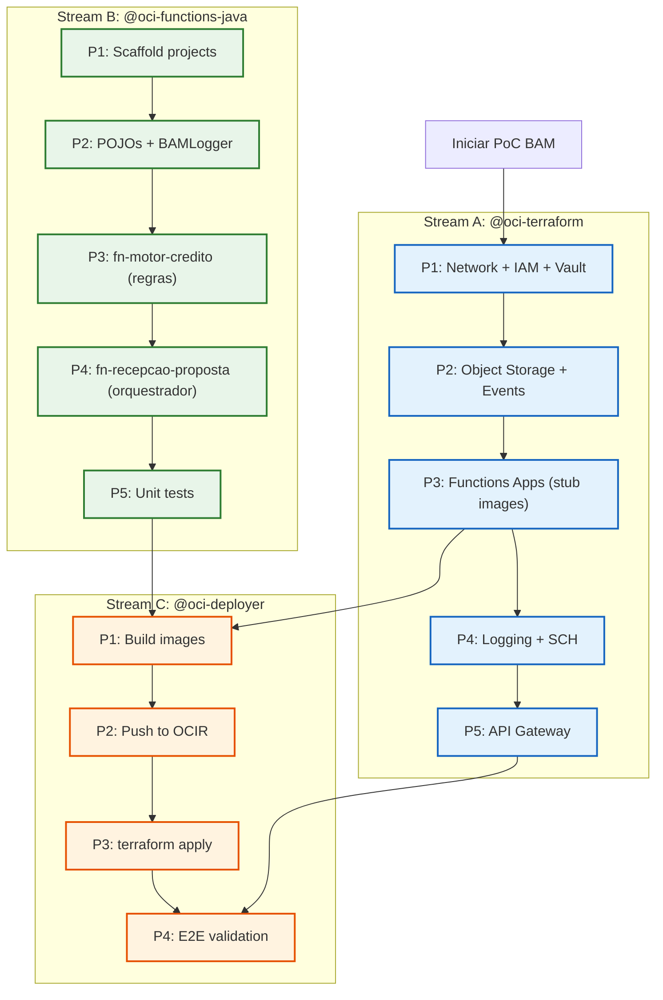

# Capacidades dos Agentes — PoC BAM Datadog

**Projeto:** PoC Monitoramento de Processos de Negócio (BAM) com Datadog  
**Data da Avaliação:** 2026-05-25  
**Resultado:** ✅ Cobertura total — todos os requisitos mapeados a skills existentes

---

## 1. Resumo Executivo

Após atualização das skills em 2026-05-25, **todos os 12 requisitos** da PoC BAM possuem skills dedicadas nos agentes. Não há gaps que impeçam a implementação automatizada via agentes.

| Métrica | Valor |
|---------|-------|
| Requisitos totais | 12 |
| Cobertos por skills | 12 (100%) |
| Gaps críticos | 0 |
| Agentes envolvidos | 4 de 6 disponíveis |

---

## 2. Matriz de Cobertura Completa

### 2.1 Infraestrutura (Terraform)

| # | Requisito | Agente | Skill (Provisioning) | Skill (Design) | Cobertura |
|---|-----------|--------|---------------------|----------------|-----------|
| 1 | VCN + Subnets + NAT + IGW | `@oci-terraform` | `provisioning-oci-networking` | `designing-oci-networking` | ✅ Completa |
| 2 | Dynamic Groups + Policies | `@oci-terraform` | `provisioning-oci-iam` | — | ✅ Completa |
| 3 | Object Storage Bucket | `@oci-terraform` | `provisioning-oci-object-storage` | `designing-oci-object-storage` | ✅ Completa |
| 4 | Functions Application + Function | `@oci-terraform` | `provisioning-oci-functions` | — | ✅ Completa |
| 5 | OCI Events Rule | `@oci-terraform` | `provisioning-oci-events` | — | ✅ Completa |
| 6 | OCI Logging (Log Group + Logs) | `@oci-terraform` | `provisioning-oci-logging` | `designing-oci-logging` | ✅ Completa |
| 7 | Service Connector Hub (→ Datadog) | `@oci-terraform` | `provisioning-oci-connector-hub` | `designing-oci-connector-hub` | ✅ Completa |
| 8 | OCI Vault (Secret: DD-API-KEY) | `@oci-terraform` | `provisioning-oci-vault` | `designing-oci-vault-security` | ✅ Completa |
| 9 | API Gateway (teste manual) | `@oci-terraform` | `provisioning-oci-api-gateway` | `designing-oci-api-gateway` | ✅ Completa |

### 2.2 Aplicação (Java Functions)

| # | Requisito | Agente | Skill | Cobertura |
|---|-----------|--------|-------|-----------|
| 10 | Function event-driven (CloudEvent handler) | `@oci-functions-java` | `implementing-oci-functions-events` | ✅ Completa |
| 11 | Object Storage read (SDK) | `@oci-functions-java` | `integrating-oci-functions-objectstorage` | ✅ Completa |
| 12 | Function invoke (fn1 → fn2 via SDK) | `@oci-functions-java` | `invoking-rest-apis-from-oci-functions` | ✅ Completa |

---

## 3. Agentes Disponíveis e Seus Papéis na PoC

### 3.1 `@oci-terraform` — Infraestrutura

**Papel:** Provisionar toda a infraestrutura OCI via Terraform.

| Tarefa | Prompt/Workflow | Skills Ativadas |
|--------|----------------|-----------------|
| Criar environment `bam/` | Manual (criar files) | `provisioning-oci-networking`, `provisioning-oci-iam` |
| Módulo `object-storage` (NOVO) | `/add-functions-infra` | `provisioning-oci-object-storage` |
| Módulo `events` (NOVO) | `/add-functions-infra` | `provisioning-oci-events` |
| Módulo `service-connector` (NOVO) | `/add-functions-infra` | `provisioning-oci-connector-hub` |
| Instanciar modules existentes | Manual | `provisioning-oci-functions`, `provisioning-oci-logging`, `provisioning-oci-vault` |

### 3.2 `@oci-functions-java` — Desenvolvimento Java

**Papel:** Implementar as 2 functions e utilitários.

| Tarefa | Prompt/Workflow | Skills Ativadas |
|--------|----------------|-----------------|
| Scaffold fn-recepcao-proposta | `/add-oci-function` | `developing-oci-functions-java` |
| Scaffold fn-motor-credito | `/add-oci-function` | `developing-oci-functions-java` |
| Event handler (CloudEvent) | `/add-event-handler` | `implementing-oci-functions-events` |
| Object Storage integration | `/add-object-storage` | `integrating-oci-functions-objectstorage` |
| Function invoke (fn1→fn2) | `/add-rest-client` | `invoking-rest-apis-from-oci-functions` |
| BAMLogger utility | Manual | `developing-oci-functions-java` |
| Unit tests | Manual | `testing-oci-functions-java` |

### 3.3 `@oci-deployer` — Build e Deploy

**Papel:** Build das imagens Docker, push para OCIR, terraform apply.

| Tarefa | Workflow |
|--------|----------|
| Build fn-recepcao-proposta image | `build-push.sh` |
| Build fn-motor-credito image | `build-push.sh` |
| `terraform apply` (environment bam) | P3-P6 workflow |
| Validação E2E (curl test) | P6 validation |

### 3.4 `@oci-serverless-stack` — End-to-End (Alternativa)

**Papel alternativo:** Criar function + infra + route em workflow único.

| Tarefa | Prompt |
|--------|--------|
| Full stack (fn + infra + API GW) | `/add-serverless-stack` |
| Adicionar function a app existente | `/add-function-to-app` |
| Executar esta spec como pattern | `/execute-pattern` |

---

## 4. Skills por Domínio (Referência Completa)

### 4.1 Terraform Provisioning (9 skills)

| Skill | Recursos Terraform Cobertos |
|-------|---------------------------|
| `provisioning-oci-networking` | `oci_core_vcn`, `oci_core_subnet`, `oci_core_nat_gateway`, `oci_core_internet_gateway`, `oci_core_route_table`, `oci_core_network_security_group` |
| `provisioning-oci-iam` | `oci_identity_dynamic_group`, `oci_identity_policy` |
| `provisioning-oci-object-storage` | `oci_objectstorage_bucket`, `data.oci_objectstorage_namespace` |
| `provisioning-oci-functions` | `oci_functions_application`, `oci_functions_function` |
| `provisioning-oci-events` | `oci_events_rule` |
| `provisioning-oci-logging` | `oci_logging_log_group`, `oci_logging_log` |
| `provisioning-oci-connector-hub` | `oci_sch_service_connector` |
| `provisioning-oci-vault` | `oci_kms_vault`, `oci_kms_key`, `oci_vault_secret` |
| `provisioning-oci-api-gateway` | `oci_apigateway_gateway`, `oci_apigateway_deployment` |

### 4.2 Architecture Design (7 skills)

| Skill | Decisões Arquiteturais |
|-------|----------------------|
| `designing-oci-networking` | Topologia VCN, segmentação, NSGs vs Security Lists |
| `designing-oci-object-storage` | Bucket design, lifecycle, CMEK, event pipelines |
| `designing-oci-logging` | Log Groups, retenção, UMA, archival |
| `designing-oci-connector-hub` | SCH pipelines, source/target patterns, HTTP plugin |
| `designing-oci-vault-security` | Key management, secret rotation, encryption at rest |
| `designing-oci-api-gateway` | Routes, auth, rate limiting, CORS |
| `architecting-oci-serverless` | Patterns gerais serverless OCI |

### 4.3 Java Development (6 skills)

| Skill | Capacidades |
|-------|-------------|
| `developing-oci-functions-java` | FDK lifecycle, handlers, configuration, deployment |
| `implementing-oci-functions-events` | CloudEvent, APIGatewayFunction, ConnectorHubFunction |
| `integrating-oci-functions-objectstorage` | Read/write Object Storage com InputStream lifecycle |
| `invoking-rest-apis-from-oci-functions` | HttpClient, OCI SDK invoke, OAuth2, timeout management |
| `publishing-events-from-oci-functions` | Streaming, Notifications, Queue, Monitoring publish |
| `testing-oci-functions-java` | FnTestingRule, Mockito, fn-events-testing |

---

## 5. Passo-a-Passo Detalhado

Para o guia completo de implementação com prompts exatos, inputs e sequência de execução, consultar:

→ **[04-implementation-steps.md](04-implementation-steps.md)**

Esse documento detalha **22 steps** organizados em 5 fases, cada um com o agente, prompt e inputs específicos.

---

## 6. Workflow de Implementação Recomendado

**Streams A e B são paralelas** — podem ser executadas simultaneamente.  
**Stream C depende** de A (infra pronta) e B (functions built).

---

## 7. Catálogo Completo de Prompts Utilizados

### 7.1 Prompts do `@oci-terraform` (15 prompts disponíveis)

| Prompt | Usado na PoC | Fase |
|--------|:---:|------|
| `/add-networking` | ✅ | 1.2 |
| `/add-iam` | ✅ | 1.3 |
| `/add-vault` | ✅ | 1.4 |
| `/add-object-storage-infra` | ✅ | 1.5 |
| `/add-functions-infra` | ✅ | 1.6 |
| `/add-event-rule` | ✅ | 1.7 |
| `/add-logging` | ✅ | 3.1 |
| `/add-connector-hub` | ✅ | 3.2 |
| `/add-api-gateway` | ✅ | 3.3 |
| `/engineer-terraform-project` | ✅ | 1.1 |
| `/add-serverless-stack` | ⬜ | (alternativa full-stack) |
| `/add-streaming` | ⬜ | Não necessário |
| `/add-apm-infrastructure` | ⬜ | Não necessário |
| `/design-monitoring-alarms` | ⬜ | Pode adicionar pós-PoC |
| `/provision-infra` (genérico) | ⬜ | Entry point genérico |

### 7.2 Prompts do `@oci-functions-java` (8 prompts disponíveis)

| Prompt | Usado na PoC | Fase |
|--------|:---:|------|
| `/add-oci-function` | ✅ | 2.1, 2.2, 2.7 |
| `/add-event-handler` | ✅ | 2.3 |
| `/add-object-storage` | ✅ | 2.4 |
| `/add-rest-client` | ✅ | 2.5 |
| `/add-function-logging` | ✅ | 2.6 |
| `/add-event-publishing` | ⬜ | Não necessário |
| `/add-function-metrics` | ⬜ | Pode adicionar pós-PoC |
| `/develop-function` (genérico) | ⬜ | Entry point genérico |

### 7.3 Prompts do `@oci-serverless-architect` (11 prompts disponíveis)

| Prompt | Usado na PoC | Fase |
|--------|:---:|------|
| `/design-serverless-architecture` | ✅ | 0.1 |
| `/audit-infra-prerequisites` | ✅ | 0.2 |
| `/design-object-storage` | ⬜ | Coberto pela spec |
| `/design-logging` | ⬜ | Coberto pela spec |
| `/design-connector-hub` | ⬜ | Coberto pela spec |
| `/design-vault-security` | ⬜ | Coberto pela spec |
| `/design-api-gateway` | ⬜ | Coberto pela spec |
| `/design-networking` | ⬜ | Coberto pela spec |
| `/design-apm-observability` | ⬜ | Fora do escopo |
| `/design-function-observability` | ⬜ | Coberto pela spec |
| `/design-specification-audit` | ⬜ | Pós-implementação |
| _(genérico removido — consolidado em `/design-serverless-architecture`)_ | — | — |

### 7.4 Prompts do `@oci-deployer` (1 prompt)

| Prompt | Usado na PoC | Fase |
|--------|:---:|------|
| `/deploy-function` | ✅ | 4.1, 4.2 |

### 7.5 Prompts do `@oci-debugger` (1 prompt)

| Prompt | Usado na PoC | Fase |
|--------|:---:|------|
| `/debug-function` | ✅ (se necessário) | 5.5 |

### 7.6 Prompts do `@oci-serverless-stack` (3 prompts)

| Prompt | Usado na PoC | Fase |
|--------|:---:|------|
| `/execute-pattern` | ⬜ | Alternativa (execução single-command) |
| `/add-function-to-app` | ⬜ | Não necessário |
| `/create-serverless-capability` (genérico) | ⬜ | Entry point genérico |

---

## 8. Notas sobre Novas Skills (Adicionadas 2026-05-25)

As seguintes skills foram adicionadas ao projeto e resolveram gaps previamente identificados:

| Skill | Versão Provider | Capacidade Adicionada |
|-------|----------------|----------------------|
| `provisioning-oci-logging` | `oracle/oci ~> 8.15` | Log Groups, Logs, UMA configurations, retention |
| `provisioning-oci-connector-hub` | `oracle/oci ~> 8.0` | Service Connector Hub completo (source→target) |
| `provisioning-oci-object-storage` | `oracle/oci ~> 8.0` | Buckets, lifecycle, CMEK, event pipelines |
| `designing-oci-logging` | — | Architecture decisions para OCI Logging |
| `designing-oci-connector-hub` | — | Architecture decisions para SCH pipelines |
| `designing-oci-object-storage` | — | Architecture decisions para Object Storage |

---

## 7. Limitações Conhecidas (Não-Gaps)

| Limitação | Impacto | Mitigação |
|-----------|---------|-----------|
| SCH HTTP Plugin — disponibilidade regional | Se indisponível na região, requer Function proxy | Verificar disponibilidade antes de provisionar |
| OCI Events → Function — cold start | Latência no primeiro invoke (10-30s Java) | Provisioned concurrency (configurável no module) |
| Fn-to-Fn invoke — resolve endpoint | Primeira invocação faz lookup via Management API | Cache do endpoint no FunctionInvokeService |
| BAMLogger — stdout contention | Logs de várias invocações podem intercalar | OCI Logging tagged por invocation ID (automático) |

---

## 8. Conclusão

A PoC BAM pode ser **100% implementada** usando os agentes e skills disponíveis no projeto. O workflow recomendado segue 3 streams paralelas:

1. **`@oci-terraform`** — Provisionar infra (3 novos módulos + instanciação de 6 existentes)
2. **`@oci-functions-java`** — Desenvolver 2 functions + utilitário BAMLogger
3. **`@oci-deployer`** — Build, push, deploy e validação E2E

Nenhum trabalho manual fora dos agentes é necessário, exceto:
- Configuração da conta Datadog (API Key)
- Criação do Dashboard Datadog (fora do escopo desta PoC)
- Upload de arquivo de teste no Object Storage (validação E2E)
