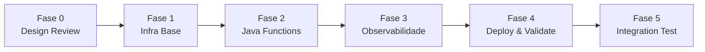

# Passo-a-Passo de Implementação — PoC BAM Datadog

**Projeto:** PoC Monitoramento de Processos de Negócio (BAM) com Datadog  
**Método:** Implementação guiada por agentes via prompts específicos  
**Pré-requisito:** Ler [README.md](README.md), [01-infra-spec.md](01-infra-spec.md) e [02-functions-spec.md](02-functions-spec.md)

---

## Visão Geral das Fases



| Fase | Agente Principal | Prompts Utilizados | Resultado |
|------|-----------------|-------------------|-----------|
| 0 | `@oci-serverless-architect` | `/design-serverless-architecture`, `/audit-infra-prerequisites` | ADR + validação de pré-requisitos |
| 1 | `@oci-terraform` | `/add-networking`, `/add-iam`, `/add-vault`, `/add-object-storage-infra`, `/add-functions-infra`, `/add-event-rule` | Environment `bam/` provisionado |
| 2 | `@oci-functions-java` | `/add-oci-function`, `/add-event-handler`, `/add-object-storage`, `/add-rest-client` | 2 functions implementadas |
| 3 | `@oci-terraform` | `/add-logging`, `/add-connector-hub`, `/add-api-gateway` | Pipeline de observabilidade completo |
| 4 | `@oci-deployer` | `/deploy-function` | Functions deployed e smoke tested |
| 5 | `@oci-debugger` | `/debug-function` (se necessário) | Validação E2E |

---

## Fase 0: Design Review (Opcional mas Recomendado)

> **Objetivo:** Validar a arquitetura antes de implementar. Identificar riscos e pré-requisitos faltantes.

### Step 0.1 — Revisão Arquitetural

**Agente:** `@oci-serverless-architect`  
**Prompt:** `/design-serverless-architecture`

```
Escopo: Revisão da arquitetura para PoC BAM (Business Activity Monitoring) com Datadog.

Componentes envolvidos:
- Object Storage (event source → bucket recebe JSON de propostas)
- OCI Events (ObjectCreate → trigger fn1)
- OCI Functions (fn-recepcao-proposta → fn-motor-credito, invocação síncrona via SDK)
- OCI Logging (captura stdout das functions como JSON estruturado)
- Service Connector Hub (Logging → HTTP Plugin → Datadog)
- OCI Vault (armazena DD-API-KEY)
- API Gateway (endpoint de teste manual POST /bam/proposta)

Requisitos não-funcionais:
- Latência: < 5s end-to-end (excluindo cold start)
- Segurança: Zero credenciais hardcoded, Resource Principal auth
- Observabilidade: 100% das transações rastreáveis via transaction_id no Datadog
- Custo: Pay-per-use (serverless), terraform destroy sem órfãos
- Isolamento: Environment Terraform separado (infra/environments/bam/)

Contexto de negócio:
- Pipeline de concessão de crédito (recepção → regras → decisão)
- BAM logging para dashboards Datadog (JSON estruturado em stdout)
```

**Output esperado:** ADR com recomendações, riscos identificados, validação do design.

---

### Step 0.2 — Auditoria de Pré-requisitos

**Agente:** `@oci-serverless-architect`  
**Prompt:** `/audit-infra-prerequisites`

```
Documento de padrão: docs/specs/poc-bam/01-infra-spec.md
Diretório de infraestrutura: infra/
```

**Output esperado:** Lista de pré-requisitos confirmados vs faltantes, ações corretivas.

---

## Fase 1: Infraestrutura Base (Terraform)

> **Objetivo:** Provisionar toda a infraestrutura OCI necessária no environment isolado `infra/environments/bam/`.

### Step 1.1 — Criar Environment Base

**Agente:** `@oci-terraform`  
**Prompt:** `/engineer-terraform-project`

```
Escopo do projeto: Criar novo environment 'bam' para PoC BAM Datadog

Environments: bam (novo, isolado)
Estratégia de state: Local (terraform.tfstate no diretório)
Plataforma CI/CD: Nenhuma (execução manual via terminal)

Módulos necessários (novos):
- object-storage (bucket com event trigger)
- events (oci_events_rule para ObjectCreate)
- service-connector (OCI Logging → Datadog via HTTP)

Módulos existentes a reutilizar:
- network (VCN, subnets, NAT, IGW, NSGs)
- iam (dynamic groups, policies)
- vault (vault, key, secret para DD-API-KEY)
- function-app (isolated application per function)
- observability (log group, logs)
- api-gateway (gateway, deployment, routes)

Variáveis requeridas:
- tenancy_ocid, compartment_ocid, region
- datadog_api_key (sensitive), datadog_site_url
- fn_recepcao_proposta_image, fn_motor_credito_image
- existing_subnet_id (opcional, brownfield)
```

**Output esperado:** Estrutura base do environment (`versions.tf`, `variables.tf`, `main.tf`, `outputs.tf`, `terraform.tfvars`).

---

### Step 1.2 — Networking (VCN + Subnets + Gateways)

**Agente:** `@oci-terraform`  
**Prompt:** `/add-networking`

```
CIDR blocks: 10.0.0.0/16 (VCN), 10.0.0.0/24 (pública), 10.0.1.0/24 (privada)
Tipos de subnet: 1 pública (API Gateway), 1 privada (Functions)
Gateways necessários: NAT Gateway (egress functions), Internet Gateway (API GW)
Regras NSG:
  - NSG Functions: ingress port 443 from API GW NSG; egress all
  - NSG API GW: ingress port 443 from 0.0.0.0/0; egress to Functions NSG
Suporte brownfield: Se var.existing_subnet_id != null, não criar rede
```

**Output esperado:** Instanciação do módulo `network` no `main.tf` com lógica condicional.

---

### Step 1.3 — IAM (Dynamic Groups + Policies)

**Agente:** `@oci-terraform`  
**Prompt:** `/add-iam`

```
Resource type: fnfunc (OCI Functions)
Matching rule: ALL {resource.type = 'fnfunc', resource.compartment.id = 'var.compartment_ocid'}
Dynamic group name: dg-poc-bam-functions-bam

Permissões necessárias (policy statements):
1. Allow dynamic-group [DG] to manage objects in compartment [X]
   → Functions leem propostas do Object Storage
2. Allow dynamic-group [DG] to use functions-family in compartment [X]
   → fn1 invoca fn2 via SDK
3. Allow dynamic-group [DG] to read secret-family in compartment [X]
   → Functions leem secrets do Vault (se necessário)
4. Allow any-user to read log-content in compartment [X] where any {request.principal.type='serviceconnector'}
   → SCH lê logs do OCI Logging
5. Allow any-user to manage serviceconnectors in compartment [X] where any {request.principal.type='serviceconnector'}
   → SCH auto-gestão

Escopo do compartimento: var.compartment_ocid
```

**Output esperado:** Módulo `iam` instanciado com policies específicas para BAM.

---

### Step 1.4 — Vault (DD-API-KEY Secret)

**Agente:** `@oci-terraform`  
**Prompt:** `/add-vault`

```
Secret names: datadog-api-key
Key algorithm: AES (256-bit, para encryption at rest)
Rotation policy: Manual (PoC — sem auto-rotation)
Consumers: Service Connector Hub (referencia secret para header DD-API-KEY)

Notas:
- O valor do secret vem de var.datadog_api_key (sensitive = true)
- Vault display_name: vault-poc-bam-bam
- Key display_name: key-poc-bam-master-bam
```

**Output esperado:** Módulo `vault` instanciado + `oci_vault_secret` para DD-API-KEY.

---

### Step 1.5 — Object Storage (Bucket de Propostas)

**Agente:** `@oci-terraform`  
**Prompt:** `/add-object-storage-infra`

```
Bucket name: bucket-bam-entrada-propostas-bam
Access type: NoPublicAccess (privado)
Storage tier: Standard
Versionamento: Enabled (trilha de auditoria)
Auto-tiering: InfrequentAccess (objetos processados movidos automaticamente)
Lifecycle rules:
  - Após 30 dias: mover para InfrequentAccess
  - Após 90 dias: mover para Archive (se custo for preocupação)
Encryption: CMEK via key do Vault (step 1.4)
Event integration: Bucket será source de OCI Events Rule (step 1.7)
```

**Output esperado:** Novo módulo `object-storage` criado + instanciado no environment.

---

### Step 1.6 — Functions Infrastructure (2 Applications)

**Agente:** `@oci-terraform`  
**Prompt:** `/add-functions-infra`

> **Executar 2x** — uma por function:

**Invocação 1:**
```
Function name: recepcao-proposta
App name: app-poc-bam-recepcao-proposta-bam
Image: (placeholder — será atualizada após build)
Memory: 256 MB
Timeout: 120 seconds
Compartment: var.compartment_ocid
Subnet: Private subnet (output do step 1.2)

Config keys:
  BUCKET_NAME = module.object_storage.bucket_name
  BUCKET_NAMESPACE = module.object_storage.bucket_namespace
  FN_MOTOR_CREDITO_ID = module.fn_motor_credito.function_id
```

**Invocação 2:**
```
Function name: motor-credito
App name: app-poc-bam-motor-credito-bam
Image: (placeholder — será atualizada após build)
Memory: 512 MB
Timeout: 60 seconds
Compartment: var.compartment_ocid
Subnet: Private subnet (output do step 1.2)

Config keys: (nenhuma — fn2 recebe tudo via payload)
```

**Output esperado:** 2 instâncias do módulo `function-app` no `apps.tf`.

---

### Step 1.7 — Events Rule (ObjectCreate → fn1)

**Agente:** `@oci-terraform`  
**Prompt:** `/add-event-rule`

```
Event type: com.oraclecloud.objectstorage.createobject
Source service: Object Storage
Condition filter: bucketName = "bucket-bam-entrada-propostas-bam"
Target action:
  action_type: FAAS
  function_id: module.fn_recepcao_proposta.function_id
Rule name: rule-bam-object-create-trigger
Description: Trigger fn-recepcao-proposta quando JSON uploaded ao bucket
```

**Output esperado:** Novo módulo `events` criado + instanciado.

---

## Fase 2: Java Functions Development

> **Objetivo:** Implementar as 2 functions Java com todos os services, models e BAMLogger.

### Step 2.1 — Scaffold fn-recepcao-proposta

**Agente:** `@oci-functions-java`  
**Prompt:** `/add-oci-function`

```
Function name: fn-recepcao-proposta
Handler type: Event-driven (OCI Events CloudEvent trigger)
Package: com.brx.bam.recepcao
Project type: New project (services/fn-recepcao-proposta/)

Descrição: Orquestrador do pipeline BAM. Recebe CloudEvent de Object Storage,
faz download do JSON, gera transaction_id, invoca fn-motor-credito, emite BAM logs.

Integrações necessárias:
- Object Storage (leitura de arquivo JSON)
- Functions Invoke SDK (invocar fn-motor-credito)
- BAMLogger (structured JSON stdout)

Memory: 256 MB
Timeout: 120s
Java: 17
FDK: 1.1.11
```

**Output esperado:** Scaffold completo (pom.xml, func.yaml, Dockerfile, handler base, build-push.sh).

---

### Step 2.2 — Scaffold fn-motor-credito

**Agente:** `@oci-functions-java`  
**Prompt:** `/add-oci-function`

```
Function name: fn-motor-credito
Handler type: Direct invocation (recebe POJO via SDK invoke)
Package: com.brx.bam.motor
Project type: New project (services/fn-motor-credito/)

Descrição: Motor de regras de crédito. Recebe PropostaEnriquecida (com transaction_id),
aplica 3 regras sequenciais, retorna DecisaoCredito. Emite BAM logs.

Integrações necessárias:
- BAMLogger (structured JSON stdout)
- Nenhum OCI SDK (stateless, recebe tudo via payload)

Memory: 512 MB
Timeout: 60s
Java: 17
FDK: 1.1.11
```

**Output esperado:** Scaffold completo (pom.xml, func.yaml, Dockerfile, handler base, build-push.sh).

---

### Step 2.3 — Adicionar Event Handler (fn1)

**Agente:** `@oci-functions-java`  
**Prompt:** `/add-event-handler`

```
Event source: OCI Events (CloudEvent format)
Existing class: com.brx.bam.recepcao.RecepcaoPropostaFunction
Request type: CloudEvent JSON (contém metadata do object criado)
Response type: String (JSON da DecisaoCredito)

O CloudEvent contém:
- data.resourceName → nome do arquivo no bucket
- data.additionalDetails.bucketName → nome do bucket
- data.additionalDetails.namespace → namespace do Object Storage

Após extrair metadata, o handler deve:
1. Fazer download do objeto via ObjectStorageService
2. Deserializar para PropostaInput
3. Gerar transaction_id (UUID)
4. Emitir BAM log RECEBIDO
5. Invocar fn-motor-credito
6. Emitir BAM log FINALIZADO
```

**Output esperado:** Handler com parse de CloudEvent implementado.

---

### Step 2.4 — Adicionar Object Storage Integration (fn1)

**Agente:** `@oci-functions-java`  
**Prompt:** `/add-object-storage`

```
Bucket name: Configurável via RuntimeContext (config key: BUCKET_NAME)
Namespace: Configurável via RuntimeContext (config key: BUCKET_NAMESPACE)
Operations: read (somente leitura — download do JSON de proposta)
Existing class: com.brx.bam.recepcao.RecepcaoPropostaFunction
File size constraints: < 1MB (JSONs de proposta são pequenos)
Auth: Resource Principal (automático via FDK)

Resultado esperado:
- ObjectStorageService criado com getObject(bucketName, objectName)
- Inicialização no @FnConfiguration
- InputStream lifecycle correto (try-with-resources)
```

**Output esperado:** `ObjectStorageService.java` com Resource Principal auth.

---

### Step 2.5 — Adicionar Function Invoke (fn1 → fn2)

**Agente:** `@oci-functions-java`  
**Prompt:** `/add-rest-client`

```
Target API: OCI Functions Invoke (fn-motor-credito)
Auth method: OCI signing (Resource Principal, automático)
Existing class: com.brx.bam.recepcao.RecepcaoPropostaFunction
HTTP methods: POST (invoke function)

Detalhes:
- Target function ID: configurável via RuntimeContext (FN_MOTOR_CREDITO_ID)
- Payload: PropostaEnriquecida (JSON serializado via Jackson)
- Response: DecisaoCredito (JSON desserializado)
- Timeout: 60s (budget para fn2 processar)
- Retry: Nenhum (fn2 é idempotente pela natureza, mas sem retry para simplicidade)

Implementação necessária:
- FunctionInvokeService com lazy endpoint resolution
- Método invoke(functionId, payload) → response string
- Cache do invoke endpoint (resolve uma vez, reutiliza em hot function)
```

**Output esperado:** `FunctionInvokeService.java` com OCI Functions SDK.

---

### Step 2.6 — Configurar Structured Logging (BAMLogger)

**Agente:** `@oci-functions-java`  
**Prompt:** `/add-function-logging`

```
Logging framework: System.out.println (stdout direto — capturado pelo OCI Logging)
Log format: JSON linear (uma linha por evento — parseável pelo Datadog)
Log routing: stdout → OCI Logging → Service Connector Hub → Datadog

Campos obrigatórios no JSON:
- bam_process: "concessao_credito" (fixo)
- transaction_id: String (TX-{UUID})
- function_name: String (nome da function emissora)
- step: String (recebido, motor_regras, analise_fraude, decisao_final, finalizado)
- business_status: String (RECEBIDO, APROVADO_AUTOMATICO, REJEITADO_SCORE, etc.)
- business_value: double (valor monetário da proposta)
- client_region: String (UF do cliente)
- message: String (descrição legível)

Implementação:
- Classe utilitária estática BAMLogger.java
- Método: emitBusinessEvent(txId, functionName, step, status, value, region, message)
- Serialização via Jackson ObjectMapper (singleton)
- Fallback: se serialização falhar, System.err (nunca quebrar o fluxo)

Ambas as functions devem ter cópia idêntica do BAMLogger.
```

**Output esperado:** `BAMLogger.java` em ambos os projetos.

---

### Step 2.7 — Implementar Motor de Regras (fn2)

**Agente:** `@oci-functions-java`  
**Prompt:** `/add-oci-function` (modificação da fn2 existente)

```
Modificar: services/fn-motor-credito/
Adicionar lógica de regras no handler:

Regras sequenciais (primeiro match vence):
1. IF score_credito < 400 → REJEITADO_SCORE (step: motor_regras)
2. IF valor_solicitado > 50000.00 → REQUER_ANALISE_MANUAL (step: analise_fraude)
3. ELSE → APROVADO_AUTOMATICO (step: decisao_final)

Classes necessárias:
- CreditRulesEngine.java (motor com método evaluate(PropostaEnriquecida) → DecisaoCredito)
- PropostaEnriquecida.java (POJO input com @JsonProperty snake_case)
- DecisaoCredito.java (POJO output com builder pattern)

O handler MotorCreditoFunction.handleRequest(PropostaEnriquecida):
1. Validar transaction_id presente
2. Delegar para CreditRulesEngine.evaluate()
3. Emitir BAM log com resultado
4. Retornar DecisaoCredito
```

**Output esperado:** Handler completo + CreditRulesEngine + POJOs.

---

## Fase 3: Observabilidade (Logging → Datadog)

> **Objetivo:** Configurar o pipeline OCI Logging → Service Connector Hub → Datadog.

### Step 3.1 — OCI Logging (Log Group + Logs)

**Agente:** `@oci-terraform`  
**Prompt:** `/add-logging`

```
Log group name: log-group-bam-poc
Log type: SERVICE (captura automática do stdout das Functions)
Service logs:
  - Category: invoke
  - Service: functions
  - Resources: [module.fn_recepcao_proposta.application_id, module.fn_motor_credito.application_id]
Custom logs: Nenhum (usamos service logs que capturam stdout)
Retention: 30 dias
Compartment: var.compartment_ocid
```

**Output esperado:** Módulo `observability` instanciado com Log Group + 2 Service Logs.

---

### Step 3.2 — Service Connector Hub (Logging → Datadog)

**Agente:** `@oci-terraform`  
**Prompt:** `/add-connector-hub`

```
Source type: Logging
Source details:
  - Log group: log-group-bam-poc (OCID do step 3.1)
  - Filtro: Todos os logs do log group (sem filtro adicional — Datadog fará parsing)

Target type: Functions (ou HTTP Plugin se disponível na região)
Target details:
  - Se HTTP Plugin disponível:
    - URL: var.datadog_site_url (default: https://http-intake.logs.datadoghq.com/api/v2/logs)
    - Headers: { "DD-API-KEY": var.datadog_api_key, "Content-Type": "application/json" }
  - Se HTTP Plugin NÃO disponível:
    - Target: Function intermediária (fn-log-forwarder) que faz HTTP POST para Datadog
    - Neste caso, criar function adicional (fora do escopo principal)

Task (transformação):
  - Nenhuma transformação necessária (JSON pass-through)
  - O BAMLogger já emite JSON no formato esperado pelo Datadog

Connector name: sch-bam-to-datadog-bam
Description: Route BAM structured logs from OCI Logging to Datadog Log Intake API
```

**Output esperado:** Novo módulo `service-connector` criado + instanciado.

---

### Step 3.3 — API Gateway (Endpoint de Teste)

**Agente:** `@oci-terraform`  
**Prompt:** `/add-api-gateway`

```
Routes:
  - Path: /bam/proposta
    Methods: [POST]
    Backend: ORACLE_FUNCTIONS_BACKEND
    Function ID: module.fn_recepcao_proposta.function_id
    Authentication: ANONYMOUS (PoC — sem auth para facilitar testes)
    CORS: Disabled (não necessário para PoC)

Subnet: Public subnet (output do step 1.2)
Deployment path prefix: /v1

Nota: Este endpoint é ALTERNATIVO ao trigger via Events.
Permite testar a fn-recepcao-proposta diretamente sem upload ao bucket.
O payload enviado via POST simula o conteúdo do arquivo JSON.
```

**Output esperado:** Módulo `api-gateway` instanciado com rota para fn1.

---

## Fase 4: Deploy & Validate

> **Objetivo:** Build das imagens Docker, push para OCIR, terraform apply, smoke test.

### Step 4.1 — Deploy fn-recepcao-proposta

**Agente:** `@oci-deployer`  
**Prompt:** `/deploy-function`

```
Function name: fn-recepcao-proposta
Function path: services/fn-recepcao-proposta/
Registry: <region>.ocir.io/<namespace>/poc-bam
Image tag: 0.0.1
Deploy method: Terraform (atualizar var.fn_recepcao_proposta_image no terraform.tfvars)
Smoke test: Invocar via OCI CLI → verificar que retorna JSON (não 502)
```

**Output esperado:** Imagem built, pushed, function deployed e respondendo.

---

### Step 4.2 — Deploy fn-motor-credito

**Agente:** `@oci-deployer`  
**Prompt:** `/deploy-function`

```
Function name: fn-motor-credito
Function path: services/fn-motor-credito/
Registry: <region>.ocir.io/<namespace>/poc-bam
Image tag: 0.0.1
Deploy method: Terraform (atualizar var.fn_motor_credito_image no terraform.tfvars)
Smoke test: Invocar via OCI CLI com payload de teste → verificar decisão
```

**Output esperado:** Imagem built, pushed, function deployed e respondendo.

---

### Step 4.3 — Terraform Apply (Infrastructure completa)

**Ação manual (terminal):**

```bash
cd infra/environments/bam

# Injetar secret
export TF_VAR_datadog_api_key="<sua-dd-api-key>"

# Planejar
terraform plan -out=tfplan

# Revisar o plan (verificar recursos a criar)
# Esperado: ~15-20 recursos (VCN, subnets, gateways, IAM, bucket, events, functions, logs, SCH, API GW)

# Aplicar
terraform apply tfplan
```

---

## Fase 5: Teste de Integração End-to-End

> **Objetivo:** Validar o fluxo completo (upload → event → fn1 → fn2 → logs → Datadog).

### Step 5.1 — Teste via Object Storage (Fluxo Real)

```bash
# Criar arquivo de proposta de teste
cat > /tmp/proposta-teste.json << 'EOF'
{
  "cliente_id": "CLI-998877",
  "nome": "João da Silva",
  "valor_solicitado": 15000.00,
  "score_credito": 650,
  "regiao": "SP"
}
EOF

# Upload para o bucket (trigger automático via Events)
oci os object put \
  --bucket-name bucket-bam-entrada-propostas-bam \
  --file /tmp/proposta-teste.json \
  --name "propostas/CLI-998877-$(date +%s).json"

# Aguardar ~10-30s (cold start + processamento)

# Verificar logs no OCI Logging
oci logging-search search-logs \
  --search-query 'search "log-group-bam-poc" | sort by datetime desc' \
  --time-start "$(date -u -v-5M +%Y-%m-%dT%H:%M:%SZ)" \
  --time-end "$(date -u +%Y-%m-%dT%H:%M:%SZ)" \
  | jq '.data.results[].data.logContent.data.message'
```

**Resultado esperado:** 3 BAM logs capturados:
1. `RECEBIDO` (fn1)
2. `APROVADO_AUTOMATICO` (fn2, step: decisao_final)
3. `FINALIZADO` (fn1)

---

### Step 5.2 — Teste via API Gateway (Bypass Events)

```bash
# Obter endpoint do API Gateway
ENDPOINT=$(cd infra/environments/bam && terraform output -raw api_gateway_endpoint)

# Invocar diretamente
curl -s -X POST "${ENDPOINT}/v1/bam/proposta" \
  -H "Content-Type: application/json" \
  -d '{
    "cliente_id": "CLI-112233",
    "nome": "Maria Santos",
    "valor_solicitado": 75000.00,
    "score_credito": 720,
    "regiao": "RJ"
  }' | jq .
```

**Resultado esperado:**
```json
{
  "transaction_id": "TX-...",
  "decision": "REQUER_ANALISE_MANUAL",
  "reason": "Valor 75000.00 > limite automático 50000.00",
  "processed_at": "..."
}
```

---

### Step 5.3 — Cenários de Teste Adicionais

| # | Cenário | Input | Expected Status |
|---|---------|-------|-----------------|
| 1 | Aprovação automática | score=650, valor=15000 | `APROVADO_AUTOMATICO` |
| 2 | Rejeição por score | score=350, valor=5000 | `REJEITADO_SCORE` |
| 3 | Análise manual | score=700, valor=75000 | `REQUER_ANALISE_MANUAL` |
| 4 | Erro validação | cliente_id="" | `ERRO_VALIDACAO_DADOS` |
| 5 | Boundary (score=400) | score=400, valor=10000 | `APROVADO_AUTOMATICO` |
| 6 | Boundary (valor=50000) | score=500, valor=50000 | `APROVADO_AUTOMATICO` |

---

### Step 5.4 — Verificar Ingestão no Datadog

```bash
# Buscar logs no Datadog (via API ou UI)
# Filtro: @bam_process:concessao_credito

# Se usando Datadog API:
curl -s "https://api.datadoghq.com/api/v2/logs/events/search" \
  -H "DD-API-KEY: ${DD_API_KEY}" \
  -H "DD-APPLICATION-KEY: ${DD_APP_KEY}" \
  -d '{
    "filter": {
      "query": "@bam_process:concessao_credito",
      "from": "now-15m",
      "to": "now"
    },
    "sort": "-timestamp",
    "page": {"limit": 10}
  }' | jq '.data[].attributes.attributes.business_status'
```

**Resultado esperado:** Logs BAM visíveis no Datadog com todos os campos parseados.

---

### Step 5.5 — Debug (se necessário)

**Agente:** `@oci-debugger`  
**Prompt:** `/debug-function`

```
# Usar apenas se algum step falhar

HTTP status code: [502|503|504|500]
Function name: fn-recepcao-proposta (ou fn-motor-credito)
When it started: Após último deploy
Invoke method: OCI Events trigger (ou API Gateway)
Error message: [colar mensagem de erro]
```

---

## Fase 6: Cleanup (Quando Terminar)

```bash
# Destruir toda a infraestrutura da PoC (sem impacto em dev/prod)
cd infra/environments/bam
terraform destroy

# Verificar que não há recursos órfãos
oci search resource structured-search \
  --query-text "query all resources where compartmentId = '<COMPARTMENT_OCID>'" \
  | jq '.data.items | length'
# Esperado: 0
```

---

## Resumo de Prompts por Fase

| Fase | Step | Agente | Prompt | Resultado |
|------|------|--------|--------|-----------|
| 0 | 0.1 | `@oci-serverless-architect` | `/design-serverless-architecture` | ADR + validação |
| 0 | 0.2 | `@oci-serverless-architect` | `/audit-infra-prerequisites` | Checklist |
| 1 | 1.1 | `@oci-terraform` | `/engineer-terraform-project` | Environment base |
| 1 | 1.2 | `@oci-terraform` | `/add-networking` | VCN + Subnets + Gateways |
| 1 | 1.3 | `@oci-terraform` | `/add-iam` | Dynamic Group + Policies |
| 1 | 1.4 | `@oci-terraform` | `/add-vault` | Vault + Secret DD-API-KEY |
| 1 | 1.5 | `@oci-terraform` | `/add-object-storage-infra` | Bucket de propostas |
| 1 | 1.6 | `@oci-terraform` | `/add-functions-infra` (2x) | 2 Functions Apps |
| 1 | 1.7 | `@oci-terraform` | `/add-event-rule` | ObjectCreate → fn1 |
| 2 | 2.1 | `@oci-functions-java` | `/add-oci-function` | Scaffold fn1 |
| 2 | 2.2 | `@oci-functions-java` | `/add-oci-function` | Scaffold fn2 |
| 2 | 2.3 | `@oci-functions-java` | `/add-event-handler` | CloudEvent handler |
| 2 | 2.4 | `@oci-functions-java` | `/add-object-storage` | ObjectStorageService |
| 2 | 2.5 | `@oci-functions-java` | `/add-rest-client` | FunctionInvokeService |
| 2 | 2.6 | `@oci-functions-java` | `/add-function-logging` | BAMLogger |
| 2 | 2.7 | `@oci-functions-java` | `/add-oci-function` (modify) | CreditRulesEngine |
| 3 | 3.1 | `@oci-terraform` | `/add-logging` | Log Group + Service Logs |
| 3 | 3.2 | `@oci-terraform` | `/add-connector-hub` | SCH → Datadog |
| 3 | 3.3 | `@oci-terraform` | `/add-api-gateway` | Endpoint de teste |
| 4 | 4.1 | `@oci-deployer` | `/deploy-function` | Deploy fn1 |
| 4 | 4.2 | `@oci-deployer` | `/deploy-function` | Deploy fn2 |
| 4 | 4.3 | Manual | `terraform apply` | Infra completa |
| 5 | 5.1-5.4 | Manual | CLI / curl | E2E validation |
| 5 | 5.5 | `@oci-debugger` | `/debug-function` | (se necessário) |

---

## Alternativa: Execução via Pattern (Single Command)

Se preferir executar tudo de uma vez via o agente full-stack:

**Agente:** `@oci-serverless-stack`  
**Prompt:** `/execute-pattern`

```
Pattern document path: docs/specs/poc-bam/
Environment: bam
OCIR namespace: <seu-namespace>
Skip steps: none (executar tudo)
```

> **Nota:** O `/execute-pattern` delega internamente para `@oci-terraform` e `@oci-functions-java` nos steps apropriados, seguindo a mesma sequência documentada acima mas de forma automatizada.
