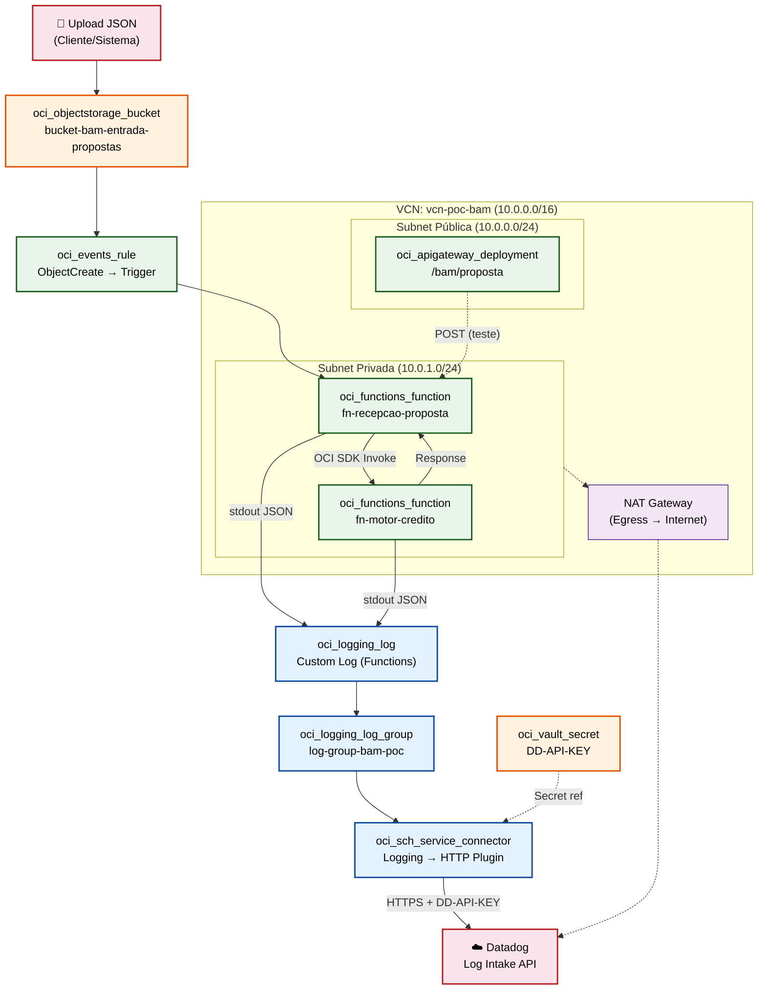
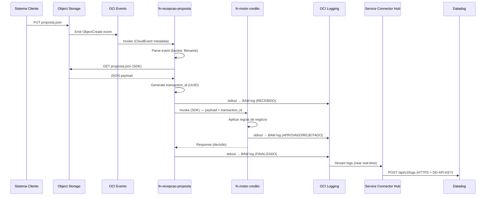
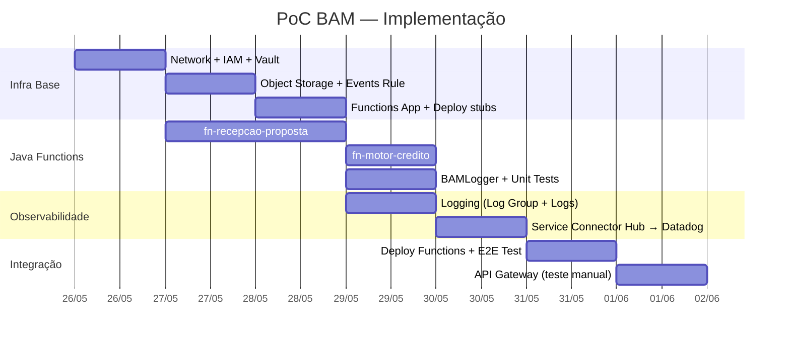

# PoC BAM: Monitoramento de Processos de Negócio com Datadog

**Projeto:** PoC Monitorização de Processos de Negócio (BAM — Business Activity Monitoring)  
**Plataforma:** Oracle Cloud Infrastructure (OCI)  
**Observabilidade:** Datadog (ingestão via Service Connector Hub)  
**Data:** 2026-05-25  

---

## 1. Objetivo

Demonstrar as capacidades do **Datadog** como plataforma de observabilidade corporativa para OCI, utilizando uma arquitetura 100% serverless e orientada a eventos. O caso de uso é um **pipeline de concessão de crédito** com rastreabilidade end-to-end de eventos de negócio (BAM).

---

## 2. Diagrama de Arquitetura



---

## 3. Fluxo de Execução (Sequência)



---

## 4. Escopo

### ✅ Dentro do Escopo

| Camada | Componentes |
|--------|-------------|
| **Infraestrutura (Terraform)** | VCN, Subnets, NAT GW, IAM (Dynamic Groups + Policies), Object Storage Bucket, OCI Events Rule, Functions Application + 2 Functions, Log Group + Logs, Service Connector Hub, Vault (DD-API-KEY), API Gateway (teste) |
| **Aplicação (Java)** | `fn-recepcao-proposta` (orquestrador), `fn-motor-credito` (regras), `BAMLogger` (utilitário telemetria) |
| **Observabilidade (OCI)** | Structured logging (JSON → stdout), OCI Logging capture, SCH routing para Datadog |

### ❌ Fora do Escopo

| Item | Razão |
|------|-------|
| Dashboard Datadog (criação/configuração) | Configuração manual na plataforma Datadog — não provisionável via Terraform OCI |
| Pipelines Datadog (Log Processing) | Configuração interna Datadog |
| Alertas e Monitors Datadog | Configuração interna Datadog |
| CI/CD Pipeline (build/deploy automático) | Deploy manual via `build-push.sh` + `terraform apply` |
| Integração com banco de dados | Fora do caso de uso da PoC |
| Multi-region / DR | Complexidade desnecessária para PoC |

---

## 5. Pré-requisitos

| Requisito | Descrição |
|-----------|-----------|
| Conta OCI ativa | Com permissões para criar recursos no compartimento alvo |
| Compartimento dedicado | Isolamento de blast radius para a PoC |
| OCI CLI configurado | Para `fn deploy` e `oci os object put` |
| Docker instalado | Para build das imagens das Functions |
| Terraform >= 1.9 | Compatível com OCI Provider ~> 8.15 |
| Conta Datadog | Com API Key válida para ingestão de logs |
| OCIR (Container Registry) | Repositório para imagens Docker das Functions |

---

## 6. Estrutura de Arquivos (Alvo)

```
infra/
  environments/
    bam/                          ← Novo environment isolado
      main.tf                     ← Módulos compartilhados (network, iam, vault)
      apps.tf                     ← Functions + Events + Logging + SCH
      variables.tf                ← Inputs (tenancy, compartment, region, dd_api_key)
      outputs.tf                  ← Endpoints, OCIDs
      terraform.tfvars            ← Valores (exceto secrets)
      versions.tf                 ← Provider constraints
  modules/
    object-storage/               ← Novo módulo
    events/                       ← Novo módulo
    service-connector/            ← Novo módulo
    (network, function-app, iam, observability, vault, api-gateway → existentes)

services/
  fn-recepcao-proposta/           ← Nova function
    src/main/java/com/brx/bam/
      RecepcaoPropostaFunction.java
      BAMLogger.java
      model/PropostaInput.java
      model/PropostaEnriquecida.java
    src/test/java/...
    pom.xml
    func.yaml
    Dockerfile
    build-push.sh
  fn-motor-credito/               ← Nova function
    src/main/java/com/brx/bam/
      MotorCreditoFunction.java
      BAMLogger.java (shared copy)
      model/PropostaEnriquecida.java
      model/DecisaoCredito.java
    src/test/java/...
    pom.xml
    func.yaml
    Dockerfile
    build-push.sh
```

---

## 7. Documentos de Especificação

| Documento | Conteúdo |
|-----------|----------|
| [01-infra-spec.md](01-infra-spec.md) | Especificação completa de infraestrutura Terraform |
| [02-functions-spec.md](02-functions-spec.md) | Especificação de desenvolvimento das Java Functions |
| [03-agent-capabilities.md](03-agent-capabilities.md) | Mapeamento de capacidades dos agentes + catálogo de prompts |
| [04-implementation-steps.md](04-implementation-steps.md) | **Passo-a-passo detalhado** — 22 steps com agente, prompt e inputs exatos |

---

## 8. Ordem de Implementação Recomendada


